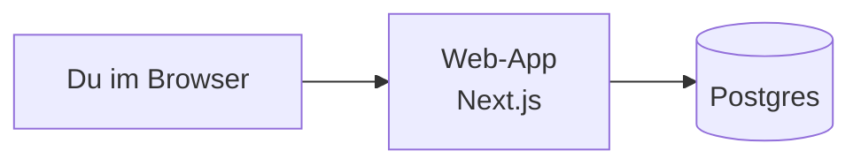

<!--
PaiBot – Architektur: Aufbau von PaiBot heute und geplante Teile.

Autor:     Oliver Hees
Website:   https://paibot.de
Copyright: 2026 Oliver Hees. Alle Urheberrechte liegen beim Autor.
Lizenz:    PaiBot Fair-Code-Lizenz 1.0 – siehe Datei LICENSE im Projektstamm
Seit:      2026-11-18
-->

# Architektur

**Ergebnis:** Du siehst, aus welchen Teilen PaiBot heute besteht und was erst geplant ist. Diese Seite wächst mit jeder Funktion mit.

## Heutiger Stand

| Teil              | Ort               | Was es heute tut                                                                       |
| ----------------- | ----------------- | -------------------------------------------------------------------------------------- |
| Web-App           | `apps/web`        | Startseite mit Datenbank-Status, Health-Endpunkt `/api/health`, Migrationen beim Start |
| Datenbank-Paket   | `packages/db`     | Verbindung (`createDb`), Schema, Migrationen (`runMigrations`), Erreichbarkeitsprüfung |
| Gemeinsames Paket | `packages/shared` | gemeinsame Verträge aller Pakete (siehe unten), App-Name, Sprachen (`de`, `en`)        |
| Deployment        | `deploy`          | Docker Compose mit `postgres` und `web`                                                |

### Healthcheck

`GET /api/health` fragt die Datenbank ab und antwortet mit JSON.

| `db`             | `status`   | HTTP | Bedeutung                    |
| ---------------- | ---------- | ---- | ---------------------------- |
| `ok`             | `ok`       | 200  | Datenbank erreichbar         |
| `down`           | `degraded` | 503  | Datenbank nicht erreichbar   |
| `not_configured` | `ok`       | 200  | keine `DATABASE_URL` gesetzt |

Das Docker-Image prüft denselben Endpunkt in seinem eigenen Healthcheck.

### Datenbank und Migrationen

- Postgres wird mit Drizzle angesprochen. Das Schema liegt in `packages/db/src/schema.ts`, die erzeugten Migrationen in `packages/db/drizzle/`.
- Heute gibt es die Tabelle `settings` mit genau einer Zeile (`id = "singleton"`): Sprache, Zeitzone, Standard der Datenschleuse, maximale Übergaben, Tagesbudget und Zeitpunkt der Einrichtung. PaiBot gehört genau einer Person.
- Beim Start der Web-App (`apps/web/src/instrumentation-node.ts`) werden offene Migrationen angewendet, mit bis zu fünf Versuchen. Gelingt das nicht, startet die App trotzdem, und `/api/health` meldet `degraded`.

## Geplant

Diese Teile gibt es als Ordner oder Platzhalter, aber noch ohne Funktion. Details folgen auf den Doku-Seiten, sobald es sie wirklich gibt.

| Teil             | Ort                | Stand                     |
| ---------------- | ------------------ | ------------------------- |
| Datenschleuse    | eigener Dienst     | geplant                   |
| KI-Modelle       | `packages/llm`     | Platzhalter, nicht gebaut |
| Bots und Team    | `packages/agents`  | Platzhalter, nicht gebaut |
| Apps per MCP     | `packages/mcp`     | Platzhalter, nicht gebaut |
| Hintergrund-Jobs | `packages/jobs`    | Platzhalter, nicht gebaut |
| UI-Komponenten   | `packages/ui`      | Platzhalter, nicht gebaut |
| Browser-Dienst   | `services/browser` | geplant                   |

## Gemeinsame Verträge (`packages/shared`)

Alle Pakete sprechen über dieselben Typen und Zod-Schemas. Sie liegen in `packages/shared` und haben als einzige Abhängigkeit `zod`. Die Verträge gibt es schon; die Teile, die sie benutzen (Chat, Tor, Belege), sind **im Bau**.

| Unterpfad                   | Inhalt                                                                                  |
| --------------------------- | --------------------------------------------------------------------------------------- |
| `@paibot/shared/ids`        | IDs mit Präfix pro Art, z. B. `unt_06f8k2m9qz3w7x1c4b5n8p0r2t`, zeitlich sortierbar     |
| `@paibot/shared/objekte`    | Unterhaltung, Nachricht, Lauf, Bot, Anbieter, Modell, Einstellungen, Sitzung            |
| `@paibot/shared/eingaben`   | Prüfung aller Eingaben der API (Längen, Formate)                                        |
| `@paibot/shared/ereignisse` | Ereignisse einer Unterhaltung und ihre Übertragung per Server-Sent Events               |
| `@paibot/shared/aktionen`   | alle Aktionen mit Akteur, Ziel und Fakten                                               |
| `@paibot/shared/tor`        | Regeln, Stufen, Grenzen, Entscheidung und Berechtigung des Tors                         |
| `@paibot/shared/belege`     | Format eines Belegs und des Exports                                                     |
| `@paibot/shared/motor`      | Vertrag für den Motor                                                                   |
| `@paibot/shared/fehler`     | Fehlercodes mit HTTP-Status und Fehlerklasse                                            |
| `@paibot/shared/api`        | Antwort-Hülle der API: `{ "ok": true, "daten": … }` oder `{ "ok": false, "fehler": … }` |
| `@paibot/shared/texte`      | alle Texte als Schlüssel mit deutschen Werten, Zugriff mit `t(key)`                     |
| `@paibot/shared/konstanten` | gemeinsame Grenzen und Namen (Cookies, Kopfzeilen, Speicher-Schlüssel)                  |

## Begriffe

Diese Begriffe tauchen in Code und Doku immer wieder auf. Was mit **im Bau** markiert ist, gibt es bisher nur als Vertrag, noch nicht als Funktion.

| Begriff       | Bedeutung                                                                                                                                                      | Stand  |
| ------------- | -------------------------------------------------------------------------------------------------------------------------------------------------------------- | ------ |
| Besitzer      | die eine Person, der die Installation gehört                                                                                                                   | im Bau |
| Bot           | dein Assistent mit Name, Anweisung, Modell und Avatar                                                                                                          | im Bau |
| Unterhaltung  | ein Gespräch mit einem Bot; sie enthält Nachrichten                                                                                                            | im Bau |
| Nachricht     | ein Beitrag in einer Unterhaltung, von dir oder vom Bot                                                                                                        | im Bau |
| Lauf          | die Arbeit an einer Antwort, im Hintergrund; Zustände: wartet, läuft, fertig, fehlgeschlagen, abgebrochen, abgelehnt (später: wartet auf Freigabe)             | im Bau |
| Ereignis      | ein Schritt im Ereignis-Strom einer Unterhaltung (z. B. „Antwort wächst um ein Stück Text“), mit laufender Nummer, damit nach einer Unterbrechung nichts fehlt | im Bau |
| Anbieter      | ein Dienst, der Modelle bereitstellt (zuerst EUrouter); der Schlüssel liegt verschlüsselt in der Datenbank                                                     | im Bau |
| Modell        | das KI-Modell eines Anbieters, das die Antwort schreibt                                                                                                        | im Bau |
| Datenschleuse | eigener Dienst, der persönliche Daten vor dem Modell maskiert; Schalter An/Aus pro Unterhaltung                                                                | im Bau |
| Aktion        | alles, was etwas verändert oder nach außen geht, z. B. `nachricht.senden` oder `modell.anfragen`                                                               | im Bau |
| Akteur        | wer eine Aktion auslöst: `besitzer` oder `bot:<id>`                                                                                                            | im Bau |
| Tor           | der einzige Eintrittspunkt für jede Aktion; prüft feste Regeln und Grenzen, ohne KI                                                                            | im Bau |
| Regel         | sagt dem Tor, was erlaubt ist (z. B. „R-002 Bot darf antworten“); in der ersten Version nur feste Standard-Regeln                                              | im Bau |
| Grenze        | feste Prüfung zusätzlich zu den Regeln, z. B. Länge, Tagesbudget, Not-Aus                                                                                      | im Bau |
| Stufe         | wie weit eine erlaubte Aktion geht: fragen, vorbereiten oder ausführen; in der ersten Version nur „ausführen“                                                  | im Bau |
| Beleg         | Eintrag im Protokoll zu jeder Entscheidung des Tors und ihrem Ergebnis, verkettet über Prüfsummen und signiert mit dem Schlüssel der Installation              | im Bau |
| Motor         | der Teil, der mit dem Modell eine Runde Gespräch erzeugt; er führt nie selbst ein Werkzeug aus                                                                 | im Bau |

## Zusammenspiel der Pakete

`apps/web` nutzt `@paibot/db` und `@paibot/shared`. Das Monorepo wird mit pnpm und Turborepo gebaut; das Docker-Image baut nur die Web-App und kopiert die Migrationen dazu.
