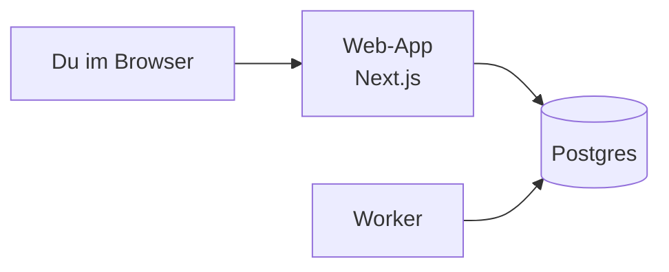

<!--
PaiBot – Architektur: Aufbau von PaiBot heute und geplante Teile.

Autor:     Oliver Hees
Website:   https://paibot.de
Copyright: 2026 Oliver Hees. Alle Urheberrechte liegen beim Autor.
Lizenz:    PaiBot Fair-Code-Lizenz 1.1 – siehe Datei LICENSE im Projektstamm
Seit:      2026-11-18
-->

# Architektur

**Ergebnis:** Du siehst, aus welchen Teilen PaiBot heute besteht und was erst geplant ist. Diese Seite wächst mit jeder Funktion mit.

## Heutiger Stand



| Teil              | Ort               | Was es heute tut                                                                         |
| ----------------- | ----------------- | ---------------------------------------------------------------------------------------- |
| Web-App           | `apps/web`        | Oberfläche (Startseite ist der Chat), Health-Endpunkt `/api/health` mit Datenbank-Status |
| Datenbank-Paket   | `packages/db`     | Verbindung (`createDb`), Schema, Migrationen (`runMigrations`), Erreichbarkeitsprüfung   |
| Gemeinsames Paket | `packages/shared` | gemeinsame Verträge aller Pakete (siehe unten), App-Name, Sprachen (`de`, `en`)          |
| Deployment        | `deploy`          | Docker Compose mit `postgres`, `web` und `worker` (Datenschleuse zuschaltbar)            |

### Healthcheck

`GET /api/health` fragt die Datenbank ab und antwortet mit JSON, zum Beispiel `{"status":"ok","app":"PaiBot","db":"ok","time":"2026-11-20T10:00:00.000Z"}`. Er ist ohne Anmeldung erreichbar und nennt deshalb keine Version; die steht für Angemeldete in der Kopfzeile `X-Pb-Stand` und auf der Seite „Info“.

| `db`             | `status`   | HTTP | Bedeutung                    |
| ---------------- | ---------- | ---- | ---------------------------- |
| `ok`             | `ok`       | 200  | Datenbank erreichbar         |
| `down`           | `degraded` | 503  | Datenbank nicht erreichbar   |
| `not_configured` | `ok`       | 200  | keine `DATABASE_URL` gesetzt |

Das Docker-Image prüft denselben Endpunkt in seinem eigenen Healthcheck.

### Datenbank und Migrationen

- Postgres wird mit Drizzle angesprochen. Das Schema liegt in `packages/db/src/schema/` (eine Datei pro Bereich), die erzeugten Migrationen in `packages/db/drizzle/`.
- Alle Tabellen der Basis sind angelegt (siehe [Datenmodell](#datenmodell)). Die Einstellungen stehen in `settings` mit genau einer Zeile (`id = "singleton"`), denn PaiBot gehört genau einer Person.
- Offene Migrationen wendet im Betrieb der Einmal-Dienst `migrate` an (dasselbe Image mit `PAIBOT_ROLE=migrate`, Einstieg wie die Web-App über `apps/web/src/instrumentation-node.ts`), mit bis zu fünf Versuchen; danach beendet er sich. Web-App und Worker migrieren im Betrieb nie, sie prüfen nur Stand und Rechte. In der Entwicklung (`pnpm dev`) migriert die Web-App selbst. Im Betrieb (`NODE_ENV=production`) bricht der Start mit Exit-Code 1 ab, wenn Pflichtwerte fehlen oder die Migrationen, die Rollen oder der Stand der Datenbank nicht stimmen (`apps/web/src/lib/betrieb.ts`). Nur in der Entwicklung bleibt es bei Meldungen; ohne `DATABASE_URL` startet sie ohne Datenbank, und `/api/health` meldet `not_configured`.

## Bausteine

Diese Pakete sind gebaut und getestet, auch im Zusammenspiel (siehe [Entwickeln und Testen](entwickeln.md#durchstich)), und in der Oberfläche angeschlossen: Einrichtung und Anmeldung, Chat, Belege und Regeln, Modell und Anbieter, Datenschleuse, Bot, Einstellungen und Info.

| Teil             | Ort                    | Was es kann                                                                                                                                                                                                    | Doku                                                     |
| ---------------- | ---------------------- | -------------------------------------------------------------------------------------------------------------------------------------------------------------------------------------------------------------- | -------------------------------------------------------- |
| Krypto           | `packages/crypto`      | Wurzel-Geheimnis, Schlüssel ableiten, Schlüssel verschlüsselt speichern, Passwörter, Tokens, Signaturen                                                                                                        | [Sicherheit](sicherheit.md)                              |
| Tor              | `packages/gate`        | prüft jede Aktion mit festen Regeln und Grenzen, ohne KI; führt nur Erlaubtes aus und schreibt zwei Belege                                                                                                     | [Das Tor](funktion-tor.md)                               |
| Belege           | `packages/receipts`    | hängt Belege unter einer Sperre an die Kette, prüft sie mit Schlüsseln nur aus der Kette (auch im Browser und mit `pnpm belege:pruefen`), Anker, Nachrechnen mit dem damaligen Regelstand, Export              | [Belege](funktion-belege.md)                             |
| Anbieter-Schicht | `packages/llm`         | Modell-Liste, Verbindungstest, Ausgangs-Liste, Weg über die Datenschleuse, Modell-Zugang nur mit Berechtigung                                                                                                  | [Anbieter und Modelle](funktion-anbieter-und-modelle.md) |
| Warteschlange    | `packages/jobs`        | Läufe der Reihe nach je Unterhaltung, kein Lauf doppelt, Herzschlag gegen hängende Aufträge                                                                                                                    | [Hintergrund-Läufe](#hintergrund-läufe)                  |
| Datenzugriff     | `packages/db` (`repo`) | Lesen und Schreiben je Bereich, Ereignis-Strom mit lückenlosen Nummern, Läufe mit erlaubten Statuswechseln                                                                                                     | –                                                        |
| Worker           | `apps/worker`          | holt Aufträge aus der Warteschlange ab und lässt sie von der Lauf-Steuerung ausführen, prüft beim Start Einstellungen, Rechte und Migrationen, meldet den Zustand der Datenschleuse, schreibt einen Herzschlag | [Worker](#worker)                                        |
| Motor            | `packages/agents`      | holt mit einem Modell-Schritt eine Antwort vom Modell, streamt sie und lässt sich abbrechen                                                                                                                    | [Motor](#motor)                                          |
| UI-Komponenten   | `packages/ui`          | Design-Tokens, App-Rahmen und Grundkomponenten der Oberfläche                                                                                                                                                  | [Oberfläche](#oberfläche)                                |
| Test-Anbieter    | `tools/fake-provider`  | spielt in Tests einen Modell-Anbieter, damit kein echter Schlüssel nötig ist                                                                                                                                   | [Entwickeln und Testen](entwickeln.md)                   |

## Oberfläche

Die Oberfläche besteht aus den Bausteinen in `packages/ui` und den Seiten in `apps/web`.

| Teil          | Ort                                                     | Was es ist                                                                                                                          |
| ------------- | ------------------------------------------------------- | ----------------------------------------------------------------------------------------------------------------------------------- |
| Design-Tokens | `packages/ui/src/tokens.css`                            | Farben, Schrift, Abstände, Ecken und Bewegung als CSS-Variablen; dunkles Design zuerst, helles Design über System oder `data-theme` |
| Bausteine     | `packages/ui`                                           | Knöpfe, Felder, Schalter, Dialog und Blatt, Menü, Reiter, Chat-Blase, Zustände (leer, lädt, Fehler) und der App-Rahmen `AppShell`   |
| Seitenvorlage | `apps/web/src/app/(app)/layout.tsx` und `AppRahmen.tsx` | jede Seite in diesem Ordner bekommt Anmelde-Prüfung, Seitenleiste und am Handy die mobile Leiste                                    |
| Beispielseite | `/_komponenten`                                         | alle Bausteine mit ihren Zuständen, nur mit dem Entwicklungs-Server (`pnpm dev`)                                                    |
| Web-App       | `apps/web/src/app/manifest.ts`, `apps/web/public/icons` | Manifest und Symbole zum Installieren, siehe [Als Web-App installieren](installation.md#als-web-app-installieren)                   |

**Neue Seite:** einen Ordner unter `apps/web/src/app/(app)/` mit einer `page.tsx` anlegen. Der Rahmen mit Navigation kommt aus dem Layout der Gruppe; die Seite liefert nur ihren Inhalt.

### Prüfungen der Oberfläche

| Prüfung            | Datei                                   | Was sie prüft                                                                                                                                                                                              | Läuft                                  |
| ------------------ | --------------------------------------- | ---------------------------------------------------------------------------------------------------------------------------------------------------------------------------------------------------------- | -------------------------------------- |
| Kontrast (WCAG AA) | `packages/ui/src/kontrast.test.ts`      | liest die Farben aus den Tokens und die benutzten Paare aus allen Stilen; Text mindestens 4,5:1, Fokus-Ring, Kanten von Bedienelementen und Akzent-Flächen mindestens 3:1, im dunklen und im hellen Design | bei `pnpm test` und in der CI          |
| Tastatur           | `packages/ui/browser/tastatur.test.mjs` | im echten Browser: Tab-Reihenfolge, sichtbarer Fokus, Fokus-Falle, Escape und Rückkehr des Fokus (Dialog, Blatt, Menü am Handy, Arbeitsfläche), Pfeiltasten in Menü und Reitern, Schalter, Auswahl         | nur mit Playwright, sonst übersprungen |
| Web-App            | `apps/web/src/app/manifest.test.ts`     | Pflichtfelder des Manifests, Symbole (Größen, maskierbar, Apple-Touch-Icon), Metadaten, kein Service Worker                                                                                                | bei `pnpm test` und in der CI          |

Die Tastatur-Tests brauchen Playwright mit Chromium. Es gehört nicht zu den Abhängigkeiten des Projekts (wie bei den Doku-Bildern). Einmalig außerhalb des Projekts installieren (`npm install -g playwright && npx playwright install chromium`), dann:

```bash
pnpm --filter @paibot/ui test:browser
```

Unter `pnpm test` werden die Tastatur-Tests übersprungen, wenn Playwright nicht gefunden wird; mit `test:browser` schlagen sie dann fehl statt sich zu überspringen.

## Stand der Teile und geplante Teile

| Teil                 | Ort                | Stand                                                              |
| -------------------- | ------------------ | ------------------------------------------------------------------ |
| Lauf-Steuerung       | `packages/agents`  | gebaut (`executeRun`, `failStaleRuns`)                             |
| Datenschleuse        | eigener Dienst     | Anbindung gebaut, zuschaltbar mit Profil `schleuse`, Standard: aus |
| Oberfläche der Basis | `apps/web`         | gebaut (Einrichtung, Anmeldung, Chat und die Seiten)               |
| Apps per MCP         | `packages/mcp`     | geplant                                                            |
| Browser-Dienst       | `services/browser` | geplant                                                            |

- **Lauf-Steuerung** (`packages/agents`) macht aus dem Motor den ganzen Ablauf einer Antwort: Nachricht lesen, Modell fragen über das Tor, Ergebnis speichern, hängende Läufe aufräumen (siehe [Chat](funktion-chat.md#so-funktioniert-es)).
- Für Mitwirkende gibt es außerdem `packages/stub` (gemeinsamer Fehler für noch nicht gebaute Funktionen), `tools/lint-regeln` (eigene Prüfregeln für Biome) und `tools/durchstich` (Test über alle Bausteine).

## Gemeinsame Verträge (`packages/shared`)

Alle Pakete sprechen über dieselben Typen und Zod-Schemas. Sie liegen in `packages/shared` und haben als einzige Abhängigkeit `zod`. Die Verträge gibt es schon. Tor, Belege, Motor, Worker und die Seiten der App nutzen sie.

| Unterpfad                   | Inhalt                                                                                  |
| --------------------------- | --------------------------------------------------------------------------------------- |
| `@paibot/shared/ids`        | IDs mit Präfix pro Art, z. B. `unt_06f8k2m9qz3w7x1c4b5n8p0r2t`, zeitlich sortierbar     |
| `@paibot/shared/objekte`    | Unterhaltung, Nachricht, Lauf, Bot, Anbieter, Modell, Einstellungen, Sitzung            |
| `@paibot/shared/eingaben`   | Prüfung aller Eingaben der API (Längen, Formate)                                        |
| `@paibot/shared/ereignisse` | Ereignisse einer Unterhaltung und ihre Übertragung per Server-Sent Events               |
| `@paibot/shared/aktionen`   | alle Aktionen mit Akteur, Ziel und Fakten                                               |
| `@paibot/shared/tor`        | Regeln, Stufen, Grenzen, Entscheidung und Berechtigung des Tors                         |
| `@paibot/shared/belege`     | Format eines Belegs und des Exports                                                     |
| `@paibot/shared/motor`      | Vertrag für den Motor                                                                   |
| `@paibot/shared/fehler`     | Fehlercodes mit HTTP-Status und Fehlerklasse                                            |
| `@paibot/shared/api`        | Antwort-Hülle der API: `{ "ok": true, "daten": … }` oder `{ "ok": false, "fehler": … }` |
| `@paibot/shared/texte`      | alle Texte als Schlüssel mit deutschen Werten, Zugriff mit `t(key)`                     |
| `@paibot/shared/konstanten` | gemeinsame Grenzen und Namen (Cookies, Kopfzeilen, Speicher-Schlüssel)                  |

## Begriffe

Diese Begriffe tauchen in Code und Doku immer wieder auf. **Gebaut** heißt: in der App vorhanden und getestet. **Baustein** heißt: als getestetes Paket vorhanden und von der App genutzt, ohne eigene Seite. **Geplant** heißt: bisher nur als Vertrag, noch nicht als Funktion.

| Begriff       | Bedeutung                                                                                                                                                      | Stand    |
| ------------- | -------------------------------------------------------------------------------------------------------------------------------------------------------------- | -------- |
| Besitzer      | die eine Person, der die Installation gehört                                                                                                                   | gebaut   |
| Bot           | dein Assistent mit Name, Anweisung, Modell und Avatar                                                                                                          | gebaut   |
| Unterhaltung  | ein Gespräch mit einem Bot; sie enthält Nachrichten                                                                                                            | gebaut   |
| Nachricht     | ein Beitrag in einer Unterhaltung, von dir oder vom Bot                                                                                                        | gebaut   |
| Lauf          | die Arbeit an einer Antwort, im Hintergrund; Zustände: wartet, läuft, fertig, fehlgeschlagen, abgebrochen, abgelehnt, wartet auf Freigabe                      | gebaut   |
| Ereignis      | ein Schritt im Ereignis-Strom einer Unterhaltung (z. B. „Antwort wächst um ein Stück Text“), mit laufender Nummer, damit nach einer Unterbrechung nichts fehlt | gebaut   |
| Anbieter      | ein Dienst, der Modelle bereitstellt (zuerst EUrouter); der Schlüssel liegt verschlüsselt in der Datenbank                                                     | Baustein |
| Modell        | das KI-Modell eines Anbieters, das die Antwort schreibt                                                                                                        | gebaut   |
| Datenschleuse | eigener Dienst, der persönliche Daten vor dem Modell maskiert; Schalter An/Aus pro Unterhaltung                                                                | gebaut   |
| Aktion        | alles, was etwas verändert oder nach außen geht, z. B. `nachricht.senden` oder `modell.anfragen`                                                               | Baustein |
| Akteur        | wer eine Aktion auslöst: `besitzer` oder `bot:<id>`                                                                                                            | Baustein |
| Tor           | der einzige Eintrittspunkt für jede Aktion; prüft feste Regeln und Grenzen, ohne KI                                                                            | Baustein |
| Regel         | sagt dem Tor, was erlaubt ist (z. B. „R-002 Bot darf antworten“); in der ersten Version nur feste Standard-Regeln                                              | Baustein |
| Grenze        | feste Prüfung zusätzlich zu den Regeln, z. B. Länge, Tagesbudget, Not-Aus                                                                                      | Baustein |
| Stufe         | wie weit eine erlaubte Aktion geht: fragen, vorbereiten oder ausführen; in der ersten Version nur „ausführen“                                                  | Baustein |
| Beleg         | Eintrag im Protokoll zu jeder Entscheidung des Tors und ihrem Ergebnis, verkettet über Prüfsummen und signiert mit dem Schlüssel der Installation              | Baustein |
| Motor         | der Teil, der mit dem Modell eine Runde Gespräch erzeugt; er führt nie selbst ein Werkzeug aus                                                                 | Baustein |

## Datenmodell

Das Schema liegt in `packages/db/src/schema/` (eine Datei pro Bereich), die Migrationen in `packages/db/drizzle/`. Alle Tabellen sind angelegt; was mit **ungenutzt** markiert ist, nutzt noch keine Funktion der App.

| Tabelle               | Wofür                                                                                                                                                                                                      | Stand        |
| --------------------- | ---------------------------------------------------------------------------------------------------------------------------------------------------------------------------------------------------------- | ------------ |
| `settings`            | Einstellungen der Installation, genau eine Zeile (Sprache, Zeitzone, Standard der Datenschleuse, Grenzen, Not-Aus, Installations-ID, Prüfwert des Einrichtungs-Codes bis zum Abschluss der Einrichtung)    | in Benutzung |
| `owner`               | die eine Person, der die Installation gehört (Passwort-Prüfwert); höchstens eine Zeile                                                                                                                     | in Gebrauch  |
| `sessions`            | angemeldete Sitzungen; gespeichert wird nur die Prüfsumme des Tokens                                                                                                                                       | in Gebrauch  |
| `rate_limits`         | Zähler gegen zu viele Versuche (Anmelden, Nachrichten)                                                                                                                                                     | in Gebrauch  |
| `providers`           | Anbieter von Modellen; der API-Schlüssel liegt nur verschlüsselt                                                                                                                                           | in Gebrauch  |
| `models`              | Modelle eines Anbieters                                                                                                                                                                                    | in Gebrauch  |
| `bots`                | Bot mit Name, Anweisung, Modell und Aussehen                                                                                                                                                               | in Gebrauch  |
| `conversations`       | Unterhaltungen mit dem Bot, mit Schalter der Datenschleuse                                                                                                                                                 | in Gebrauch  |
| `messages`            | Nachrichten einer Unterhaltung                                                                                                                                                                             | in Gebrauch  |
| `runs`                | Läufe: die Arbeit an einer Antwort im Hintergrund                                                                                                                                                          | in Gebrauch  |
| `conversation_events` | Ereignis-Strom je Unterhaltung, nur anhängend, mit laufender Nummer                                                                                                                                        | in Gebrauch  |
| `rules`               | Regeln des Tors, nur anhängen: jede Änderung (auch Ein- und Ausschalten) ist eine neue Fassung; `seq` nummeriert alle Zeilen, der höchste Wert ist der Regelstand; in der Basisversion nur aus Migrationen | in Gebrauch  |
| `installation_keys`   | Signaturschlüssel der Installation für die Belege, nur anhängen; ändern darf sich allein `retired_at` (Ausmustern)                                                                                         | in Gebrauch  |
| `belege`              | Protokoll aller Entscheidungen des Tors, verkettet und unveränderlich                                                                                                                                      | in Gebrauch  |
| `tool_calls`          | Werkzeug-Aufrufe eines Laufs mit Zustand (angefragt, wartet auf Freigabe, läuft, erledigt …), Entscheidungs- und Ergebnis-Beleg                                                                            | ungenutzt    |

Was die Datenbank selbst absichert:

- **IDs** haben pro Art ein festes Muster (z. B. `unt_…`), jede Tabelle prüft es. Aufzählungen wie Rolle, Zustand oder Region sind per `CHECK` auf die erlaubten Werte begrenzt.
- **Ein offener Lauf je Unterhaltung:** Läufe im Zustand `queued`, `running` oder `waiting_approval` zählen als offen; ein eindeutiger Index lässt pro Unterhaltung höchstens einen zu. Wird ein wartender Lauf fortgesetzt, ist das ein neuer Lauf, der über `resumes_run_id` auf den alten zeigt.
- **Belege sind unveränderlich:** Trigger weisen `UPDATE`, `DELETE` und `TRUNCATE` auf `belege` ab. Jeder Eintrag zeigt über `prev_hash` auf den vorigen; eindeutige Indizes verhindern, dass die Kette sich verzweigt. Die Spalten zum Suchen (`seq`, `action_id`, `action`, `actor`, `conversation_id`) müssen per `CHECK` zum signierten Körper passen. Belege enthalten keine Nachrichtentexte und hängen nicht per Fremdschlüssel an Unterhaltungen.
- **Regeln und Schlüssel werden nur angehängt:** Trigger weisen jede Änderung und jedes Löschen von Regeln ab; bei `installation_keys` ist nur das einmalige Setzen von `retired_at` erlaubt. `rules.seq` vergibt allein die Datenbank (ab 1, streng wachsend; ein selbst gesetzter Wert wird auch mit `OVERRIDING SYSTEM VALUE` abgewiesen).
- **Regeln in festen Bändern:** Die Kennung `R-…` gehört genau zur Quelle `standard`, eigene Regeln und Vorschläge tragen `reg_…`. Eigene Regeln und Vorschläge sind in der Basisversion nie eingeschaltet. Prioritäten: `standard` 0 bis 999 und 1 000 000 (Auffang-Regel), alle anderen 1 000 bis 999 999. `rules.loadSnapshot` bricht ab, wenn der Stand nicht genau den Standard-Regeln im Code entspricht.
- **Belege je Aktion:** höchstens eine Entscheidung und ein Ergebnis je Aktions-Kennung (eindeutiger Index); ein Ergebnis nur nach der Entscheidung derselben Aktion, mit passendem Ausgang (Trigger).
- **Einrichtungs-Code:** `settings.setup_code_hash` (Format `sha256:…`) und `setup_code_created_at` stehen nur gemeinsam, nur vor dem Abschluss der Einrichtung und nur, solange es keinen Besitzer gibt (CHECK und Trigger).
- **Fester Suchpfad:** Alle Tabellen werden mit Schema angesprochen (`"public"."belege"`), jede Verbindung der App setzt beim Aufbau ihren Suchpfad, die Funktionen der Trigger tragen einen eigenen.
- **Werkzeug-Aufrufe:** Ein Aufruf hat außer im Zustand „angefragt“ und „abgebrochen“ immer einen Entscheidungs-Beleg; Ergebnis und Ende gibt es genau bei erledigten Aufrufen.
- **Ereignisse werden nur angehängt:** gelöscht werden nur `text.delta`-Ereignisse und alles zusammen mit der Unterhaltung.
- **Installations-ID:** nach dem Setzen nicht mehr änderbar.
- **Standard-Regeln** (`R-001` bis `R-006`, `R-999`) legen Migrationen an, wiederholbar ohne Doppelungen. Ihr Inhalt steht zusätzlich im Code; beim Nachrechnen von Belegen zählt der Code.
- **Rechte der App-Rolle:** Die App arbeitet mit einer eigenen Rolle ohne Sonderrechte. Sie darf `belege` nur lesen und anhängen, `rules` nur lesen, bei `installation_keys` zusätzlich nur `retired_at` setzen, bei `tool_calls` nur Zustand und Ergebnis fortschreiben (kein Löschen), bei `conversation_events` nicht ändern; nirgends `TRUNCATE`, Trigger oder Besitz. Die Rechte je Tabelle stehen in `packages/db/src/rollen.ts`, jede Tabelle hat dort einen Eintrag (ein Test prüft das).
- **Datenschleuse:** `settings.schleuse_mode_default` kennt `off` und `on`, der Standard ist `off`. Bestehende Installationen mit dem früheren Wert `auto` werden bei der Migration auf `off` gesetzt.

## Hintergrund-Läufe

Die Antwort auf eine Nachricht entsteht im Hintergrund. Die Web-App reiht dafür einen Lauf in eine Warteschlange ein, der Worker holt ihn dort ab. Die Warteschlange liegt in derselben Postgres-Datenbank wie alles andere, in einem eigenen Schema (`pgboss`); es braucht keinen weiteren Dienst. Sie steckt im Paket `packages/jobs` (Bibliothek: pg-boss). Außerhalb dieses Pakets kennt niemand die Bibliothek.

| Frage                                          | Antwort                                                                                                                                              |
| ---------------------------------------------- | ---------------------------------------------------------------------------------------------------------------------------------------------------- |
| Wie wird ein Lauf eingereiht?                  | `enqueueRun({ runId, conversationId })`; auf Wunsch in derselben Transaktion wie Nachricht und Lauf, sodass beides zusammen gilt oder zusammen fällt |
| Läuft zu einer Unterhaltung mehr als ein Lauf? | Nein. Pro Unterhaltung läuft ein Lauf nach dem anderen, in der Reihenfolge des Einreihens. Verschiedene Unterhaltungen laufen parallel               |
| Kann ein Lauf doppelt entstehen?               | Nein. Aus der Lauf-ID wird eine feste Auftrags-ID gebildet; ein zweites Einreihen desselben Laufs ändert nichts und liefert dieselbe ID              |
| Wird ein fehlgeschlagener Lauf wiederholt?     | Nein, nie: eine Modell-Antwort soll nicht doppelt entstehen. Die Aufgabe bekommt keinen zweiten Versuch                                              |
| Was, wenn die Aufgabe einen Fehler wirft?      | Der Auftrag gilt als fehlgeschlagen und wird entfernt, damit die Unterhaltung nicht stehen bleibt; der Fehler steht im Log des Workers               |
| Wie lange darf ein Lauf dauern?                | Zehn Minuten. Danach löst die Warteschlange das Abbruch-Signal der Aufgabe aus und gibt den Auftrag auf                                              |
| Wie endet der Worker?                          | `stop` nimmt nichts Neues an und wartet, bis laufende Aufgaben fertig sind. Nach der Wartezeit bekommen sie das Abbruch-Signal                       |

Gut zu wissen:

- **Wecken:** Neue Aufträge wecken den Worker sofort (LISTEN/NOTIFY). Zusätzlich fragt der Worker alle ein bis zwei Sekunden nach, damit ein Auftrag, der hinter einem laufenden derselben Unterhaltung wartet, gleich nach dessen Ende drankommt.
- **Fehlgeschlagene Aufträge stehen nicht im Weg:** Bei dieser Art Warteschlange hält ein fehlgeschlagener Auftrag alle folgenden derselben Unterhaltung zurück. PaiBot räumt solche Aufträge beim Start des Workers und danach alle 10 Sekunden weg, auch wenn der Auftrag nicht durch einen Fehler, sondern durch Zeitablauf fehlgeschlagen ist.
- **Absturz des Workers:** Ein Auftrag, der gerade lief, wird nicht neu gestartet. Ein lebender Worker meldet sich regelmäßig (Herzschlag); bleibt das aus, gibt die Warteschlange den Auftrag nach etwa 30 Sekunden auf, und die Unterhaltung kommt wieder dran. Den Zustand des Laufs selbst räumt der Worker beim Start auf (`failStaleRuns`): Läufe ohne Herzschlag enden als „fehlgeschlagen“.
- **Schema:** Das Schema `pgboss` legt der Migrations-Schritt beim Start an und übergibt es der App-Rolle. Die Warteschlange richtet darin nur ihre Tabellen ein; ein Recht zum Anlegen von Schemas in der Datenbank braucht die App-Rolle nicht. Läuft alles mit nur einer Rolle (Entwicklung), legt der Start das Schema mit dieser Rolle an.

## Worker

Der Worker (`apps/worker`) holt die Läufe aus der Warteschlange und lässt sie von der Lauf-Steuerung (`executeRun` aus `packages/agents`) ausführen. Er ist eine einzelne gebündelte Datei (`dist/worker.mjs`, gebaut mit esbuild) und liegt im selben Image wie die Web-App; `PAIBOT_ROLE=worker` startet ihn.

Beim Start arbeitet er diese Schritte der Reihe nach ab. Scheitert einer, steht der Grund im Log, und der Prozess endet mit Exit-Code 1:

| Schritt          | Was passiert                                                                                                                                            |
| ---------------- | ------------------------------------------------------------------------------------------------------------------------------------------------------- |
| 1. Einstellungen | `PAIBOT_SECRET` und `DATABASE_URL` prüfen, mit denselben Regeln und Meldungen wie die Web-App (im Betrieb auch Länge und Platzhalter des Passworts)     |
| 2. Datenbank     | bis zu 60 Sekunden auf die Datenbank warten                                                                                                             |
| 3. Migrationen   | bis zu 3 Minuten warten, bis die Web-App alle Migrationen angewendet hat. Der Worker migriert nie selbst und kennt die Migrations-Rolle nicht           |
| 4. Rechte        | wie die Web-App prüfen, ob die Verbindung zu viele Rechte hat; im Betrieb Abbruch, außer `PAIBOT_ALLOW_PRIVILEGED_DB=1`                                 |
| 5. Warteschlange | Warteschlange starten, veraltete Läufe aufräumen (`failStaleRuns`), danach Aufträge annehmen (`PAIBOT_WORKER_CONCURRENCY`, Standard 2)                  |
| 6. Herzschlag    | alle zehn Sekunden die Datei `/tmp/paibot-worker.herzschlag` schreiben, solange die Datenbank antwortet und kein Lauf länger als seine Ablaufzeit hängt |

Für jeden Auftrag ruft der Worker `executeRun` auf. Endet sie mit einem Ausnahmefehler, setzt der Worker den Lauf auf „fehlgeschlagen“ (Code `intern`) und schreibt das Ereignis `run.failed`, beides in einer Transaktion. Der Fehler geht nicht an die Warteschlange zurück; die Unterhaltung bleibt frei.

Beim Beenden (`SIGTERM` oder `SIGINT`) nimmt er keine neuen Aufträge mehr an, gibt laufenden Läufen das Abbruch-Signal, wartet höchstens 20 Sekunden (`PAIBOT_WORKER_SHUTDOWN_TIMEOUT_MS`), schließt Warteschlange und Datenbank und endet mit Exit-Code 0. Ein zweites Signal beendet ihn sofort. Unerwartete Fehler stehen als eine Zeile im Log, danach endet er mit Exit-Code 1.

Das Log hat je Ereignis eine Zeile mit dem Präfix `[paibot-worker]`. Es enthält Lauf-IDs, Status und Dauer, nie Inhalte von Unterhaltungen und nie Schlüssel; Passwörter und Schlüssel aus der Umgebung werden in Fehlertexten geschwärzt.

## Motor

Der Motor erzeugt eine Runde Gespräch: Er schickt Anweisung und Verlauf an das gewählte Modell und liefert die Antwort Stück für Stück zurück. Er steckt in `packages/agents` (Datei `motor-aisdk.ts`, Bibliothek: Vercel AI SDK `ai` mit `@ai-sdk/openai-compatible`, beide fest auf eine Version gepinnt). Außerhalb dieser Datei kennt niemand die Bibliothek; eine Lint-Regel sorgt dafür.

| Frage                                          | Antwort                                                                                                                                                                                                                                          |
| ---------------------------------------------- | ------------------------------------------------------------------------------------------------------------------------------------------------------------------------------------------------------------------------------------------------ |
| Was macht eine Runde?                          | Genau einen Modell-Schritt. Danach ist die Runde zu Ende, auch wenn das Modell ein Werkzeug benutzen möchte                                                                                                                                      |
| Was liefert der Motor?                         | Ereignisse: `text-delta` (ein Stück Text), `tool-call` (Wunsch nach einem Werkzeug), `finish` (Abschlussgrund und Token-Zahlen) oder `error` (fester Fehlercode)                                                                                 |
| Führt der Motor Werkzeuge aus?                 | Nie. Er bekommt nur Beschreibungen ohne Ausführung. Ein Wunsch geht an die Lauf-Steuerung, die jeden Aufruf einzeln durch das Tor schickt                                                                                                        |
| Woher kommt das Modell?                        | Nur aus der Anbieter-Schicht (`resolveModel`), und nur mit einer Berechtigung des Tors. Ein Modell als Text-Kennung gibt es nicht (Lint-Regel). Eine Kopie oder ein Nachbau des Zugangs nimmt der Motor nicht an (Fehler `intern`, ohne Anfrage) |
| Wann gilt der Zugang?                          | Nur während der Ausführung der Aktion „Modell anfragen“ im Tor. Die ganze Runde des Motors läuft dort; danach sendet der Zugang nichts mehr                                                                                                      |
| Kennt der Motor den Schlüssel?                 | Nein. Das `fetch` des Zugangs setzt die Anmeldung selbst; der Zugang hat kein Feld mit dem Schlüssel                                                                                                                                             |
| Wohin darf der Motor verbinden?                | Nur über das `fetch` aus dem Modell-Zugang. Dessen Ausgangs-Liste kennt genau ein Ziel; alles andere wird abgelehnt, bevor eine Verbindung entsteht                                                                                              |
| Was passiert beim Stoppen?                     | Der Strom endet sofort, die Verbindung zum Anbieter wird geschlossen, und es kommt kein weiteres Ereignis, auch kein Fehler                                                                                                                      |
| Was bei Fehlern des Anbieters?                 | Ein Ereignis `error` mit Code aus der Anbieter-Schicht: z. B. `schluessel_ungueltig` (401, 403), `limit_erreicht` (402, 429), `anbieter_nicht_erreichbar` (5xx, Netz, Zeitgrenze)                                                                |
| Wiederholt der Motor fehlgeschlagene Anfragen? | Nein. Ob es einen neuen Versuch gibt, entscheidet die Lauf-Steuerung                                                                                                                                                                             |
| Was speichert der Motor?                       | Nichts. Verlauf, Werkzeug-Aufrufe und Ergebnisse liegen in der Datenbank von PaiBot                                                                                                                                                              |

Gut zu wissen:

- **Zeitgrenzen:** Jede Runde hat eine Gesamt-Zeitgrenze (`limits.timeoutMs`). Mit `idleTimeoutMs` endet sie zusätzlich, wenn der Anbieter zu lange nichts schickt.
- **Telemetrie:** Der Motor registriert keine Telemetrie; die Bibliothek sendet dann nichts.
- **Ergebnis im Beleg:** Was die Runde ergab, steht im Beleg „Ergebnis“ der Modell-Anfrage: bei `finish` „ok“ mit den Token-Zahlen, bei `error` der Fehlercode, nach einem Abbruch „abgebrochen“.
- **Für Mitwirkende:** `@paibot/agents/testing` enthält einen Test-Motor (`createFakeMotor`) und den gemeinsamen Vertrags-Test-Satz (`motorContractTests`), den jeder Motor bestehen muss. Die Tests des Motors laufen gegen den Test-Anbieter, ohne Internet.

## Live-Ereignisse

Während der Bot antwortet, siehst du die Antwort Stück für Stück. Das läuft über einen Ereignis-Strom je Unterhaltung (Server-Sent Events): `GET /api/unterhaltungen/:id/ereignisse`. Die Bausteine liegen in `apps/web/src/lib/sse/`.

| Frage                                         | Antwort                                                                                                                                                                                    |
| --------------------------------------------- | ------------------------------------------------------------------------------------------------------------------------------------------------------------------------------------------ |
| Wer darf den Strom öffnen?                    | Nur du mit gültiger Anmeldung; ohne sie antwortet die Route mit 401 und liest nichts aus der Datenbank. Die Anmeldung wird bei jedem Herzschlag erneut geprüft                             |
| Woher kommen die Ereignisse?                  | Aus der Tabelle `conversation_events`. Jedes Ereignis hat eine fortlaufende Nummer je Unterhaltung. Eine Meldung (`NOTIFY` auf `paibot_ereignis`) enthält nur die ID der Unterhaltung      |
| Wie sieht ein Ereignis aus?                   | `id:` ist die Nummer, `event:` der Typ (z. B. `text.delta`), `data:` das Ereignis als JSON. Am Anfang steht `retry: 2750`, alle 15 Sekunden kommt ein Herzschlag `: puls`                  |
| Was passiert nach einer Unterbrechung?        | Der Browser verbindet sich neu und schickt die letzte Nummer (`Last-Event-ID`). Der Strom schickt alles danach, ohne Lücke und ohne Doppel. Ohne Kopfzeile geht auch `?nach=<Nummer>`      |
| Wie viele Datenbank-Verbindungen braucht das? | Eine einzige `LISTEN`-Verbindung je Prozess, egal wie viele Ströme offen sind. Bricht sie ab, baut sie sich selbst wieder auf, und alle Ströme lesen nach, was in der Zwischenzeit dazukam |
| Gibt es Grenzen?                              | Höchstens 10 offene Ströme je Anmeldung und 20 insgesamt (sonst 429). Ein Strom endet nach 15 Minuten und verbindet sich dann von selbst neu                                               |
| Was, wenn ein Gerät nicht mitliest?           | Der Strom liest nur nach, solange der Puffer Platz hat. Bleibt er eine Minute voll, wird die Verbindung getrennt; der Server wartet nicht                                                  |
| Welche Fehler gibt es?                        | 401 ohne Anmeldung, 404 für eine unbekannte Unterhaltung (ohne Details), 400 für eine ungültige oder zu große `Last-Event-ID`, 429 bei zu vielen Strömen                                   |

Für die Oberfläche gibt es den Hook `useConversationEvents(conversationId, { onEvent, nachSeq })`. Er meldet jedes Ereignis genau einmal und in Reihenfolge, verbindet nach Abbrüchen selbst neu und nennt den Zustand der Verbindung: `verbunden`, `verbindet_neu` oder `getrennt`. Mit `neuVerbinden()` lässt sich eine getrennte Verbindung wieder aufbauen.

## Zusammenspiel der Pakete

`apps/web` nutzt `@paibot/db` und `@paibot/shared`. Das Monorepo wird mit pnpm und Turborepo gebaut; das Docker-Image enthält die Web-App, den Worker (`apps/worker/dist/worker.mjs`) und die Migrationen; `PAIBOT_ROLE` wählt, was startet.
