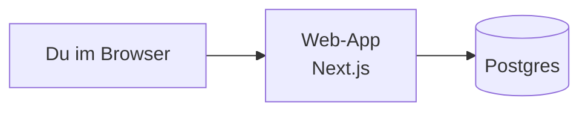

<!--
PaiBot – Architektur: Aufbau von PaiBot heute und geplante Teile.

Autor:     Oliver Hees
Website:   https://paibot.de
Copyright: 2026 Oliver Hees. Alle Urheberrechte liegen beim Autor.
Lizenz:    PaiBot Fair-Code-Lizenz 1.0 – siehe Datei LICENSE im Projektstamm
Seit:      2026-11-18
-->

# Architektur

**Ergebnis:** Du siehst, aus welchen Teilen PaiBot heute besteht und was erst geplant ist. Diese Seite wächst mit jeder Funktion mit.

## Heutiger Stand

| Teil              | Ort               | Was es heute tut                                                                       |
| ----------------- | ----------------- | -------------------------------------------------------------------------------------- |
| Web-App           | `apps/web`        | Startseite mit Datenbank-Status, Health-Endpunkt `/api/health`, Migrationen beim Start |
| Datenbank-Paket   | `packages/db`     | Verbindung (`createDb`), Schema, Migrationen (`runMigrations`), Erreichbarkeitsprüfung |
| Gemeinsames Paket | `packages/shared` | App-Name, unterstützte Sprachen (`de`, `en`), Auswahl der Sprache                      |
| Deployment        | `deploy`          | Docker Compose mit `postgres` und `web`                                                |

### Healthcheck

`GET /api/health` fragt die Datenbank ab und antwortet mit JSON.

| `db`             | `status`   | HTTP | Bedeutung                    |
| ---------------- | ---------- | ---- | ---------------------------- |
| `ok`             | `ok`       | 200  | Datenbank erreichbar         |
| `down`           | `degraded` | 503  | Datenbank nicht erreichbar   |
| `not_configured` | `ok`       | 200  | keine `DATABASE_URL` gesetzt |

Das Docker-Image prüft denselben Endpunkt in seinem eigenen Healthcheck.

### Datenbank und Migrationen

- Postgres wird mit Drizzle angesprochen. Das Schema liegt in `packages/db/src/schema.ts`, die erzeugten Migrationen in `packages/db/drizzle/`.
- Heute gibt es die Tabelle `settings` mit genau einer Zeile (`id = "singleton"`): Sprache, Zeitzone, Standard der Datenschleuse, maximale Übergaben, Tagesbudget und Zeitpunkt der Einrichtung. PaiBot gehört genau einer Person.
- Beim Start der Web-App (`apps/web/src/instrumentation-node.ts`) werden offene Migrationen angewendet, mit bis zu fünf Versuchen. Gelingt das nicht, startet die App trotzdem, und `/api/health` meldet `degraded`.

## Geplant

Diese Teile gibt es als Ordner oder Platzhalter, aber noch ohne Funktion. Details folgen auf den Doku-Seiten, sobald es sie wirklich gibt.

| Teil             | Ort                | Stand                     |
| ---------------- | ------------------ | ------------------------- |
| Datenschleuse    | eigener Dienst     | geplant                   |
| KI-Modelle       | `packages/llm`     | Platzhalter, nicht gebaut |
| Bots und Team    | `packages/agents`  | Platzhalter, nicht gebaut |
| Apps per MCP     | `packages/mcp`     | Platzhalter, nicht gebaut |
| Hintergrund-Jobs | `packages/jobs`    | Platzhalter, nicht gebaut |
| UI-Komponenten   | `packages/ui`      | Platzhalter, nicht gebaut |
| Browser-Dienst   | `services/browser` | geplant                   |

## Zusammenspiel der Pakete

`apps/web` nutzt `@paibot/db` und `@paibot/shared`. Das Monorepo wird mit pnpm und Turborepo gebaut; das Docker-Image baut nur die Web-App und kopiert die Migrationen dazu.
