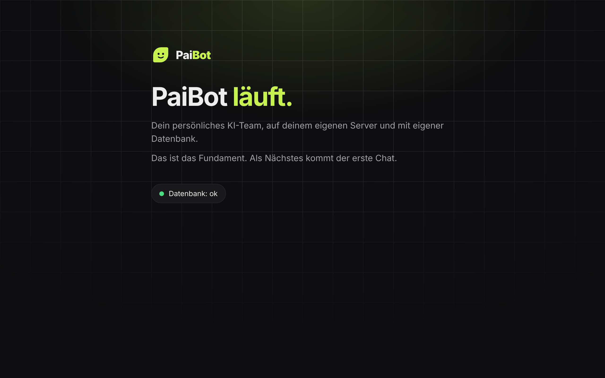

<!--
PaiBot – Anleitung: PaiBot mit Coolify auf dem eigenen Server betreiben.

Autor:     Oliver Hees
Website:   https://paibot.de
Copyright: 2026 Oliver Hees. Alle Urheberrechte liegen beim Autor.
Lizenz:    PaiBot Fair-Code-Lizenz 1.1 – siehe Datei LICENSE im Projektstamm
Seit:      2026-11-07
-->

# PaiBot mit Coolify betreiben

Ziel: PaiBot läuft auf deinem eigenen Server in der EU, unter deiner Domain mit HTTPS, und `/api/health` meldet `"db":"ok"`.

PaiBot ist ein Docker-Compose-Stack (`deploy/docker-compose.yml`). Coolify ist der bequeme Weg, ihn auf einem Server zu betreiben; nötig ist es nicht (siehe [`deploy/README.md`](../deploy/README.md)).

## 1. Server und Coolify

Du brauchst einen Server bei einem Hoster mit Rechenzentrum in der EU (Ubuntu LTS, mindestens 2 vCPU und 4 GB RAM) mit Coolify.

**Empfohlen:** [coolify-shield](https://github.com/oliverhees/coolify-shield). Ein Befehl auf deinem Rechner führt dich durch Bestellung, Coolify-Installation und Absicherung (SSH nur per Schlüssel, Firewall, WireGuard-Tunnel). Das Coolify-Dashboard ist danach nur noch durch den Tunnel erreichbar: `http://10.8.0.1:8000`.

Wer Coolify von Hand installiert, folgt https://coolify.io/docs und sichert Server und Dashboard selbst ab.

## 2. Domain

Lege eine Domain oder Subdomain an (z. B. `paibot.deine-domain.de`), deren A-Record auf die Server-IP zeigt.

## 3. PaiBot als Ressource anlegen

1. In Coolify ein Projekt anlegen, z. B. „PaiBot“.
2. Neue Ressource → aus dem öffentlichen GitHub-Repo `https://github.com/oliverhees/paibot` → Build-Art **Docker Compose**.
3. Compose-Datei: `deploy/docker-compose.yml`, Branch `main`.
4. Umgebungsvariablen setzen:
   - `POSTGRES_PASSWORD`: langes Zufallspasswort
   - `APP_URL`: `https://paibot.deine-domain.de`
5. Beim Dienst `web` die Domain eintragen (Port 3000). Coolify besorgt das HTTPS-Zertifikat.
6. Deploy starten.

Datenbank und Web-App veröffentlichen ihre Ports nur auf `127.0.0.1`. Von außen ist PaiBot nur über deine Domain erreichbar.

## 4. Prüfen

```bash
curl https://paibot.deine-domain.de/api/health
```

Erwartet: `{"status":"ok","app":"PaiBot","db":"ok",...}`.

| Ergebnis                | Bedeutung                             | Was tun                                                               |
| ----------------------- | ------------------------------------- | --------------------------------------------------------------------- |
| `"db":"ok"`             | alles läuft                           | –                                                                     |
| `"db":"down"`, HTTP 503 | App läuft, Datenbank nicht erreichbar | Logs von `postgres` und `web` in Coolify prüfen, Passwort vergleichen |
| keine Antwort           | Domain, DNS oder Proxy falsch         | A-Record und Domain-Eintrag beim Dienst `web` prüfen                  |

## So sieht es aus

Öffnest du deine Domain im Browser, zeigt die Startseite „Datenbank: ok“, sobald die Datenbank erreichbar ist.



## 5. Danach

- Backups der Datenbank einrichten (Ziel: S3-kompatibler Speicher in der EU)
- Automatische Deploys bei Push auf `main` aktivieren, wenn gewünscht
