<!--
PaiBot – Anbieter und Modelle: Anbieter eintragen, Modelle abrufen, Verbindung testen.

Autor:     Oliver Hees
Website:   https://paibot.de
Copyright: 2026 Oliver Hees. Alle Urheberrechte liegen beim Autor.
Lizenz:    PaiBot Fair-Code-Lizenz 1.1 – siehe Datei LICENSE im Projektstamm
Seit:      2026-11-20
-->

# Anbieter und Modelle

**Ergebnis:** Du wählst einen Modell-Anbieter – EUrouter, Mistral AI (direkt) oder einen eigenen bzw. lokalen Dienst –, testest die Verbindung und wählst ein Modell bzw. bei EUrouter eine deiner Routing-Regeln. PaiBot zeigt nur Belegbares: an jeder Antwort, wer laut Anbieter geantwortet hat, bei Vorlagen die Aussagen des Anbieters mit Stand und bei eigenen Anbietern deine Angabe als deine. Jede Antwort geht nur an den Anbieter des gewählten Modells, und bei eingeschalteter Datenschleuse nur an die Datenschleuse.

## Wofür

PaiBot braucht ein Sprachmodell, das die Antworten schreibt. Das Modell läuft nicht bei dir, sondern bei einem Anbieter. Hier legst du fest, bei wem, und PaiBot prüft, ob der Zugang funktioniert.

## So benutzt du es

Den Anbieter verbindest du meist schon in der Einrichtung. Danach änderst du alles auf der Seite „Modell und Anbieter“ (Navigation links bzw. im Menü am Handy).

**Herkunft ansehen und Schlüssel ersetzen**

1. Öffne „Modell und Anbieter“. Oben siehst du den Anbieter mit Adresse, **Herkunft** und „Schlüssel hinterlegt“. Den Schlüssel selbst zeigt PaiBot nie an, auch nicht teilweise. Bei „Herkunft“ steht nur, was sich belegen lässt: bei EUrouter, dass deine Routing-Regel den antwortenden Anbieter festlegt und PaiBot ihn an jeder Antwort zeigt; bei Mistral AI die Aussagen von Mistral mit Stand; bei einem eigenen Anbieter der Ort, den du selbst angegeben hast, „laut deiner Einstellung“. Ein pauschales „EU“ aus einer Vorlage gibt es nicht. In der Seitenleiste steht dieselbe Angabe hinter „Modelle:“, ohne gewähltes Modell „noch keins“.

   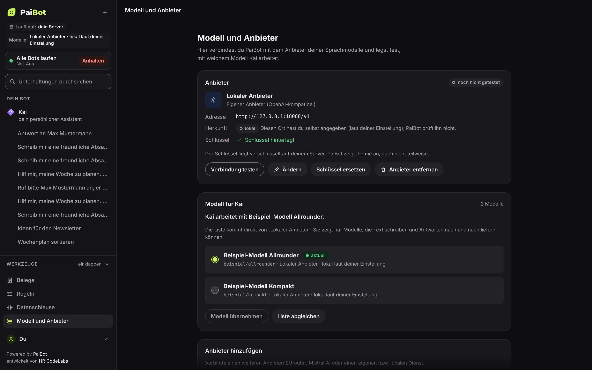
2. Klicke „Verbindung testen“, um den gespeicherten Schlüssel zu prüfen. Das Ergebnis steht deutlich darunter: grün mit Haken „Verbindung steht“ oder rot mit Warnzeichen „Verbindung fehlgeschlagen“, jeweils mit einem Satz dazu. Bei EUrouter prüft der Test den Schlüssel mit deiner ersten gespeicherten Regel (eine sehr kleine echte Anfrage).

   
3. Klicke „Schlüssel ersetzen“ und füge den neuen Schlüssel in das Feld ein.
4. Klicke „Verbindung testen“. Nimmt der Anbieter den Schlüssel nicht an, steht rot darunter, was du tun kannst; gespeichert ist dann nichts.

   
5. Klicke „Schlüssel speichern“. PaiBot prüft den Schlüssel beim Anbieter noch einmal und speichert ihn nur, wenn er angenommen wird. Danach lädt die Modell-Liste neu.

   

**Modell wählen**

6. Unter „Modell für …“ steht, mit welchem Modell dein Bot gerade arbeitet; dieses Modell trägt in der Liste die Marke „aktuell“.
7. Die Liste kommt direkt vom Anbieter. Bei mehr als acht Modellen erscheint ein Suchfeld; tippe einen Teil des Namens ein.

   
8. Wähle ein Modell und klicke „Modell übernehmen“. Ab der nächsten Antwort nutzt dein Bot dieses Modell.

   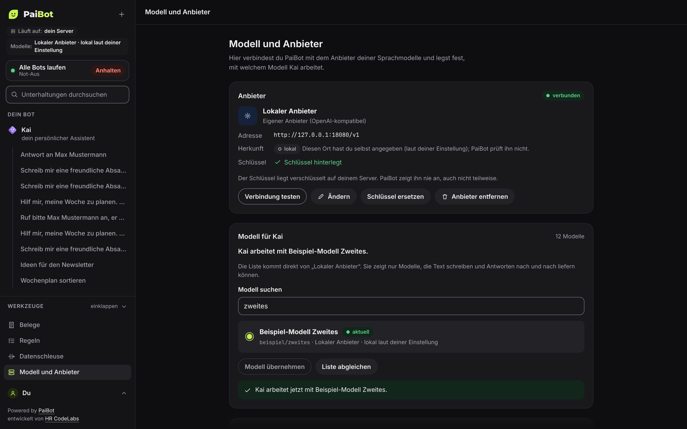

**EUrouter hinzufügen und Routing-Regeln eintragen**

Bei EUrouter wählst du keine Modelle aus einer Liste, sondern eine deiner Routing-Regeln. PaiBot kann die Regeln deines Kontos nicht selbst auflisten; du trägst ihre Namen ein, und PaiBot prüft jeden einzeln.

9. Unten auf der Seite steht die Karte „Anbieter hinzufügen“. Klicke „Anbieter hinzufügen“ und wähle „EUrouter“. Zu jedem Anbieter stehen seine Angaben mit Stand und der Link „Noch kein Konto? Hier anlegen“. Trag den Schlüssel ein und klicke „Verbindung testen und speichern“.

   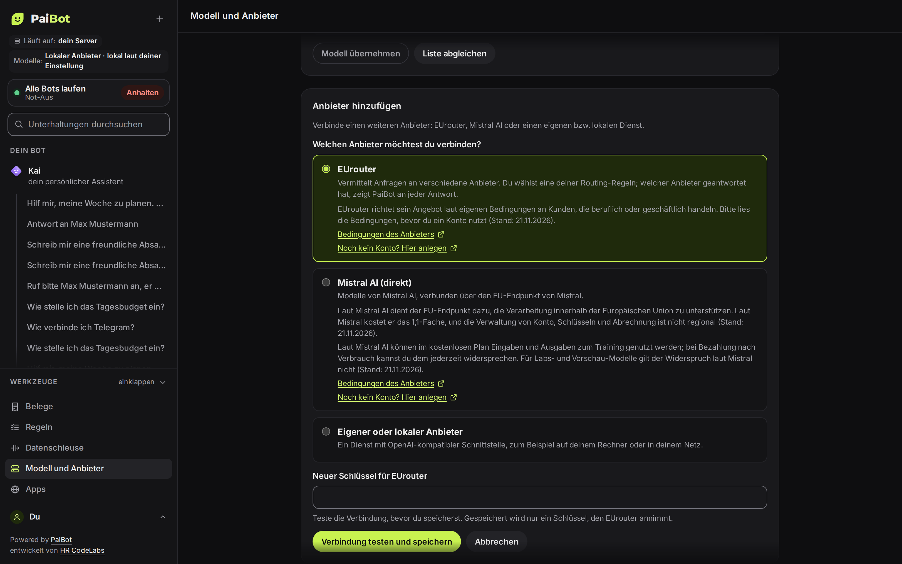
10. Oben erscheint EUrouter, darunter die Karte „Routing-Regel für …“. Trag bei „Name der Routing-Regel“ den Namen genau so ein, wie er in deinem Konto bei EUrouter unter „Routing“ steht, und klicke „Regel prüfen und hinzufügen“. Die Prüfung ist eine sehr kleine echte Anfrage an ein Modell und kostet bei EUrouter wenige Token. Funktioniert die Regel, steht grün, wer laut EUrouter geantwortet hat und dessen Sitz laut der Anbieter-Liste von EUrouter; die Regel steht dann zur Wahl.

    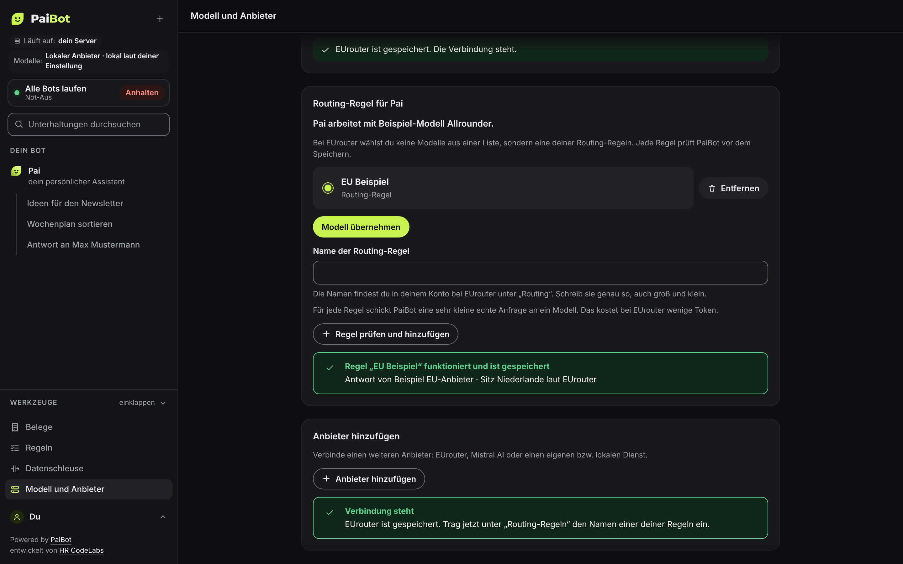
11. Kennt EUrouter den Namen nicht (oder ist die Regel ausgeschaltet), steht rot, was du tun kannst; gespeichert ist dann nichts.

    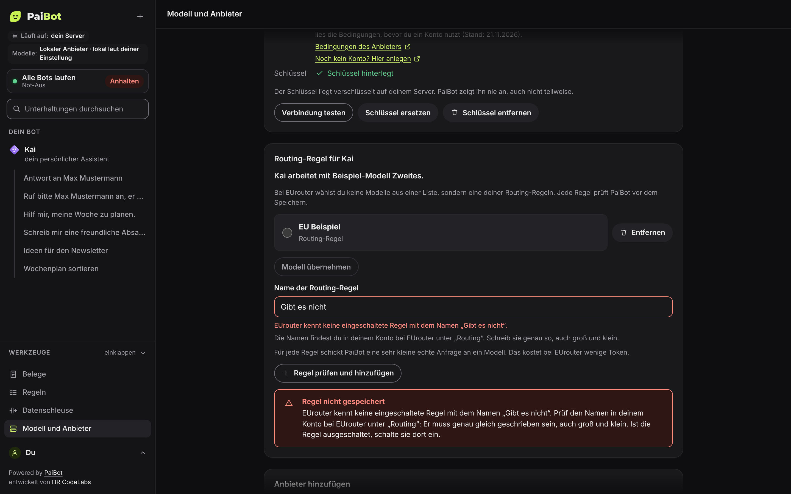
12. Wähle die Regel und klicke „Modell übernehmen“. Ab der nächsten Antwort nutzt dein Bot diese Regel. Mit „Entfernen“ nimmst du eine Regel wieder heraus. Am Handy stehen die Teile untereinander:

    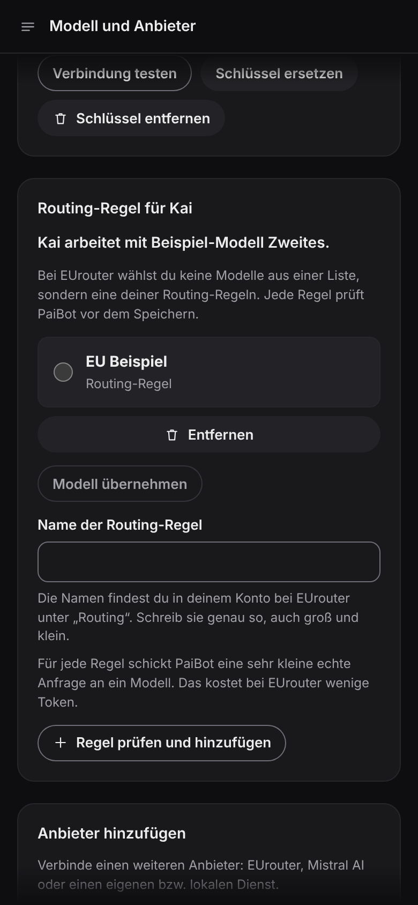
13. Hast du EUrouter schon früher mit einem Modell aus der Liste eingerichtet, bleibt dieser Eintrag benutzbar. Er trägt die Marke „früherer Eintrag“, und ein Hinweis schlägt vor, auf eine Routing-Regel umzustellen. Eine Angabe zur EU gibt es dafür nicht.
14. Wie jeder Anbieter lässt sich EUrouter mit „Schlüssel entfernen“ wieder entfernen.

    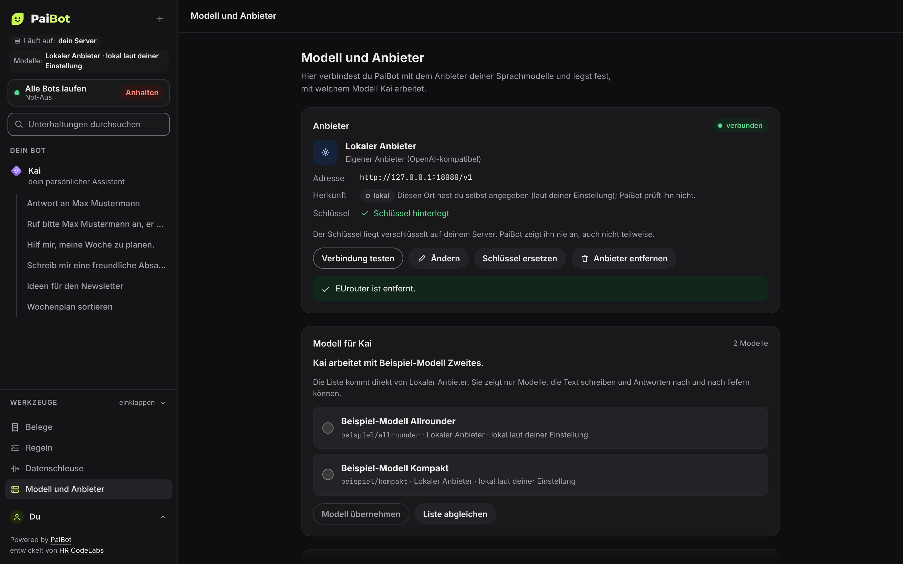

**Mistral AI hinzufügen**

15. Wähle in „Anbieter hinzufügen“ „Mistral AI (direkt)“, trag den Schlüssel ein und klicke „Verbindung testen und speichern“. PaiBot verbindet den EU-Endpunkt von Mistral (`https://api.eu.mistral.ai/v1`) und holt die Modell-Liste; ein Modell wählst du wie in den Schritten 6 bis 8. Ob Schlüssel und Modelle passen, zeigt erst dieser Test mit deinem Konto.

**Eigenen Anbieter hinzufügen (auch auf deinem Rechner)**

16. Wähle in „Anbieter hinzufügen“ „Eigener oder lokaler Anbieter“.
17. Gib einen Namen ein (so heißt der Anbieter in PaiBot; Steuer- und unsichtbare Zeichen entfernt PaiBot) und die Adresse des Dienstes, meist mit `/v1` am Ende.
18. Wähle bei „Wo läuft der Dienst?“ den Ort: „Bei einem Dienst in der EU“, „Bei einem Dienst außerhalb der EU“ oder „Auf deinem Rechner oder in deinem Netz (lokal)“. Diese Angabe ist deine; PaiBot zeigt sie mit „laut deiner Einstellung“ und prüft sie nicht. „lokal“ gilt nur für Adressen auf deinem Rechner oder in deinem Netz: Eine öffentliche Adresse ist nie „lokal“ – auch nicht, wenn ein Name dorthin zeigt – und braucht https mit einem anderen Ort. Nur bei „lokal“ sind `http://` und Adressen im eigenen Netz erlaubt; bei `http://` erscheint ein Hinweis, dass die Verbindung unverschlüsselt ist. Bei „lokal“ ist der Schlüssel freiwillig, sonst Pflicht.

    
19. Klicke „Testen und speichern“. PaiBot testet die Verbindung und speichert nur, was der Dienst annimmt. Passt die Adresse nicht, steht der Grund direkt am Feld. Adressen von PaiBot selbst (Datenbank, Datenschleuse, Web-App, Worker) sind auch bei „lokal“ gesperrt.

    **Achtung bei „außerhalb der EU“:** Wählst du diesen Ort, lehnt das Tor jede Antwort dieses Anbieters ab (Regel „Anbieter aktiv und Region erlaubt“: erlaubt sind nur „EU“ und „lokal“), und PaiBot schickt ihm nichts. Das Formular warnt davor, und auf der Seite steht der Hinweis, solange der Ort so gewählt ist. Stimmt der Ort nicht, wähl „Ändern“ und stell ihn richtig ein, zum Beispiel „EU“ für einen Dienst in der EU oder „lokal“ für deinen eigenen Rechner. Den Ort zu ändern ist jederzeit möglich; die Warnung ersetzt nicht deine eigene Prüfung, wo der Dienst wirklich läuft.

    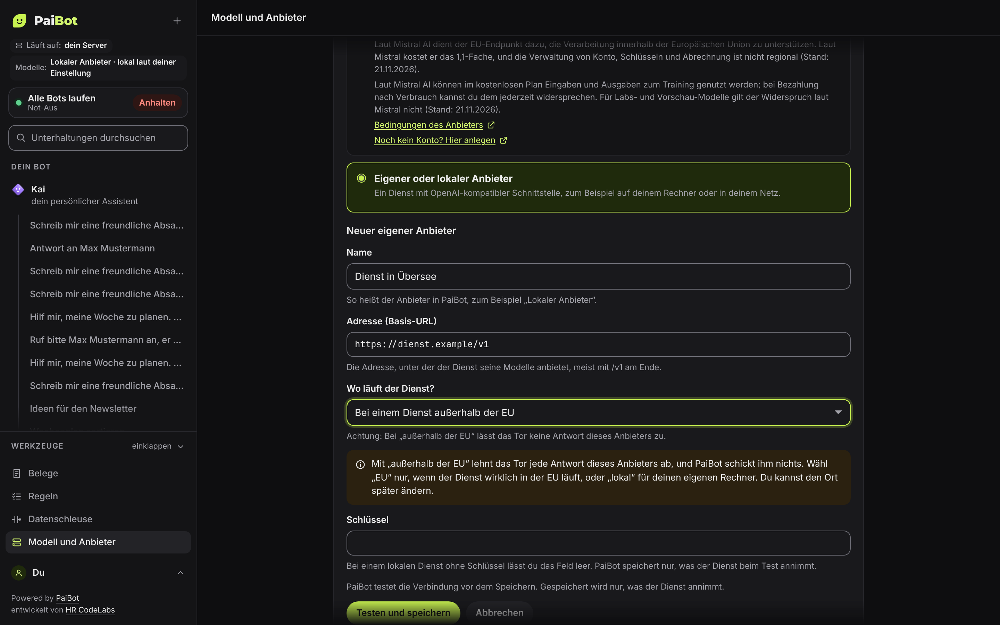

    
20. Nach dem Speichern steht unter dem Knopf „… ist gespeichert. Die Verbindung steht.“ Oben zeigt die Karte „Anbieter“ jetzt den neuen Anbieter, darunter seine Modelle.

    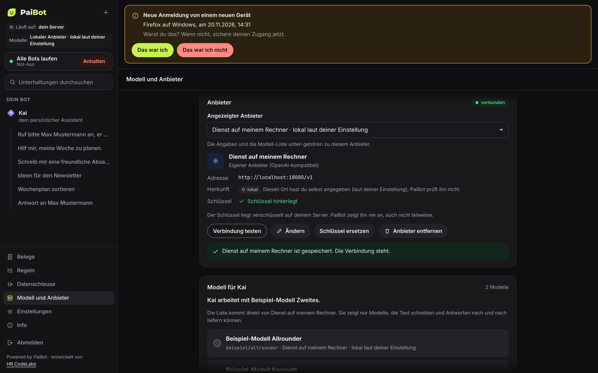
21. Sobald es mehr als einen Anbieter gibt, wählst du oben bei „Angezeigter Anbieter“, welcher Anbieter und welche Modell-Liste angezeigt werden. Ein Modell dieses Anbieters übernimmst du wie in den Schritten 6 bis 8.

    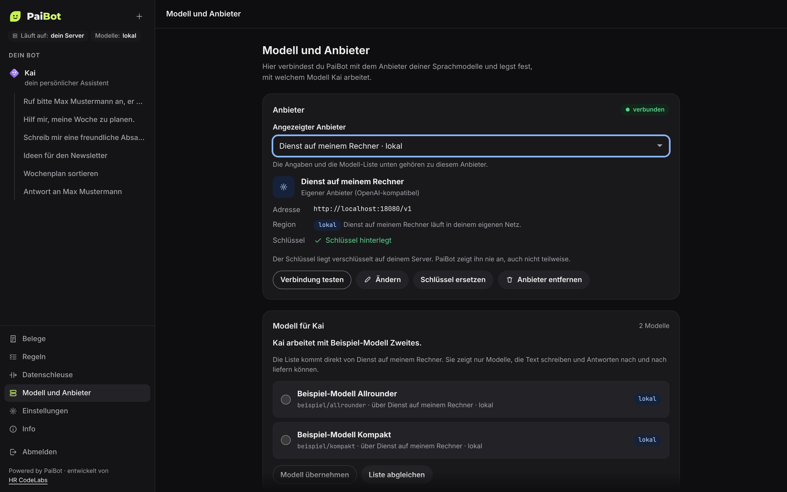

**Eigenen Anbieter ändern**

22. Wähle den Anbieter oben aus und klicke „Ändern“. Name, Adresse und Ort sind vorbelegt; den Schlüssel zeigt PaiBot nie an.
23. Lass das Schlüssel-Feld leer, um den gespeicherten Schlüssel zu behalten, oder trag einen neuen ein. Änderst du die Adresse, gib den Schlüssel noch einmal ein. Bei „lokal“ kannst du mit „Gespeicherten Schlüssel entfernen“ ohne Schlüssel weiterarbeiten. Klicke „Testen und speichern“.

    
24. „Verbindung testen“ prüft den Anbieter, ohne etwas zu ändern. „Liste abgleichen“ holt die Modelle neu; Modelle, die der Anbieter nicht mehr meldet, sind danach nicht mehr wählbar.

    

**Anbieter entfernen**

25. Klicke „Anbieter entfernen“ (bei EUrouter heißt der Knopf „Schlüssel entfernen“) und bestätige die Rückfrage. Damit entfernst du den Anbieter samt Schlüssel und Modell-Liste. Frühere Antworten in deinen Unterhaltungen bleiben. Arbeitet dein Bot gerade mit einem Modell dieses Anbieters, sagt die Rückfrage das: Danach hat er kein Modell mehr, bis du ein anderes wählst.

    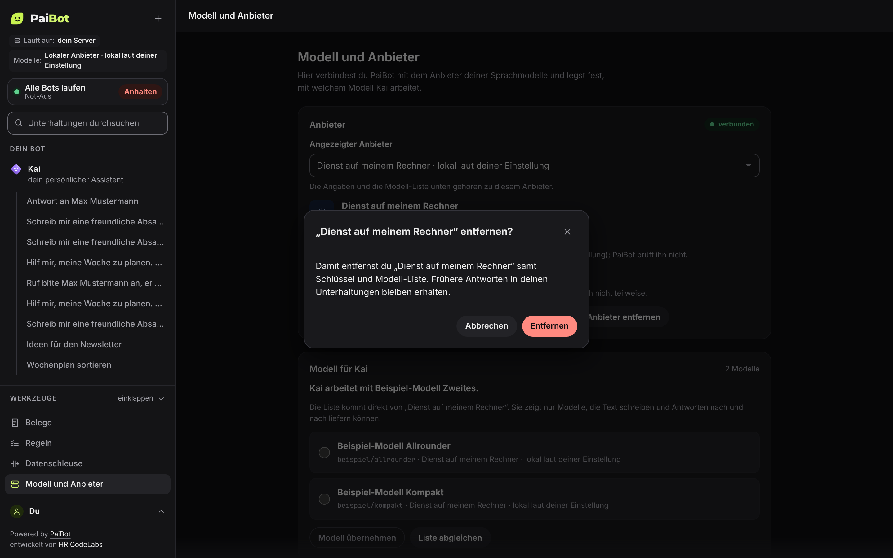
26. Schreibt dein Bot in diesem Moment mit einem Modell dieses Anbieters, lehnt PaiBot das Entfernen ab: „… schreibt gerade mit einem Modell von …“. Warte, bis die Antwort fertig ist, oder brich sie im Chat ab.
27. Entfernst du den letzten Anbieter, fügst du unter „Anbieter hinzufügen“ wieder einen hinzu.

    

**Zweiter Schlüssel für EUrouter (freiwillig): was deine Regeln vorgeben**

Mit dem normalen Schlüssel kann PaiBot nicht lesen, was eine Regel vorgibt. Mit einem zweiten Schlüssel (einem Verwaltungsschlüssel) liest PaiBot die Liste deiner Regeln und merkt sich ihre Vorgaben. Nur dann kann eine Regel die Kennzeichnung „EU laut Regel“ tragen, und nur, wenn die Regel in deinem Konto als Datenresidenz genau „EU“ angibt. Ohne den zweiten Schlüssel funktioniert alles wie bisher, nur ohne Kennzeichnung.

28. Lege in deinem Konto bei EUrouter unter „Settings“ → „Management keys“ einen Verwaltungsschlüssel an (so beschreibt es die Anleitung des Anbieters, Stand 21.11.2026). Ob ein Schlüssel nur zum Lesen reicht, ist noch nicht mit einem echten Konto geprüft; die Anleitung des Anbieters sagt, dass er für die Regel-Liste angenommen wird.
29. Öffne „Modell und Anbieter“ mit EUrouter, geh zur Karte „Zweiter Schlüssel (freiwillig)“ und klicke „Zweiten Schlüssel eintragen“. Füge den Schlüssel ein und klicke „Prüfen und speichern“. PaiBot speichert ihn nur, wenn sich die Regel-Liste damit lesen lässt. Darf der Schlüssel das nicht, steht rot „Dieser Schlüssel darf die Regeln nicht lesen.“ mit dem Weg, einen Verwaltungsschlüssel anzulegen; gespeichert ist dann nichts. Denselben Satz bekommst du, wenn du den normalen Schlüssel einträgst (so antwortete EUrouter in einem echten Aufruf am 21.11.2026).

    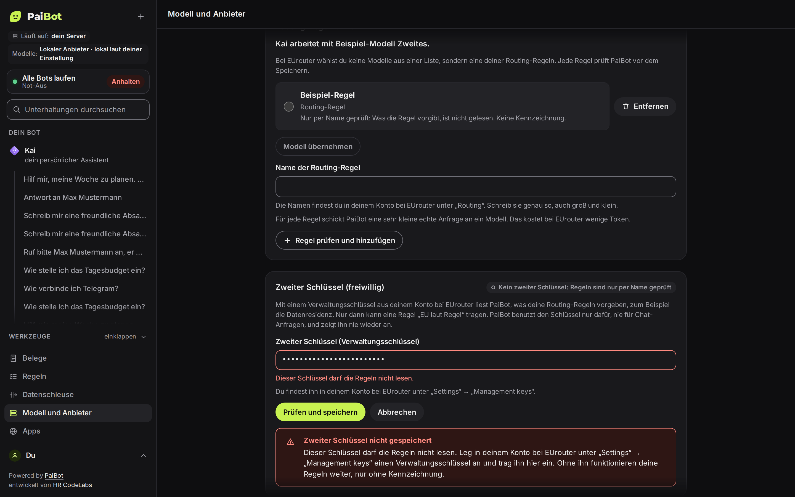
30. Mit einem passenden Schlüssel steht oben „Zweiter Schlüssel hinterlegt“. PaiBot hat die Vorgaben deiner gespeicherten Regeln gleich gelesen. Den Schlüssel zeigt PaiBot nie wieder an; er liegt getrennt vom normalen Schlüssel verschlüsselt und wird nur für die Regel-Liste benutzt, nie für Chat-Anfragen.

    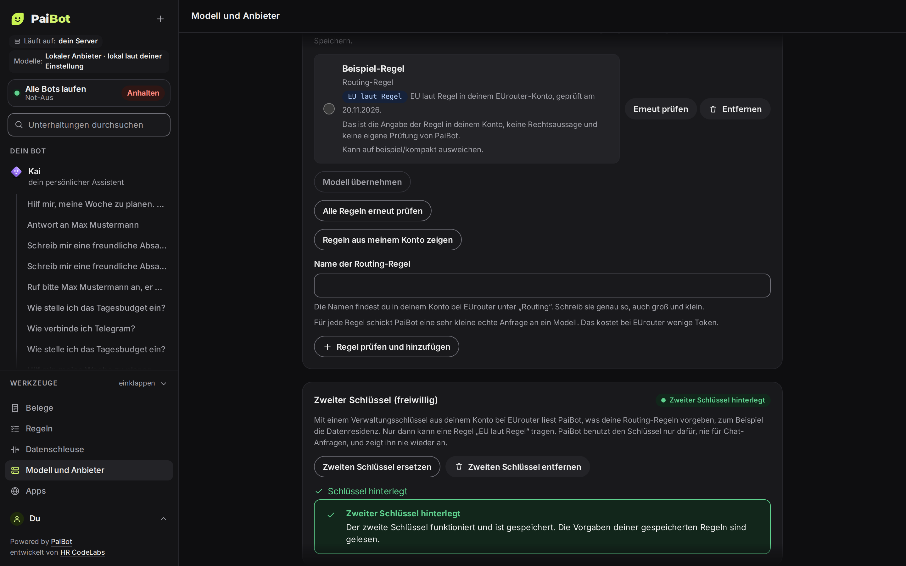
31. In der Karte „Routing-Regel für …“ trägt eine Regel die Marke **EU laut Regel**, wenn sie in der Liste deines Kontos als Datenresidenz genau „EU“ meldet. Daneben steht, woher das kommt und wann es geprüft wurde („EU laut Regel in deinem EUrouter-Konto, geprüft am …“). Das ist die Angabe deiner Regel, keine Rechtsaussage und keine eigene Prüfung von PaiBot. Der freie Text der Regel (die Beschreibung) zählt nie.

    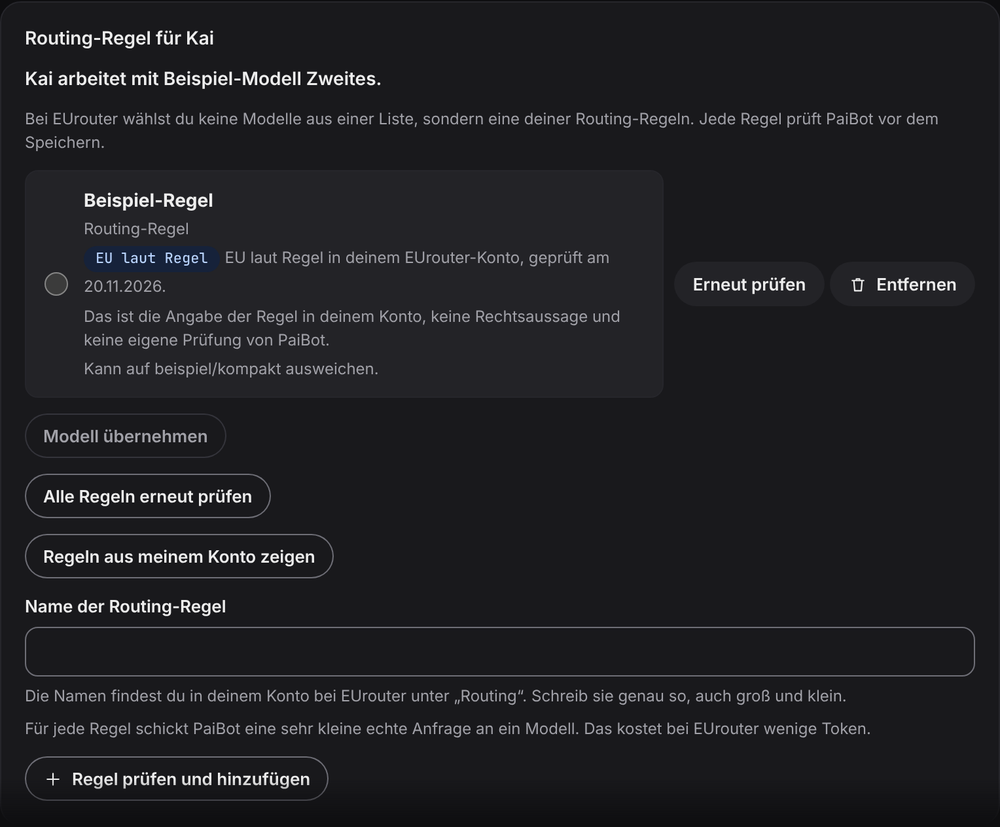
32. Klicke „Regeln aus meinem Konto zeigen“. PaiBot liest die Liste und zeigt die eingeschalteten Regeln, mit „EU laut Regel“ nur bei der, die es meldet. Mit „Hinzufügen“ prüft PaiBot eine Regel wie gewohnt (eine sehr kleine echte Anfrage) und speichert sie samt Vorgaben. Zeigt die Antwort Hinweise auf weitere Seiten, steht „Liste möglicherweise unvollständig“; trag eine fehlende Regel dann per Name ein.

    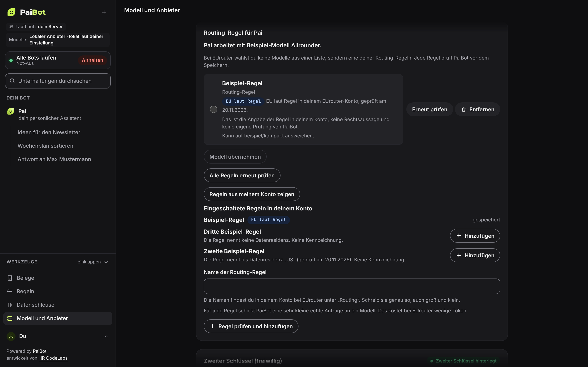
33. Eine Regel, die etwas anderes als „EU“ meldet, trägt keine Kennzeichnung; es steht, was sie nennt oder dass sie keine Datenresidenz nennt. Dasselbe gilt für eine Regel, die du nur per Name eingetragen hast oder die nicht in der Liste steht: „Nur per Name geprüft … Keine Kennzeichnung.“ Auch bei einem anderen oder unbekannten Wert gibt es keine Kennzeichnung.

    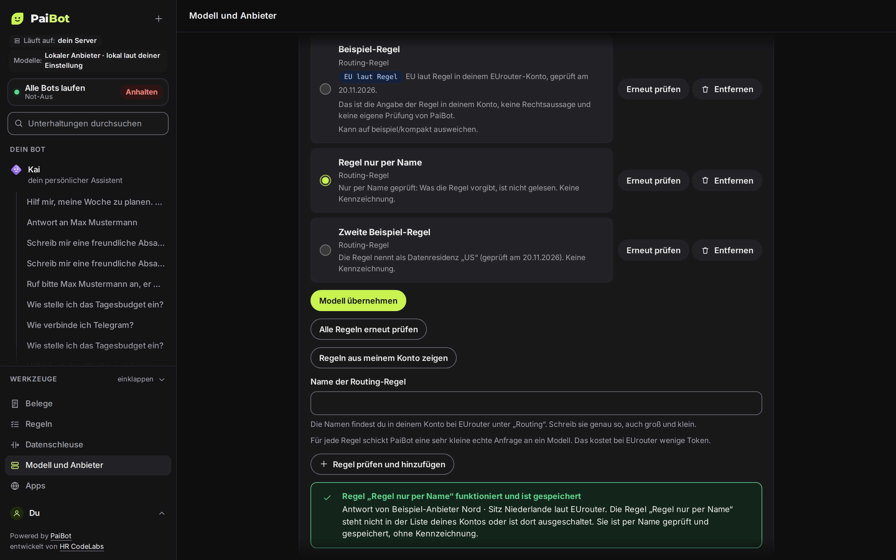
34. Klicke bei einer Regel „Erneut prüfen“ oder oben „Alle Regeln erneut prüfen“, um die Vorgaben neu zu lesen. Eine Angabe, die älter als 14 Tage ist, bleibt sichtbar, zeigt aber „zuletzt geprüft am …“ und „länger nicht geprüft“. Ist eine Regel in einer vollständig gelesenen Liste nicht mehr zu finden (oder ausgeschaltet), entfällt ihre Kennzeichnung; bei einer möglicherweise unvollständigen Liste bleibt sie unverändert.

    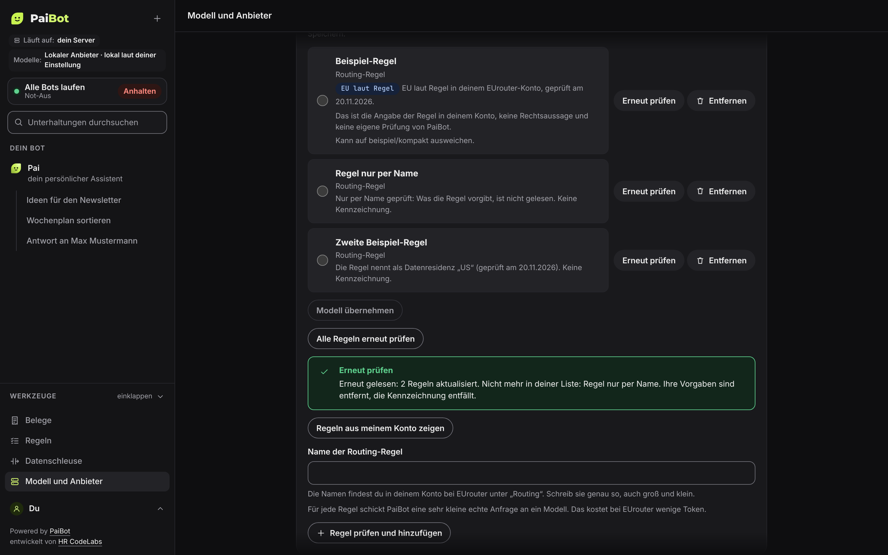
35. Kann eine Regel ausweichen, sagt PaiBot es: „Kann auf … ausweichen“, wenn die Regel Ausweich-Modelle nennt, oder „Kann ausweichen“, wenn sie es erlaubt. Wer tatsächlich antwortet, steht an jeder Antwort. Dieselbe Regel hat in echten Aufrufen schon von verschiedenen Anbietern geantwortet.
36. Wähle die Regel und klicke „Modell übernehmen“. Im Chat steht die Marke im Kopf und in der Zeile unter der Antwort, mit dem Datum. Der Name der Regel steht dort als schlichter Text in Anführungszeichen; die Kennzeichnung ist ein eigenes Element mit eigenem Rahmen. Was in Anführungszeichen steht, hast du vergeben, die Kennzeichnung kommt von PaiBot.

    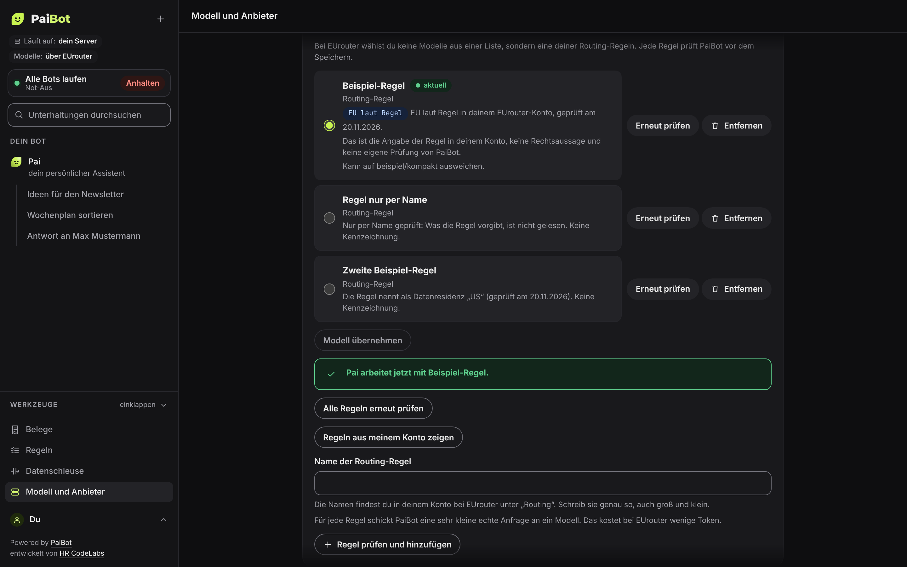

    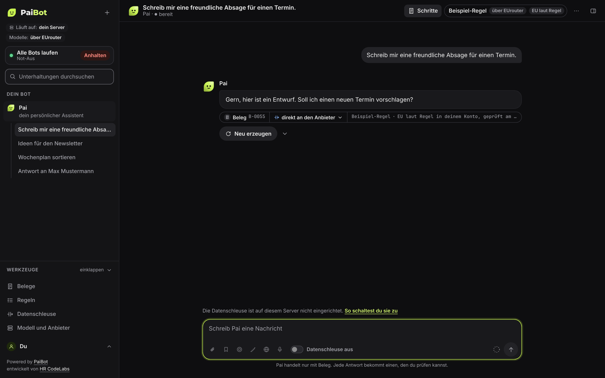
37. Mit „Zweiten Schlüssel entfernen“ löschst du den Schlüssel und die gelesenen Vorgaben. Die Regeln bleiben, die Kennzeichnung entfällt.

    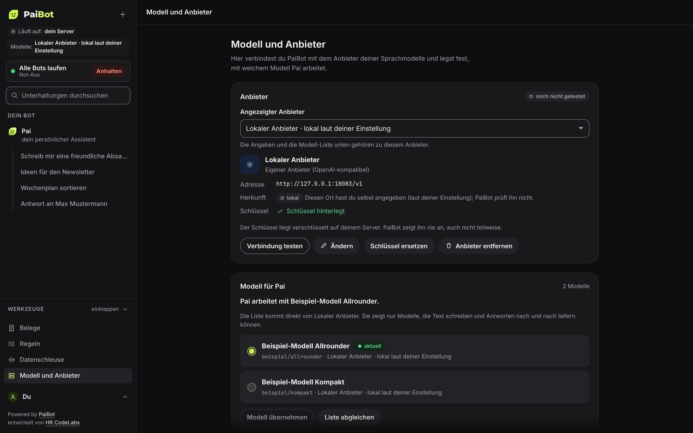

Ist ein Anbieter zu erreichen, aber eine Regel gibt es dort nicht mehr (oder sie ist ausgeschaltet), steht im Chat statt eines allgemeinen Fehlers: „Die gewählte Routing-Regel gibt es bei deinem Anbieter nicht mehr, oder sie ist ausgeschaltet.“ mit dem Weg: unter „Modell und Anbieter“ eine Regel neu wählen.

Beispiel für das Ergebnis eines Tests mit falschem Schlüssel:

```text
EUrouter hat den Schlüssel nicht angenommen. Prüf, ob du den Schlüssel vollständig kopiert hast,
oder erzeuge in deinem Konto bei EUrouter einen neuen.
```

Bei einem eigenen Anbieter, bei dem es kein Konto gibt (zum Beispiel auf deinem Rechner), lautet der Satz so:

```text
Prüf, ob du den Schlüssel vollständig kopiert hast und ob er zu deinem Anbieter gehört.
Trag bei Bedarf einen neuen ein.
```

## So sieht es aus

Die Bilder zu den einzelnen Schritten stehen oben in der Anleitung. Sie zeigen den Test-Anbieter der Beispiel-Umgebung („Lokaler Anbieter“ auf dem eigenen Rechner) mit erfundenen Modellen; auch „EUrouter“ ist in den Bildern dieser Test-Anbieter, mit der Beispiel-Regel „Beispiel-Regel“ und dem erfundenen „Beispiel-Anbieter Nord“. In einigen Bildern heißt der Bot „Kai“, weil er auf der Seite „Bot“ vorher umbenannt wurde. Die Beispiel-Regeln („Beispiel-Regel“, „Zweite Beispiel-Regel“) tragen absichtlich kein „EU“ im Namen: Eine Kennzeichnung gibt es nie wegen eines Namens. Die Regel-Liste der Bilder stammt aus einem Beispiel-Konto, das nur für die Bilder die Form der Antwort von EUrouter nachstellt.

Nach dem Entfernen eines weiteren Anbieters zeigt die Seite wieder den verbleibenden:

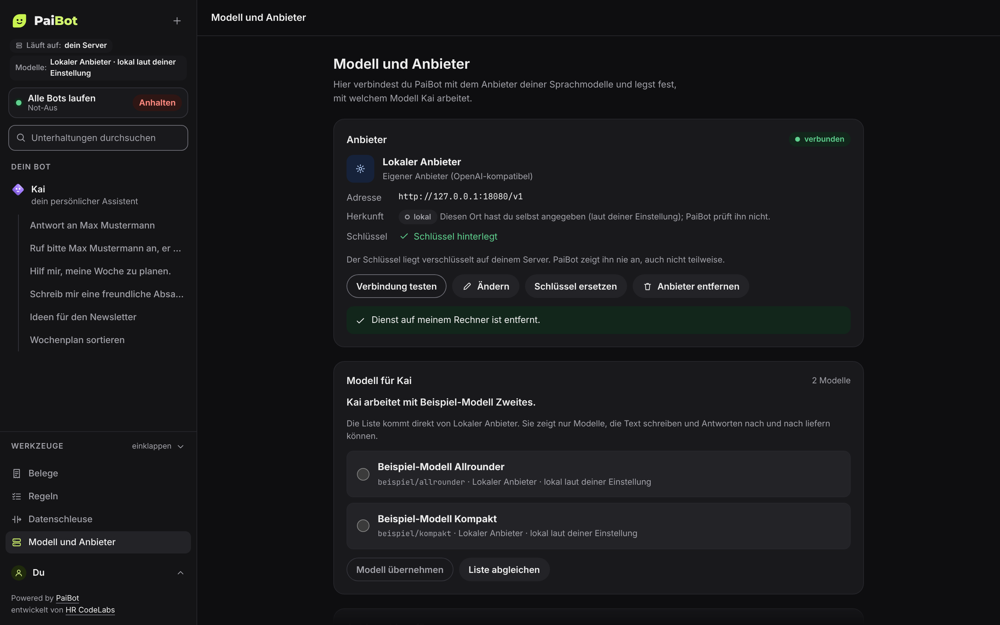

Nach dem Entfernen des letzten Anbieters hat dein Bot kein Modell mehr, und du fügst unter „Anbieter hinzufügen“ einen neuen hinzu:

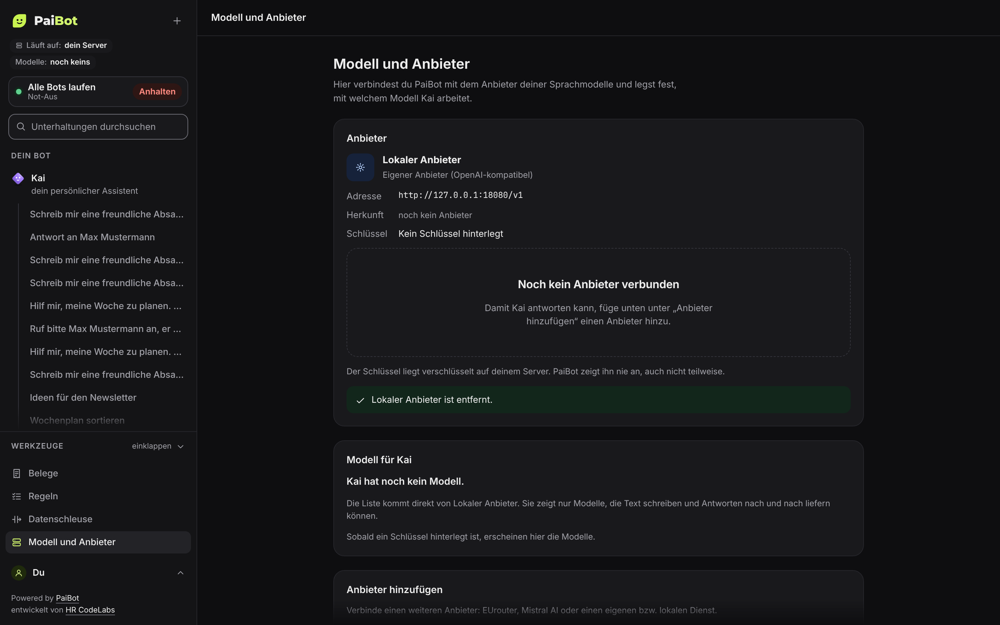

Am Handy stehen die Karten untereinander:


## Einstellungen

| Einstellung        | Wo                                     | Bedeutung                                                                                                                                                                                                                                      | Standard                                                                           |
| ------------------ | -------------------------------------- | ---------------------------------------------------------------------------------------------------------------------------------------------------------------------------------------------------------------------------------------------- | ---------------------------------------------------------------------------------- |
| Basis-URL          | Anbieter                               | Adresse eines kompatiblen Dienstes, endet meist auf `/v1`                                                                                                                                                                                      | EUrouter: `https://api.eurouter.ai/v1`; Mistral AI: `https://api.eu.mistral.ai/v1` |
| Region             | Anbieter                               | `eu`, `non_eu` oder `local` („Wo läuft der Dienst?“); bestimmt, was für die Adresse erlaubt ist und was das Tor zulässt. Bei Vorlagen fest (`eu`), wird aber nicht als Herkunft angezeigt; bei eigenen Anbietern als „laut deiner Einstellung“ | Vorlagen: `eu`; eigener Anbieter: EU                                               |
| Routing-Regeln     | Anbieter EUrouter                      | Namen deiner Regeln, je einzeln geprüft; die gewählte ersetzt das Modell                                                                                                                                                                       | keine                                                                              |
| Zweiter Schlüssel  | Anbieter EUrouter                      | Verwaltungsschlüssel, nur zum Lesen der Regel-Liste; getrennt verschlüsselt, nie angezeigt; freiwillig                                                                                                                                         | keiner                                                                             |
| Alter einer Angabe | im Code (`VORGABE_ALT_TAGE`)           | Nach so vielen Tagen steht bei einer gelesenen Vorgabe „länger nicht geprüft“                                                                                                                                                                  | 14                                                                                 |
| Konto-Links        | im Code (`lib/modelle/konto-links.ts`) | Link „Noch kein Konto? Hier anlegen“ je Anbieter; ein Empfehlungs-Link erscheint nur, wenn er dort eingetragen ist, und dann mit Hinweis auf die Provision                                                                                     | normale Seite des Anbieters                                                        |
| Schlüssel          | Anbieter                               | wird verschlüsselt gespeichert; bei `local` freiwillig                                                                                                                                                                                         | leer                                                                               |
| `SCHLEUSE_URL`     | Umgebungsvariable                      | Adresse der Datenschleuse, z. B. `http://datenschleuse:4000/v1`                                                                                                                                                                                | nicht gesetzt = nicht installiert                                                  |
| `SCHLEUSE_KEY`     | Umgebungsvariable                      | Schlüssel der Datenschleuse; Pflicht, sobald `SCHLEUSE_URL` gesetzt ist                                                                                                                                                                        | –                                                                                  |

## So funktioniert es

| Schritt             | Was passiert                                                                                                                                                                                                                                                                                                                                                                                                                                                                                                                                                                                                                                                                                                                                                                                                                                                                                                      |
| ------------------- | ----------------------------------------------------------------------------------------------------------------------------------------------------------------------------------------------------------------------------------------------------------------------------------------------------------------------------------------------------------------------------------------------------------------------------------------------------------------------------------------------------------------------------------------------------------------------------------------------------------------------------------------------------------------------------------------------------------------------------------------------------------------------------------------------------------------------------------------------------------------------------------------------------------------- |
| Modell-Liste        | PaiBot ruft `GET <Basis-URL>/models` ab. Übrig bleiben Modelle, die Text zu Text können, den Chat-Endpunkt anbieten und streamen. Fehlen diese Zusatzangaben in der Liste, gilt das Modell als passend.                                                                                                                                                                                                                                                                                                                                                                                                                                                                                                                                                                                                                                                                                                           |
| Routing-Regel       | Bei EUrouter prüft PaiBot jeden Namen mit `POST <Basis-URL>/chat/completions`, Feld `rule_name`, ohne `model`, eine Nachricht „ok“, höchstens 4 Token Ausgabe, ohne Strom. 200: die Regel gibt es; die Antwort nennt in `provider` und `model`, wer geantwortet hat. 400: EUrouter kennt keine eingeschaltete Regel mit genau diesem Namen (groß und klein zählen). Gespeichert wird die Regel als Eintrag `rule:<Name>` in der Liste der Modelle. Im Chat setzt der Zugang `rule_name` in den Körper und nimmt `model` heraus, weil EUrouter ein mitgeschicktes Modell statt der Regel auswertet. Über die Datenschleuse geht keine Regel (abgelehnt), weil nicht geprüft ist, ob sie das Feld weitergibt.                                                                                                                                                                                                       |
| Herkunft            | Der Motor liest aus dem Strom der Antwort die Felder `provider` und `model` (nur in erlaubter Form) und speichert sie an der Nachricht und im Beleg „Ergebnis“ (`servedBy`). Den Sitz des Anbieters nimmt PaiBot aus der öffentlichen Anbieter-Liste von EUrouter (`/api/v1/providers`, Feld `headquarters`), höchstens einmal am Tag geholt, ohne Schlüssel. Andere Felder der Liste zeigt PaiBot nicht. „EU“ gibt es nur für eine Regel, deren Vorgabe gelesen wurde (siehe „Kennzeichnung“); nie aus einer Vorlage und nie für ein ganzes Angebot.                                                                                                                                                                                                                                                                                                                                                             |
| Zweiter Schlüssel   | Er liegt in `providers.management_key_enc`, getrennt vom normalen Schlüssel, verschlüsselt mit derselben Methode, aber gebunden an Anbieter, Basis-URL und den Zweck `management_key`; ein Wert lässt sich nicht als der andere entschlüsseln. Er wird nur für `GET <Origin>/api/v1/routing-rules` entschlüsselt und nie in einer Antwort, einem Beleg oder einem Log gezeigt. Gespeichert wird er nur, wenn die Liste damit gelesen werden kann.                                                                                                                                                                                                                                                                                                                                                                                                                                                                 |
| Regel-Liste         | `GET https://api.eurouter.ai/api/v1/routing-rules` mit `Authorization: Bearer <zweiter Schlüssel>`, durch die Ausgangs-Liste, höchstens 1 MiB, zehn Sekunden. Die Antwort wird mit Zod geprüft: `{ "data": [ { name, enabled, provider: { … }, models } ] }`. Zusatzfelder werden verworfen; `id`, `user_id`, `org_id`, `workspace_id`, `api_key_id` und `description` übernimmt PaiBot nie. Nur Regeln mit `enabled: true` werden angeboten; ein Name, der sich beim Bereinigen ändern würde, wird nicht angeboten (er ließe sich nicht aufrufen). 403: „Dieser Schlüssel darf die Regeln nicht lesen.“; 401, Zeitüberschreitung und eine unerwartete Form haben je einen eigenen Satz. Hinweise auf weitere Seiten (ein Feld wie `next`, `cursor`, `has_more`, `page` oder eine Gesamtzahl über der Zahl der Regeln, oder eine `Link`-Kopfzeile mit `rel="next"`) ergeben „Liste möglicherweise unvollständig“. |
| Vorgaben            | An der gespeicherten Regel (`models.rule_policy`) liegen `data_residency`, `eu_owned`, `data_collection`, `max_retention_days`, `allow_fallbacks` und die Ausweich-Modelle `models`, dazu Herkunft (`rule_policy_source`: Verwaltungsschlüssel) und Zeitpunkt (`rule_policy_checked_at`). Ein Feld, das fehlt oder nicht die erwartete Form hat, wird nicht gespeichert.                                                                                                                                                                                                                                                                                                                                                                                                                                                                                                                                          |
| Kennzeichnung       | „EU laut Regel“ gilt genau dann, wenn `data_residency` der gespeicherten Vorgaben `"EU"` ist (Groß- und Kleinschreibung zählt). Name, Beschreibung, Vorlage, Anbieter-Sitz und `eu_owned` zählen nicht. Sie erscheint in der Karte der Regeln, in der Liste der Regeln aus dem Konto, im Chat-Kopf und in der Zeile unter der Antwort, immer mit Herkunft und Datum und ohne Rechtsaussage.                                                                                                                                                                                                                                                                                                                                                                                                                                                                                                                       |
| Alter der Angabe    | Nach 14 Tagen (`VORGABE_ALT_TAGE` in `lib/modelle/vorgabe.ts`; ein Vorschlag, kein Wert des Anbieters) gilt eine Angabe als länger nicht geprüft. Sie bleibt mit „zuletzt geprüft am …“ sichtbar. PaiBot liest nie von selbst neu; „Erneut prüfen“ ist deine Entscheidung.                                                                                                                                                                                                                                                                                                                                                                                                                                                                                                                                                                                                                                        |
| Tor und Region      | Das Tor prüft nur die gespeicherte Region des Anbieters (bei Vorlagen fest `eu`, technisch nötig, damit die Adresse erlaubt ist) und ob der Anbieter eingeschaltet ist. Die gelesene Vorgabe einer Regel prüft es nicht. Beides kann sich deshalb widersprechen: Meldet eine Regel eine andere Datenresidenz als „EU“, lässt das Tor sie trotzdem durch, weil die Region der Vorlage `eu` ist; die Kennzeichnung entfällt dann, und die Anzeige nennt, was die Regel sagt.                                                                                                                                                                                                                                                                                                                                                                                                                                        |
| Regel nicht mehr da | Antwortet der Anbieter auf `rule_name` mit 400 „Routing rule with name … not found“, bildet PaiBot das auf den Fehlercode `regel_unbekannt` ab (nicht auf den allgemeinen Fehler) mit Satz und Weg. Es gibt keinen neuen Versuch.                                                                                                                                                                                                                                                                                                                                                                                                                                                                                                                                                                                                                                                                                 |
| Mistral AI          | Vorlage mit dem EU-Endpunkt `https://api.eu.mistral.ai/v1`; laut Mistral dient er dazu, die Verarbeitung innerhalb der EU zu unterstützen. Die Modell-Liste in der Form von Mistral (`capabilities.completion_chat`, `archived`) wird so gefiltert, dass nur Chat-Modelle übrig bleiben.                                                                                                                                                                                                                                                                                                                                                                                                                                                                                                                                                                                                                          |
| Verbindungstest     | Derselbe Abruf, ohne kostenpflichtigen Modell-Aufruf. Das Ergebnis ist „ok“ oder einer der Fälle: Schlüssel nicht angenommen, Limit erreicht, Anbieter nicht erreichbar (auch bei Zeitüberschreitung, unbekannter Adresse oder einer Antwort, die kein JSON ist).                                                                                                                                                                                                                                                                                                                                                                                                                                                                                                                                                                                                                                                 |
| Weg zum Modell      | Pro Nachricht gilt: Schalter der Nachricht, sonst der Unterhaltung, sonst der Standard. „Aus“ heißt direkt zum Anbieter. „An“ heißt über die Datenschleuse; ist sie nicht installiert oder nicht erreichbar, wird die Nachricht **nicht** direkt geschickt.                                                                                                                                                                                                                                                                                                                                                                                                                                                                                                                                                                                                                                                       |
| Zugang zum Modell   | Ein Lauf bekommt den Zugang nur mit einer Berechtigung des Tors. Ohne sie, oder mit einer, die nicht zu Unterhaltung, Modell und Anbieter passt, gibt es keinen Zugang.                                                                                                                                                                                                                                                                                                                                                                                                                                                                                                                                                                                                                                                                                                                                           |
| Ziel prüfen         | Das Tor entscheidet über ein bestimmtes Ziel: In der Berechtigung steht ein Abdruck aus Anbieter und Basis-URL. Direkt vor dem Abruf rechnet PaiBot ihn aus dem gelesenen Anbieter neu. Wurde die Adresse inzwischen geändert, gibt es keinen Zugang („Das Tor hat die Aktion abgelehnt“), und es geht nichts hinaus.                                                                                                                                                                                                                                                                                                                                                                                                                                                                                                                                                                                             |
| Schlüssel           | Der Schlüssel ist an den Anbieter und seine ganze Basis-URL gebunden (Schema, Host, Port und Pfad; ein `/` am Ende zählt nicht) und wird nur damit entschlüsselt. Auf dem Host des Anbieters geht er nur an Pfade unter der Basis-URL. Er steht in keinem Feld des Zugangs, sondern wird erst beim Senden in die Kopfzeile `Authorization` gesetzt. In Logs, JSON und Fehlern erscheint er nicht. Nach dem Ende des Laufs lässt sich der Zugang nicht mehr benutzen.                                                                                                                                                                                                                                                                                                                                                                                                                                              |
| Ausgangs-Liste      | Der Zugang trägt ein `fetch`, das nur die Adresse des gewählten Weges erreicht (Anbieter oder Datenschleuse). Jedes andere Ziel wird abgelehnt, bevor eine Verbindung entsteht, und gemeldet. Das gilt auch für Weiterleitungen. Verbunden wird genau mit den Adressen, die vorher geprüft wurden; der Name wird für die Verbindung nicht ein zweites Mal aufgelöst. Proxy-Einstellungen der Umgebung (`HTTP_PROXY`, `HTTPS_PROXY`, `NODE_USE_ENV_PROXY`) gelten für diese Verbindungen nicht.                                                                                                                                                                                                                                                                                                                                                                                                                    |
| Größe der Antwort   | PaiBot bricht Antworten ab, die zu groß werden, und schließt die Verbindung sofort: eine Antwort im Gespräch bei 64 MiB, die Modell-Liste bei 5 MB, die Prüfung der Datenschleuse bei 64 KiB. Gepackte Antworten dürfen beim Entpacken höchstens 500-mal größer werden als empfangen (ab 1 MiB), eine einzelne Zeile im Strom höchstens 1 MiB lang sein, die Kopfzeilen zusammen höchstens 16 KiB. Von einer Fehlerantwort liest PaiBot nur die ersten 64 KiB. Der Lauf endet dann mit „Ein Limit ist erreicht“, ohne neuen Versuch. Dazu kommen die Zeitgrenzen: ohne Datenfluss und für die ganze Runde.                                                                                                                                                                                                                                                                                                        |
| Kopfzeilen          | `Host` und den Namen für die Prüfung des Zertifikats bildet PaiBot nur aus der geprüften Adresse. Mitgegebene `Host`-, `X-Forwarded-…`-, `Forwarded`- und Proxy-Kopfzeilen werden verworfen.                                                                                                                                                                                                                                                                                                                                                                                                                                                                                                                                                                                                                                                                                                                      |
| Basis-URL-Prüfung   | Siehe unten. Sie läuft beim Eintragen und noch einmal bei jeder Nutzung.                                                                                                                                                                                                                                                                                                                                                                                                                                                                                                                                                                                                                                                                                                                                                                                                                                          |
| Fehler              | Jeder Fehler wird auf einen festen Code abgebildet (`schluessel_ungueltig`, `limit_erreicht`, `anbieter_nicht_erreichbar`, `regel_unbekannt`, `schleuse_blockiert`, `unterbrochen`, `intern`) mit Text und Ausweg aus dem Textkatalog. Schlüssel kommen in keinem Fehler und keinem Log vor.                                                                                                                                                                                                                                                                                                                                                                                                                                                                                                                                                                                                                      |

**Welche Adressen erlaubt sind**

| Adresse                                                                                   | Region `eu` / `non_eu` | Region `local`                             |
| ----------------------------------------------------------------------------------------- | ---------------------- | ------------------------------------------ |
| `https://` mit öffentlichem Namen oder öffentlicher IP                                    | erlaubt                | abgelehnt (siehe unten)                    |
| Ports außer 443 und 8443                                                                  | abgelehnt              | erlaubt                                    |
| `http://`                                                                                 | abgelehnt              | erlaubt, mit Warnhinweis „unverschlüsselt“ |
| `localhost`, Loopback, private Netze, Namen ohne Punkt, `.local`, `.internal`             | abgelehnt              | erlaubt, mit Warnhinweis                   |
| öffentliche IP-Adresse, oder ein Name, der auf eine öffentliche Adresse zeigt             | erlaubt (mit https)    | abgelehnt („nicht lokal“), auch über https |
| Namen der PaiBot-Dienste (`postgres`, `datenschleuse`, `web`, `worker`)                   | abgelehnt              | abgelehnt                                  |
| Adressen, auf die diese Namen gerade zeigen (z. B. die Datenbank im Compose-Netz)         | abgelehnt              | abgelehnt                                  |
| Link-Local (`169.254.…`, `fe80::`) und Adressen von Metadaten-Diensten der Cloud-Anbieter | abgelehnt              | abgelehnt                                  |
| Zugangsdaten in der Adresse (`nutzer:passwort@…`)                                         | abgelehnt              | abgelehnt                                  |
| Abfrage oder Anker in der Adresse (`?…`, `#…`, auch leer)                                 | abgelehnt              | abgelehnt                                  |

Ungewöhnliche Schreibweisen von IP-Adressen (dezimal, hexadezimal, oktal, gekürzt, IPv6 mit eingebetteter IPv4-Adresse) werden vor der Prüfung vereinheitlicht und dann genauso behandelt. Bei Namen schaut PaiBot bei jedem Aufruf nach, auf welche Adressen sie zeigen; zeigt eine davon auf ein nicht erlaubtes Ziel, wird der Aufruf abgelehnt. Als nicht öffentlich gelten auch Bereiche für besondere Zwecke wie `192.88.99.0/24`, `2001::/23`, `3fff::/20` und alles außerhalb von `2000::/3`.

## Grenzen

- Die Adressen eines Namens werden bei jedem Aufruf neu geprüft. Zeigt der Name bei einem späteren Aufruf auf ein gesperrtes Ziel, wird dieser Aufruf abgelehnt; eine bestehende Prüfung kann ein umgestellter DNS-Eintrag nicht mehr unterlaufen.
- Die Sperre der eigenen Dienste bei Region `local` kennt deren Adressen nur über ihre Namen (`postgres`, `datenschleuse`, `web`, `worker`). Andere Adressen im eigenen Netz, etwa der Rechner selbst, bleiben für einen lokalen Anbieter erreichbar; das ist gewollt (zum Beispiel ein Dienst auf dem eigenen Rechner).
- Ändert sich die Basis-URL (auch nur der Pfad, z. B. ein anderes Konto bei einem Gateway), passt der gespeicherte Schlüssel nicht mehr. Beim Ändern der Adresse gibst du den Schlüssel deshalb noch einmal ein. Einen stillen Rückgriff auf die alte Adresse gibt es nicht.
- Die Grenzen für die Größe gelten je Antwort. Ein Strom mit sehr vielen gleichen Stücken kann beim Entpacken die Verhältnis-Grenze erreichen, obwohl er harmlos ist; dann bricht PaiBot ihn ebenfalls ab.
- Ein lokaler Anbieter (Region `local`, zum Beispiel ein Dienst auf deinem Rechner) darf ohne Schlüssel arbeiten. Für Anbieter in den Regionen `eu` und `non_eu` ist ein Schlüssel Pflicht; fehlt er, meldet PaiBot „Der Anbieter hat den Schlüssel nicht angenommen“, ohne etwas zu senden.
- Der Verbindungstest ruft bei Mistral AI und eigenen Anbietern nur die Modell-Liste ab. Liefert ein Anbieter die Liste auch ohne Schlüssel, erkennt der Test einen falschen Schlüssel nicht; er zeigt sich erst bei der ersten Antwort. Bei EUrouter prüft der Test mit einer gespeicherten Regel; ohne Regel nur die Erreichbarkeit.
- Bei EUrouter lassen sich die Regeln des Kontos mit dem normalen Schlüssel nicht auflisten (EUrouter antwortete in einem echten Aufruf am 21.11.2026 mit 403) und ihre Vorgaben nicht lesen. Ohne zweiten Schlüssel gibt es deshalb keine Kennzeichnung für Regeln, nur die Angabe, wer laut EUrouter geantwortet hat. Der Sitz eines Anbieters sagt nicht, wo er rechnet.
- Die Kennzeichnung „EU laut Regel“ gibt wieder, was die Regel in deinem Konto angibt. Sie ist keine Rechtsaussage und keine Prüfung von PaiBot; ob die Anbieter hinter der Regel sich daran halten, sagt sie nicht. Das Tor prüft die Vorgabe der Regel nicht (siehe „Tor und Region“).
- Belegt ist die Form der Regel-Liste nur mit den Feldern, die ein echter Aufruf am 21.11.2026 gezeigt hat (vier Regeln, alle mit `data_residency: "EU"`). Nicht geprüft ist, welche anderen Werte `data_residency` annehmen kann, ob die Liste Seiten hat, wie eine Regel ohne EU-Vorgabe aussieht und ob ein Schlüssel nur zum Lesen reicht. PaiBot übernimmt deshalb nur Felder in der erwarteten Form; was anders aussieht, bleibt ohne Kennzeichnung. Ob EUrouter diese Felder in Zukunft gleich nennt, weiß PaiBot nicht.
- Die Vorgaben einer Regel gelten für den Zeitpunkt der Prüfung. Ändert jemand die Regel danach in deinem Konto, merkt PaiBot das erst nach „Erneut prüfen“.
- PaiBot kann nicht prüfen, ob der normale Schlüssel und der zweite Schlüssel zum selben Konto gehören. Eine gelesene Vorgabe hängt nur am Namen der Regel. Deshalb löscht PaiBot alle gelesenen Vorgaben eines Eintrags, sobald du den normalen Schlüssel ersetzt oder entfernst oder den zweiten Schlüssel ersetzt oder entfernst. Die Kennzeichnung fehlt dann, bis du „Erneut prüfen“ wählst. Trag beide Schlüssel aus demselben Konto ein; ob das stimmt, bleibt deine Sache.
- Ein Regel-Name, der den Wortlaut der Kennzeichnung enthält („… laut Regel …“), wird nicht angenommen und nicht aus der Liste des Kontos angeboten: Er sähe neben dem Namen wie die echte Kennzeichnung aus. Benenn die Regel in deinem Konto um.
- Auch ein Name, der durchkommt, sieht nie wie die Kennzeichnung aus: Der Name steht schlicht in Anführungszeichen, die Kennzeichnung ist ein eigenes Element, und es gibt sie nur, wenn die gelesene Vorgabe „EU“ trägt.
- Unter einer älteren Antwort steht die Kennzeichnung nur, wenn die Vorgabe der Regel nachweislich schon zur Zeit der Antwort galt: Die Antwort nennt ihr Modell, und die Prüfung der Vorgabe liegt vor der Antwort. Sonst steht dort nur, wer laut Anbieter geantwortet hat. Liest du die Vorgaben mit „Erneut prüfen“ neu, tragen deshalb ältere Antworten keine Kennzeichnung mehr. Eine Antwort, die gerade fertig wird, bekommt ihre Kennzeichnung, sobald du die Seite neu lädst.
- Kommt ein Regel-Name in der Liste deines Kontos mehrfach vor (eingeschaltet), kann PaiBot nicht sagen, welche Regel gilt. Der Name bekommt dann keine Kennzeichnung und den Hinweis „Name nicht eindeutig“. Gib den Regeln im Konto verschiedene Namen.
- Ausweichen: Die Angaben `models` und `allow_fallbacks` der Regel nennt PaiBot nur. Was EUrouter daraus im Einzelfall macht, steht an der Antwort („Antwort von …“).
- Jede Prüfung einer Regel ist eine echte Anfrage und kostet bei EUrouter wenige Token.
- Eine Regel, die es bei EUrouter nicht mehr gibt, fällt erst bei der nächsten Antwort auf; der Chat sagt es dann mit dem Weg „Regel neu wählen“. Bei „Regeln aus meinem Konto zeigen“ siehst du es vorher. Sobald ein Lauf deswegen endet, verschwindet die Marke im Chat-Kopf sofort; gelöscht werden die gespeicherten Vorgaben erst bei „Erneut prüfen“.
- Über die Datenschleuse lässt sich eine Routing-Regel nicht benutzen.
- Mistral AI ist mit einem echten Konto nicht ausprobiert; PaiBot folgt der Beschreibung von Mistral. Ob es passt, zeigt der Verbindungstest mit deinem Schlüssel.
- Ein bestehender „lokaler“ Anbieter mit einer öffentlichen Adresse wird nicht mehr benutzt; der Test meldet „nicht lokal“. Ändere Ort oder Adresse.
- Der Gesundheitsabruf der Datenschleuse prüft nur, dass sie antwortet (`GET /models` mit ihrem Schlüssel). Ob ihre Erkennung läuft, sagt er nicht; ist sie ausgefallen, blockiert die Datenschleuse die Anfrage selbst (`schleuse_blockiert`).
- Wie die Datenschleuse einen Block als HTTP-Antwort meldet, ist noch nicht gegen den laufenden Dienst geprüft; erkannt wird die Kennung `DatenschleuseBlocked` in den üblichen Feldern.
- Der Datenschleuse-Dienst selbst ist nicht Teil dieser Funktion; hier gibt es nur die Anbindung.
- Nur Anbieter mit kompatibler Schnittstelle (wie bei der Vorlage EUrouter). Bilder, Embeddings und andere Modellarten werden herausgefiltert.
- Die Vorlage eines Anbieters bleibt beim Ändern: Aus EUrouter wird kein eigener Anbieter und umgekehrt. Für einen anderen Dienst legst du einen eigenen Anbieter an.
- Jede Adresse gibt es nur einmal (ein `/` am Ende zählt nicht).
- Ob der Bot gerade schreibt, prüft PaiBot unmittelbar vor dem Entfernen. Eine Antwort, die genau in diesem Augenblick beginnt, endet mit „Für deinen Bot ist kein Modell gewählt.“; schick die Nachricht dann nach der Wahl eines Modells noch einmal.

## Fehlerbehebung

| Beobachtung                                                                                      | Ursache                                                                                                    | Was tun                                                                                                              |
| ------------------------------------------------------------------------------------------------ | ---------------------------------------------------------------------------------------------------------- | -------------------------------------------------------------------------------------------------------------------- |
| „Der Anbieter des Modells ist nicht erreichbar“ beim Eintragen                                   | Adresse falsch, Anbieter down, Antwort ohne JSON oder Adresse nicht erlaubt (z. B. `http` bei Region `eu`) | Adresse und Region prüfen; bei einem lokalen Anbieter Region `lokal` wählen                                          |
| „Der Anbieter hat den Schlüssel nicht angenommen“                                                | Schlüssel falsch, abgelaufen oder mit Leer- oder Sonderzeichen                                             | Schlüssel neu eintragen; ein Schlüssel darf nur aus sichtbaren Zeichen ohne Leerzeichen bestehen                     |
| „Der Anbieter hat den Schlüssel nicht angenommen“ nach einer Änderung der Adresse                | Der Schlüssel ist an die bisherige Adresse gebunden (Host, Port und Pfad)                                  | Schlüssel neu eintragen                                                                                              |
| „Ein Limit ist erreicht“ mitten in einer Antwort                                                 | Die Antwort des Anbieters wurde zu groß (siehe „Größe der Antwort“)                                        | Nachricht kürzer fassen oder ein anderes Modell wählen; prüfen, ob der Anbieter richtig arbeitet                     |
| „Der Anbieter hat den Schlüssel nicht angenommen“ nach einem Update                              | Der Schlüssel stammt aus einer älteren Version (Format `v1`, ohne Bindung)                                 | Schlüssel neu eintragen                                                                                              |
| „Das Tor hat die Aktion abgelehnt“ bei einer Antwort                                             | Die Adresse des Anbieters hat sich zwischen Entscheidung und Abruf geändert                                | Adresse prüfen; wenn sie stimmt, die Nachricht noch einmal schicken                                                  |
| „Der Anbieter des Modells ist nicht erreichbar“ mit einem Port wie `:5432`                       | Außerhalb der Region `lokal` sind nur die Ports 443 und 8443 erlaubt                                       | Adresse ohne Port oder mit 443 eintragen                                                                             |
| „Ein Limit ist erreicht“                                                                         | Anbieter meldet 429 oder fehlendes Guthaben (402)                                                          | kurz warten, Guthaben und Tagesbudget prüfen                                                                         |
| „Private Adressen und interne Namen sind nur bei Region „lokal“ erlaubt.“                        | Der Dienst läuft im eigenen Netz, als Ort ist aber EU oder außerhalb der EU gewählt                        | Bei „Wo läuft der Dienst?“ „Auf deinem Rechner oder in deinem Netz (lokal)“ wählen                                   |
| „Für diese Adresse gibt es schon einen Anbieter.“                                                | Die Adresse ist schon eingetragen                                                                          | Den vorhandenen Anbieter oben auswählen und „Ändern“                                                                 |
| „… schreibt gerade mit einem Modell von …“ beim Entfernen                                        | Eine Antwort mit einem Modell dieses Anbieters läuft noch                                                  | Warten oder die Antwort im Chat abbrechen, dann noch einmal entfernen                                                |
| „Ohne Schlüssel geht es nur bei einem lokalen Dienst.“                                           | Schlüssel entfernt oder leer gelassen bei Ort EU oder außerhalb der EU                                     | „lokal“ wählen oder einen Schlüssel eintragen                                                                        |
| „Diese Adresse liegt nicht auf deinem Rechner und nicht in deinem Netz.“                         | Ort „lokal“ mit einer öffentlichen Adresse                                                                 | Ort „EU“ oder „außerhalb der EU“ und eine Adresse mit https wählen – oder eine Adresse im eigenen Netz               |
| „Dieser Schlüssel darf die Regeln nicht lesen.“                                                  | EUrouter lehnt die Regel-Liste für diesen Schlüssel ab (403), etwa beim normalen Schlüssel                 | Im Konto unter „Settings“ → „Management keys“ einen Verwaltungsschlüssel anlegen und als zweiten Schlüssel eintragen |
| „… hat den zweiten Schlüssel nicht angenommen.“                                                  | 401: Schlüssel falsch, abgelaufen oder unvollständig kopiert                                               | Schlüssel neu kopieren oder einen neuen anlegen                                                                      |
| „… hat auf die Frage nach deinen Regeln nicht rechtzeitig geantwortet.“                          | Zeitüberschreitung beim Lesen der Regel-Liste                                                              | gleich noch einmal versuchen                                                                                         |
| „… eine Form, die PaiBot nicht kennt.“                                                           | Die Antwort der Regel-Liste sieht anders aus als die belegte Form; nichts wurde gespeichert                | Regeln funktionieren weiter, nur ohne Kennzeichnung; Meldung an PaiBot, wenn es bleibt                               |
| „Liste möglicherweise unvollständig“                                                             | Die Antwort deutet auf weitere Seiten hin, die PaiBot nicht holt                                           | Fehlende Regel per Name eintragen                                                                                    |
| „Name nicht eindeutig“ bei einer Regel                                                           | Der Name kommt in der Liste deines Kontos mehrfach vor                                                     | Regeln im Konto verschieden benennen, dann „Erneut prüfen“                                                           |
| Eine Regel fehlt in „Regeln aus meinem Konto zeigen“, die Zahl der nicht angebotenen steht dabei | Ihr Name enthält „laut Regel“ oder unsichtbare Zeichen                                                     | Regel im Konto umbenennen                                                                                            |
| Die Kennzeichnung ist nach dem Ändern eines Schlüssels weg                                       | Gewollt: PaiBot löscht die Vorgaben, wenn sich ein Schlüssel des Eintrags ändert                           | „Erneut prüfen“ wählen                                                                                               |
| Keine Marke „EU laut Regel“ bei einer Regel                                                      | Kein zweiter Schlüssel, die Regel meldet nicht genau „EU“, oder die Regel steht nicht in der Liste         | Zweiten Schlüssel eintragen, „Erneut prüfen“; in deinem Konto die Vorgabe der Regel ansehen                          |
| „Die gewählte Routing-Regel gibt es bei deinem Anbieter nicht mehr …“ im Chat                    | EUrouter kennt den Namen nicht (mehr) oder die Regel ist ausgeschaltet                                     | Unter „Modell und Anbieter“ eine Regel neu wählen                                                                    |
| Der Bot antwortet nicht, Anbieter mit Ort „außerhalb der EU“                                     | Das Tor lehnt Antworten von Anbietern außerhalb der EU und „lokal“ ab                                      | Anbieter „Ändern“ und den richtigen Ort wählen                                                                       |
| „Regel nicht gespeichert“ bei EUrouter                                                           | EUrouter kennt keine eingeschaltete Regel mit genau diesem Namen                                           | Namen im Konto unter „Routing“ nachsehen (groß und klein beachten), Regel einschalten                                |
| „Die Modell-Liste wurde in kurzer Zeit sehr oft gelesen.“                                        | Die Seite „Modell und Anbieter“ wurde mehr als 60-mal in einer Minute geöffnet oder neu geladen            | Kurz warten und die Seite dann noch einmal öffnen; der Verbindungstest ist davon unabhängig                          |
| Bei EUrouter keine Modell-Liste                                                                  | gewollt: bei EUrouter wählst du eine Routing-Regel                                                         | Namen einer Regel eintragen                                                                                          |
| Modell-Liste ist leer                                                                            | Der Anbieter bietet kein Text-zu-Text-Modell mit Chat und Streaming an                                     | anderen Anbieter oder anderes Konto prüfen                                                                           |
| „Die Datenschleuse ist nicht installiert“                                                        | `SCHLEUSE_URL` fehlt                                                                                       | Datenschleuse installieren oder den Schalter auf „Aus“ lassen                                                        |
| `SCHLEUSE_URL ist keine gültige URL` / `SCHLEUSE_KEY fehlt` beim Start                           | Umgebung unvollständig                                                                                     | beide Variablen setzen; die URL ohne Zugangsdaten                                                                    |
