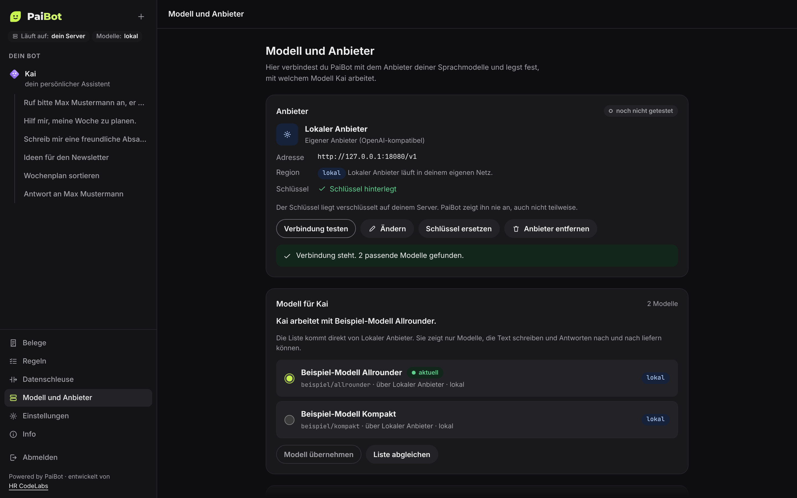
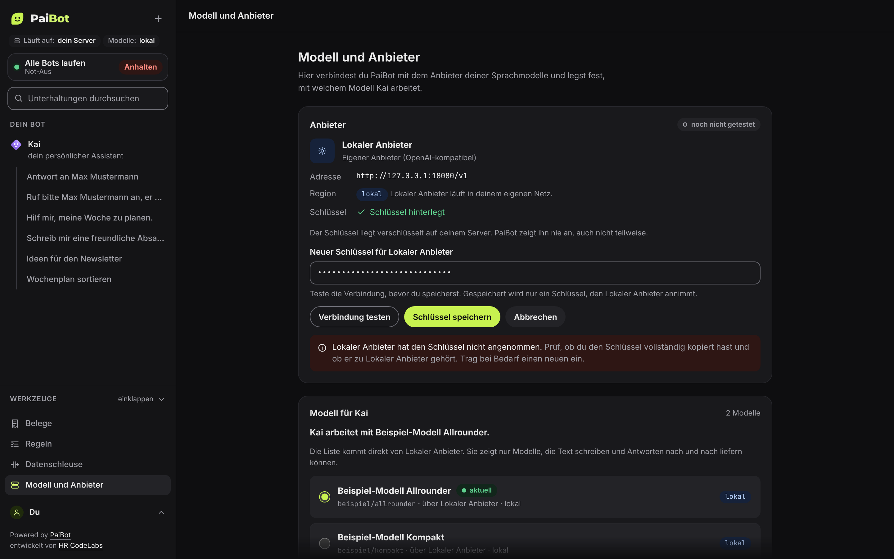
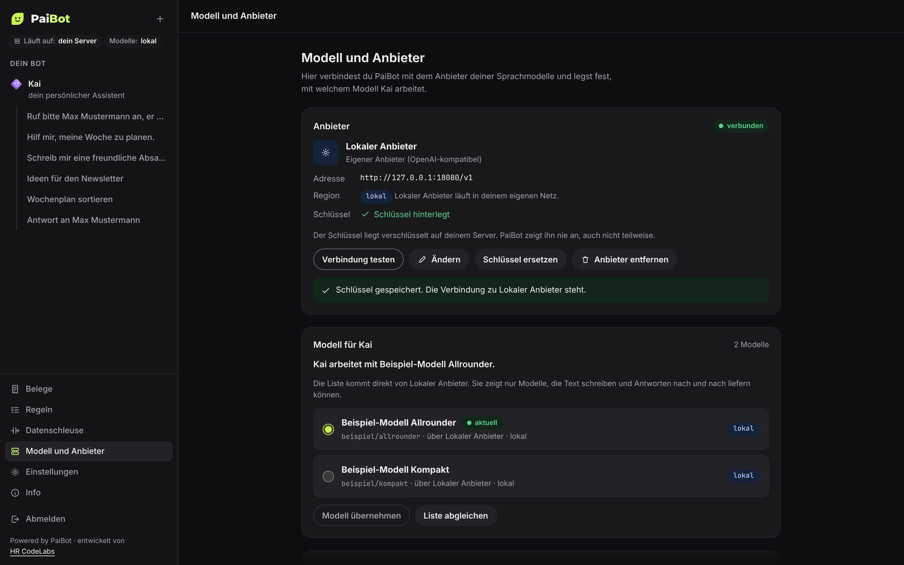
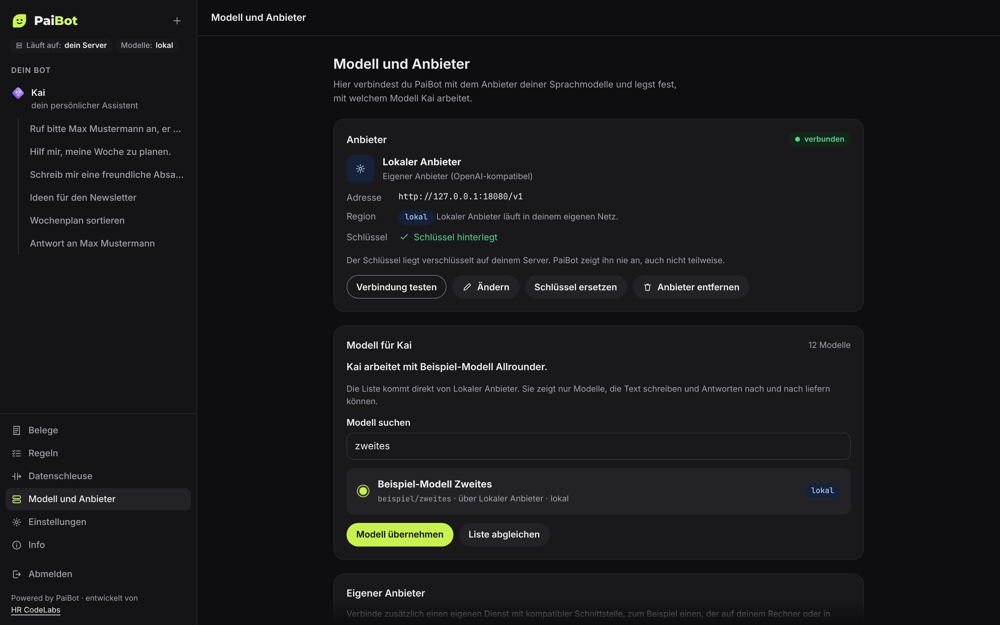
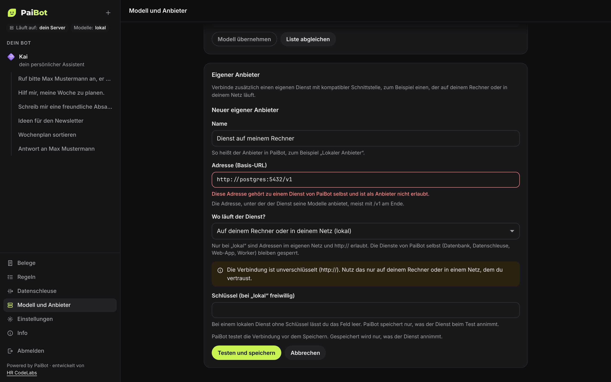
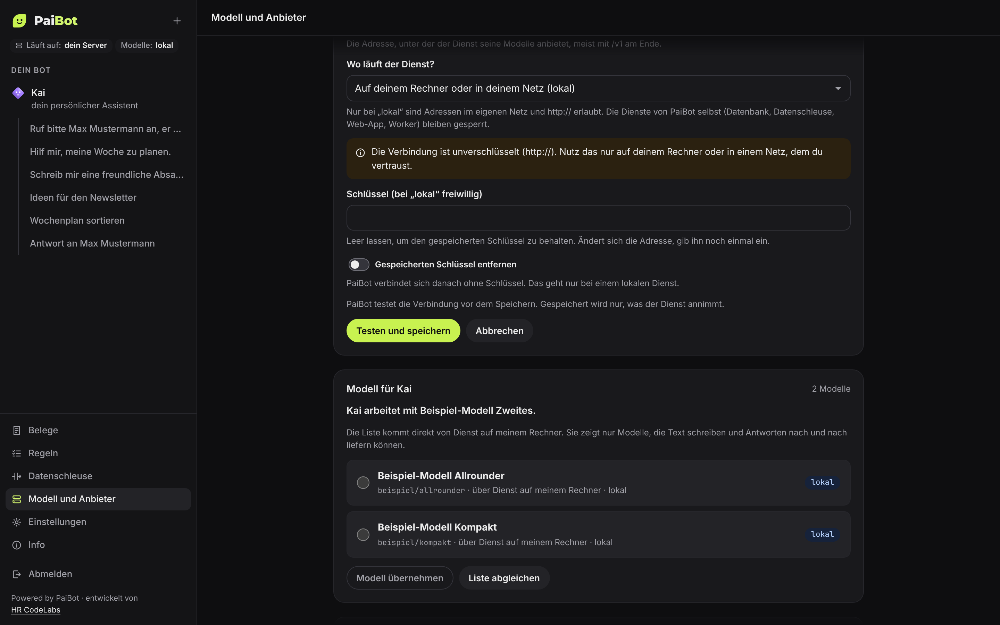
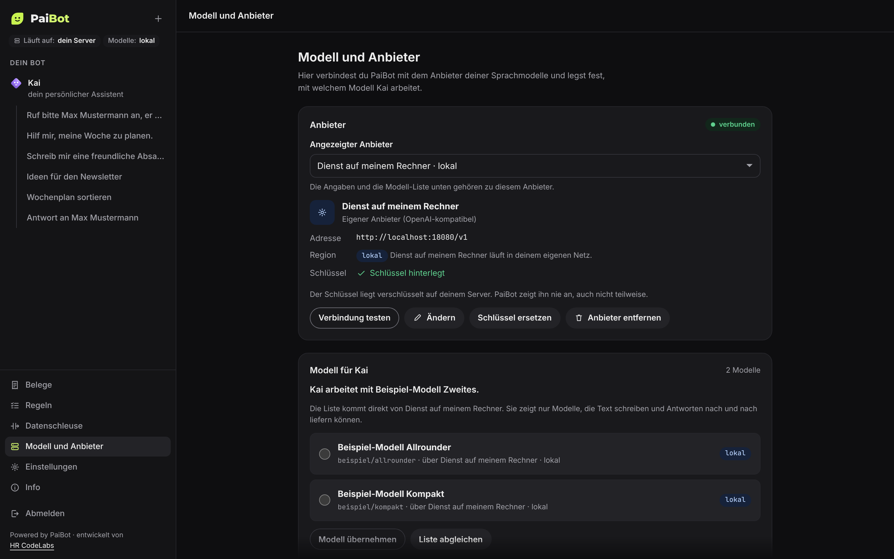
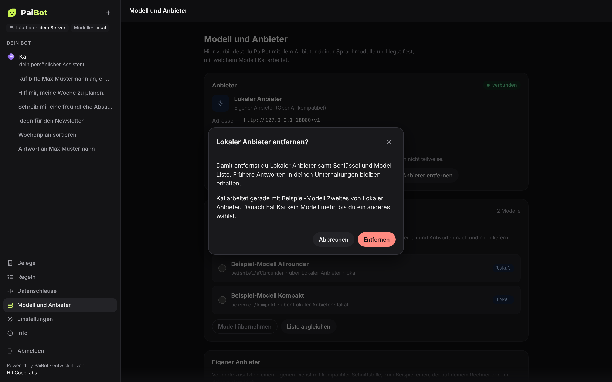
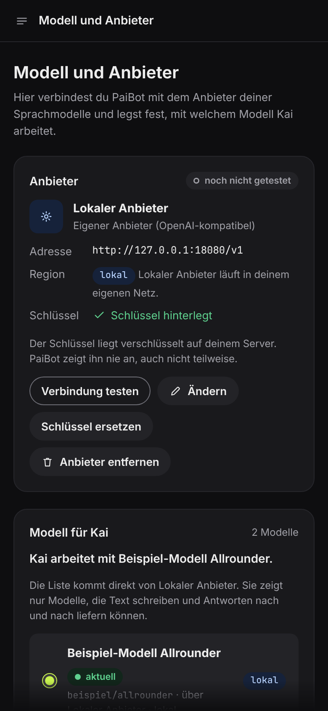

<!--
PaiBot – Anbieter und Modelle: Anbieter eintragen, Modelle abrufen, Verbindung testen.

Autor:     Oliver Hees
Website:   https://paibot.de
Copyright: 2026 Oliver Hees. Alle Urheberrechte liegen beim Autor.
Lizenz:    PaiBot Fair-Code-Lizenz 1.1 – siehe Datei LICENSE im Projektstamm
Seit:      2026-11-20
-->

# Anbieter und Modelle

**Ergebnis:** Du trägst einen Modell-Anbieter ein, testest die Verbindung, siehst die passenden Modelle und wählst eines. Zusätzlich kannst du eigene Anbieter verbinden, auch einen Dienst auf deinem Rechner oder in deinem Netz. Jede Antwort geht nur an den Anbieter des gewählten Modells, und bei eingeschalteter Datenschleuse nur an die Datenschleuse.

## Wofür

PaiBot braucht ein Sprachmodell, das die Antworten schreibt. Das Modell läuft nicht bei dir, sondern bei einem Anbieter. Hier legst du fest, bei wem, und PaiBot prüft, ob der Zugang funktioniert.

## So benutzt du es

Den Anbieter verbindest du meist schon in der Einrichtung. Danach änderst du alles auf der Seite „Modell und Anbieter“ (Navigation links bzw. im Menü am Handy).

**Schlüssel ersetzen**

1. Öffne „Modell und Anbieter“. Oben siehst du den Anbieter mit Adresse, Region (zum Beispiel „EU“) und „Schlüssel hinterlegt“. Den Schlüssel selbst zeigt PaiBot nie an, auch nicht teilweise. Dieselbe Region steht oben in der Seitenleiste als „Modelle: EU“ (bzw. „lokal“ oder „außerhalb der EU“); sie folgt dem Anbieter des gewählten Modells. Ohne gewähltes Modell steht dort „noch keins“.

   
2. Klicke „Verbindung testen“, um den gespeicherten Schlüssel zu prüfen. Das Ergebnis steht in einem Satz darunter, zum Beispiel „Verbindung steht. 12 passende Modelle gefunden.“

   
3. Klicke „Schlüssel ersetzen“ und füge den neuen Schlüssel in das Feld ein.
4. Klicke „Verbindung testen“. Nimmt der Anbieter den Schlüssel nicht an, steht dort, was du tun kannst; gespeichert ist dann nichts.

   
5. Klicke „Schlüssel speichern“. PaiBot prüft den Schlüssel beim Anbieter noch einmal und speichert ihn nur, wenn er angenommen wird. Danach lädt die Modell-Liste neu.

   

**Modell wählen**

6. Unter „Modell für …“ steht, mit welchem Modell dein Bot gerade arbeitet; dieses Modell trägt in der Liste die Marke „aktuell“.
7. Die Liste kommt direkt vom Anbieter. Bei mehr als acht Modellen erscheint ein Suchfeld; tippe einen Teil des Namens ein.

   
8. Wähle ein Modell und klicke „Modell übernehmen“. Ab der nächsten Antwort nutzt dein Bot dieses Modell.

   

**Eigenen Anbieter hinzufügen (auch auf deinem Rechner)**

9. Unten auf der Seite steht die Karte „Eigener Anbieter“. Klicke „Eigenen Anbieter hinzufügen“.
10. Gib einen Namen ein (so heißt der Anbieter in PaiBot) und die Adresse des Dienstes, meist mit `/v1` am Ende.
11. Wähle bei „Wo läuft der Dienst?“ den Ort: „Bei einem Dienst in der EU“, „Bei einem Dienst außerhalb der EU“ oder „Auf deinem Rechner oder in deinem Netz (lokal)“. Nur bei „lokal“ sind Adressen im eigenen Netz und `http://` erlaubt; bei `http://` erscheint ein Hinweis, dass die Verbindung unverschlüsselt ist. Bei „lokal“ ist der Schlüssel freiwillig, sonst Pflicht.

    
12. Klicke „Testen und speichern“. PaiBot testet die Verbindung und speichert nur, was der Dienst annimmt. Passt die Adresse nicht, steht der Grund direkt am Feld. Adressen von PaiBot selbst (Datenbank, Datenschleuse, Web-App, Worker) sind auch bei „lokal“ gesperrt.

    
13. Nach dem Speichern steht unter dem Knopf „… ist gespeichert. Die Verbindung steht.“ Oben zeigt die Karte „Anbieter“ jetzt den neuen Anbieter, darunter seine Modelle.

    
14. Sobald es mehr als einen Anbieter gibt, wählst du oben bei „Angezeigter Anbieter“, welcher Anbieter und welche Modell-Liste angezeigt werden. Ein Modell dieses Anbieters übernimmst du wie in den Schritten 6 bis 8.

    

**Eigenen Anbieter ändern**

15. Wähle den Anbieter oben aus und klicke „Ändern“. Name, Adresse und Ort sind vorbelegt; den Schlüssel zeigt PaiBot nie an.
16. Lass das Schlüssel-Feld leer, um den gespeicherten Schlüssel zu behalten, oder trag einen neuen ein. Änderst du die Adresse, gib den Schlüssel noch einmal ein. Bei „lokal“ kannst du mit „Gespeicherten Schlüssel entfernen“ ohne Schlüssel weiterarbeiten. Klicke „Testen und speichern“.

    
17. „Verbindung testen“ prüft den Anbieter, ohne etwas zu ändern. „Liste abgleichen“ holt die Modelle neu; Modelle, die der Anbieter nicht mehr meldet, sind danach nicht mehr wählbar.

    

**Anbieter entfernen**

18. Klicke „Anbieter entfernen“ (bei EUrouter heißt der Knopf „Schlüssel entfernen“) und bestätige die Rückfrage. Damit entfernst du den Anbieter samt Schlüssel und Modell-Liste. Frühere Antworten in deinen Unterhaltungen bleiben. Arbeitet dein Bot gerade mit einem Modell dieses Anbieters, sagt die Rückfrage das: Danach hat er kein Modell mehr, bis du ein anderes wählst.

    
19. Schreibt dein Bot in diesem Moment mit einem Modell dieses Anbieters, lehnt PaiBot das Entfernen ab: „… schreibt gerade mit einem Modell von …“. Warte, bis die Antwort fertig ist, oder brich sie im Chat ab.
20. Entfernst du den letzten Anbieter, kannst du gleich wieder einen Schlüssel eintragen und ein Modell wählen (Schritte 3 bis 8).

    

Beispiel für das Ergebnis eines Tests mit falschem Schlüssel:

```text
EUrouter hat den Schlüssel nicht angenommen. Prüf, ob du den Schlüssel vollständig kopiert hast,
oder erzeuge in deinem Konto bei EUrouter einen neuen.
```

Bei einem eigenen Anbieter, bei dem es kein Konto gibt (zum Beispiel auf deinem Rechner), lautet der Satz so:

```text
Prüf, ob du den Schlüssel vollständig kopiert hast und ob er zu deinem Anbieter gehört.
Trag bei Bedarf einen neuen ein.
```

## So sieht es aus

Die Bilder zu den einzelnen Schritten stehen oben in der Anleitung. Sie zeigen den Test-Anbieter der Beispiel-Umgebung („Lokaler Anbieter“ auf dem eigenen Rechner) mit erfundenen Modellen; mit EUrouter steht dort der Name EUrouter und die Region „EU“. In einigen Bildern heißt der Bot „Kai“, weil er auf der Seite „Bot“ vorher umbenannt wurde.

Nach dem Entfernen eines weiteren Anbieters zeigt die Seite wieder den verbleibenden:


Nach dem Entfernen des letzten Anbieters hat dein Bot kein Modell mehr, und du kannst gleich einen neuen Schlüssel eintragen:


Am Handy stehen die Karten untereinander:



## Einstellungen

| Einstellung    | Wo                | Bedeutung                                                                                       | Standard                               |
| -------------- | ----------------- | ----------------------------------------------------------------------------------------------- | -------------------------------------- |
| Basis-URL      | Anbieter          | Adresse eines kompatiblen Dienstes, endet meist auf `/v1`                                       | EUrouter: `https://api.eurouter.ai/v1` |
| Region         | Anbieter          | `eu`, `non_eu` oder `local` („Wo läuft der Dienst?“); bestimmt, was für die Adresse erlaubt ist | EUrouter: `eu`; eigener Anbieter: EU   |
| Schlüssel      | Anbieter          | wird verschlüsselt gespeichert; bei `local` freiwillig                                          | leer                                   |
| `SCHLEUSE_URL` | Umgebungsvariable | Adresse der Datenschleuse, z. B. `http://datenschleuse:4000/v1`                                 | nicht gesetzt = nicht installiert      |
| `SCHLEUSE_KEY` | Umgebungsvariable | Schlüssel der Datenschleuse; Pflicht, sobald `SCHLEUSE_URL` gesetzt ist                         | –                                      |

## So funktioniert es

| Schritt           | Was passiert                                                                                                                                                                                                                                                                                                                                                                                                                                                                                                                                                                                               |
| ----------------- | ---------------------------------------------------------------------------------------------------------------------------------------------------------------------------------------------------------------------------------------------------------------------------------------------------------------------------------------------------------------------------------------------------------------------------------------------------------------------------------------------------------------------------------------------------------------------------------------------------------- |
| Modell-Liste      | PaiBot ruft `GET <Basis-URL>/models` ab. Übrig bleiben Modelle, die Text zu Text können, den Chat-Endpunkt anbieten und streamen. Fehlen diese Zusatzangaben in der Liste, gilt das Modell als passend.                                                                                                                                                                                                                                                                                                                                                                                                    |
| Verbindungstest   | Derselbe Abruf, ohne kostenpflichtigen Modell-Aufruf. Das Ergebnis ist „ok“ oder einer der Fälle: Schlüssel nicht angenommen, Limit erreicht, Anbieter nicht erreichbar (auch bei Zeitüberschreitung, unbekannter Adresse oder einer Antwort, die kein JSON ist).                                                                                                                                                                                                                                                                                                                                          |
| Weg zum Modell    | Pro Nachricht gilt: Schalter der Nachricht, sonst der Unterhaltung, sonst der Standard. „Aus“ heißt direkt zum Anbieter. „An“ heißt über die Datenschleuse; ist sie nicht installiert oder nicht erreichbar, wird die Nachricht **nicht** direkt geschickt.                                                                                                                                                                                                                                                                                                                                                |
| Zugang zum Modell | Ein Lauf bekommt den Zugang nur mit einer Berechtigung des Tors. Ohne sie, oder mit einer, die nicht zu Unterhaltung, Modell und Anbieter passt, gibt es keinen Zugang.                                                                                                                                                                                                                                                                                                                                                                                                                                    |
| Ziel prüfen       | Das Tor entscheidet über ein bestimmtes Ziel: In der Berechtigung steht ein Abdruck aus Anbieter und Basis-URL. Direkt vor dem Abruf rechnet PaiBot ihn aus dem gelesenen Anbieter neu. Wurde die Adresse inzwischen geändert, gibt es keinen Zugang („Das Tor hat die Aktion abgelehnt“), und es geht nichts hinaus.                                                                                                                                                                                                                                                                                      |
| Schlüssel         | Der Schlüssel ist an den Anbieter und seine ganze Basis-URL gebunden (Schema, Host, Port und Pfad; ein `/` am Ende zählt nicht) und wird nur damit entschlüsselt. Auf dem Host des Anbieters geht er nur an Pfade unter der Basis-URL. Er steht in keinem Feld des Zugangs, sondern wird erst beim Senden in die Kopfzeile `Authorization` gesetzt. In Logs, JSON und Fehlern erscheint er nicht. Nach dem Ende des Laufs lässt sich der Zugang nicht mehr benutzen.                                                                                                                                       |
| Ausgangs-Liste    | Der Zugang trägt ein `fetch`, das nur die Adresse des gewählten Weges erreicht (Anbieter oder Datenschleuse). Jedes andere Ziel wird abgelehnt, bevor eine Verbindung entsteht, und gemeldet. Das gilt auch für Weiterleitungen. Verbunden wird genau mit den Adressen, die vorher geprüft wurden; der Name wird für die Verbindung nicht ein zweites Mal aufgelöst. Proxy-Einstellungen der Umgebung (`HTTP_PROXY`, `HTTPS_PROXY`, `NODE_USE_ENV_PROXY`) gelten für diese Verbindungen nicht.                                                                                                             |
| Größe der Antwort | PaiBot bricht Antworten ab, die zu groß werden, und schließt die Verbindung sofort: eine Antwort im Gespräch bei 64 MiB, die Modell-Liste bei 5 MB, die Prüfung der Datenschleuse bei 64 KiB. Gepackte Antworten dürfen beim Entpacken höchstens 500-mal größer werden als empfangen (ab 1 MiB), eine einzelne Zeile im Strom höchstens 1 MiB lang sein, die Kopfzeilen zusammen höchstens 16 KiB. Von einer Fehlerantwort liest PaiBot nur die ersten 64 KiB. Der Lauf endet dann mit „Ein Limit ist erreicht“, ohne neuen Versuch. Dazu kommen die Zeitgrenzen: ohne Datenfluss und für die ganze Runde. |
| Kopfzeilen        | `Host` und den Namen für die Prüfung des Zertifikats bildet PaiBot nur aus der geprüften Adresse. Mitgegebene `Host`-, `X-Forwarded-…`-, `Forwarded`- und Proxy-Kopfzeilen werden verworfen.                                                                                                                                                                                                                                                                                                                                                                                                               |
| Basis-URL-Prüfung | Siehe unten. Sie läuft beim Eintragen und noch einmal bei jeder Nutzung.                                                                                                                                                                                                                                                                                                                                                                                                                                                                                                                                   |
| Fehler            | Jeder Fehler wird auf einen festen Code abgebildet (`schluessel_ungueltig`, `limit_erreicht`, `anbieter_nicht_erreichbar`, `schleuse_blockiert`, `unterbrochen`, `intern`) mit Text und Ausweg aus dem Textkatalog. Schlüssel kommen in keinem Fehler und keinem Log vor.                                                                                                                                                                                                                                                                                                                                  |

**Welche Adressen erlaubt sind**

| Adresse                                                                                   | Region `eu` / `non_eu` | Region `local`                             |
| ----------------------------------------------------------------------------------------- | ---------------------- | ------------------------------------------ |
| `https://` mit öffentlichem Namen oder öffentlicher IP                                    | erlaubt                | erlaubt                                    |
| Ports außer 443 und 8443                                                                  | abgelehnt              | erlaubt                                    |
| `http://`                                                                                 | abgelehnt              | erlaubt, mit Warnhinweis „unverschlüsselt“ |
| `localhost`, Loopback, private Netze, Namen ohne Punkt, `.local`, `.internal`             | abgelehnt              | erlaubt, mit Warnhinweis                   |
| Namen der PaiBot-Dienste (`postgres`, `datenschleuse`, `web`, `worker`)                   | abgelehnt              | abgelehnt                                  |
| Adressen, auf die diese Namen gerade zeigen (z. B. die Datenbank im Compose-Netz)         | abgelehnt              | abgelehnt                                  |
| Link-Local (`169.254.…`, `fe80::`) und Adressen von Metadaten-Diensten der Cloud-Anbieter | abgelehnt              | abgelehnt                                  |
| Zugangsdaten in der Adresse (`nutzer:passwort@…`)                                         | abgelehnt              | abgelehnt                                  |
| Abfrage oder Anker in der Adresse (`?…`, `#…`, auch leer)                                 | abgelehnt              | abgelehnt                                  |

Ungewöhnliche Schreibweisen von IP-Adressen (dezimal, hexadezimal, oktal, gekürzt, IPv6 mit eingebetteter IPv4-Adresse) werden vor der Prüfung vereinheitlicht und dann genauso behandelt. Bei Namen schaut PaiBot bei jedem Aufruf nach, auf welche Adressen sie zeigen; zeigt eine davon auf ein nicht erlaubtes Ziel, wird der Aufruf abgelehnt. Als nicht öffentlich gelten auch Bereiche für besondere Zwecke wie `192.88.99.0/24`, `2001::/23`, `3fff::/20` und alles außerhalb von `2000::/3`.

## Grenzen

- Die Adressen eines Namens werden bei jedem Aufruf neu geprüft. Zeigt der Name bei einem späteren Aufruf auf ein gesperrtes Ziel, wird dieser Aufruf abgelehnt; eine bestehende Prüfung kann ein umgestellter DNS-Eintrag nicht mehr unterlaufen.
- Die Sperre der eigenen Dienste bei Region `local` kennt deren Adressen nur über ihre Namen (`postgres`, `datenschleuse`, `web`, `worker`). Andere Adressen im eigenen Netz, etwa der Rechner selbst, bleiben für einen lokalen Anbieter erreichbar; das ist gewollt (zum Beispiel ein Dienst auf dem eigenen Rechner).
- Ändert sich die Basis-URL (auch nur der Pfad, z. B. ein anderes Konto bei einem Gateway), passt der gespeicherte Schlüssel nicht mehr. Beim Ändern der Adresse gibst du den Schlüssel deshalb noch einmal ein. Einen stillen Rückgriff auf die alte Adresse gibt es nicht.
- Die Grenzen für die Größe gelten je Antwort. Ein Strom mit sehr vielen gleichen Stücken kann beim Entpacken die Verhältnis-Grenze erreichen, obwohl er harmlos ist; dann bricht PaiBot ihn ebenfalls ab.
- Ein lokaler Anbieter (Region `local`, zum Beispiel ein Dienst auf deinem Rechner) darf ohne Schlüssel arbeiten. Für Anbieter in den Regionen `eu` und `non_eu` ist ein Schlüssel Pflicht; fehlt er, meldet PaiBot „Der Anbieter hat den Schlüssel nicht angenommen“, ohne etwas zu senden.
- Der Verbindungstest ruft nur die Modell-Liste ab. Liefert ein Anbieter die Liste auch ohne Schlüssel (EUrouter tut das), erkennt der Test einen falschen Schlüssel nicht; er zeigt sich erst bei der ersten Antwort.
- Der Gesundheitsabruf der Datenschleuse prüft nur, dass sie antwortet (`GET /models` mit ihrem Schlüssel). Ob ihre Erkennung läuft, sagt er nicht; ist sie ausgefallen, blockiert die Datenschleuse die Anfrage selbst (`schleuse_blockiert`).
- Wie die Datenschleuse einen Block als HTTP-Antwort meldet, ist noch nicht gegen den laufenden Dienst geprüft; erkannt wird die Kennung `DatenschleuseBlocked` in den üblichen Feldern.
- Der Datenschleuse-Dienst selbst ist nicht Teil dieser Funktion; hier gibt es nur die Anbindung.
- Nur Anbieter mit kompatibler Schnittstelle (wie bei der Vorlage EUrouter). Bilder, Embeddings und andere Modellarten werden herausgefiltert.
- Die Vorlage eines Anbieters bleibt beim Ändern: Aus EUrouter wird kein eigener Anbieter und umgekehrt. Für einen anderen Dienst legst du einen eigenen Anbieter an.
- Jede Adresse gibt es nur einmal (ein `/` am Ende zählt nicht).
- Ob der Bot gerade schreibt, prüft PaiBot unmittelbar vor dem Entfernen. Eine Antwort, die genau in diesem Augenblick beginnt, endet mit „Für deinen Bot ist kein Modell gewählt.“; schick die Nachricht dann nach der Wahl eines Modells noch einmal.

## Fehlerbehebung

| Beobachtung                                                                       | Ursache                                                                                                    | Was tun                                                                                          |
| --------------------------------------------------------------------------------- | ---------------------------------------------------------------------------------------------------------- | ------------------------------------------------------------------------------------------------ |
| „Der Anbieter des Modells ist nicht erreichbar“ beim Eintragen                    | Adresse falsch, Anbieter down, Antwort ohne JSON oder Adresse nicht erlaubt (z. B. `http` bei Region `eu`) | Adresse und Region prüfen; bei einem lokalen Anbieter Region `lokal` wählen                      |
| „Der Anbieter hat den Schlüssel nicht angenommen“                                 | Schlüssel falsch, abgelaufen oder mit Leer- oder Sonderzeichen                                             | Schlüssel neu eintragen; ein Schlüssel darf nur aus sichtbaren Zeichen ohne Leerzeichen bestehen |
| „Der Anbieter hat den Schlüssel nicht angenommen“ nach einer Änderung der Adresse | Der Schlüssel ist an die bisherige Adresse gebunden (Host, Port und Pfad)                                  | Schlüssel neu eintragen                                                                          |
| „Ein Limit ist erreicht“ mitten in einer Antwort                                  | Die Antwort des Anbieters wurde zu groß (siehe „Größe der Antwort“)                                        | Nachricht kürzer fassen oder ein anderes Modell wählen; prüfen, ob der Anbieter richtig arbeitet |
| „Der Anbieter hat den Schlüssel nicht angenommen“ nach einem Update               | Der Schlüssel stammt aus einer älteren Version (Format `v1`, ohne Bindung)                                 | Schlüssel neu eintragen                                                                          |
| „Das Tor hat die Aktion abgelehnt“ bei einer Antwort                              | Die Adresse des Anbieters hat sich zwischen Entscheidung und Abruf geändert                                | Adresse prüfen; wenn sie stimmt, die Nachricht noch einmal schicken                              |
| „Der Anbieter des Modells ist nicht erreichbar“ mit einem Port wie `:5432`        | Außerhalb der Region `lokal` sind nur die Ports 443 und 8443 erlaubt                                       | Adresse ohne Port oder mit 443 eintragen                                                         |
| „Ein Limit ist erreicht“                                                          | Anbieter meldet 429 oder fehlendes Guthaben (402)                                                          | kurz warten, Guthaben und Tagesbudget prüfen                                                     |
| „Private Adressen und interne Namen sind nur bei Region „lokal“ erlaubt.“         | Der Dienst läuft im eigenen Netz, als Ort ist aber EU oder außerhalb der EU gewählt                        | Bei „Wo läuft der Dienst?“ „Auf deinem Rechner oder in deinem Netz (lokal)“ wählen               |
| „Für diese Adresse gibt es schon einen Anbieter.“                                 | Die Adresse ist schon eingetragen                                                                          | Den vorhandenen Anbieter oben auswählen und „Ändern“                                             |
| „… schreibt gerade mit einem Modell von …“ beim Entfernen                         | Eine Antwort mit einem Modell dieses Anbieters läuft noch                                                  | Warten oder die Antwort im Chat abbrechen, dann noch einmal entfernen                            |
| „Ohne Schlüssel geht es nur bei einem lokalen Dienst.“                            | Schlüssel entfernt oder leer gelassen bei Ort EU oder außerhalb der EU                                     | „lokal“ wählen oder einen Schlüssel eintragen                                                    |
| Modell-Liste ist leer                                                             | Der Anbieter bietet kein Text-zu-Text-Modell mit Chat und Streaming an                                     | anderen Anbieter oder anderes Konto prüfen                                                       |
| „Die Datenschleuse ist nicht installiert“                                         | `SCHLEUSE_URL` fehlt                                                                                       | Datenschleuse installieren oder den Schalter auf „Aus“ lassen                                    |
| `SCHLEUSE_URL ist keine gültige URL` / `SCHLEUSE_KEY fehlt` beim Start            | Umgebung unvollständig                                                                                     | beide Variablen setzen; die URL ohne Zugangsdaten                                                |
