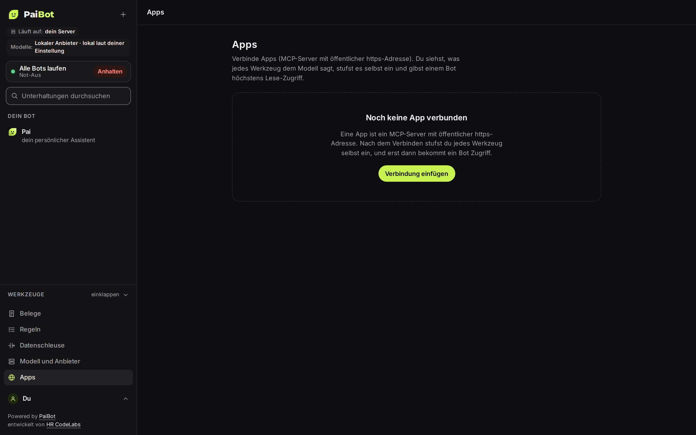
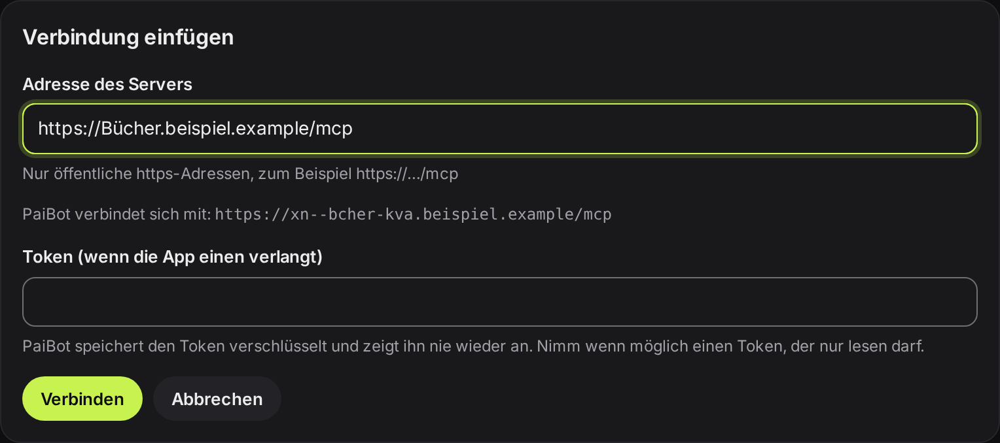
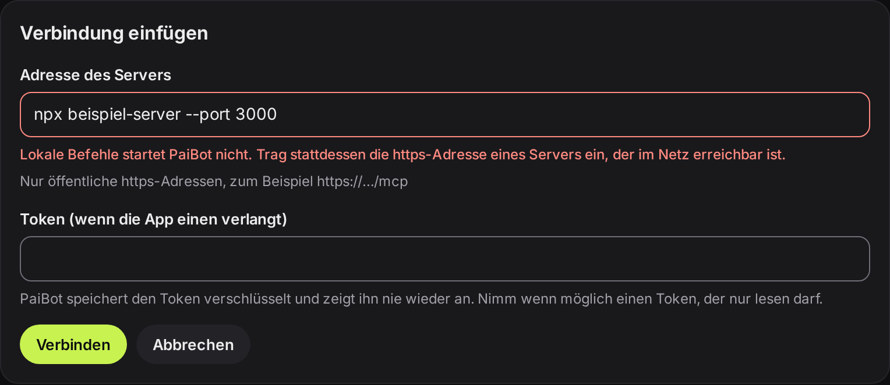
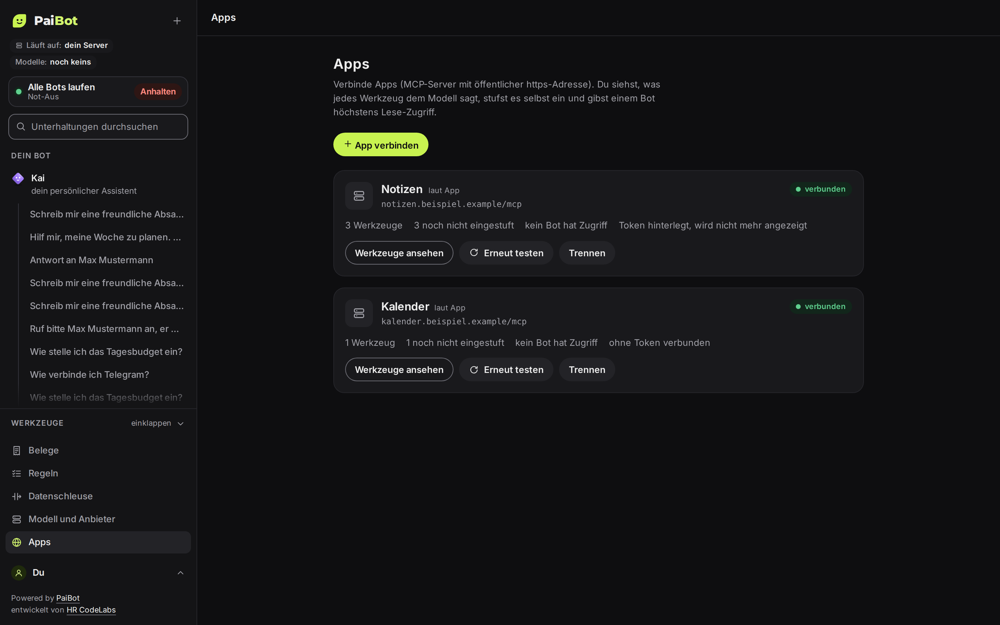
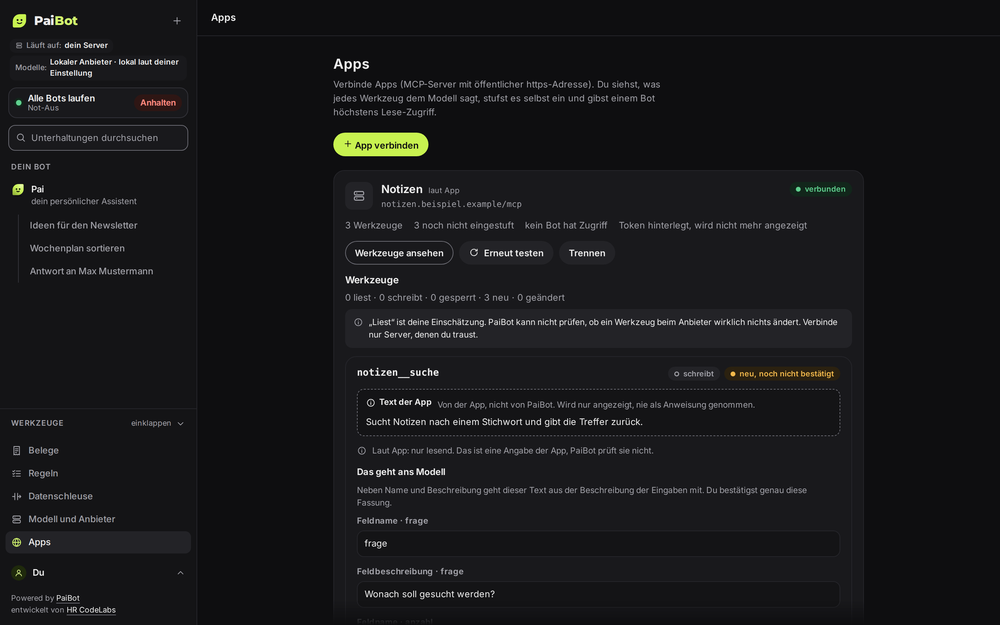
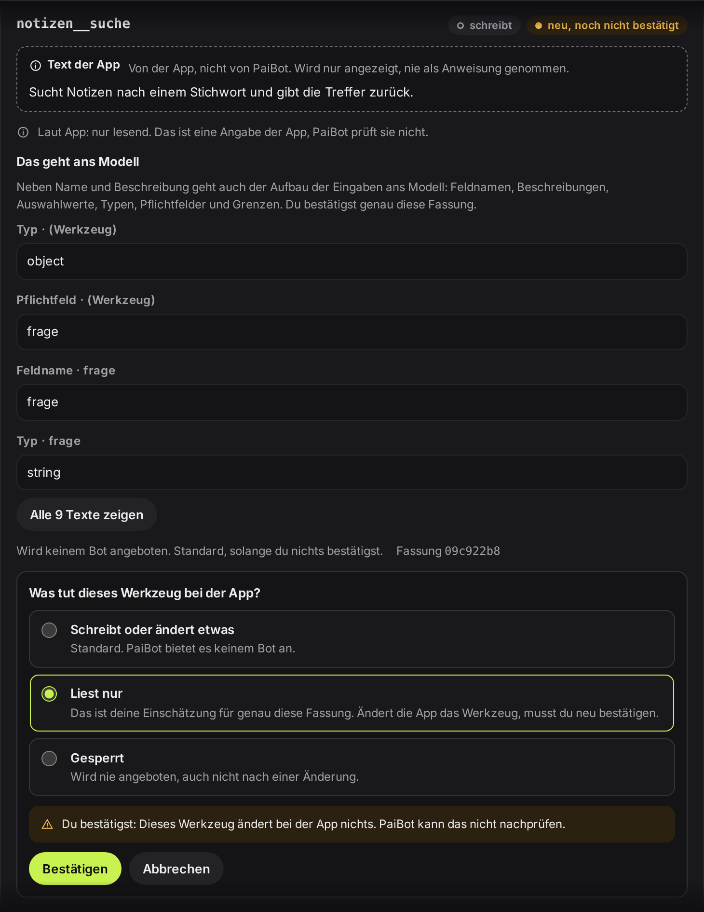
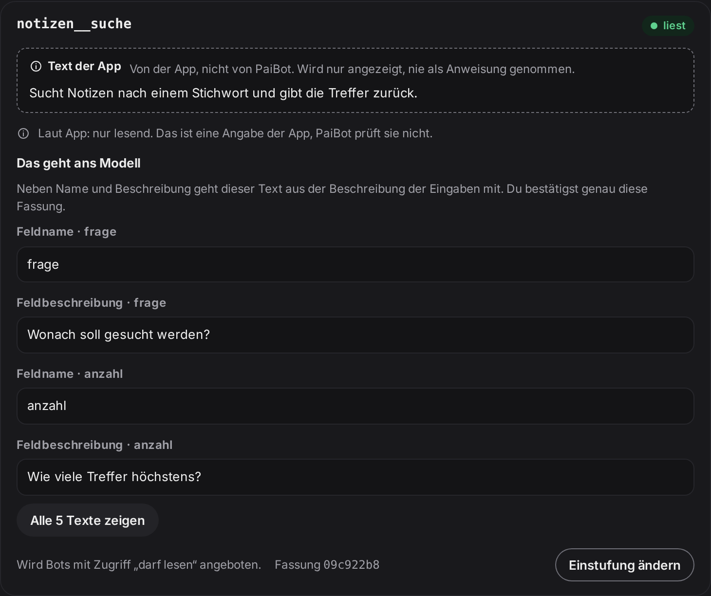
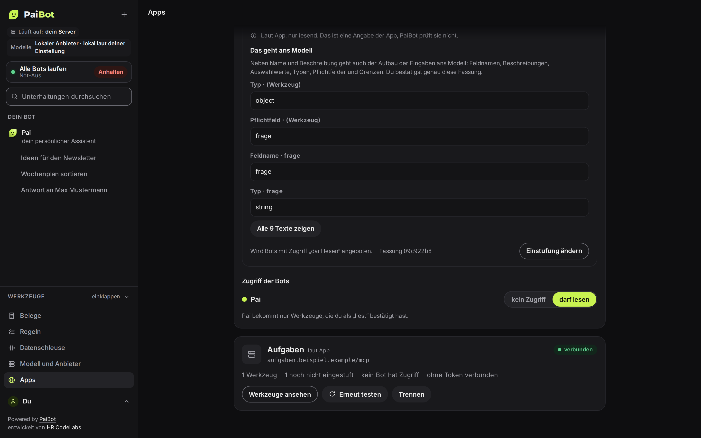
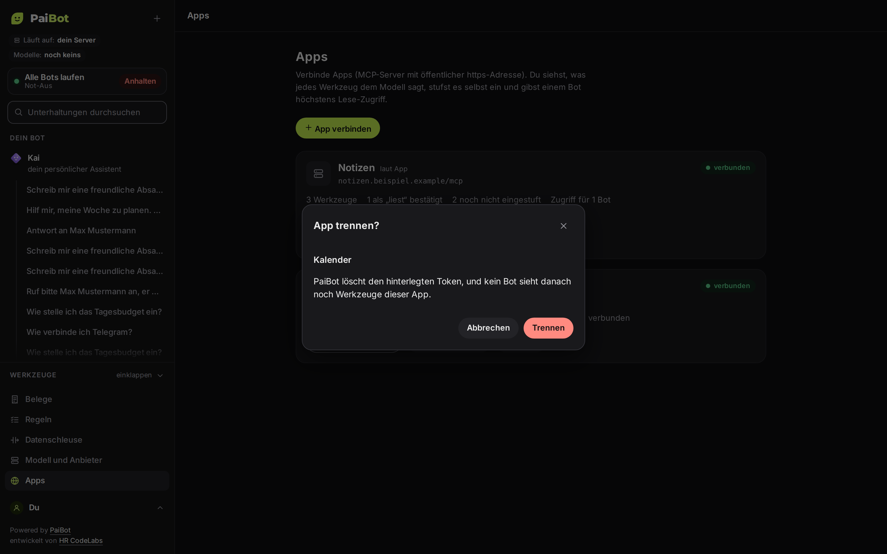
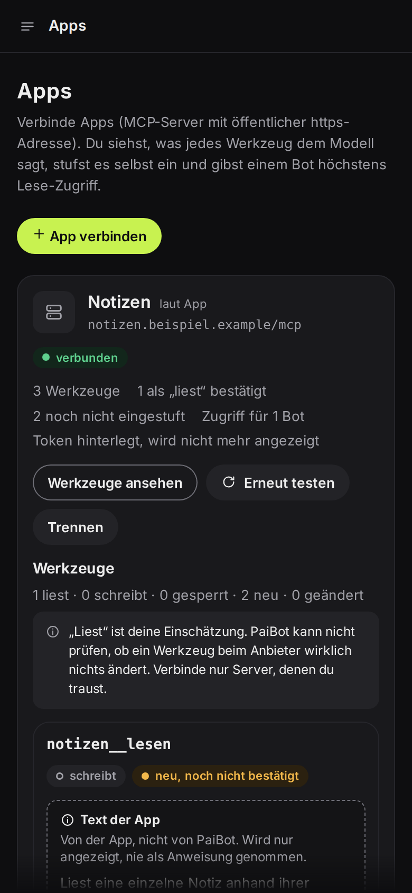

<!--
PaiBot – Doku: Apps verbinden, ihre Werkzeuge prüfen und einstufen, Zugriff je Bot setzen.

Autor:     Oliver Hees
Website:   https://paibot.de
Copyright: 2026 Oliver Hees. Alle Urheberrechte liegen beim Autor.
Lizenz:    PaiBot Fair-Code-Lizenz 1.1 – siehe Datei LICENSE im Projektstamm
Seit:      2026-11-22
-->

# Apps

**Ergebnis:** Du verbindest eine App (einen MCP-Server mit öffentlicher https-Adresse), siehst, was jedes ihrer Werkzeuge dem Modell sagt, stufst es selbst ein und gibst deinem Bot höchstens Lese-Zugriff. Was du freigibst, entscheidest allein du.

## Wofür

Du willst, dass dein Bot im Chat etwas nachschlagen kann, das in einer anderen Anwendung liegt, zum Beispiel in deinen Notizen. Dafür verbindest du die App, prüfst ihre Werkzeuge und erlaubst dem Bot genau die, die nur lesen.

## So benutzt du es

1. Öffne in der Seitenleiste unter „Werkzeuge“ die Seite **Apps** (Adresse `/apps`). Solange keine App verbunden ist, steht dort der Weg zum Verbinden.

   
2. Klick auf **Verbindung einfügen** (später **App verbinden**) und trag die **Adresse des Servers** ein. Erlaubt sind nur öffentliche https-Adressen auf dem Port 443, ohne Benutzer-Teil, ohne Abfrage-Teil (`?…`) und ohne Anker (`#…`). Unter dem Feld steht, mit welcher Adresse sich PaiBot verbindet; Namen mit Umlauten erscheinen dort in der Form mit `xn--`.

   
3. Verlangt die App einen persönlichen Token, trag ihn im Feld **Token** ein. Er wird verschlüsselt gespeichert, danach nie wieder angezeigt und steht in keiner Meldung. Schreib ihn nicht in die Adresse.
4. Fügst du statt einer Adresse einen Befehl ein (zum Beispiel `npx …`), sagt PaiBot „Lokale Befehle startet PaiBot nicht“ und startet nichts. Starte den Server selbst und trag seine Adresse ein.

   
5. Klick auf **Verbinden**. PaiBot prüft die Adresse, holt die Liste der Werkzeuge der App (nur die Liste, es wird nichts aufgerufen) und speichert sie. Danach steht oben, wie viele Werkzeuge gefunden wurden. Werkzeuge, die PaiBot nicht prüfen kann, nennt die Meldung mit Namen; sie werden nicht angezeigt und keinem Bot angeboten.

   
6. Klick bei einer App auf **Werkzeuge ansehen**. Du siehst jedes Werkzeug mit dem Text, der ans Modell gehen würde, und darunter den **Zugriff der Bots**. Ein neues Werkzeug gilt als „schreibt“, bis du es einstufst. Die Angabe „laut App: nur lesend“ ist nur eine Auskunft der App und ändert nichts.

   
7. Klick bei einem Werkzeug auf **Einstufen**. Dort steht der volle Text, den das Modell sähe (Beschreibung, Feldnamen, Beschreibungen der Felder, Auswahlwerte, Vorgaben, Beispiele). Wähle **Liest nur**, **Schreibt** oder **Gesperrt** und klick auf **Bestätigen**. Mit „Liest nur“ sagst du, dass das Werkzeug nichts verändert; das entscheidest du, nicht die App.

   
8. Nach dem Bestätigen gilt die Einstufung für genau die Fassung, die du gesehen hast. Ein als „liest“ eingestuftes Werkzeug wird angeboten; alle anderen nicht.

   
9. Unter **Zugriff der Bots** stellst du je Bot **kein Zugriff** oder **darf lesen** ein. Mit „darf lesen“ bekommt der Bot nur die Werkzeuge, die du als „liest“ bestätigt hast. Schreib-Zugriff gibt es nicht.

   
10. **Erneut testen** holt die Liste noch einmal und gleicht sie mit dem ab, was du bestätigt hast. Hat die App ein Werkzeug geändert, steht es danach als „geändert“ da und wird nicht mehr angeboten, bis du es neu bestätigst.
11. **Trennen** fragt vorher nach. PaiBot löscht den hinterlegten Token, und kein Bot sieht danach noch Werkzeuge dieser App. Die App steht danach unter „Getrennte Apps“.

    

## So sieht es aus

Die Bilder zu den einzelnen Schritten stehen oben in der Anleitung (Beispiel-Daten, erfundene Apps „Notizen“ und „Kalender“, nichts davon ist ein echter Server). Am Handy steht alles untereinander:

## Einstellungen

| Einstellung                | Wo                             | Bedeutung                                                                          | Standard                            |
| -------------------------- | ------------------------------ | ---------------------------------------------------------------------------------- | ----------------------------------- |
| Einstufung eines Werkzeugs | Seite Apps, „Einstufen“        | „Liest nur“, „Schreibt“ oder „Gesperrt“; gilt für die Fassung, die du gesehen hast | „Schreibt“, bis du etwas bestätigst |
| Zugriff je Bot             | Seite Apps, „Zugriff der Bots“ | „kein Zugriff“ oder „darf lesen“                                                   | „kein Zugriff“                      |

## So funktioniert es

- Alles, was du auf der Seite änderst, geht durch das Tor und bekommt Belege (Entscheidung und Ergebnis), zu sehen unter „Belege“. Die Adresse prüft das Tor vor jeder Verbindung. Lehnt es sie ab, steht in der Meldung der Grund (nur https, nur öffentliche Adressen, nur Port 443, kein Benutzer-, Abfrage- oder Anker-Teil), und es wird nichts verbunden.
- Ob der Bot ein Werkzeug im Chat benutzt, entscheiden die Regeln und Grenzen des Tors bei jedem Aufruf neu (siehe [Das Tor](funktion-tor.md), „Pai liest in Apps“, und [Chat](funktion-chat.md), „Pai liest in Apps“). Die Seite „Apps“ legt nur fest, was du erlaubst.
- Texte aus einer App (Namen, Beschreibungen, Felder) zeigt die Seite nur als Text: kein Markup, keine Bilder, keine Links; eine Bild-Adresse aus einer App lädt der Browser nie.
- Der **Not-Aus** hält nur die Aufrufe an: Solange er an ist, ruft PaiBot keine App auf. Zugriff und Einstufung lassen sich auch dann weiter ändern.

## Grenzen

- **Neu verbinden:** Eine getrennte App lässt sich nicht wieder verbinden; du trägst sie noch einmal ein, und sie bekommt dabei einen neuen Kurznamen. Die Einstufungen der früheren Verbindung gelten dann nicht.
- **Nur lesen:** PaiBot liest Werkzeuge und bietet nur solche an, die du als „liest“ bestätigt hast. Schreibende Werkzeuge gibt es nicht.
- **Ob ein Werkzeug wirklich nur liest, weiß PaiBot nicht.** Du entscheidest das beim Einstufen; die Angabe der App („nur lesend“) zählt nicht. Das Verhalten eines Servers kann sich ändern, ohne dass sich die Beschreibung ändert; PaiBot merkt eine geänderte Beschreibung, aber nicht, was das Werkzeug dahinter tut.
- **Nicht jedes Werkzeug lässt sich prüfen:** Hat ein Werkzeug ein Eingabe-Schema, das PaiBot nicht prüfen kann, wird es nicht gespeichert und nie angeboten.
- **Grenzen beim Lesen der Liste:** PaiBot liest höchstens 200 Werkzeuge je Abruf; hat die App mehr, steht das in der Meldung und die übrigen fehlen.
- **Was „geändert“ im Einzelnen war,** zeigt die Seite noch nicht: Sie sagt nur, dass sich die Fassung geändert hat.
- **Nicht gegen echte Server geprüft:** Verbinden, Einstufen und Zugriff sind gegen einen Test-Server geprüft, nicht gegen echte MCP-Server (zum Beispiel Notion, Linear oder ein Kalender). Ob echte Server nach diesen Regeln bestätigbar sind, ist offen.
- **Im Chat:** Die Zeile eines Werkzeug-Aufrufs im Chat nennt die App noch nicht. Hat sich eine Antwort auf Inhalte aus einer App gestützt, sind Links darin nicht anklickbar: Das ganze Ziel steht als Text daneben, auch der Abfrage-Teil. Wer es öffnen will, kopiert es. Das Kennzeichen kommt für eine frisch fertige Antwort erst, wenn die Seite den Lauf noch einmal gelesen hat (kurz nach dem Ende); lädst du die Seite neu, steht es sofort da.

## Fehlerbehebung

| Beobachtung                                     | Ursache                                                                            | Was tun                                                         |
| ----------------------------------------------- | ---------------------------------------------------------------------------------- | --------------------------------------------------------------- |
| „Nur der Port 443 ist erlaubt“                  | Die Adresse nennt einen anderen Port                                               | Lass die Port-Angabe weg                                        |
| „Nur öffentliche Adressen sind erlaubt“         | Die Adresse ist eine IP-Adresse oder ein interner Name                             | Nimm den öffentlichen Namen des Servers                         |
| „Lokale Befehle startet PaiBot nicht“           | Du hast einen Befehl statt einer Adresse eingefügt                                 | Starte den Server selbst und trag seine https-Adresse ein       |
| „Zugang ungültig“                               | Der Token fehlt, ist falsch oder abgelaufen                                        | Trag einen gültigen Token ein                                   |
| „Die App ist nicht erreichbar“                  | Der Server antwortet nicht oder zu langsam                                         | Prüfe die Adresse und versuche es später noch einmal            |
| „Die App wird gerade abgeglichen oder geändert“ | Ein anderer Vorgang hält die App kurz fest                                         | Warte einen Moment und versuche es noch einmal                  |
| Ein Werkzeug fehlt in der Liste                 | PaiBot kann sein Eingabe-Schema nicht prüfen (steht in der Meldung beim Verbinden) | Es wird nicht angeboten; frag den Betreiber der App             |
| Ein Werkzeug steht auf „geändert“               | Die App hat es seit deiner Bestätigung geändert                                    | Sieh dir den neuen Text an und bestätige neu, wenn du es willst |
| Die Seite lädt nicht                            | PaiBot kommt nicht an die Liste der Apps                                           | Lade die Seite neu; hilft das nicht, schau in den Selbsttest    |
