<!--
PaiBot – Doku-Seite: Belege und das Tor.

Autor:     Oliver Hees
Website:   https://paibot.de
Copyright: 2026 Oliver Hees. Alle Urheberrechte liegen beim Autor.
Lizenz:    PaiBot Fair-Code-Lizenz 1.1 – siehe Datei LICENSE im Projektstamm
Seit:      2026-11-20
-->

# Belege

**Ergebnis:** Zu jeder Aktion in PaiBot gibt es einen Beleg. Du kannst jederzeit nachprüfen, dass kein Beleg nachträglich verändert, gelöscht oder eingeschoben wurde – in PaiBot selbst oder mit einem Export ganz ohne PaiBot. Mit einem Anker, den du außerhalb aufbewahrst, fällt auch auf, wenn Belege bis zum Stand des Ankers fehlen; was danach kam, schützt erst ein neuerer Anker.

## Wofür

PaiBot handelt für dich: Er schickt Anfragen an ein Modell, ändert Einstellungen, legt Unterhaltungen an. Belege halten fest, was passiert ist, wer es ausgelöst hat und nach welcher Regel es erlaubt war. So musst du PaiBot nicht einfach glauben, sondern kannst es prüfen.

## So benutzt du es

Belege entstehen von selbst, du musst nichts einschalten.

### In PaiBot ansehen und prüfen

1. Klick in der Navigation auf **Belege**. Du siehst alle Belege, der neueste steht oben. Jede Zeile nennt Zeit, Kennung (zum Beispiel `B-0042`), wer die Aktion ausgelöst hat („Du“, dein Bot oder PaiBot selbst), was passiert ist, die Art (Start, Entscheidung, Ergebnis, Schlüsselwechsel) und das Ergebnis (erlaubt, abgelehnt, fragt, fertig, fehlgeschlagen, abgebrochen).

   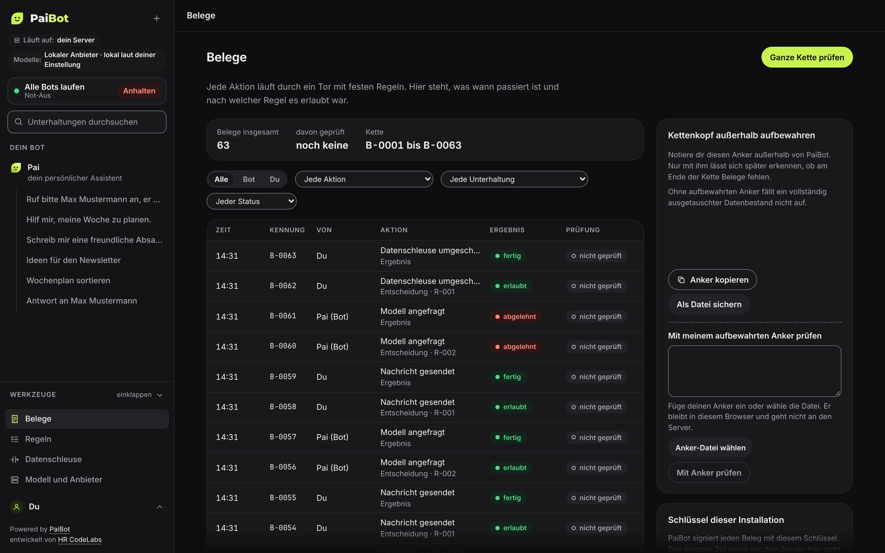
2. Ältere Belege holst du unten mit **Ältere Belege laden**. Mit den Auswahlfeldern **Aktion** (zum Beispiel „Nachricht gesendet“) und **Unterhaltung** fragt PaiBot nur die passenden Belege ab, auch beim Nachladen. Diese Auswahl steht in der Adresse (zum Beispiel `/belege?aktion=nachricht.senden`), du kannst sie also als Lesezeichen speichern. Mit den Knöpfen **Alle · Bot · Du** und der Auswahl **Jeder Status** grenzt du die schon geladenen Belege weiter ein.

   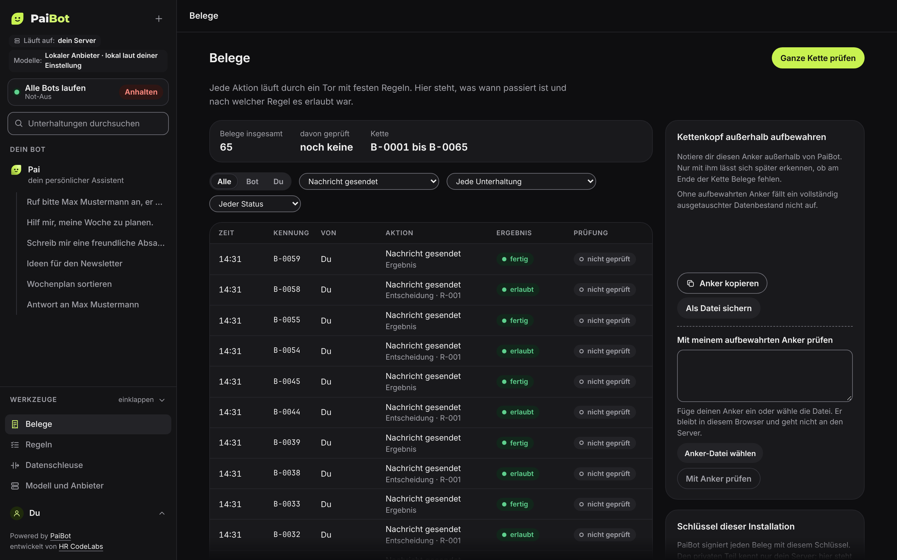
3. Klick auf **Ganze Kette prüfen**. Dein Browser lädt alle Belege in Stücken (der Balken zeigt, wie weit er ist) und prüft sie selbst. Danach steht oben das Ergebnis in Worten, zum Beispiel „Vertrauenswürdig: 142 Belege geprüft, alle Schlüssel aus der Kette.“ oder „Ungültig an Stelle B-0042: Inhalt geändert“. In der Liste steht bei jedem Beleg „geprüft“, „Fehler hier“, „nicht bestätigt“ oder „nicht beglaubigt“.

   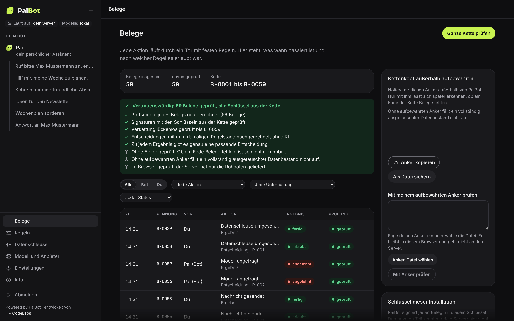
4. Klick auf eine Zeile. Der Beleg erscheint als Karte: was, wer, wann, die Entscheidung mit der angewandten Regel samt Fassung, Vorbedingungen und Grenzen in Worten (erfüllt, eingehalten, verletzt), beim Ergebnis Status und Token. Verweise führen zum zugehörigen Entscheidungs- bzw. Ergebnis-Beleg, zum vorigen und nächsten Beleg und zur Unterhaltung.

   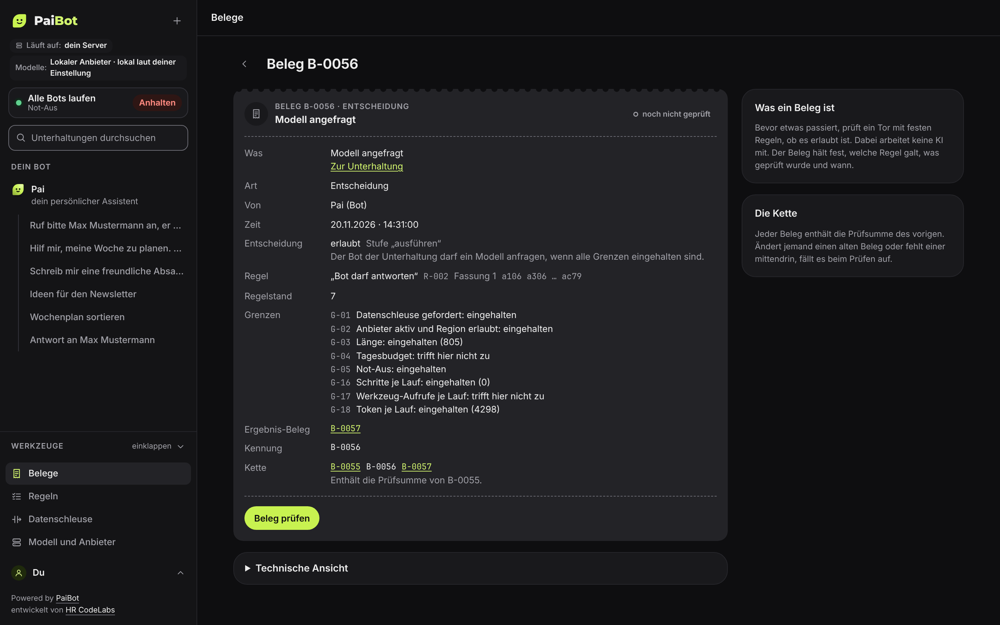
5. Klick auf der Karte auf **Beleg prüfen**. Geprüft werden Prüfsumme, Signatur mit dem Schlüssel aus der Kette, die Verbindung zum vorigen und zum nächsten Beleg und bei Entscheidungen das Nachrechnen mit dem damaligen Regelstand. Steht alles, heißt es „Beleg stimmt“.

   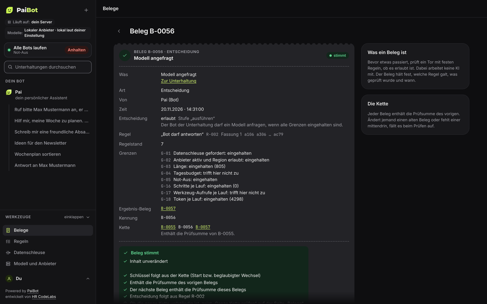
6. Unter der Karte klappst du **Technische Ansicht** auf: kanonisches JSON, Prüfsumme, Signatur, Schlüssel-Kennung und Prüfsumme des Vorgängers. **Beleg kopieren** legt den Beleg als eine Zeile im Format des Exports in die Zwischenablage.

   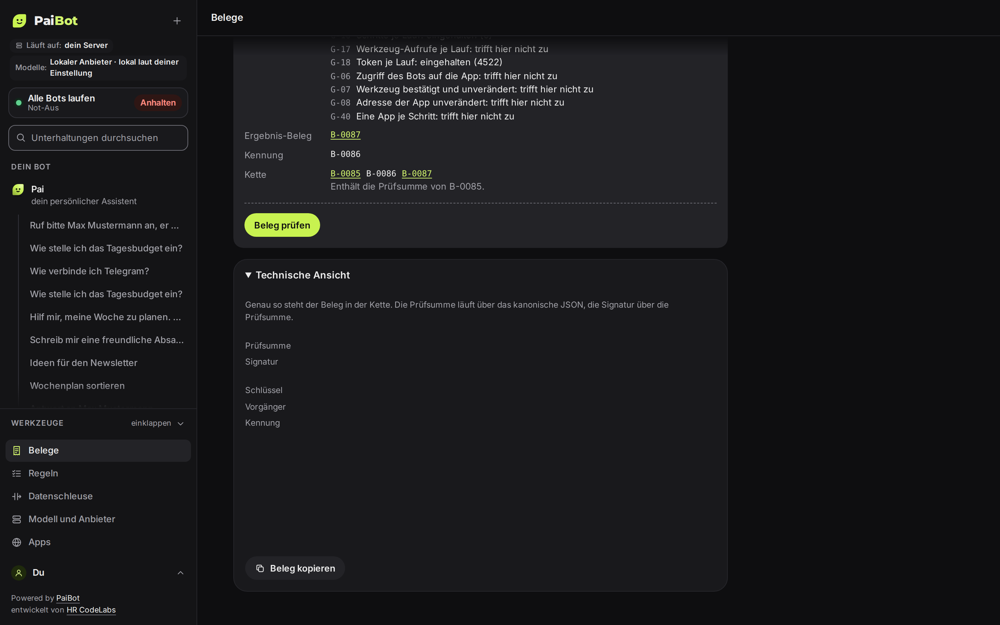
7. Über **Regeln ansehen** (rechts auf der Seite „Belege“) oder über **Regeln** in der Navigation kommst du zur Seite **Regeln**. Dort stehen die festen Regeln des Tors mit Kennung, Fassung und Stufe, dazu die Grenzen und Vorbedingungen in Worten.

Geprüft wird in deinem Browser mit demselben Prüfer wie im Befehl `pnpm belege:pruefen`. Der Server liefert nur die Rohdaten und kann so nicht einfach „gültig“ behaupten. Kann dein Browser nicht selbst prüfen (Ed25519 in Web Crypto fehlt), prüft der Server; dann steht beim Ergebnis „vom Server geprüft“.

### Schlüssel dieser Installation

1. Auf der Seite „Belege“ steht rechts der Kasten **Schlüssel dieser Installation**. Er nennt die **Kurzform** des Schlüssels, mit dem PaiBot die Belege signiert, seine **Kennung** und seit wann er gilt. Gab es einen Schlüsselwechsel, stehen darunter die früheren Schlüssel.
2. Notiere dir die Kurzform. Dieselbe Kurzform nennt **Beleg prüfen** bei jedem Beleg, und sie steht im Kopf des Exports. Weicht sie später ab, wurde der Schlüssel gewechselt.
3. Mit **Öffentlichen Schlüssel anzeigen** klappst du den öffentlichen Teil des Schlüssels auf. Den privaten Teil zeigt PaiBot nie; er bleibt auf deinem Server.

   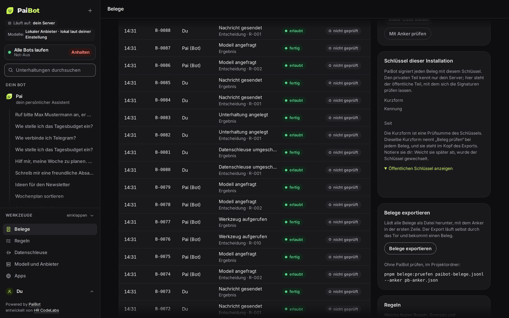

### Exportieren und ohne PaiBot prüfen

1. Klick auf der Seite „Belege“ rechts auf **Belege exportieren**. Dein Browser speichert die Datei `paibot-belege-<Datum>.jsonl`. Sie enthält alle Belege, die öffentlichen Schlüssel deiner Installation und in der ersten Zeile den Anker (den Kettenkopf beim Export).
2. Der Export läuft selbst durch das Tor und bekommt zwei Belege. Die Seite nennt sie gleich nach dem Speichern („Der Export selbst steht in den Belegen B-0143 und B-0144“). Die Entscheidung steht schon in der Datei, das Ergebnis folgt erst danach.

   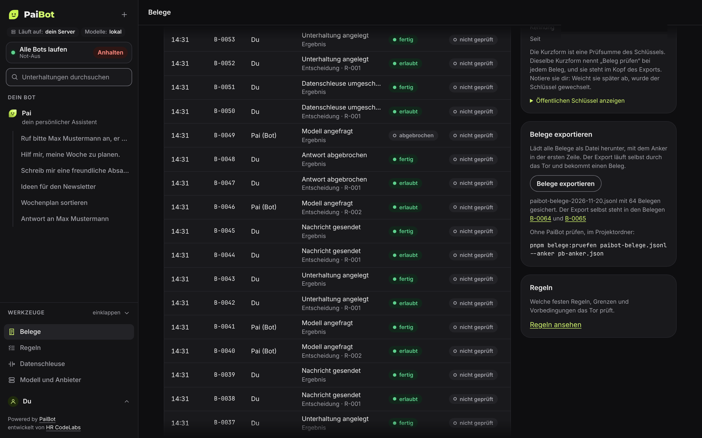
3. Im Projektordner von PaiBot den Export prüfen:

```text
pnpm belege:pruefen paibot-belege-2026-11-21.jsonl
```

Ist alles in Ordnung, siehst du:

```text
Belege-Kette gültig: 128 Einträge geprüft.
Letzter Eintrag: 128 (sha256:3f9c…)
```

Ist etwas verändert, nennt der Befehl die erste betroffene Stelle und was dort nicht stimmt:

```text
Belege-Kette ungültig bei Eintrag 42: 128 Einträge geprüft.
  ✗ Inhalt verändert
  ✓ Signatur gültig (Schlüssel 3f9c-2ab1-77d0-e4c5)
  ✓ Kette lückenlos bis hier
```

Die erste Zeile sagt dasselbe wie der Ausgang des Befehls. Fehlt am Ende der Kette etwas (sie ist kürzer als der Anker), ist kein einzelner Beleg verändert; die erste Zeile heißt dann „Belege-Kette ungültig: 6 Einträge geprüft.“, ohne Stelle, und der Ausgang ist `1`.

Darunter steht das Urteil über die ganze Kette, zum Beispiel „Kette gültig, alle Schlüssel aus der Kette.“, und ohne Anker der Hinweis „Ohne Anker geprüft: Ob am Ende Belege fehlen, ist so nicht erkennbar.“

4. Mit Anker prüfen: Gib den aufbewahrten Anker mit, als Datei oder als kopierten Text (siehe unten):

```text
pnpm belege:pruefen paibot-belege-2026-11-21.jsonl --anker pb-anker.json
```

| Exit-Code | Bedeutung                                                                                          |
| --------- | -------------------------------------------------------------------------------------------------- |
| `0`       | Kette gültig, alle Schlüssel aus der Kette; mit Anker: passt zum Anker                             |
| `1`       | Kette ungültig: die Ausgabe nennt die Stelle bzw. das Problem (z. B. kürzer als der Anker)         |
| `2`       | Aufruf falsch, Datei nicht lesbar, kein Beleg-Export oder kein gültiger Anker                      |
| `3`       | Kette in sich gültig, aber ein Schlüsselwechsel ist nur vom neuen Schlüssel signiert (siehe unten) |
| `4`       | Kette mit dieser Fassung nicht prüfbar: sie enthält Belege aus einer neueren PaiBot-Fassung        |

Der Befehl braucht keine Datenbank und kein Netz. Er funktioniert auch auf einem anderen Rechner, solange dort Node.js 22 oder neuer und der Code von PaiBot liegen.

### Anker: so bewahrst du den Kettenkopf außerhalb auf

Der Anker ist eine Zeile Text: welche Installation, wie weit die Kette reicht (Nummer und Prüfsumme des letzten Belegs), welcher Schlüssel zuletzt signiert hat und mit welchem Schlüssel die Kette begonnen hat. Nur wenn du ihn **außerhalb von PaiBot** aufbewahrst, kannst du später zeigen, dass die Kette bis dorthin vollständig und unverändert ist.

1. Auf der Seite „Belege“ steht rechts der Kasten **Kettenkopf außerhalb aufbewahren** mit dem aktuellen Anker. Klick auf **Anker kopieren** oder auf **Als Datei sichern** (Datei `pb-anker.json`).

   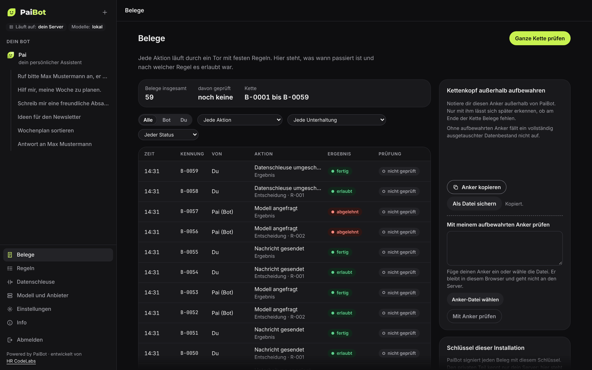
2. Oder ohne Oberfläche: Lass dir den Anker eines Exports ausgeben. Der Befehl prüft die Kette und schreibt den Anker als letzte Zeile:

   ```text
   pnpm belege:pruefen anker paibot-belege-2026-11-21.jsonl
   ```

   ```text
   {"format":"pb-anker","v":1,"installationId":"ins_…","seq":128,"hash":"sha256:3f9c…","keyId":"sch_…","startKeyId":"sch_…","startPublicKey":"…","time":"2026-11-20T10:00:00.000Z"}
   ```

   Derselbe Anker steht auch in der ersten Zeile des Exports unter `"anchor"`.

3. Speichere diese Zeile als Datei `pb-anker.json` an einem Ort, auf den der Server keinen Zugriff hat: ein USB-Stick, ein Passwort-Manager, eine E-Mail an dich selbst.
4. Wiederhole das ab und zu, zum Beispiel einmal im Monat. Ein neuerer Anker ersetzt den alten nicht, er reicht nur weiter.
5. Zum Prüfen in PaiBot: Füge den Anker im Feld **Mit meinem aufbewahrten Anker prüfen** ein oder klick auf **Anker-Datei wählen**, dann auf **Mit Anker prüfen**. Der Anker bleibt in deinem Browser und geht nicht an den Server; der Sinn ist ja, dass er außerhalb liegt.

   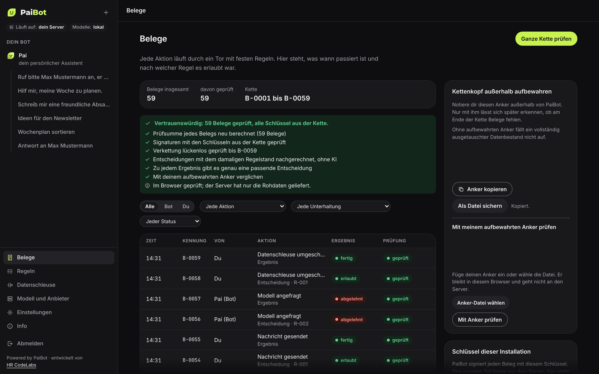
6. Zum Prüfen ohne PaiBot: `pnpm belege:pruefen paibot-belege-2026-11-21.jsonl --anker pb-anker.json`. Statt der Datei geht auch der Text selbst in Anführungszeichen: `--anker '{"format":"pb-anker",…}'`.

Passt die Kette nicht zum Anker, nennen Seite und Befehl den Grund, zum Beispiel „Die Kette ist kürzer als der Anker: Am Ende fehlen Belege.“ (Befehl: Exit-Code `1`). Ohne aufbewahrten Anker fällt ein vollständig ausgetauschter Datenbestand nicht auf.

Nimm als Anker nur einen, den du selbst außerhalb aufbewahrt hast. Den Anker in der ersten Zeile eines Exports hat der Server geschrieben; er ist zum Notieren da, nicht als Beweis gegen denselben Server.

## So sieht es aus

Die Bilder zu den einzelnen Schritten stehen oben in der Anleitung. Sie zeigen die Belege einer Beispiel-Installation (Bot „Pai“, einige Unterhaltungen mit dem Test-Anbieter). Was bei jeder Installation anders ist, ist in den Bildern ausgeblendet: der Anker, die Werte des Schlüssels, Prüfsummen und Signaturen der technischen Ansicht und die Kurzform in „Signatur gültig (Schlüssel …)“.

Am Handy, nach „Ganze Kette prüfen“ und mit dem Filter „Nachricht gesendet“:

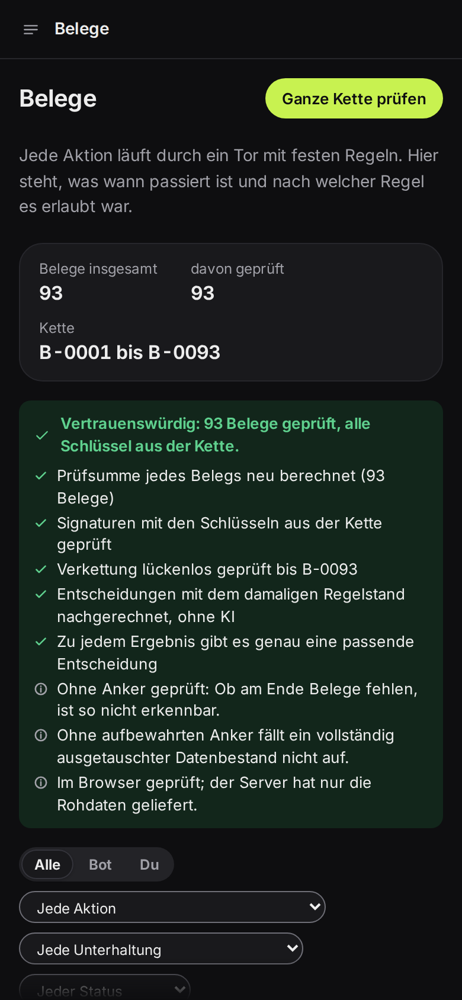

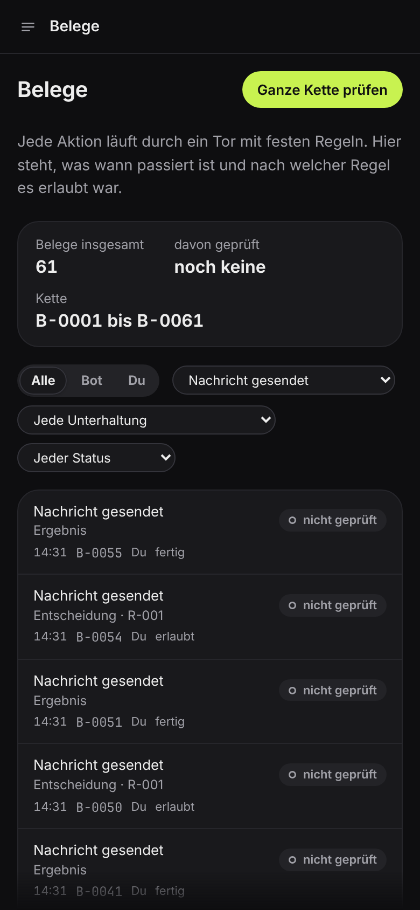

Die Seite „Regeln“ zeigt [Das Tor](funktion-tor.md#so-sieht-es-aus).

## Einstellungen

| Einstellung     | Wo                | Bedeutung                                                                                                                                                              | Standard                  |
| --------------- | ----------------- | ---------------------------------------------------------------------------------------------------------------------------------------------------------------------- | ------------------------- |
| `PAIBOT_SECRET` | Umgebungsvariable | Wurzel-Geheimnis. Daraus wird der Schlüssel abgeleitet, mit dem der private Signaturschlüssel verschlüsselt gespeichert wird, und der Schlüssel für Kontext-Prüfsummen | keiner, muss gesetzt sein |
| `PAIBOT_BUILD`  | Umgebungsvariable | Stand der Software, steht im ersten Beleg der Kette                                                                                                                    | `<version>+dev`           |

Sonst gibt es nichts einzustellen. Belege lassen sich nicht abschalten.

## So funktioniert es

### Was ein Beleg ist

Ein Beleg ist ein kleiner Datensatz. Er enthält nur Werte, nie den Inhalt deiner Nachrichten:

| Feld        | Inhalt                                                                                       |
| ----------- | -------------------------------------------------------------------------------------------- |
| `v`         | Formatversion, heute `1`                                                                     |
| `id`, `seq` | Kennung (`blg_…`) und laufende Nummer ab 1                                                   |
| `time`      | Zeitpunkt in UTC, z. B. `2026-11-20T10:00:00.000Z`                                           |
| `type`      | `start`, `decision` (Entscheidung), `result` (Ergebnis) oder `key_change` (Schlüsselwechsel) |
| `action`    | welche Aktion, wer sie ausgelöst hat (`besitzer` oder ein Bot) und worauf sie zielt          |
| `decision`  | was das Tor entschieden hat, nach welcher Regel und welche Grenzen geprüft wurden            |
| `facts`     | die Werte, die das Tor gesehen hat, z. B. Länge der Eingabe oder Region des Anbieters        |
| `context`   | Prüfsumme über die ausgehende Anfrage (`hmac-sha256:…`), nicht der Inhalt selbst             |
| `result`    | wie die Aktion ausging: `ok`, `error`, `cancelled` oder `denied`                             |
| `undo`      | ob und wie sich die Aktion rückgängig machen lässt                                           |
| `prev`      | Prüfsumme des vorigen Belegs                                                                 |
| `keyId`     | welcher Schlüssel den Beleg signiert hat                                                     |

Zu jeder Aktion gibt es zwei Belege: die **Entscheidung** vor der Ausführung und das **Ergebnis** danach. Beide tragen dieselbe Aktions-Kennung (`akt_…`).

### Wie die Kette funktioniert

1. **Kanonische Form:** Jeder Beleg wird immer gleich in Text verwandelt (JSON nach RFC 8785: Schlüssel sortiert, keine Leerzeichen, nur ganze Zahlen). So ergibt derselbe Beleg auf jedem Rechner denselben Text.
2. **Prüfsumme:** Über diesen Text (mit dem Vorsatz `pb-beleg/v1` und einem Zeilenumbruch) wird SHA-256 gerechnet. Ergebnis: `sha256:<64 Zeichen>`.
3. **Kette:** Jeder Beleg nennt in `prev` die Prüfsumme des vorigen. Der erste Beleg („Start“) nennt eine Prüfsumme aus lauter Nullen, deine Installations-Kennung und den öffentlichen Schlüssel. Wer einen Beleg ändert, löscht, einschiebt oder Belege vertauscht, bricht die Kette an genau dieser Stelle.
4. **Signatur:** Jede Prüfsumme wird mit dem Signaturschlüssel deiner Installation (Ed25519) signiert. Der private Teil liegt nur verschlüsselt in der Datenbank. Wer nur die Datenbank ändert, kann keine gültigen Signaturen erzeugen.
5. **Anhängen unter Sperre:** Neue Belege werden in einer Datenbank-Transaktion mit einer festen Sperre angehängt. Auch wenn Web-App und Hintergrund-Dienst gleichzeitig Belege schreiben, bleibt die Kette lückenlos und verzweigt sich nicht. Die Datenbank weist jede Änderung und jedes Löschen von Belegen ab, und die Spalten, nach denen PaiBot Belege sucht (Nummer, Aktion, Akteur, Unterhaltung), müssen zum signierten Beleg passen.
6. **Regelstand:** Eine Entscheidung nennt die Prüfsumme jeder angewandten Regel und den Stand des Regel-Protokolls, den das Tor sah. Regeln werden nie geändert, nur in neuer Fassung angehängt. So lässt sich jede Entscheidung später mit genau den Regeln von damals nachrechnen.

### Schlüsselwechsel

Bekommt PaiBot einen neuen Signaturschlüssel, wird ein Beleg „Schlüsselwechsel“ angehängt. Er nennt den neuen Schlüssel und den bisherigen. Ab dann gilt nur noch der neue Schlüssel. Der Prüfer kennt die Schlüssel nur aus der Kette: den ersten aus dem Start-Beleg, jeden weiteren aus einem Schlüsselwechsel.

- **Regelfall:** Der bisherige Schlüssel ist noch da und signiert den Wechsel (`signedBy: "previous"`). Damit bestätigt er den neuen. Die Kette bleibt „gültig, alle Schlüssel aus der Kette“.
- **Schlüssel verloren** (zum Beispiel, weil `PAIBOT_SECRET` neu gesetzt wurde): Der neue Schlüssel signiert den Wechsel selbst (`signedBy: "new"`). Das bestätigt niemand. Der Prüfer meldet dann „Ein Schlüsselwechsel ist nur vom neuen Schlüssel signiert. Ab hier ist nicht belegt, dass die Belege vom ursprünglichen Schlüssel stammen.“ und das Urteil „Kette in sich gültig, aber die Vertrauenskette ist unterbrochen.“ (Exit-Code `3`). Alle Belege ab diesem Wechsel gelten als nicht beglaubigt, auch wenn ihre Signaturen stimmen.

Die öffentlichen Schlüssel in der Datenbank und in der ersten Zeile des Exports dienen nur der Anzeige und dem Vergleich. Nennt diese Liste unter derselben Kennung einen anderen Schlüssel als die Kette, meldet der Prüfer „Ein Beleg ist mit einem Schlüssel signiert, der nicht aus der Kette selbst folgt.“

Nach einem Wechsel mit `signedBy: "new"` ist ein neuer Anker besonders wichtig: Notiere ihn sofort, damit spätere Prüfungen von diesem Stand ausgehen können.

### Wie geprüft wird

Für jeden Beleg laufen diese Prüfungen:

| #   | Prüfung                                                                                                | Ergebnis                                            |
| --- | ------------------------------------------------------------------------------------------------------ | --------------------------------------------------- |
| 1   | Prüfsumme neu berechnen und vergleichen                                                                | „Inhalt unverändert“ / „Inhalt verändert“           |
| 2   | Signatur mit dem Schlüssel prüfen, der an dieser Stelle aus der Kette folgt                            | „Signatur gültig (Schlüssel `xxxx-xxxx-xxxx-xxxx`)“ |
| 3   | Verbindung zum vorigen Beleg prüfen (`prev` und laufende Nummer)                                       | „Kette lückenlos bis hier“ / „Kette unterbrochen“   |
| 4   | Entscheidung aus den gespeicherten Fakten und den Regeln zum damaligen Regelstand nachrechnen, ohne KI | „Entscheidung folgt aus Regel …“                    |
| 5   | Nur auf dem Server: Kontext-Prüfsumme mit der gespeicherten Nachricht vergleichen                      | „Kontext passt“ / „Inhalt gelöscht, nicht prüfbar“  |

Die Prüfungen 1 bis 4 nutzen nur Web Crypto und laufen deshalb auch im Browser und im Befehl `pnpm belege:pruefen`. Prüfung 4 braucht die Regel-Fassungen; der Befehl kennt sie nicht und lässt sie aus. Prüfen erzeugt selbst keinen Beleg.

Beim Nachrechnen (Prüfung 4) gilt:

- Es zählen nur die Regeln, die zum festgehaltenen Regelstand gehörten. Eine später dazugekommene Regel ändert alte Entscheidungen nicht.
- Standard-Regeln zählen mit ihrem Inhalt aus dem Code von PaiBot, nicht mit dem aus der Datenbank.
- Passt der Inhalt einer damals angewandten Regel nicht mehr zu ihrer Prüfsumme im Beleg, meldet der Prüfer genau diese Regel als geändert.
- Ältere Belege ohne festgehaltenen Regelstand rechnet er mit den heutigen Regeln nach und sagt dazu „Regelstand nicht festgehalten“. Das gilt nur für Ketten älterer Installationen: Trägt der Start-Beleg die neue Fassung der Kette (`format: 2`), muss jede Entscheidung ihren Regelstand und je Regel die Prüfsumme tragen; fehlt das, ist die Kette ungültig („Regelstand fehlt“).

Jede Entscheidung gehört zu einer Fassung der Tor-Regeln, also zu der Art, wie das Tor damals entschieden hat. Geprüft wird jeder Beleg nach seiner eigenen Fassung: welche Aktionen und Fakten es gab, welche Felder im Beleg stehen dürfen, und das Nachrechnen mit genau dieser Fassung. Ein Ergebnis wird nach der Fassung seiner Entscheidung geprüft. Stammt ein Beleg aus einer neueren PaiBot-Fassung, die dein PaiBot noch nicht kennt, heißt das Urteil „mit dieser Fassung nicht prüfbar“, nie „gültig“. Passt ein Beleg nicht zu seiner Fassung (z. B. ein Feld, das es dort nicht gibt), ist die Kette ungültig („Beleg passt nicht zu seiner Fassung“). Ab Fassung 2 steht die Fassung in jeder Entscheidung, dazu immer die Vorbedingungen und bei Werkzeug-Aufrufen der Deckel; beim Nachrechnen wird all das verglichen. Folgt auf einen Beleg einer neueren Tor-Fassung einer einer älteren, zeigen Befehl und Belege-Seite eine Warnung; das Urteil ändert sich dadurch nicht.

Über die ganze Kette prüft er zusätzlich je Aktion:

- Ein Ergebnis braucht vorher die Entscheidung derselben Aktion (gleiche Aktion, gleicher Akteur, gleiches Ziel). Fehlt sie, meldet er „Ergebnis ohne Entscheidung“.
- „ok“, „Fehler“ und „abgebrochen“ passen nur zu einer Erlaubnis, „abgelehnt“ nur zu einer anderen Entscheidung; sonst „Ergebnis passt nicht zur Entscheidung“.
- Je Aktion gibt es höchstens eine Entscheidung und ein Ergebnis; eine zweite meldet er als „Aktion doppelt“.

Die Datenbank lässt solche Belege gar nicht erst zu: Sie nimmt je Aktion nur eine Entscheidung und ein Ergebnis an, und ein Ergebnis nur nach einer passenden Entscheidung. Der Prüfer erkennt es trotzdem, etwa in einem Export, der außerhalb von PaiBot verändert wurde.

### Was der Prüfer erkennt – und was nicht

| Was passiert ist                                                                 | Ohne Anker                                      | Mit Anker                                                  |
| -------------------------------------------------------------------------------- | ----------------------------------------------- | ---------------------------------------------------------- |
| Ein Beleg wurde geändert, gelöscht, eingeschoben oder Belege vertauscht          | erkannt (Stelle)                                | erkannt (Stelle)                                           |
| Ein Beleg ist mit einem fremden Schlüssel signiert                               | erkannt                                         | erkannt                                                    |
| Der öffentliche Schlüssel in der Datenbank wurde ausgetauscht                    | erkannt (Vergleich)                             | erkannt                                                    |
| Schlüsselwechsel, den nur der neue Schlüssel signiert hat                        | gemeldet (Stufe „Vertrauenskette unterbrochen“) | gemeldet                                                   |
| Am Ende fehlen Belege (bis zum Stand des Ankers)                                 | **nicht erkennbar**                             | erkannt („kürzer als der Anker“)                           |
| Am Ende fehlen Belege, die nach dem Anker entstanden sind                        | **nicht erkennbar**                             | **nicht erkennbar**                                        |
| Ergebnis ohne passende Entscheidung, Aktion doppelt                              | erkannt                                         | erkannt                                                    |
| Belege bis zum Anker umgeschrieben und neu signiert (mit dem echten Schlüssel)   | **nicht erkennbar**                             | erkannt („Beleg an der Stelle des Ankers ist ein anderer“) |
| Die Datenbank wurde vollständig ausgetauscht, mit eigenem Schlüssel neu signiert | **nicht erkennbar**                             | erkannt („beginnt mit einem anderen Schlüssel“)            |

Ehrlich gesagt: Wer die Datenbank vollständig austauscht und du keinen Anker aufbewahrt hast, fällt nicht auf. Eine neu geschriebene Kette ist in sich genauso gültig wie die echte. Belege, die nach deinem letzten Anker entstanden sind, schützt der Anker nicht; dafür hilft nur ein neuer Anker.

### Export

Der Export ist eine Textdatei im Format JSON Lines (`application/x-ndjson`):

- **Zeile 1:** `{"format":"pb-belege","v":1,"installationId":"ins_…","publicKeys":[{"keyId":"sch_…","publicKey":"…","fingerprint":"xxxx-xxxx-xxxx-xxxx"}],"anchor":{"format":"pb-anker",…}}` (die Schlüssel nur zur Anzeige, `anchor` ist der Kettenkopf beim Export)
- **jede weitere Zeile:** ein Beleg mit `seq`, `id`, `hash`, `signature`, `keyId` und `body` (der Beleg in kanonischer Form)

Beteiligte Teile: `packages/receipts` (Bauen, Prüfsumme, Signatur, Anhängen, Prüfer, Anker, Nachrechnen, Export, Befehl), `packages/crypto` (Signaturschlüssel), `packages/db` (Tabellen `belege`, `rules` und `installation_keys`, nur anhängen).

In der Web-App liefern Lese-Routen nur Rohdaten: `GET /api/belege` (Liste mit Blättern), `GET /api/belege/<kennung>` (Beleg mit Vorgänger, Nachfolger und zugehörigem Beleg), `GET /api/belege/kette` (die Kette in Stücken im Format des Exports), `GET /api/belege/schluessel` (Start-Beleg und Schlüsselwechsel) und `GET /api/regeln` (Regelstand und alle Fassungen zum Nachrechnen). Geprüft wird im Browser mit `@paibot/receipts/pruefen`. Nur als Rückfall prüft der Server (`GET /api/belege/<kennung>/pruefung` bzw. `GET /api/belege/kette?pruefung=server`). Der Export (`POST /api/belege/export`) ist eine eigene Aktion `belege.exportieren` und läuft durch das Tor.

## Das Tor

Jeder Beleg „Entscheidung“ und „Ergebnis“ entsteht im Tor. Wie das Tor entscheidet, welche Regeln und Grenzen es prüft und wann es ablehnt, steht auf der Seite [Das Tor](funktion-tor.md).

## Grenzen

- **Wer den Server vollständig kontrolliert** (Datenbank **und** `PAIBOT_SECRET`), kann die ganze Kette neu schreiben oder mit einem eigenen Schlüssel neu beginnen. Das fällt nur mit einem Anker auf, den du vorher außerhalb aufbewahrt hast, und nur für Belege bis zu diesem Anker.
- **Abgeschnittenes Ende:** Fehlen die letzten Belege, bleibt der Rest eine gültige Kette. Ohne Anker ist das nicht erkennbar; mit Anker nur bis zu dessen Stand.
- **Erster Anker:** Er stammt aus der Installation selbst. War sie schon beim ersten Anker manipuliert, bestätigt er die Fälschung. Notiere deshalb früh nach der Einrichtung die Kurzform des Start-Schlüssels und einen ersten Anker.
- **Schlüsselwechsel mit `signedBy: "new"`** bestätigt kein alter Schlüssel. Der Prüfer meldet ihn als unterbrochene Vertrauenskette, nie als „gültig, alle Schlüssel aus der Kette“.
- **Ältere Belege ohne Regelstand:** Sie werden mit den heutigen Regeln nachgerechnet. Ist seither eine Regel dazugekommen, kann eine damals richtige Entscheidung abweichen. Belege mit Regelstand betrifft das nicht.
- Belege enthalten keine Inhalte. Ob eine Antwort wirklich zu einer Nachricht passt, prüft nur der Server über die Kontext-Prüfsumme, und nur solange die Nachricht noch gespeichert ist.
- Prüfen im Browser setzt Ed25519 in Web Crypto voraus. Kann der Browser das nicht, prüft der Server; das Ergebnis heißt dann „vom Server geprüft“, und ein eingefügter Anker wird nicht verglichen.
- „Beleg prüfen“ prüft einen Beleg und seine Nachbarn, nicht die ganze Kette. Ob irgendwo ein Beleg fehlt, zeigt erst „Ganze Kette prüfen“.
- Den zugehörigen Entscheidungs- bzw. Ergebnis-Beleg sucht die Karte in den 500 Belegen davor bzw. danach.
- Prüfe Belege mit derselben oder einer neueren PaiBot-Fassung. Gehst du auf eine ältere Fassung zurück, kann sie neuere Belege nicht lesen oder zeigt sie als ungültig.
- Belege dieser Version tragen die Tor-Fassung 2. Eine PaiBot-Fassung, die nur Fassung 1 kennt, zeigt sie als „mit dieser Fassung nicht prüfbar“.

## Fehlerbehebung

| Beobachtung                                                                                               | Ursache                                                                                                                                              | Was tun                                                                                                                                                              |
| --------------------------------------------------------------------------------------------------------- | ---------------------------------------------------------------------------------------------------------------------------------------------------- | -------------------------------------------------------------------------------------------------------------------------------------------------------------------- |
| „Inhalt verändert“                                                                                        | Der Beleg wurde nach dem Schreiben geändert (z. B. in der Datei)                                                                                     | Mit einem älteren Export vergleichen; die Stelle steht in der Ausgabe                                                                                                |
| „Signatur ungültig“                                                                                       | Der Beleg ist nicht mit dem Schlüssel signiert, der an dieser Stelle aus der Kette folgt (fremder Schlüssel oder alter Schlüssel nach einem Wechsel) | Der Beleg stammt nicht von dieser Installation oder wurde nachträglich neu signiert; mit einem älteren Export vergleichen                                            |
| „Kette unterbrochen“                                                                                      | Ein Beleg fehlt, wurde eingeschoben oder Belege wurden vertauscht                                                                                    | Die Ausgabe nennt den ersten betroffenen Eintrag                                                                                                                     |
| Exit-Code `2`, „Zeile …“                                                                                  | Die Datei ist kein Beleg-Export oder beschädigt                                                                                                      | Export neu herunterladen; die Datei nicht in einem Programm öffnen, das Zeilen umbricht                                                                              |
| Exit-Code `2`, „Aufruf“                                                                                   | Kein oder mehr als ein Dateiname                                                                                                                     | `pnpm belege:pruefen <datei.jsonl>` mit genau einer Datei                                                                                                            |
| „kein gültiger Anker“                                                                                     | Der Text nach `--anker` ist keine vollständige Anker-Zeile                                                                                           | Die ganze Zeile `{"format":"pb-anker",…}` übernehmen oder die Datei `pb-anker.json` angeben                                                                          |
| „kürzer als der Anker“                                                                                    | Am Ende der Kette fehlen Belege, oder der Export ist älter als der Anker                                                                             | Einen neueren Export prüfen; fehlen die Belege auch dort, wurden sie entfernt                                                                                        |
| „anderen Schlüssel als im Anker“                                                                          | Die Kette beginnt nicht mit deinem Start-Beleg                                                                                                       | Die Datenbank wurde ersetzt oder es ist der Export einer anderen Installation                                                                                        |
| „Fehler hier“ in der Liste                                                                                | An diesem Beleg schlägt eine Prüfung fehl; alles danach ist „nicht bestätigt“                                                                        | Beleg öffnen und „Beleg prüfen“; der Grund steht im Ergebnis                                                                                                         |
| „vom Server geprüft“                                                                                      | Dein Browser kann Ed25519 in Web Crypto nicht                                                                                                        | Einen aktuellen Browser nehmen, wenn du unabhängig vom Server prüfen willst; oder den Export mit dem Befehl prüfen                                                   |
| Exit-Code `3`                                                                                             | Ein Schlüsselwechsel ist nur vom neuen Schlüssel signiert                                                                                            | War das dein eigener Wechsel (Schlüssel verloren)? Dann ab jetzt einen neuen Anker aufbewahren                                                                       |
| „Kette nicht prüfbar“ / Exit-Code `4`                                                                     | Die Kette enthält Belege aus einer neueren PaiBot-Fassung                                                                                            | Mit derselben oder einer neueren PaiBot-Fassung prüfen. Hast du PaiBot nie aktualisiert, ist das ein Warnzeichen: Export aufbewahren und mit einem Anker vergleichen |
| „Beleg passt nicht zu seiner Fassung“                                                                     | Der Beleg wurde verändert oder stammt nicht von deinem PaiBot                                                                                        | Mit einem älteren Export vergleichen; die Stelle steht in der Ausgabe                                                                                                |
| Warnung: Rückschritt der Fassung („Nach einem Beleg einer neueren Tor-Fassung folgt einer einer älteren“) | Du bist auf eine ältere PaiBot-Fassung zurückgegangen, oder es ist kurz beim Update passiert. Das Urteil ändert sich dadurch nicht                   | Ist beides nicht geschehen, ist das ein Warnzeichen: Export aufbewahren und mit einem Anker vergleichen                                                              |
