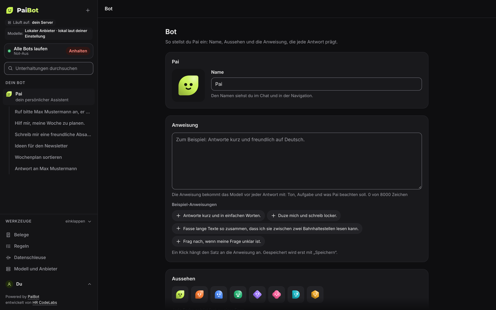
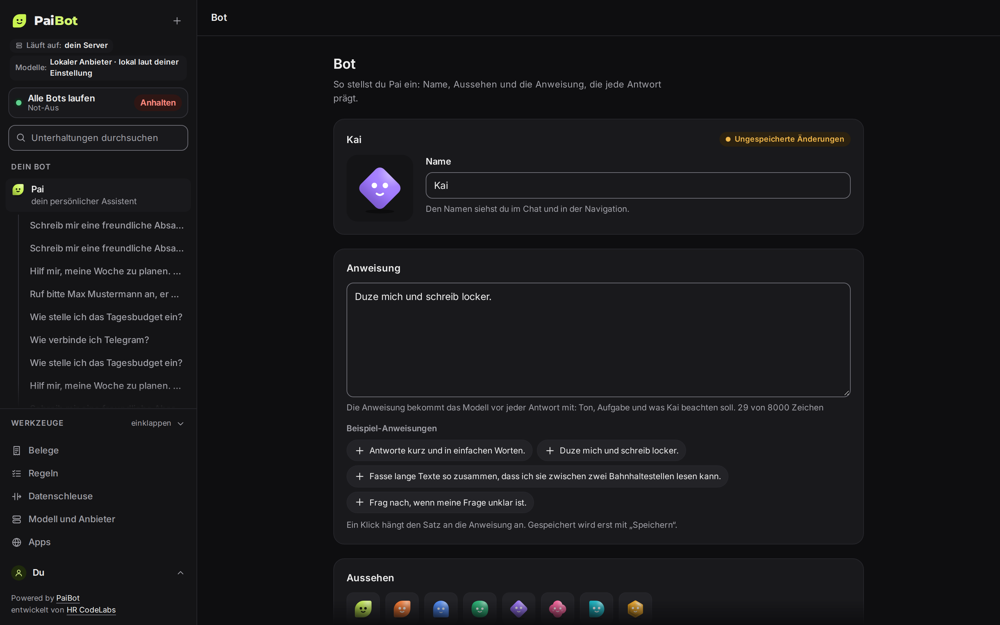
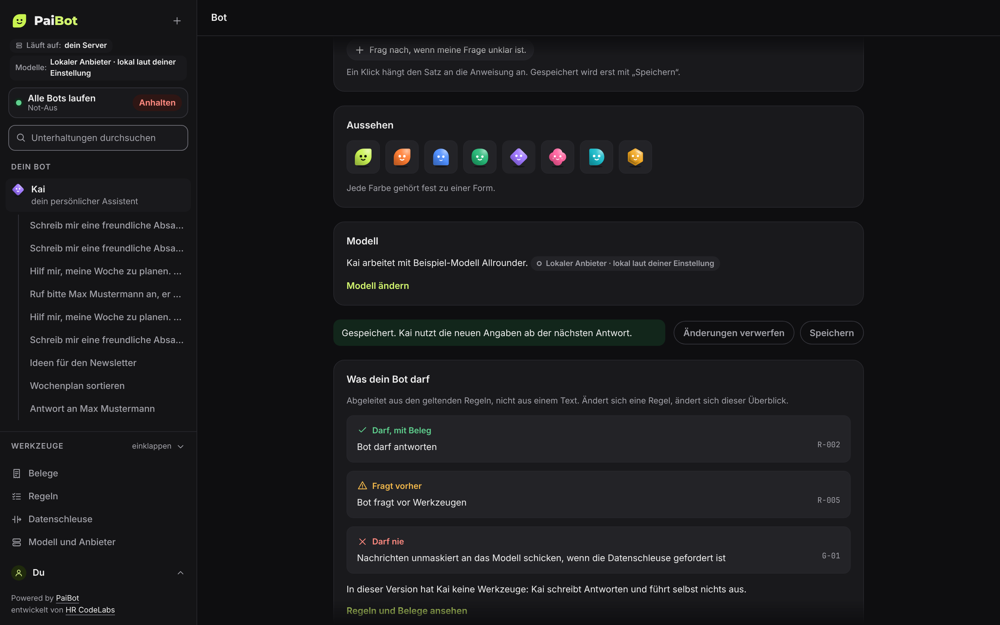
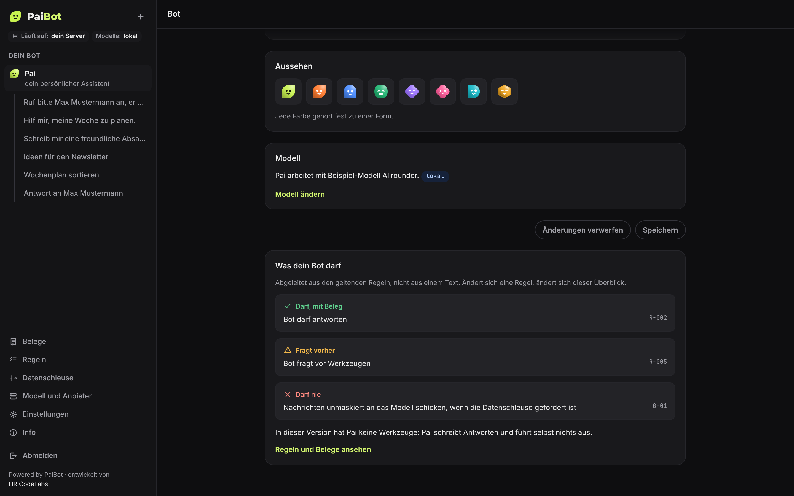
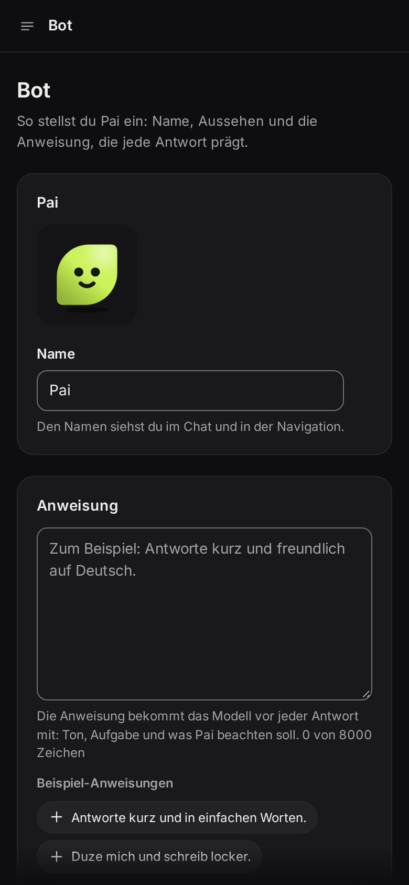

<!--
PaiBot – Doku: den Bot einstellen (Name, Anweisung, Aussehen) und sehen, was er darf.

Autor:     Oliver Hees
Website:   https://paibot.de
Copyright: 2026 Oliver Hees. Alle Urheberrechte liegen beim Autor.
Lizenz:    PaiBot Fair-Code-Lizenz 1.1 – siehe Datei LICENSE im Projektstamm
Seit:      2026-11-21
-->

# Bot

**Ergebnis:** Dein Bot hat den Namen, das Aussehen und die Anweisung, die du willst. Die Anweisung bekommt das Modell vor jeder Antwort mit, und du siehst jederzeit, was der Bot nach den geltenden Regeln darf.

## Wofür

Du willst, dass dein Bot in deinem Ton antwortet und weiß, wofür du ihn brauchst, zum Beispiel „Duze mich und schreib locker“. Oder du willst ihm einen anderen Namen und eine andere Farbe geben.

## So benutzt du es

1. Klick in der Seitenleiste unter „Dein Bot“ auf den Namen deines Bots (am Handy zuerst auf das Menü oben links). Es öffnet sich die Seite „Bot“ (Adresse `/bot`); in der Seitenleiste ist dein Bot dann hervorgehoben.

   
2. Ändere unter „Name“ den Namen deines Bots (höchstens 60 Zeichen).
3. Schreib unter „Anweisung“, wie dein Bot antworten soll und worauf er achten soll. Unter dem Feld zählt PaiBot mit, wie viele der 8000 Zeichen du schon nutzt.
4. Ein Klick auf eine der „Beispiel-Anweisungen“ hängt den Satz an deine Anweisung an. Gespeichert ist noch nichts.
5. Wähle unter „Aussehen“ eine Farbe. Jede Farbe gehört fest zu einer Form; die Vorschau oben zeigt das Ergebnis. Die Vorschau lebt ruhig: Der Avatar blinzelt und atmet, schaut aber nicht auf deinen Mauszeiger. Alle sieben Formen haben dasselbe Gesicht; was dein Bot im Chat gerade tut, zeigt dieses Gesicht dort (siehe [Chat](funktion-chat.md), „Der Avatar zeigt, was dein Bot tut“). Mit „weniger Bewegung“ in deinem System steht er still.
6. Sobald etwas geändert ist, steht oben „Ungespeicherte Änderungen“. Klicke „Speichern“ oder „Änderungen verwerfen“.

   
7. Nach dem Speichern steht „Gespeichert. … nutzt die neuen Angaben ab der nächsten Antwort.“ Der neue Name erscheint auch in der Navigation.

   
8. Unter „Modell“ steht, mit welchem Modell dein Bot arbeitet. „Modell ändern“ führt zur Seite „Modell und Anbieter“.
9. Unter „Was dein Bot darf“ siehst du, was er nach den geltenden Regeln darf, wofür er fragen muss und was er nie darf. Dort steht auch „Bot liest in der Doku seiner Version“ (R-010): Damit darf der Bot in der Doku dieser PaiBot-Version nachschlagen, ohne zu fragen und jedes Mal mit Beleg; das Werkzeug selbst liest nur die mitgelieferte Doku und ruft nichts im Netz auf; was es findet, geht wie der übrige Chat an den Anbieter deines Modells (siehe [Chat](funktion-chat.md), „Pai schlägt in der Doku nach“). Dazu steht dort „Bot liest in Apps mit Lese-Zugriff“ (R-014): Die Regel gehört zu PaiBot und greift nur, wenn du eine App verbunden, ein Werkzeug als „liest“ bestätigt und dem Bot Lese-Zugriff gegeben hast (siehe [Apps](funktion-apps.md) und [Das Tor](funktion-tor.md), „Pai liest in Apps“). „Regeln und Belege ansehen“ führt zu den Belegen.

   

Beispiel für eine Anweisung:

```text
Duze mich und schreib locker.
Fasse lange Texte in drei Sätzen zusammen.
```

## So sieht es aus

Die Bilder zu den einzelnen Schritten stehen oben in der Anleitung (Beispiel-Daten, Bot „Pai“, Test-Anbieter). Am Handy steht alles untereinander:



## Einstellungen

| Einstellung | Wo                          | Bedeutung                                                | Standard                             |
| ----------- | --------------------------- | -------------------------------------------------------- | ------------------------------------ |
| Name        | Seite Bot                   | Name im Chat, in der Navigation und in der Systemvorgabe | aus der Einrichtung, Vorschlag „Pai“ |
| Anweisung   | Seite Bot                   | Text, den das Modell vor jeder Antwort bekommt           | leer                                 |
| Aussehen    | Seite Bot                   | Farbe und die fest dazugehörende Form des Avatars        | Limette (Blatt)                      |
| Modell      | Seite „Modell und Anbieter“ | Modell, mit dem der Bot antwortet                        | aus der Einrichtung                  |

## So funktioniert es

- „Speichern“ schickt die Angaben an `PUT /api/bot`. Die Aktion `bot.aendern` läuft durch das Tor und bekommt zwei Belege (Entscheidung und Ergebnis). Im Beleg stehen nur die Namen der geänderten Felder, nie die Anweisung selbst.
- Ohne Änderung speichert PaiBot nichts und meldet „Es gibt nichts zu speichern.“
- Ein Lauf liest Name und Anweisung beim Start aus der Datenbank; deshalb gilt eine Änderung ab der nächsten Antwort.
- „Was dein Bot darf“ entsteht aus den aktiven Regeln, die für den Bot gelten (erlauben, fragen, ablehnen), plus der festen Grenze G-01 (keine unmaskierten Nachrichten, wenn die Datenschleuse gefordert ist). Es ist eine Anzeige, keine Einstellung.

## Grenzen

- Es gibt einen Bot. Weitere Bots anlegen ist nicht Teil dieser Version.
- Einen Bot pausieren oder löschen kannst du in der Oberfläche noch nicht. Die Datenbank und das Tor kennen es schon: Ein pausierter Bot antwortet nicht, und ein Bot, der schon gearbeitet hat, und dein Standard-Bot lassen sich nicht löschen (der feste Satz dazu: „Dieser Bot hat schon gearbeitet und lässt sich nicht löschen.“ bzw. „Das ist dein Standard-Bot und lässt sich nicht löschen.“). Mehr dazu bei [Tor und Belege](funktion-tor.md#bots-pausieren-und-teams-fassung-4).
- Als eingebautes Werkzeug nutzt der Bot das Nachschlagen in der Doku. Weitere Werkzeuge bekommt er nur aus Apps, die du verbunden, eingestuft und freigegeben hast, und nur lesende ([Apps](funktion-apps.md)). Er führt sonst selbst nichts aus.
- Eine kurze Rolle oder Beschreibung des Bots lässt sich noch nicht speichern; die Navigation zeigt „dein persönlicher Assistent“.
- Die Ausgabegrenze je Antwort hat den Standard 4096 Token und ist höchstens 200 000 (das prüft auch die Datenbank; beim Update werden höhere Werte auf 200 000 gesetzt); die Einrichtung setzt keinen eigenen Wert. Die Seite „Bot“ zeigt sie nicht und bietet kein Feld dafür; beim Speichern schickt sie den gespeicherten Wert unverändert zurück. Ändern lässt sie sich in dieser Version nur über die Schnittstelle der App (`PUT /api/bot`).

## Fehlerbehebung

| Beobachtung                          | Ursache                                  | Was tun                                |
| ------------------------------------ | ---------------------------------------- | -------------------------------------- |
| „Speichern“ lässt sich nicht klicken | Nichts geändert oder Anweisung zu lang   | Etwas ändern bzw. die Anweisung kürzen |
| „Gib deinem Bot einen Namen.“        | Das Feld „Name“ ist leer                 | Einen Namen eintragen                  |
| Antwort klingt noch wie vorher       | Die Antwort lief schon vor dem Speichern | Eine neue Nachricht schicken           |
