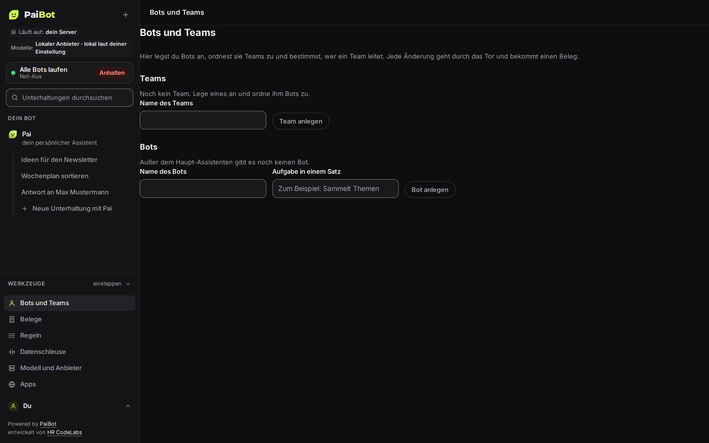
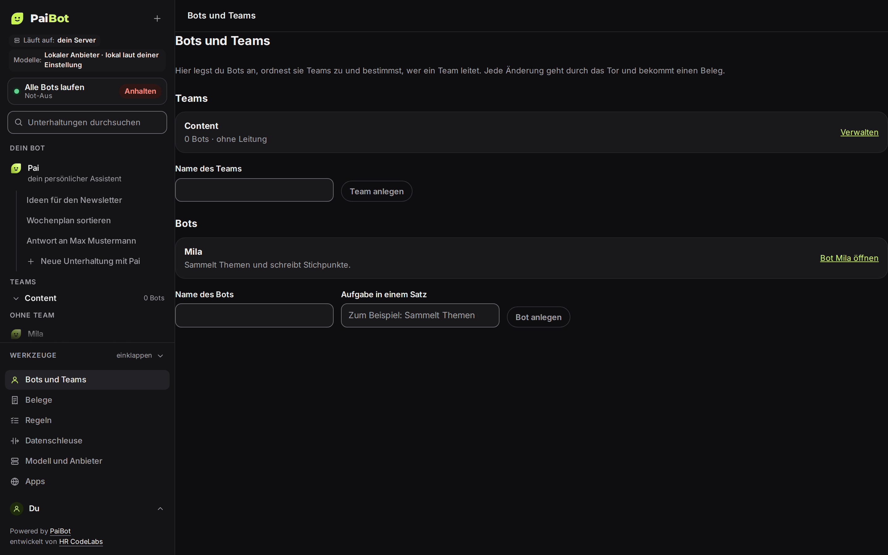
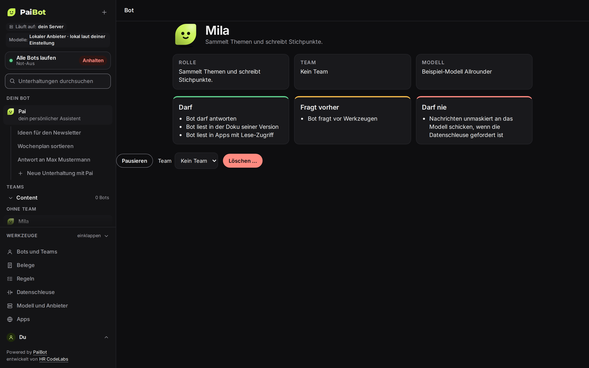
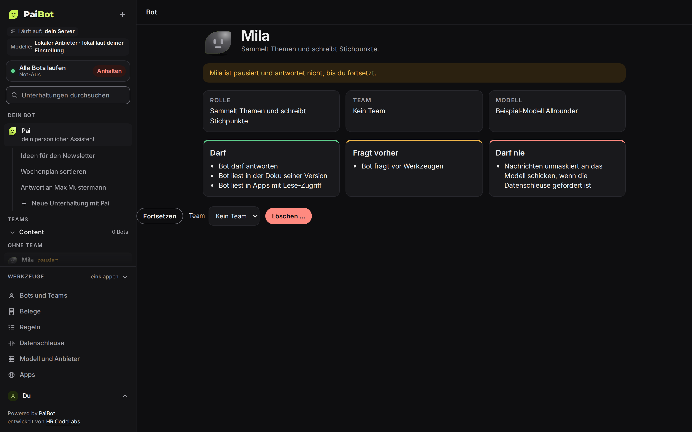
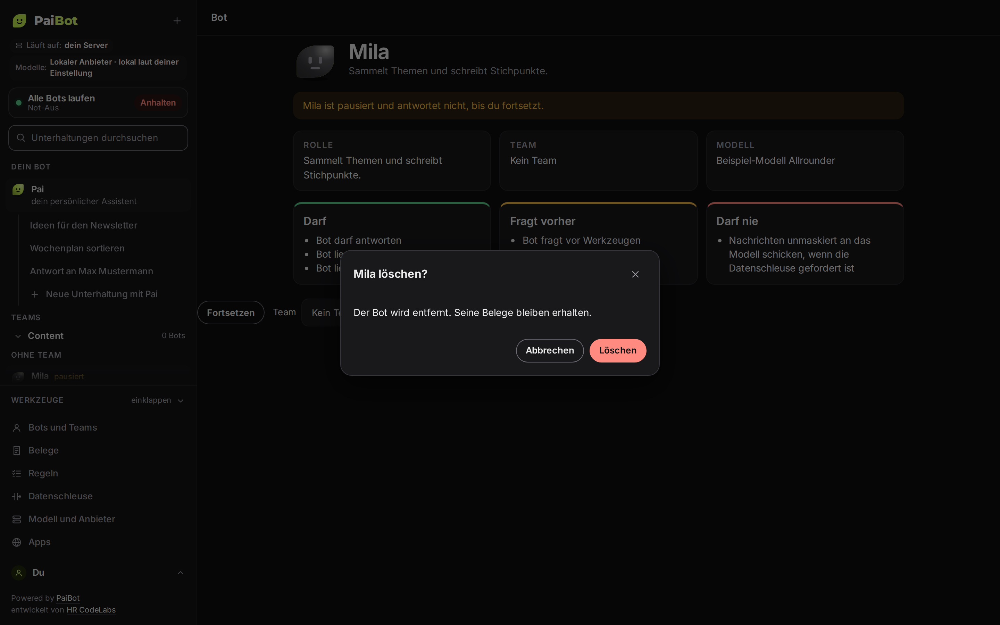
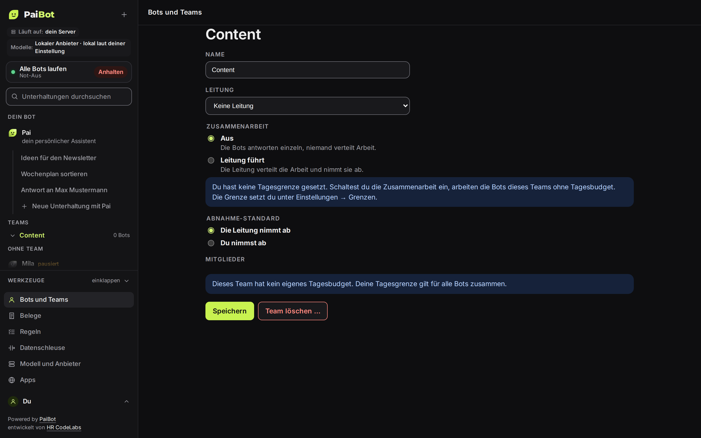
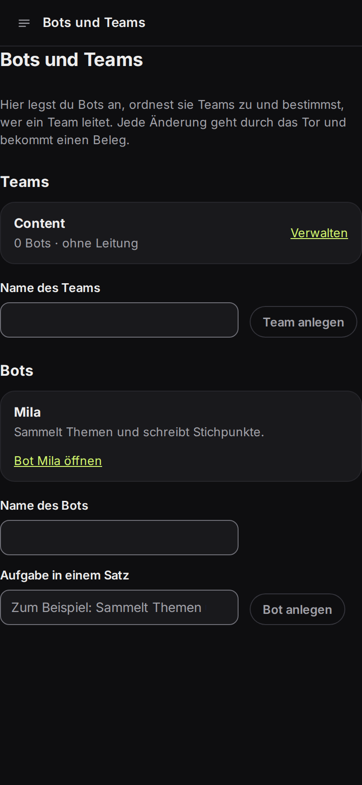
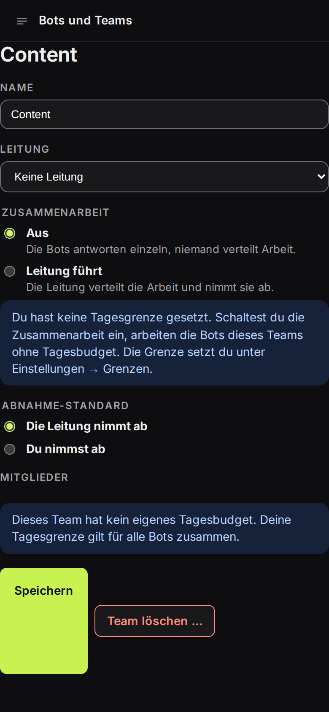

<!--
PaiBot – Doku: mehrere Bots anlegen, pausieren und löschen und sie in Teams ordnen.

Autor:     Oliver Hees
Website:   https://paibot.de
Copyright: 2026 Oliver Hees. Alle Urheberrechte liegen beim Autor.
Lizenz:    PaiBot Fair-Code-Lizenz 1.1 – siehe Datei LICENSE im Projektstamm
Seit:      2026-11-28
-->

# Bots und Teams

**Ergebnis:** Du hast mehr als einen Bot. Jeder hat seine eigene Aufgabe, seine eigenen Unterhaltungen und seine eigene Seite. Du kannst Bots zu Teams zusammenfassen, eine Leitung bestimmen, einen Bot pausieren und einen Bot löschen – und die Seitenleiste zeigt dir alles nach Teams geordnet.

## Wofür

Ein Bot für alles wird schnell unübersichtlich. Du willst zum Beispiel einen Bot, der Themen sammelt, und einen, der Texte prüft – jeder mit seiner eigenen Aufgabe, seinem eigenen Gesprächsverlauf und seiner eigenen Seite. Gehören mehrere Bots zusammen, fasst du sie zu einem Team zusammen und bestimmst, wer darin die Leitung hat.

## So benutzt du es

1. Klick in der Seitenleiste unter „Teams“ auf „Teams“ (am Handy zuerst auf das Menü oben links). Es öffnet sich die Seite „Bots und Teams“ (Adresse `/teams`). Direkt nach der Einrichtung gibt es noch kein Team und außer deinem Haupt-Assistenten noch keinen Bot.

   
2. Schreib unter „Name des Teams“ einen Namen (höchstens 60 Zeichen) und klick „Team anlegen“.
3. Schreib unter „Name des Bots“ einen Namen und unter „Aufgabe in einem Satz“, wofür du den Bot brauchst (höchstens 200 Zeichen). Klick „Bot anlegen“. Der neue Bot bekommt das Modell deines Haupt-Assistenten und steht erst einmal ohne Team da.

   Die Aufgabe ist eine Notiz für dich: Sie wird gespeichert und auf der Seite des Bots und in den Listen angezeigt. Eine **eigene Anweisung an das Modell setzt sie nicht** – ein neu angelegter Bot arbeitet mit dem allgemeinen Kopf, genau wie dein Haupt-Assistent ohne eigene Anweisung. Eine eigene Anweisung je Bot kommt später (siehe „Grenzen“).

   
4. Klick auf „Bot Mila öffnen“. Du landest auf der Seite des Bots (Adresse `/bot/<Kennung>`). Dort steht sein Steckbrief: Aufgabe, Team, Modell und was er darf, fragen muss und nie darf.

   
5. Wähle unter „Team“ das Team aus, zu dem der Bot gehören soll. Mit „Kein Team“ nimmst du ihn wieder heraus. Gespeichert ist das sofort.
6. „Pausieren“ hält den Bot an: Er antwortet nicht mehr. In seinem Chat steht dann „`<Name>` ist pausiert und antwortet nicht. Auf der Seite des Bots setzt du ihn fort.“, und das Eingabefeld ist gesperrt. „Fortsetzen“ hebt die Pause wieder auf.

   
7. „Löschen …“ fragt zurück, bevor etwas passiert: „Mila löschen?“ – „Der Bot wird entfernt. Seine Belege bleiben erhalten.“ Mit „Löschen“ ist der Bot weg, mit „Abbrechen“ bleibt alles. Deinen Haupt-Assistenten kannst du nicht löschen; dort steht stattdessen „Dein Haupt-Assistent. Er bleibt und lässt sich nicht löschen.“

   
8. Zurück auf „Bots und Teams“: Klick beim Team auf „Verwalten“ (Adresse `/teams/<Kennung>`). Dort setzt du die **Leitung** (nur ein Bot, der zum Team gehört, oder „Keine Leitung“), die **Zusammenarbeit** („Aus“ oder „Leitung führt“) und den **Abnahme-Standard** („Die Leitung nimmt ab“ oder „Du nimmst ab“). „Speichern“ übernimmt alles zusammen.

   
9. Hast du keine Tagesgrenze für Token gesetzt, steht am Schalter „Zusammenarbeit“ ein Hinweis darauf. Er sperrt nichts; die Tagesgrenze setzt du unter [Einstellungen](funktion-einstellungen.md).
10. „Team löschen …“ fragt zurück. Die Bots des Teams bleiben, sie haben danach nur kein Team mehr.
11. Eine neue Unterhaltung mit einem bestimmten Bot startest du in der Seitenleiste bei diesem Bot über „Neue Unterhaltung mit …“. Dein Haupt-Assistent bleibt die Vorgabe, wenn du keinen Bot wählst.

## So sieht es aus

Die Bilder zu den einzelnen Schritten stehen oben in der Anleitung (Beispiel-Daten, Haupt-Assistent „Pai“, Test-Anbieter). Am Handy steht alles untereinander, und die Seitenleiste ist ein Blatt von unten:

## Einstellungen

| Einstellung      | Wo                   | Bedeutung                                                                             | Standard        |
| ---------------- | -------------------- | ------------------------------------------------------------------------------------- | --------------- |
| Name des Teams   | Seite Team verwalten | Name in der Seitenleiste und in den Listen (1 bis 60 Zeichen, einmalig)               | aus dem Anlegen |
| Leitung          | Seite Team verwalten | Welcher Bot des Teams die Arbeit verteilt und abnimmt                                 | keine Leitung   |
| Zusammenarbeit   | Seite Team verwalten | „Aus“: die Bots antworten einzeln. „Leitung führt“: die Leitung verteilt Arbeit       | Aus             |
| Abnahme-Standard | Seite Team verwalten | Wer das Ergebnis abnimmt: die Leitung oder du                                         | Du nimmst ab    |
| Aufgabe des Bots | Seite Bots und Teams | Ein Satz, wofür der Bot da ist; wird nur gespeichert und angezeigt (max. 200 Zeichen) | leer            |
| Pause            | Seite des Bots       | Ein pausierter Bot antwortet nicht                                                    | nicht pausiert  |
| Team des Bots    | Seite des Bots       | Zu welchem Team der Bot gehört                                                        | kein Team       |

## So funktioniert es

- Jede Änderung geht über eine eigene Adresse der App und durch das Tor: Bot anlegen, pausieren, löschen, Team zuordnen, Team anlegen, ändern, löschen. Jede bekommt zwei Belege – einen für die Entscheidung und einen für das Ergebnis ([Belege](funktion-belege.md), [Das Tor](funktion-tor.md)).
- Es gibt höchstens 50 Bots. Den 51. lehnt das Tor mit der Grenze „Bots insgesamt“ ab.
- Eine Leitung muss zum Team gehören. Ein Bot aus einem anderen Team wird abgelehnt, bevor etwas gespeichert ist.
- Ein pausierter Bot antwortet nicht, weil das Tor jede Antwort ablehnt. Die Oberfläche sagt es dir vorher, damit du nicht ins Leere schreibst. Die Pause wird vor jeder Antwort frisch gelesen: Pausierst du mitten in einer Antwort, ist auch der nächste Schritt gesperrt.
- Ein Bot, der schon gearbeitet hat, lässt sich nicht löschen („Dieser Bot hat schon gearbeitet und lässt sich nicht löschen.“), und dein Standard-Bot auch nicht (das Tor lehnt ihn mit „Der Standard-Bot lässt sich nicht löschen.“ ab; die Seite zeigt für ihn gar keinen Knopf zum Löschen). Wird ein Bot gelöscht, bleiben seine Belege mit seiner Kennung stehen, und die Kette der Belege bleibt prüfbar.
- Ein Team mit Fäden lässt sich nicht löschen; zuerst gehen die Fäden, dann das Team.
- Die Seitenleiste zeigt zuerst deinen Haupt-Assistenten, dann die Teams mit ihrer Leitung und ihren Bots, dann die Bots ohne Team. Je Bot stehen dort seine Unterhaltungen.

## Grenzen

- **In einem Team antwortet noch kein Bot.** Teams ordnen heute deine Bots; Fäden, in denen mehrere Bots zusammenarbeiten, kommen später. Ein Faden nimmt noch keine Nachricht an.
- **Übergaben zwischen Bots gibt es noch nicht.** Jeder Bot antwortet in seiner eigenen Unterhaltung.
- „Zusammenarbeit: Leitung führt“ und der Abnahme-Standard sind heute gespeicherte Angaben; wirksam werden sie mit den Fäden (geplant).
- Ein ganzes Team mit Bots in einem Schritt anzulegen geht über eine Vorlage: [Team aus Vorlage](funktion-team-entwurf.md).
- **Die weiteren Bots haben noch keine eigene Anweisung.** Beim Anlegen wird nur die Aufgabe gespeichert und angezeigt; die Anweisung an das Modell bleibt leer, also arbeiten sie mit dem allgemeinen Kopf. Eine eigene Anweisung je Bot – und ein Weg, sie zu ändern – kommt später. Name, Anweisung und Aussehen deines Haupt-Assistenten änderst du weiter auf der Seite [Bot](funktion-bot.md); für die weiteren Bots zeigt ihre Seite heute den Steckbrief.
- Die Tagesgrenze für Token gilt für die ganze Installation, nicht je Team.

## Fehlerbehebung

| Beobachtung                                                                                           | Ursache                                       | Was tun                                                   |
| ----------------------------------------------------------------------------------------------------- | --------------------------------------------- | --------------------------------------------------------- |
| „Die Eingabe ist nicht gültig. Prüf die markierten Felder.“ beim Team anlegen                         | Ein Team mit diesem Namen gibt es schon       | Einen anderen Namen nehmen                                |
| „Die gewählte Leitung gehört nicht zu diesem Team.“                                                   | Der gewählte Bot ist nicht Mitglied des Teams | Den Bot zuerst dem Team zuordnen, dann als Leitung wählen |
| „Dieser Bot hat schon gearbeitet und lässt sich nicht löschen.“                                       | Der Bot hat schon geantwortet                 | Den Bot pausieren statt ihn zu löschen                    |
| „Dein Bot antwortet gerade noch. Warte die Antwort ab oder brich sie ab.“ beim Löschen oder Pausieren | Eine Antwort des Bots läuft noch              | Warten, bis sie fertig ist, oder sie abbrechen            |
| „Ein Limit ist erreicht.“ beim Bot anlegen                                                            | Die Grenze von 50 Bots ist erreicht           | Einen Bot löschen, den du nicht mehr brauchst             |
| „Der Standard-Bot lässt sich nicht löschen.“                                                          | Der Haupt-Assistent soll gelöscht werden      | Einen anderen Bot löschen                                 |
| Das Eingabefeld im Chat ist gesperrt, darüber steht „… ist pausiert und antwortet nicht.“             | Der Bot ist pausiert                          | Auf seiner Seite „Fortsetzen“ klicken                     |
| „Das gibt es nicht (mehr).“ beim Team zuordnen                                                        | Das Team ist inzwischen gelöscht              | Die Seite neu laden und ein vorhandenes Team wählen       |
