<!--
PaiBot – Doku: Chat mit dem Bot, wie aus einer Nachricht eine Antwort wird.

Autor:     Oliver Hees
Website:   https://paibot.de
Copyright: 2026 Oliver Hees. Alle Urheberrechte liegen beim Autor.
Lizenz:    PaiBot Fair-Code-Lizenz 1.1 – siehe Datei LICENSE im Projektstamm
Seit:      2026-11-20
-->

# Chat

**Ergebnis:** Du schreibst deinem Bot eine Nachricht. Während er schreibt, siehst du den Text vorläufig und als „noch nicht geprüft“ gekennzeichnet; die Antwort erscheint, sobald er fertig ist. Bei Fragen zu PaiBot kann er in der Doku seiner Version nachschlagen, und du siehst in einer Werkzeug-Zeile, ob er etwas gefunden hat. Jede Anfrage an das Modell und jedes Nachschlagen geht durch das Tor und bekommt Belege; du kannst die Antwort jederzeit stoppen, neu erzeugen lassen, deine Unterhaltungen durchsuchen und eine Unterhaltung als Datei sichern.

## Wofür

Der Chat ist die Hauptsache von PaiBot: Fragen stellen, Texte schreiben lassen, Gedanken sortieren. Die Antwort entsteht im Hintergrund (im Dienst `worker`). Sie läuft also weiter, auch wenn du die Seite schließt oder die Verbindung kurz abreißt, und du siehst sie beim nächsten Öffnen vollständig.

## So benutzt du es

**Eine neue Unterhaltung beginnen**

1. Melde dich an. Du landest auf der Startseite. Das ist eine neue, noch leere Unterhaltung; sie zeigt den **Startbereich**: einen Gruß, ein paar Anfänge und welches Modell antwortet. Wie er aussieht, stellst du unter [Einstellungen → Darstellung](funktion-einstellungen.md) ein (siehe unten „Der Startbereich“).

   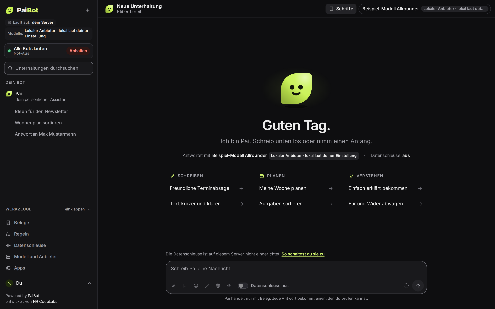

2. Schreib deine Frage in das Feld „Schreib Pai eine Nachricht“ (statt „Pai“ steht dort der Name deines Bots). Oder klick auf einen **Anfang**: Sein Text landet im Feld, der Cursor steht dahinter, und gesendet wird nichts. Ergänze den Satz und sende ihn.
3. Drück **Enter** oder klick auf den Pfeil rechts, um zu senden. Für eine neue Zeile drückst du **Umschalt+Enter**. Hat das Feld den Fokus, zeigt es eine schmale Linie in der Akzentfarbe. Nach dem Senden bleibt der Cursor im Feld, auch wenn die Antwort fertig ist oder du sie stoppst; du kannst also gleich weiterschreiben.

   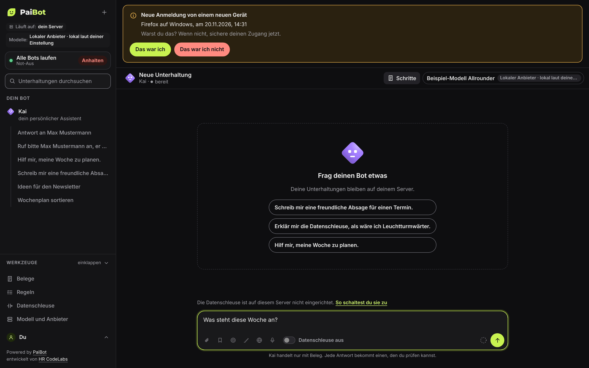

4. Die Unterhaltung erscheint links in der Seitenleiste unter deinem Bot. Ihr Titel ist der Anfang deiner ersten Nachricht (höchstens 60 Zeichen); ändern kannst du ihn später.

   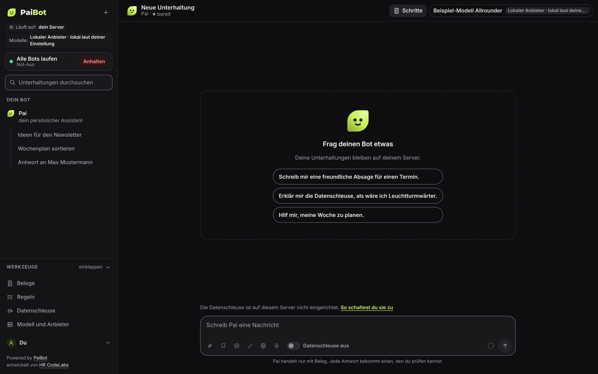

**Die Antwort lesen**

1. Unter deiner Nachricht erscheint zuerst der Text, den der Bot gerade schreibt: Stück für Stück, in einem eigenen Bereich außerhalb der Antwort-Blase, mit der Marke „vorläufig, noch nicht geprüft“. Erst wenn der Bot fertig ist, steht die Antwort als Ganzes in der Blase, und der vorläufige Bereich verschwindet. Oben steht neben dem Namen, was der Bot gerade tut: „wartet in der Schlange“, „denkt nach“ (der Lauf läuft, noch ist kein Text da), „schlägt in der Doku nach“, „schreibt“ (Text kommt an) und kurz „fertig“. Der Avatar daneben zeigt dasselbe mit seinem Gesicht (siehe „Der Avatar zeigt, was dein Bot tut“).

   

2. Abgesetzte Blöcke (etwa ein Mail-Entwurf) haben rechts oben **Kopieren**. Ein Klick legt nur diesen Block in die Zwischenablage; der Avatar zwinkert dazu kurz.
3. Links in einer Antwort zeigen in Klammern, wohin sie führen. Bilder lädt PaiBot nie; statt eines Bildes steht ein Link.
4. Ist die Antwort fertig, steht darunter eine Zeile mit drei Teilen: **Beleg** mit seiner Kennung (z. B. `B-0142`), der **Weg** („direkt an den Anbieter“ bzw. „geschützt über die Datenschleuse“) und das **Modell** mit seiner Herkunft. Als Herkunft steht nur Belegbares: bei EUrouter, wer laut Antwort geantwortet hat, mit dessen Sitz laut der Anbieter-Liste von EUrouter (zum Beispiel „Antwort von Nebul · Sitz Niederlande laut EUrouter“); bei Mistral AI der Name des Anbieters; bei einem eigenen Anbieter der Ort, den du selbst angegeben hast, „laut deiner Einstellung“. Ein pauschales „EU“ gibt es nicht. Am Handy ist die Zeile gekürzt; ein Tipp auf den Weg klappt sie aus.

   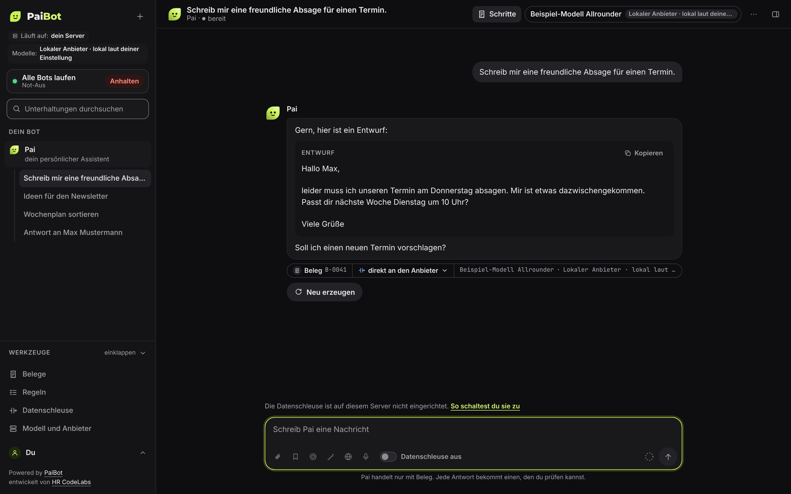

5. Mit **Schritte** oben rechts blendest du die Werkzeug-Zeilen, eingeklappte Zwischenschritte und die Beleg-Zeilen aus und wieder ein. Der vorläufige Text, der Hinweis „abgebrochen“ und die Kennzeichnung „Antwort von PaiBot, nicht vom Modell“ bleiben auch dann sichtbar.

**Pai schlägt in der Doku nach**

Bei Fragen zu PaiBot selbst kann dein Bot in der Doku der installierten PaiBot-Version nachschlagen. Das Werkzeug selbst liest nur die mitgelieferte Doku und ruft nichts im Netz auf. Was es findet, geht wie der übrige Chat mit der nächsten Anfrage an den Anbieter deines Modells.

1. Frag deinen Bot etwas zu PaiBot, zum Beispiel „Wie stelle ich das Tagesbudget ein?“, und sende die Nachricht.
2. Entscheidet sich das Modell fürs Nachschlagen, steht oben neben dem Namen „schlägt in der Doku nach“. Über der Antwort erscheint eine Werkzeug-Zeile: „In der Doku nachschlagen“ mit dem Status „läuft“, danach „fertig“ und der Zahl der gefundenen Abschnitte. Dein Bot fragt dich dafür nicht vorher; die Regel „Bot liest in der Doku seiner Version“ (R-010) erlaubt es, und jeder Aufruf bekommt seinen Beleg.
3. Klick auf die Zeile. Sie klappt auf und zeigt die **Quellen** (Doku-Seite und Abschnitt), die **Regel** und den **Beleg** mit seiner Kennung.

   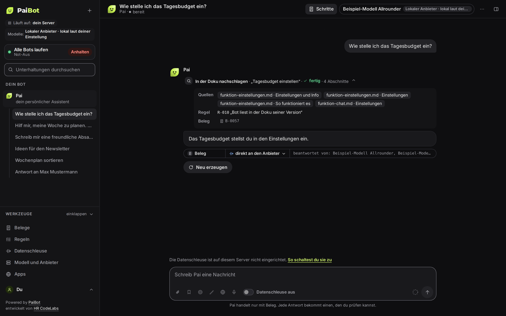

4. Lies die Antwort darunter und vergleiche sie mit den Quellen. PaiBot kann nicht erzwingen, dass sich das Modell an die gefundenen Abschnitte hält.
5. Ein Klick auf die Kennung des Belegs öffnet den Beleg „Werkzeug aufgerufen“; dort lässt er sich prüfen (siehe „Belege einer Unterhaltung ansehen“).

**Wenn nichts in der Doku steht**

1. Findet das Nachschlagen nichts, steht in der Werkzeug-Zeile „nichts gefunden“.
2. Danach antwortet das Modell ganz normal. PaiBot setzt dafür keinen eigenen Satz ein: Die Antwort kommt vom Modell, aus seinem eigenen Wissen oder mit dem Hinweis, dass es nichts weiß. Sie stammt dann nicht aus der Doku. Lies sie mit Vorsicht, denn PaiBot kann nicht erzwingen, dass das Modell nichts erfindet.

   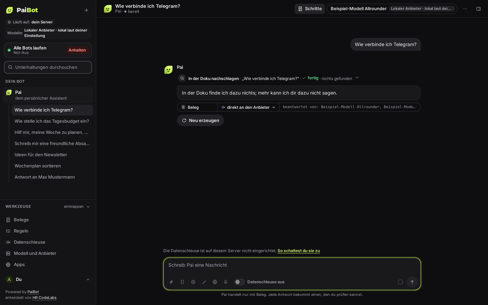

3. Feste Sätze von PaiBot gibt es nur bei Grenzen, etwa wenn die Token einer Antwort aufgebraucht sind oder die Schritte nicht reichen. Sie tragen den Hinweis „Antwort von PaiBot, nicht vom Modell“.

**Werkzeug- und Beleg-Zeilen ausblenden**

1. Klick oben rechts auf **Schritte**. Die Werkzeug-Zeilen, eingeklappte Zwischenschritte und die Beleg-Zeilen verschwinden; die Antworten bleiben.

   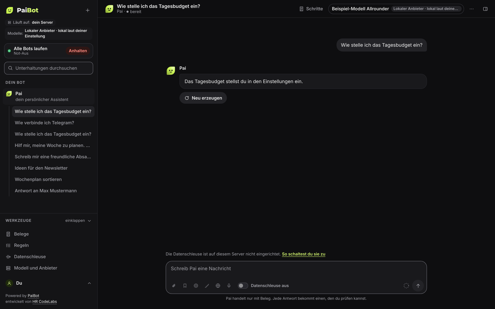

2. Ein zweiter Klick blendet sie wieder ein. Der vorläufige Text, der Hinweis „abgebrochen“ und der Hinweis „Antwort von PaiBot, nicht vom Modell“ bleiben in beiden Fällen sichtbar.

**Der Startbereich**

Der Startbereich ersetzt die leere Seite, solange eine Unterhaltung noch keine Nachricht hat. Er hat drei Fassungen; ab Werk gilt „Begrüßung“. Welche du siehst, wählst du unter _Einstellungen → Darstellung_ (siehe [Einstellungen](funktion-einstellungen.md)); die Wahl gilt für den Browser, in dem du sie triffst.

1. **Begrüßung:** großer Avatar, ein Gruß nach Tageszeit in deiner Zeitzone („Guten Morgen“ von 5 bis 10 Uhr, „Guten Tag“ bis 16, „Guten Abend“ bis 22, sonst „Hallo zu später Stunde“) und sechs Anfänge in drei Spalten: Schreiben, Planen, Verstehen. Darunter steht, mit welchem Modell der Bot antwortet, und ob die Datenschleuse an ist.
2. **Startbrett:** Karten mit Anfängen, dazu die Karte „So arbeitet Pai“ (Modell, Herkunft, Datenschleuse, Not-Aus, Zahl der Belege) und „Zuletzt“ mit bis zu drei deiner letzten Unterhaltungen.

   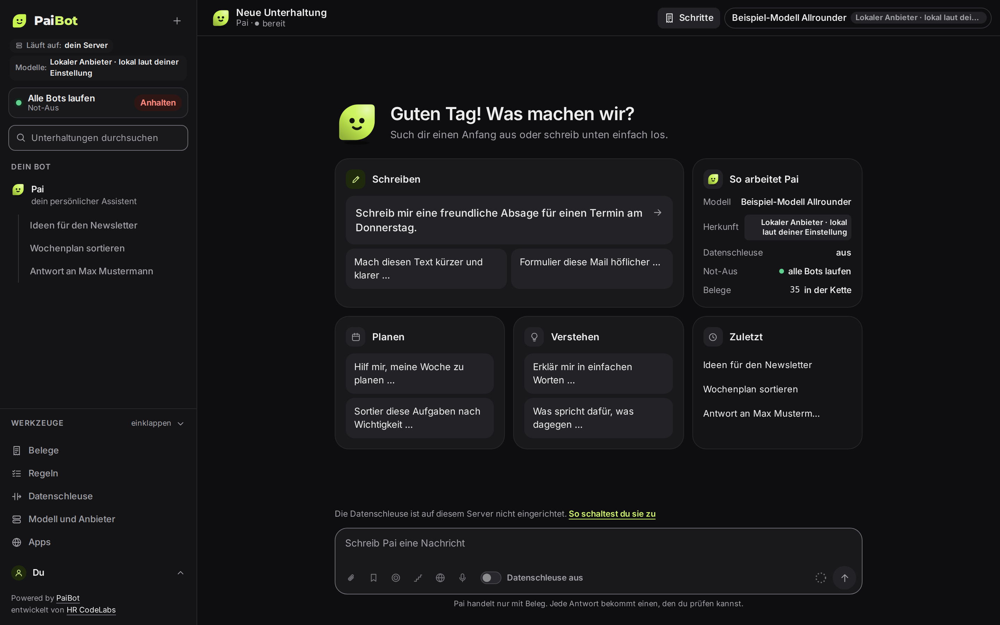

3. **Stille:** nur ein Satz und das Modell. Der Avatar sitzt über dem Eingabefeld. Klickst du ins Feld, erscheinen die Anfänge in seiner Sprechblase. Tippen oder **Esc** schließen sie; ein leeres Feld öffnet sie wieder.

   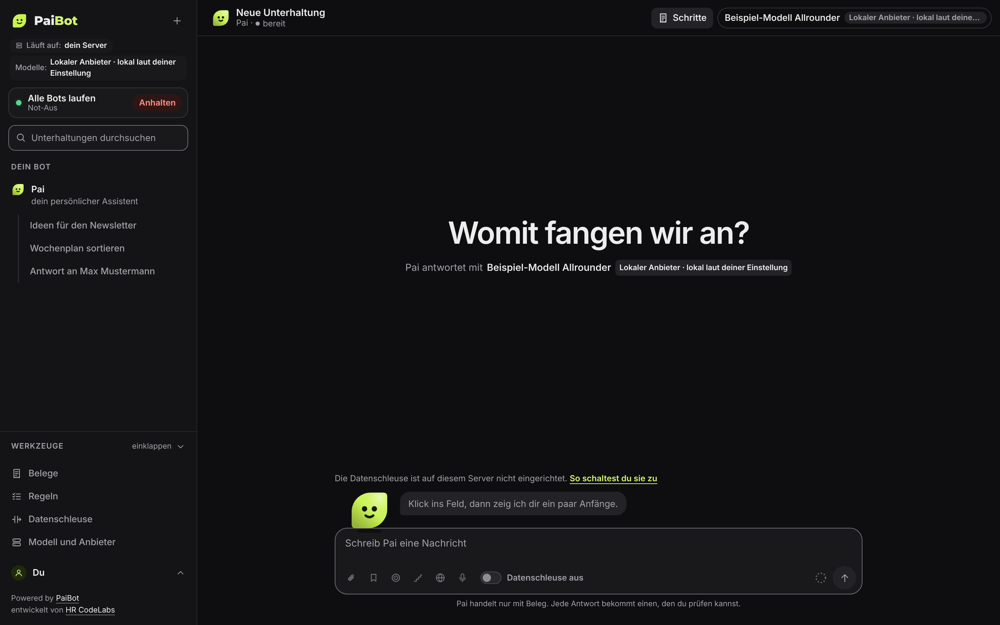

   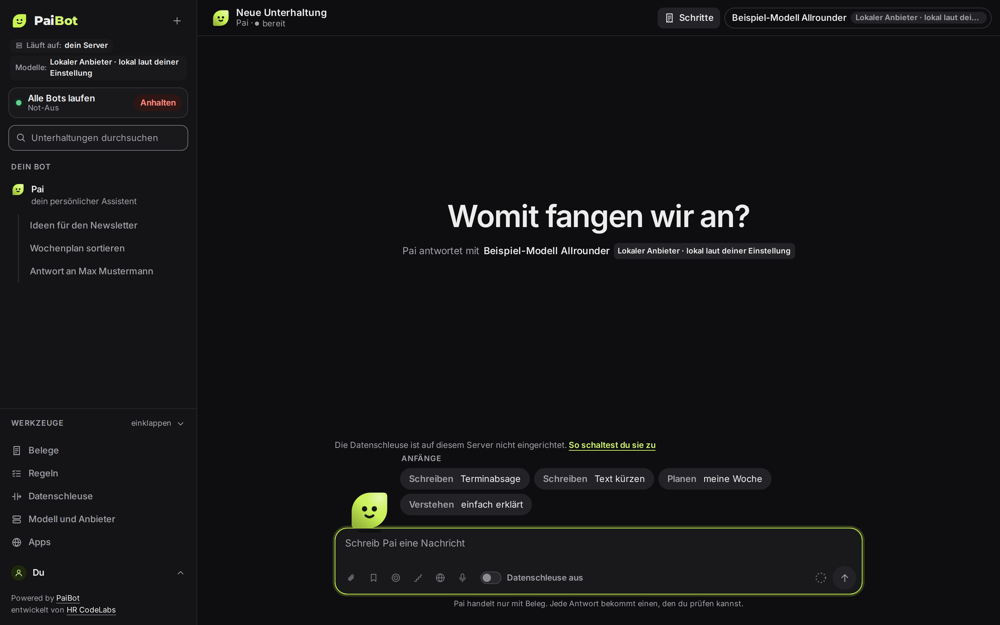

4. Auf dem Handy rücken die Spalten untereinander.

   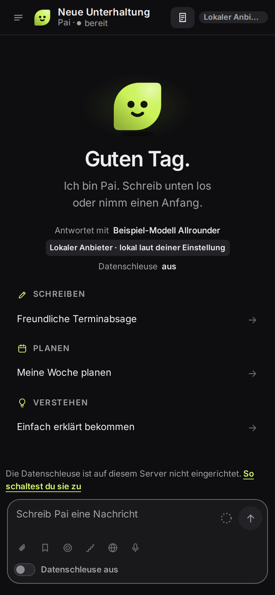

5. Was in den Karten steht, kommt aus deiner Installation: Modell und Herkunft wie im Kopf des Chats (bei EUrouter „über EUrouter“, nie ein pauschales „EU“), der Schalter der Datenschleuse, der Not-Aus und die Zahl der Belege (die Nummer des letzten Belegs in der Kette, die bei 1 beginnt). Fehlt eine Angabe, fehlt ihre Zeile; PaiBot schätzt nichts. Ist der Not-Aus an, zeigt der Startbereich nur den Hinweis „Alle Bots sind angehalten.“ und keine Anfänge.

**Der Avatar zeigt, was dein Bot tut**

Der Avatar im Kopf der Seite hat ein Gesicht, das sich nur aus echten Ereignissen ändert, nie zufällig. Das Wort neben ihm bleibt immer stehen.

| Was passiert                                                        | Avatar     | Wort neben ihm |
| ------------------------------------------------------------------- | ---------- | -------------- |
| nichts                                                              | ruhig      | „bereit“       |
| du tippst etwas ins Feld                                            | hört zu    | „hört zu“      |
| Lauf gestartet, noch kein Text                                      | denkt nach | „denkt nach“   |
| Text kommt an                                                       | schreibt   | „schreibt“     |
| Antwort fertig (knapp zwei Sekunden, dann wieder ruhig)             | fertig     | „fertig“       |
| Lauf ist gescheitert, abgelehnt oder von der Datenschleuse gestoppt | Fehler     | „Fehler“       |
| Not-Aus ist an                                                      | angehalten | „angehalten“   |

Dazu kommen kurze Gesten: ein Nicken, wenn deine Nachricht abgeschickt ist; ein Kopfschütteln, wenn sie zu lang ist; Anpacken bei „Neu erzeugen“; ein „einverstanden“, wenn du einen Lauf selbst stoppst (kein Fehler); Staunen bei einer sehr langen Antwort (ab 1.500 Ausgabe-Token); ein Zwinkern beim Kopieren eines Blocks. Nur der große Avatar im Startbereich schaut deinem Mauszeiger nach. In der Seitenleiste und neben den Antworten steht er still. Hast du in deinem System „weniger Bewegung“ eingestellt, bewegt er sich gar nicht; die Zustände bleiben am Gesicht und am Wort erkennbar. Der Zustand „wartet auf dich“ kann der Avatar zeigen, PaiBot löst ihn heute noch nicht aus, weil es noch keine Freigaben gibt.

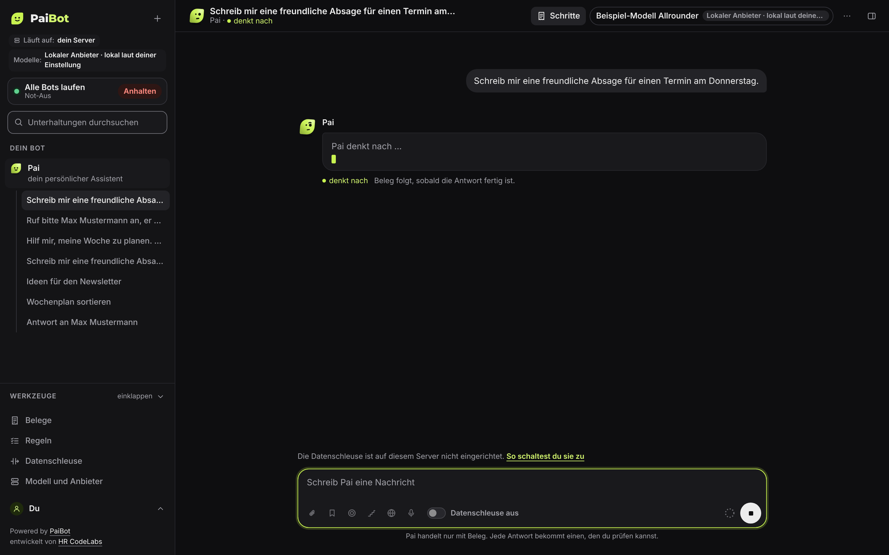

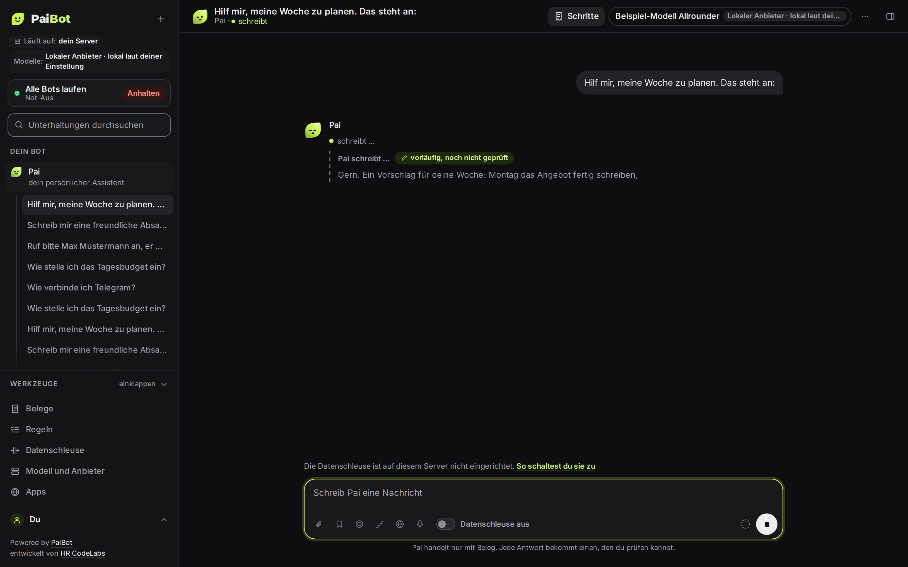

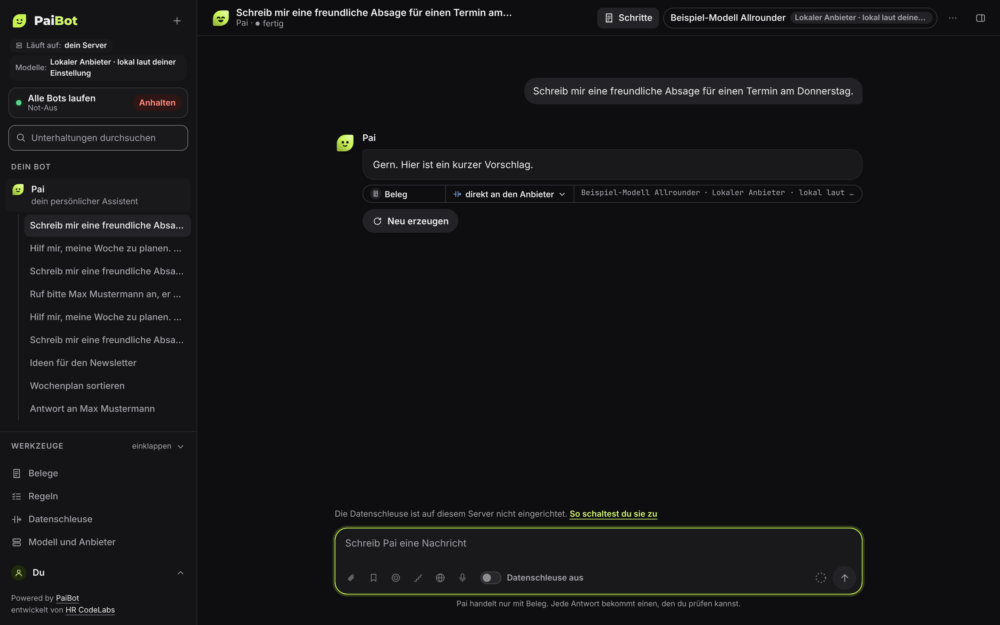

**Antwort stoppen**

1. Solange der Bot antwortet, steht in der Eingabe statt des Pfeils ein Quadrat: **Stopp**.
2. Klick darauf. Binnen etwa einer halben Sekunde hört der Bot auf. Was bis dahin geschrieben war, ist keine Antwort: Es steht als eingeklappter „Zwischenschritt – vorläufig, nicht geprüft“ über einer Blase mit dem Hinweis „Abgebrochen, bevor Pai geantwortet hat.“ Klappst du den Zwischenschritt auf, liest du den Text bis zum Stopp. Mit dem Knopf **Schritte** blendest du ihn aus.

   

3. Solange eine Antwort läuft, kannst du in dieser Unterhaltung nichts Neues senden. Danach geht es wie gewohnt weiter; der Cursor steht wieder im Nachrichtenfeld.

**Belege einer Unterhaltung ansehen**

1. Klick in der Zeile unter einer Antwort auf **Beleg**. Rechts öffnet sich die Arbeitsfläche (am Handy als Blatt von unten) mit diesem Beleg: was geschah, wer es tat, die Entscheidung des Tors, die angewandten Regeln, das Ergebnis, Zeit und Kennung.

   

2. **Als eigene Seite öffnen** führt zur Seite des Belegs unter „Belege“; dort lässt er sich prüfen.
3. **Alle Belege dieser Unterhaltung** zeigt die Liste, neuester oben. Neue Belege erscheinen dort von selbst, während der Bot arbeitet.

   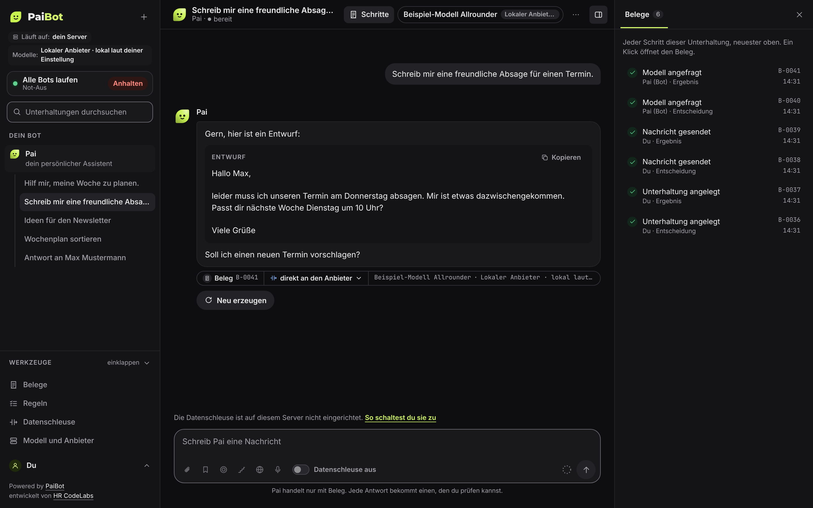

4. Ohne Klick auf einen Beleg öffnest du die Liste über das Symbol rechts oben in der Kopfzeile oder über **⋯ → Belege dieser Unterhaltung**. Mit dem Kreuz schließt du sie.

**Die Leiste unter dem Feld**

1. Links unter dem Feld stehen gedämpfte Symbole für Funktionen, die noch kommen: **Datei anhängen** (Bilder, Dokumente), **Merken**, **Ziel**, **Freigabe-Stufe**, **Web-Zugriff** und **Spracheingabe**. Sie sind gesperrt und tun nichts; zeigst du mit der Maus darauf, steht dort „… kommt später“. Rechts neben dem Pfeil steht ein leerer Ring: Dort soll später stehen, wie voll der Verlauf für das Modell ist. Er zeigt noch keine Zahl.
2. Daneben steht der Schalter **Datenschleuse** (siehe unten). Am Handy bricht die Leiste in zwei Zeilen um.

**Datenschleuse für diese Unterhaltung**

1. Unten in der Eingabe steht der Schalter **Datenschleuse an/aus**. Er gilt nur für diese Unterhaltung; neue Unterhaltungen beginnen mit dem Standard aus der Einrichtung.
2. Ist die Datenschleuse auf deinem Server nicht eingerichtet (der Worker meldet sie nicht), lässt sich der Schalter nicht einschalten. Über dem Feld steht dann „Die Datenschleuse ist auf diesem Server nicht eingerichtet.“ mit dem Link **So schaltest du sie zu** (siehe [Datenschleuse](funktion-datenschleuse.md)). Ausschalten geht immer.
3. Hat die Datenschleuse die letzte Anfrage gestoppt, steht über dem Feld „Datenschleuse nicht bereit“. Die Nachricht ging dann nicht an das Modell; es gibt keinen Rückfall auf den direkten Weg.
4. Lag es an der Datenschleuse, sagt der Hinweis an der Stelle der Antwort genau, woran: Sie hat die Anfrage gestoppt, sie war nicht bereit, sie nimmt den Schlüssel von PaiBot (`SCHLEUSE_KEY`) nicht an, oder die Antwort war zu groß. Darunter steht, was du tun kannst, und der Link **Zur Datenschleuse**.

   

**Unterhaltung umbenennen oder löschen**

1. Klick oben rechts auf **⋯** (Weitere Aktionen).

   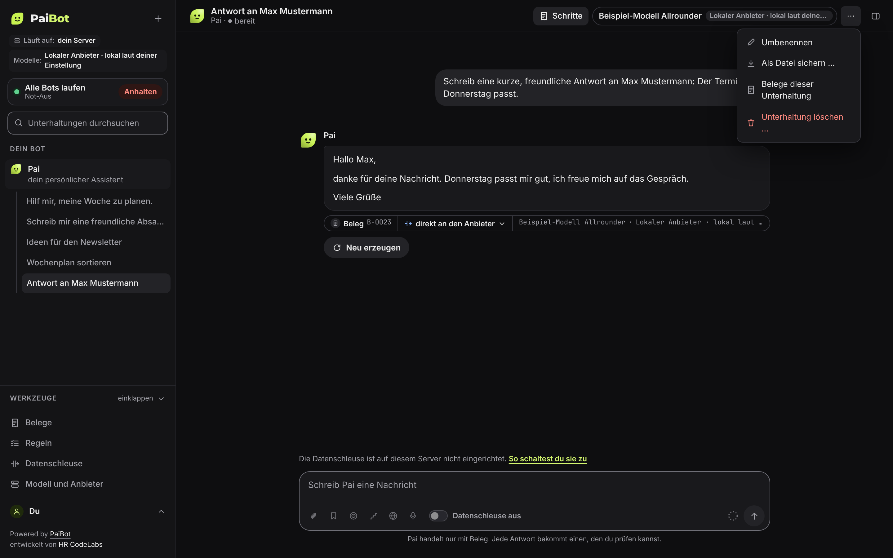

2. **Umbenennen**: neuen Titel eintragen, **Speichern** oder Enter. Die Seitenleiste zeigt den neuen Titel sofort.
3. **Unterhaltung löschen**: PaiBot fragt nach. **Löschen** entfernt Nachrichten und Antworten; die Belege bleiben, damit die Kette vollständig bleibt. Danach bist du wieder auf der Startseite.

   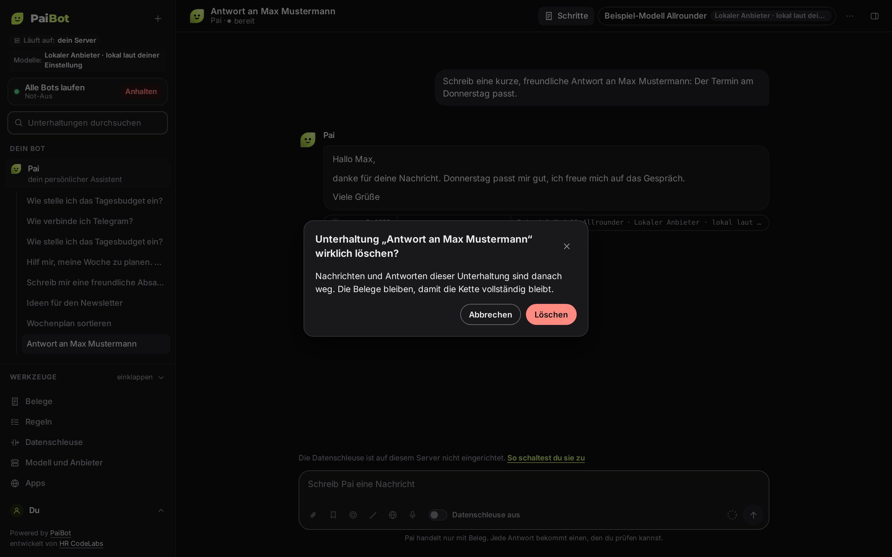

4. Solange der Bot in der Unterhaltung antwortet, lässt sie sich nicht löschen. Erst stoppen oder die Antwort abwarten.

**Unterhaltungen durchsuchen**

1. Klick links oben in der Seitenleiste in das Feld **Unterhaltungen durchsuchen** (am Handy zuerst auf das Menü oben links). Per Tastatur erreichst du es mit **Tab**.
2. Tipp ein Suchwort, mindestens zwei Zeichen. Groß- und Kleinschreibung spielen keine Rolle, Umlaute werden gefunden, wie du sie schreibst. Nach einem kurzen Moment erscheinen die Treffer an Stelle der Liste deiner Unterhaltungen: oben **Titel**, deren Name passt, darunter **Nachrichten** mit einem Ausschnitt um die Fundstelle. Das Suchwort ist darin markiert, darunter steht, wer schrieb und wann.

   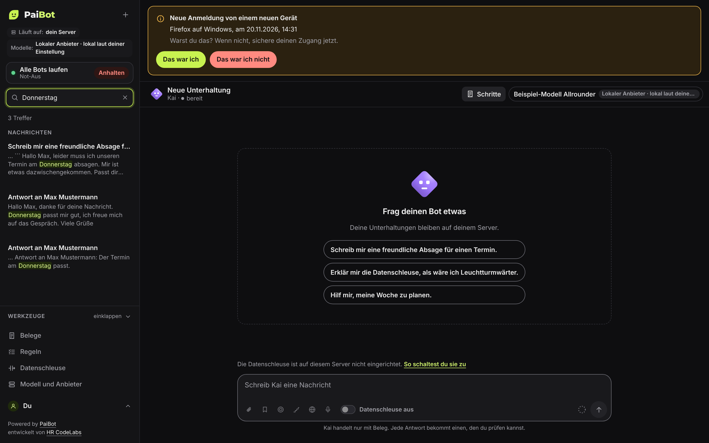

3. Klick auf einen Treffer. Ein Titel öffnet die Unterhaltung; eine Nachricht öffnet sie und rollt genau zu dieser Nachricht, die kurz umrandet ist. Per Tastatur: **Pfeil nach unten** springt vom Feld zum ersten Treffer, die Pfeile wechseln zwischen den Treffern, **Enter** öffnet, **Esc** führt zurück ins Feld.
4. Gibt es mehr als 20 Treffer in Nachrichten, holt **Weitere Treffer laden** die nächsten.
5. Findet die Suche nichts, steht dort „Nichts gefunden für …“ mit einem Tipp. **Esc** im Feld oder das Kreuz rechts darin leert die Suche; dann steht wieder die Liste deiner Unterhaltungen da.

   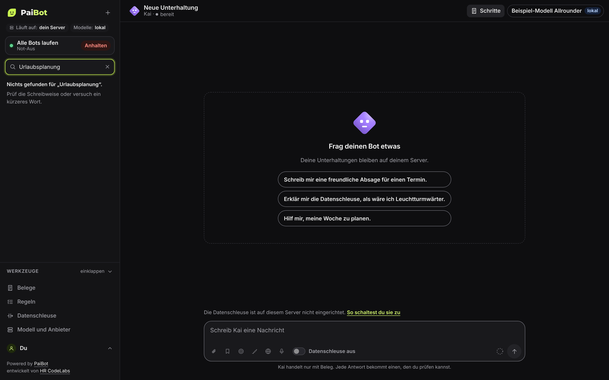

Am Handy steht das Suchfeld oben im Menü; ein Tipp auf einen Treffer schließt das Menü.

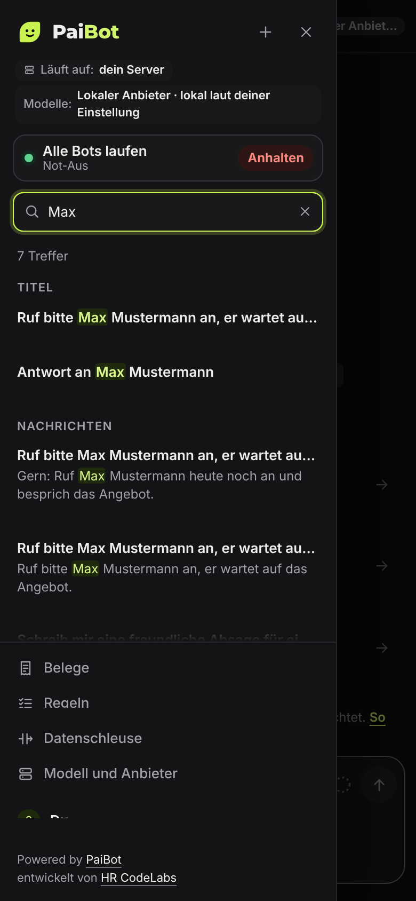

**Unterhaltung als Datei sichern**

1. Öffne die Unterhaltung und klick oben rechts auf **⋯** (Weitere Aktionen), dann auf **Als Datei sichern …**.
2. Es öffnet sich ein Fenster. Es sagt, was in der Datei steht, und weist darauf hin, dass sie persönliche Inhalte enthält. Bewahre sie sicher auf.

   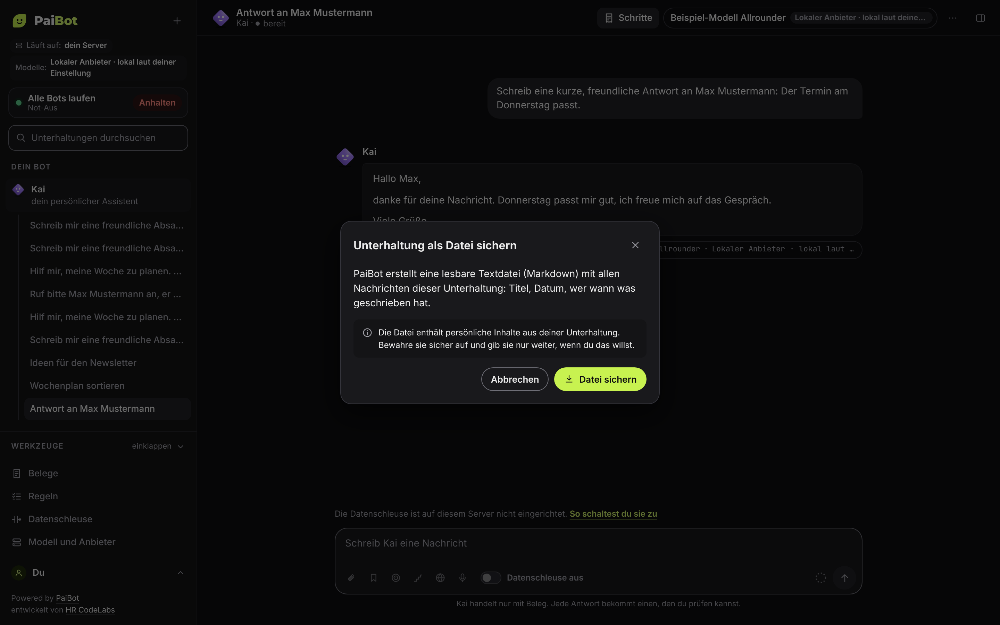

3. Klick auf **Datei sichern**. Dein Browser speichert eine Textdatei, etwa `paibot-antwort-an-max-mustermann-2026-11-21.md`. Im Fenster steht danach „Gesichert als …“.
4. Öffne die Datei mit einem beliebigen Texteditor. Oben stehen Titel, Name des Bots, wann die Unterhaltung angelegt und wann sie gesichert wurde. Darunter folgt jede Nachricht mit **wer** und **wann** als Überschrift und dem Text. Abgebrochene und fehlgeschlagene Antworten sind gekennzeichnet, ebenso frühere Fassungen einer neu erzeugten Antwort. Interne Kennungen und Schlüssel stehen nicht darin. Die Datei ist entschärft: Ein `<` aus einer Nachricht steht als `\<` darin (HTML erscheint als Text), ein Bild-Zeichen `![` als `!\[` (ein Markdown-Programm lädt so kein Bild aus dem Netz), Links auf `javascript:`, `data:` und `vbscript:` verlieren ihr Schema, Steuerzeichen fallen weg. Code-Blöcke und Code-Spannen bleiben wörtlich. In einem Texteditor bleibt alles lesbar; der Markdown-Text ist so gebaut, dass eine Vorschau daraus nichts ausführt oder nachlädt.
5. Auch das Sichern bekommt zwei Belege („Unterhaltung als Datei gesichert“). Du findest sie unter **Belege** und in der Arbeitsfläche dieser Unterhaltung.

**Antwort neu erzeugen**

1. Unter der letzten Antwort des Bots steht **Neu erzeugen**. Klick darauf. Der Bot schreibt eine neue Antwort auf dieselbe Nachricht, mit dem Modell, das er gerade hat.
2. Die neue Antwort erscheint an derselben Stelle, darunter „Fassung 2 von 2“. Die alte Antwort ist nicht weg.

   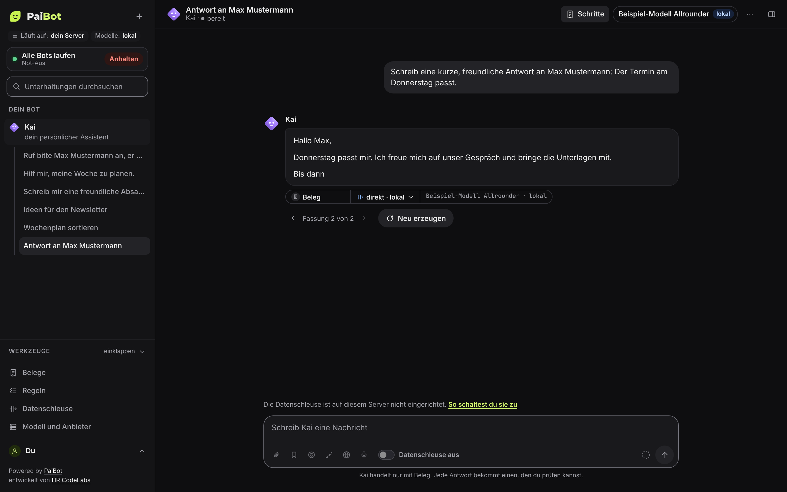

3. Mit den Pfeilen **‹** und **›** blätterst du zwischen den Fassungen. Eine ältere ist als „Frühere Fassung 1 von 2“ gekennzeichnet, mit dem Satz „Ersetzt durch eine neuere Fassung.“ Jede Fassung hat ihren eigenen Beleg. Für Bildschirmleser heißen die Pfeile „Zur vorigen Fassung der Antwort“ und „Zur nächsten Fassung der Antwort“, der kleine Pfeil neben „Neu erzeugen“ heißt „Neu erzeugen: weitere Möglichkeiten“.

   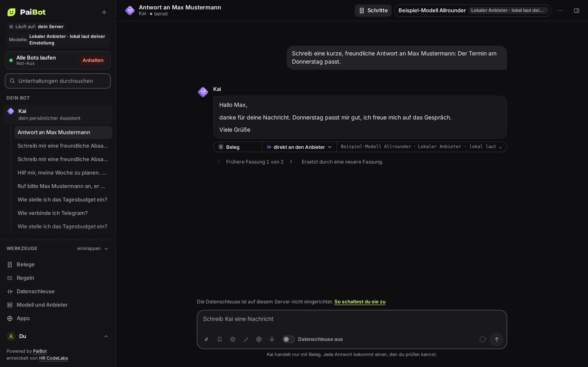

4. Mit einem anderen Modell: Klick auf den kleinen Pfeil neben **Neu erzeugen** und wähle **Mit anderem Modell …**. Wähle das Modell aus der Liste und klick auf **Neu erzeugen mit …**. Das gewählte Modell gilt danach auch für die nächsten Antworten deines Bots; zurückstellen kannst du es auf der Seite „Modell und Anbieter“. Den Pfeil gibt es nur, wenn mehr als ein Modell wählbar ist.
5. Solange eine Antwort läuft, ist **Neu erzeugen** gesperrt; daneben steht „Neu erzeugen geht wieder, sobald Pai fertig ist.“ Mit **Stopp** kannst du eine laufende neue Fassung abbrechen; ihr Text bis dahin ist keine Fassung, sondern steht wie beim Stopp einer Antwort als eingeklappter Zwischenschritt da, und die bisherige Fassung bleibt die gültige.
6. Ist der Not-Aus an, ist **Neu erzeugen** gesperrt („Neu erzeugen geht wieder, wenn du den Not-Aus aufhebst.“); am Server lehnt das Tor mit „Alle Bots sind angehalten.“ ab. Suchen und Als Datei sichern gehen auch bei Not-Aus, weil dabei kein Bot arbeitet.
7. Greift eine andere Grenze (zum Beispiel das Tagesbudget), entsteht keine neue Antwort. Unter der bisherigen Antwort steht dann der Hinweis mit dem Grund, und die bisherige Antwort bleibt die gültige.

**Eine andere Unterhaltung öffnen**

1. Klick links in der Seitenleiste auf ihren Titel (am Handy zuerst auf das Menü oben links). Die zuletzt benutzte steht oben.
2. Das **+** oben in der Seitenleiste beginnt eine neue Unterhaltung.
3. Einen angefangenen, nicht gesendeten Text merkt sich der Browser je Unterhaltung, bis du den Tab schließt.

## So sieht es aus

Die Bilder zu den einzelnen Schritten stehen oben in der Anleitung. Alle zeigen Beispiel-Daten: den Bot „Pai“, erfundene Unterhaltungen und den Test-Anbieter mit seinen Beispiel-Modellen. Uhrzeiten, die die Datenbank vergibt, sind in den Bildern ausgeblendet.

Eine Antwort über die Datenschleuse trägt in der Zeile darunter den Weg „geschützt über die Datenschleuse“:

Hat dein Bot kein Modell, sagt die Startseite das und führt zur Seite „Modell und Anbieter“:

Am Handy ist die Zeile unter der Antwort gekürzt. Ein Tipp auf den Weg klappt sie aus; ein Tipp auf den Beleg öffnet ihn als Blatt von unten.

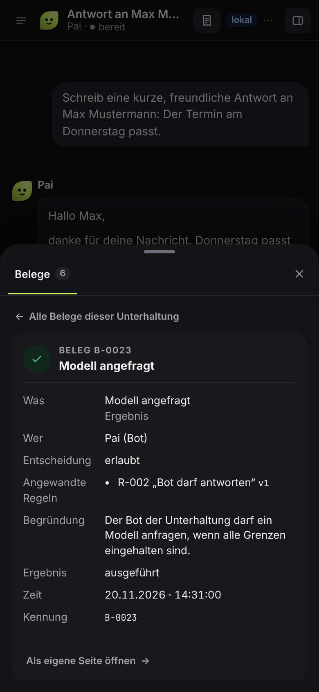

## Einstellungen

Suche, Sichern und Neu erzeugen haben keine eigenen Einstellungen. Feste Werte: Ein Suchwort hat 2 bis 100 Zeichen; je Seite zeigt die Suche bis zu 10 Titel und 20 Nachrichten (höchstens 1.000 Treffer weit); bis zu 120 Suchanfragen je Minute. Neu erzeugen zählt auf dasselbe Limit wie das Senden (30 je Minute).

| Einstellung            | Wo                                  | Bedeutung                                                                                 | Standard                                  |
| ---------------------- | ----------------------------------- | ----------------------------------------------------------------------------------------- | ----------------------------------------- |
| Modell des Bots        | Seite „Modell und Anbieter“         | Ohne gewähltes Modell antwortet der Bot nicht („Für deinen Bot ist kein Modell gewählt.“) | keins                                     |
| Anweisung des Bots     | Seite „Bot“                         | Steht am Ende der Anweisung an das Modell                                                 | leer                                      |
| Ausgabegrenze des Bots | nicht in der Oberfläche             | Höchstens so viele Token je Antwort                                                       | 4096                                      |
| Datenschleuse          | Schalter je Unterhaltung, Standard  | `An`: jede Anfrage geht über die Datenschleuse oder gar nicht                             | aus                                       |
| Verlaufsgrenze (Token) | Einstellungen                       | Wie viel vom bisherigen Gespräch mitgeschickt wird (etwa 4 Zeichen je Token)              | keine eigene Grenze                       |
| Tagesbudget (Token)    | Einstellungen                       | Ist es erreicht, lehnt das Tor weitere Anfragen bis Mitternacht (deine Zeitzone) ab       | keins                                     |
| Not-Aus                | Schalter oben in der Seitenleiste   | Ist er an, lehnt das Tor jede Anfrage des Bots ab                                         | aus                                       |
| Zeitzone               | Einstellungen                       | Für das Datum in der Anweisung und den Beginn des Tagesbudgets                            | Zeitzone des Browsers bei der Einrichtung |
| Startbereich           | Einstellungen, Reiter „Darstellung“ | Fassung der leeren Unterhaltung: Begrüßung, Startbrett oder Stille; gilt je Browser       | Begrüßung                                 |

Feste Werte der Lauf-Steuerung (im Code, `RUN_TUNING`):

| Wert                             | Wirkung                                                              |
| -------------------------------- | -------------------------------------------------------------------- |
| höchstens 50 Nachrichten Verlauf | Ältere Nachrichten werden abgeschnitten, nicht zusammengefasst       |
| höchstens 120.000 Zeichen        | Anweisung plus Verlauf je Anfrage; älteres fällt zuerst weg          |
| höchstens 200.000 Zeichen        | Länge einer Antwort; darüber endet sie mit „Ein Limit ist erreicht.“ |
| 9 Minuten                        | längste Dauer einer Antwort                                          |
| 60 Sekunden                      | längste Pause des Modells ohne neues Text-Stück                      |
| 10 Sekunden                      | Herzschlag einer laufenden Antwort in der Datenbank                  |
| 0,5 Sekunden                     | so oft prüft der Worker, ob du „Stopp“ gedrückt hast                 |
| 50 ms oder 200 Zeichen           | so werden Text-Stücke gebündelt, bevor sie an die Seite gehen        |

## So funktioniert es

Eine Nachricht wird in diesen Schritten zur Antwort:

1. **Senden (Web-App):** Steht der Schalter „Datenschleuse“ anders als bisher für die Unterhaltung, wird zuerst umgeschaltet (Aktion `schleuse.umschalten`, eigene Belege). Dann prüft das Tor die Aktion `nachricht.senden` (Unterhaltung vorhanden, kein Lauf aktiv, Länge, Not-Aus). Erst mit Erlaubnis entstehen in **einer** Transaktion die Nachricht, ein Lauf im Zustand „wartet“, die Ereignisse `message.created` und `run.queued` und der Auftrag in der Warteschlange. Scheitert ein Teil, entsteht nichts davon. Die erste Nachricht einer neuen Unterhaltung legt diese vorher an (Aktion `unterhaltung.anlegen`).
2. **Abholen (Worker):** Der Worker holt den Auftrag ab und liest Lauf, Unterhaltung, Bot, Einstellungen, Modell, Anbieter, Verlauf und den Tagesverbrauch **in einem Lesestand**. Der Lauf geht auf „läuft“ (Ereignis `run.started`).
3. **Fakten bilden:** Aus der Datenbank, nie aus dem Text der Nachricht: Anbieter, Region, Ziel-Adresse (als Abdruck), Weg (direkt oder Datenschleuse), ob die Datenschleuse erreichbar ist, Länge der Anfrage, Ausgabegrenze, Tagesverbrauch, Not-Aus.
4. **Tor:** Aktion `modell.anfragen` mit dem Bot als Akteur. Der Beleg „Entscheidung“ enthält die Fakten und eine Prüfsumme der ausgehenden Anfrage, nicht den Text.
5. **Antwort:** Nur wenn das Tor erlaubt, entsteht der Zugang zum Modell, und nur innerhalb dieser einen Ausführung. Pai hat ein Werkzeug, das Nachschlagen in der Doku; deshalb läuft jede Antwort als Folge von Schritten. In jedem Schritt fragt die Lauf-Steuerung das Modell, und jeder Schritt und jeder Werkzeug-Aufruf geht einzeln durchs Tor. Der Text eines Schritts geht gebündelt als `draft.delta` an die Seite und gilt als vorläufig: Erst am Ende des Schritts steht fest, ob er die Antwort ist oder nur ein Zwischentext vor einem Werkzeug-Aufruf. Die Antwort erscheint dann als Ganzes (`message.created`, `text.delta`, `message.completed`) mit Modell, Weg und Token-Zahlen.
6. **Ergebnis:** Der Beleg „Ergebnis“ enthält Status, Token-Zahlen und eine Prüfsumme der Antwort, nie den Text. Danach ist der Lauf fertig, und die Unterhaltung nimmt die nächste Nachricht an.

Was die Seite live bekommt (über den Ereignis-Strom der Unterhaltung):

| Ereignis                                          | Bedeutung                                                                                  |
| ------------------------------------------------- | ------------------------------------------------------------------------------------------ |
| `run.started`                                     | Der Bot beginnt zu antworten                                                               |
| `draft.delta`                                     | Neuer Text des laufenden Schritts, vorläufig, zum Anhängen                                 |
| `step.finished`                                   | Ein Schritt ist zu Ende: Zwischentext oder Antwort                                         |
| `tool.requested`, `tool.started`, `tool.finished` | Ein Werkzeug-Aufruf wurde gewünscht, läuft, ist zu Ende (Zeile „In der Doku nachschlagen“) |
| `message.created`                                 | Die Antwort des Bots ist angelegt (noch leer)                                              |
| `text.delta`                                      | Neuer Text der Antwort, zum Anhängen                                                       |
| `message.completed`                               | Antwort fertig, mit Weg, Modell und Token                                                  |
| `run.cancelled`                                   | Abgebrochen; der bisherige Text bleibt als „Abgebrochen“                                   |
| `run.failed`                                      | Keine (vollständige) Antwort; Code und Satz sagen warum                                    |
| `run.denied`                                      | Das Tor hat abgelehnt; es ging nichts an das Modell                                        |
| `schleuse.blockiert`                              | Die Datenschleuse war gefordert, aber nicht nutzbar oder hat gestoppt                      |
| `beleg.created`                                   | Ein Beleg ist entstanden (Entscheidung oder Ergebnis)                                      |

**Suchen:** Die Seitenleiste fragt `GET /api/suche?q=…` (nur angemeldet, geprüftes Suchwort, eigenes Limit). Die Datenbank deiner Installation vergleicht das Suchwort ohne Groß- und Kleinschreibung mit Titeln und dem Text deiner Nachrichten und der Antworten. Das Suchwort ist reiner Text: Zeichen wie `%` oder `_` haben keine Sonderbedeutung. Die Datenbank schneidet den Ausschnitt um die Fundstelle selbst zu, die Seite setzt ihn als Text ein. Die Suche liest nur, sie schreibt keinen Beleg und geht nicht ins Internet. Einen eigenen Suchindex gibt es nicht; für die Mengen einer Person reicht das Durchsuchen der Tabelle.

**Als Datei sichern:** `POST /api/unterhaltungen/<kennung>/export` liest die Unterhaltung in einem Lesestand. Das Tor entscheidet über die Aktion `unterhaltung.exportieren` (Unterhaltung vorhanden, V-01); erst danach entsteht die Datei (Markdown, `text/markdown`, zum Speichern, nie zum Anzeigen). Die Aktion ändert keine Daten; ihr Ergebnis sind die beiden Belege, deren Kennungen in den Kopfzeilen der Antwort stehen.

**Neu erzeugen:** `POST /api/unterhaltungen/<kennung>/antworten/<antwort>/neu`. Das Tor entscheidet über `antwort.neu_erzeugen` (Unterhaltung vorhanden V-01, kein Lauf aktiv V-02, es ist die letzte Antwort V-11, Not-Aus G-05). Erst mit Erlaubnis entstehen in einer Transaktion ein neuer Lauf zur **selben Nachricht** von dir, das Ereignis `run.queued` und der Auftrag. Danach läuft alles wie bei einer neuen Nachricht, mit eigener Entscheidung `modell.anfragen` und eigenen Belegen; Tagesbudget und alle anderen Grenzen gelten. Die alte Antwort bleibt unverändert gespeichert. Alle Antworten des Bots zwischen zwei Nachrichten von dir sind Fassungen derselben Antwort. Im Verlauf, den das Modell bei späteren Nachrichten bekommt, steht je Nachricht nur die neueste Fassung mit Text; eine neue Fassung ohne Text (abgelehnt oder fehlgeschlagen, bevor etwas kam) ersetzt nichts.

**Abbruch:** „Stopp“ setzt in der Datenbank einen Abbruch-Wunsch (Aktion `lauf.abbrechen`). Der Worker sieht ihn binnen einer halben Sekunde, schließt die Verbindung zum Anbieter und beendet den Lauf. Auch wenn der Worker herunterfährt, endet eine laufende Antwort als „Abgebrochen“.

**Hängende Läufe:** Stürzt der Worker mitten in einer Antwort ab, fehlt der Herzschlag. Beim nächsten Start beendet der Worker solche Läufe als „unterbrochen“, schreibt das fehlende Ergebnis zum Beleg „Entscheidung“ und gibt die Unterhaltung wieder frei. Läufe, die länger als 15 Minuten nie abgeholt wurden, beendet er ebenso.

**Reihenfolge der Sperren:** Die Lauf-Steuerung hält nie eine Transaktion auf der Unterhaltung offen, während sie das Tor fragt. So können Web-App und Worker gleichzeitig Ereignisse und Belege schreiben, ohne sich zu verklemmen; die Beleg-Kette bleibt lückenlos.

**Die Seite:** Beim Öffnen liest die Seite den Verlauf in einem einzigen Lesestand (Nachrichten, Läufe, die Ereignisse einer gerade laufenden Antwort, die letzte Nummer im Ereignis-Strom und die Belege). Danach verbindet sie sich mit dem Ereignis-Strom ab genau dieser Nummer. Reißt die Verbindung ab, steht über der Eingabe „verbindet neu …“; danach holt die Seite alles ab der letzten gesehenen Nummer nach, ohne Lücke und ohne Doppel. Lädst du die Seite mitten in einer Antwort neu, läuft der Lauf weiter, und die Seite zeigt ihn von dort aus; der vorläufige Text des Schritts, der gerade schreibt, ist nach dem Neuladen nicht mehr zu sehen, weil er erst am Ende des Schritts gespeichert wird. Die fertige Antwort steht danach da.

Beteiligte Teile: `apps/web/src/app/(app)/chat/` und `apps/web/src/lib/chat/` (Seite und Routen), `packages/agents/src/run/` (Lauf-Steuerung), `packages/agents/src/prompt.ts` (Anweisung an das Modell), `packages/gate` (Tor), `packages/llm` (Modell-Zugang), `packages/receipts` (Belege), `apps/worker` (Dienst im Hintergrund).

## Grenzen

- Der Bot hat in dieser Fassung **genau ein Werkzeug**: Er kann in der Doku seiner PaiBot-Version nachschlagen. Mehr nicht: Er kann nichts auslösen, nichts speichern und nichts im Internet nachsehen. Wünscht ein Modell trotzdem ein anderes Werkzeug, lehnt das Tor jeden Wunsch mit Beleg ab, und nichts wird ausgeführt. Weitere Werkzeuge sind geplant.
- **Nachschlagen in der Doku:** Die Suche findet nur Wörter, die in der Doku stehen; Entwickler-, Vertrags- und Lizenztexte gehören nicht dazu. Findet sie nichts, antwortet das Modell trotzdem, und PaiBot setzt dafür keinen eigenen Satz ein. PaiBot kann nicht erzwingen, dass das Modell dann nichts erfindet oder sich bei einem Treffer an die gefundenen Abschnitte hält. An der Werkzeug-Zeile siehst du, ob etwas gefunden wurde; ob die Antwort stimmt, siehst du dort nicht. Ob ein Modell das Werkzeug überhaupt nutzt, entscheidet das Modell; PaiBot hat das nicht gemessen.
- **Die Antwort springt am Ende in die Blase:** Der Text erscheint zuerst vorläufig und als „noch nicht geprüft“ gekennzeichnet über der Blase und steht erst am Ende des Schritts als Antwort da. Die Quellen in der Werkzeug-Zeile sind Text; sie führen nicht zu einer Doku-Seite.
- **Verlauf, Suche und Datei zeigen nur Antworten:** Zwischentexte, Werkzeug-Zeilen und der Text eines gestoppten Schritts stehen weder in der Suche noch in der gesicherten Datei.
- **Länge einer Antwort:** Eine Antwort darf höchstens so viel schreiben, wie die Ausgabegrenze deines Bots erlaubt, und zusammen mit der Anfrage nicht mehr Token verbrauchen als „Token je Antwort“ (Startwert 60 000, in dieser Version nicht einstellbar). Hat dein Bot eine sehr hohe Ausgabegrenze, kann eine Antwort deshalb kürzer begrenzt sein als die Ausgabegrenze. Reicht der Rest nicht mehr für eine Antwort, lehnt das Tor ab; greift die Grenze mitten in einer Antwort mit mehreren Schritten, schreibt PaiBot einen festen Satz, dass es aufgehört hat.
- **Kein automatisches Wiederholen:** Scheitert eine Anfrage beim Anbieter, schickst du die Nachricht selbst noch einmal.
- **Kein Rückfall auf direkt:** Ist die Datenschleuse an, aber nicht erreichbar, geht die Nachricht gar nicht raus.
- Älterer Verlauf wird abgeschnitten, nicht zusammengefasst. Bei sehr langen Unterhaltungen „vergisst“ der Bot den Anfang.
- Pro Unterhaltung antwortet der Bot immer nur auf eine Nachricht zur selben Zeit.
- Die Token-Zahlen meldet der Anbieter; PaiBot rechnet sie nicht nach.
- Der Schalter „Datenschleuse“ gilt je Unterhaltung (oder als Standard). Ein eigener Schalter nur für eine einzelne Nachricht ist geplant.
- Ob die Datenschleuse gerade bereit ist, zeigt der Chat erst, wenn eine Anfrage gestoppt wurde („Datenschleuse nicht bereit“). Den laufenden Zustand, den der Worker alle 30 Sekunden prüft, zeigt die Seite [Datenschleuse](funktion-datenschleuse.md).
- Unter einer Antwort steht nicht, wie viele Angaben die Datenschleuse ersetzt hat; diese Zahl wird nicht festgehalten.
- Die Seitenleiste zeigt die 100 zuletzt benutzten Unterhaltungen.
- Die Suche findet zusammenhängende Zeichenfolgen, keine Wortformen und keine Tippfehler („Tomate“ findet „Tomaten“, „Tomatn“ nicht). Abweichende Schreibweisen von Zeichen (etwa „ae“ statt „ä“) findet sie nicht. Nachrichten gelöschter Unterhaltungen findet sie nicht.
- Neu erzeugt wird nur die letzte Antwort einer Unterhaltung. Eine Antwort weiter oben lässt sich nicht neu erzeugen, und eine frühere Fassung lässt sich nicht wieder zur gültigen machen; dafür erzeugst du neu.
- Beim Neu erzeugen mit anderem Modell wechselt das Modell des Bots, nicht nur das einer Antwort.
- Die gesicherte Datei enthält eine Antwort, die beim Sichern noch lief, ohne Text (gekennzeichnet).
- Die Plätze in der Leiste unter dem Feld sind **geplant, nicht gebaut**: Datei anhängen (Bilder, Dokumente), Merken (der Bot merkt sich etwas), Ziel (der Bot arbeitet, bis ein Ziel erreicht ist), Freigabe-Stufe (fragen, vorbereiten, ausführen mit Beleg), Web-Zugriff, Spracheingabe und die Anzeige, wie voll der Verlauf ist. Bis dahin sind sie gesperrt und ohne Verhalten.
- Die Wahl des Startbereichs liegt in einem Cookie dieses Browsers (`paibot_startbereich`, ein Jahr). Auf einem anderen Gerät oder nach dem Löschen der Cookies gilt wieder „Begrüßung“. Sie steht nicht auf dem Server.
- Die Anfänge sind reine Text-Aufgaben; sie rufen keine Werkzeuge auf. Der Gruß richtet sich nach der Zeitzone aus den Einstellungen. Der Avatar schaut zur Schreibstelle im Feld nur ungefähr (er rechnet mit der Länge der letzten Zeile, nicht mit der echten Cursor-Position).
- Eine Nachricht hat höchstens 32.000 Zeichen. Kurz vor der Grenze zeigt die Eingabe, wie viele noch gehen; darüber wird nicht gesendet.

## Fehlerbehebung

| Beobachtung                                                     | Ursache                                                                                                           | Was tun                                                                                                                                                                                                                                                       |
| --------------------------------------------------------------- | ----------------------------------------------------------------------------------------------------------------- | ------------------------------------------------------------------------------------------------------------------------------------------------------------------------------------------------------------------------------------------------------------- |
| „Für deinen Bot ist kein Modell gewählt.“                       | Der Bot hat kein Modell, oder es ist abgeschaltet                                                                 | Modell wählen (siehe [Anbieter und Modelle](funktion-anbieter-und-modelle.md))                                                                                                                                                                                |
| „Dein Bot antwortet gerade noch.“                               | In dieser Unterhaltung läuft schon eine Antwort                                                                   | Abwarten oder „Stopp“                                                                                                                                                                                                                                         |
| „Das Tor hat die Aktion abgelehnt.“                             | Eine Grenze greift: Not-Aus, Tagesbudget, Anbieter abgeschaltet, Region                                           | Im Beleg „Entscheidung“ steht, welche Grenze (siehe [Das Tor](funktion-tor.md)). Beim Tagesbudget sagt der Chat selbst, dass du es unter Einstellungen › Grenzen ändern kannst und dass der Verbrauch ab Mitternacht in deiner Zeitzone wieder bei null zählt |
| `schleuse.blockiert`, keine Antwort                             | Datenschleuse an, aber nicht installiert, nicht erreichbar oder gestoppt                                          | Datenschleuse prüfen ([Datenschleuse](funktion-datenschleuse.md)) oder ausschalten                                                                                                                                                                            |
| „Der Anbieter hat den Schlüssel nicht angenommen.“              | Schlüssel falsch, abgelaufen, oder die Adresse des Anbieters wurde geändert                                       | Schlüssel neu eintragen                                                                                                                                                                                                                                       |
| „Ein Limit ist erreicht.“                                       | Der Anbieter meldet ein Limit, oder die Antwort wurde zu lang                                                     | Kurz warten; Tagesbudget prüfen                                                                                                                                                                                                                               |
| „Der Anbieter des Modells ist nicht erreichbar.“                | Netz, Anbieter gestört, oder keine Antwort innerhalb der Zeitgrenze                                               | Später noch einmal senden                                                                                                                                                                                                                                     |
| „Die Antwort wurde unterbrochen.“                               | Abgebrochen oder der Worker wurde beendet                                                                         | Nachricht noch einmal senden                                                                                                                                                                                                                                  |
| Der Text bleibt im vorläufigen Bereich, die Antwort kommt nicht | Der Schritt ist noch nicht zu Ende, oder der Worker läuft nicht                                                   | Warten oder „Stopp“; sonst `docker compose logs worker` ansehen                                                                                                                                                                                               |
| Werkzeug-Zeile „abgelehnt“ oder „fehlgeschlagen“                | Das Tor hat den Aufruf abgelehnt, oder das Nachschlagen ist gescheitert; der Grund steht aufgeklappt in der Zeile | Zeile aufklappen und den Beleg ansehen; die Antwort des Modells folgt trotzdem                                                                                                                                                                                |
| Werkzeug-Zeile fehlt                                            | Der Knopf „Schritte“ ist aus, oder das Modell hat nicht nachgeschlagen                                            | Knopf „Schritte“ einschalten; ob nachgeschlagen wurde, zeigen die Belege der Unterhaltung                                                                                                                                                                     |
| Der Worker startet nicht, im Log steht „Doku-Index“             | Der Index der Doku fehlt oder ist ungültig                                                                        | Mit `pnpm doku:index` neu bauen, im Image das Image neu bauen, oder `PAIBOT_DOKU_INDEX` prüfen                                                                                                                                                                |
| Antwort bleibt lange bei „denkt nach …“                         | Worker läuft nicht                                                                                                | `docker compose logs worker` ansehen; Zeilen wie `Lauf lau_… beendet: succeeded` zeigen Läufe                                                                                                                                                                 |
| „verbindet neu …“ bleibt stehen                                 | Die Web-App ist nicht erreichbar                                                                                  | Warten; sonst „Neu verbinden“ oder die Seite neu laden. Die Antwort läuft im Hintergrund weiter                                                                                                                                                               |
| Schalter „Datenschleuse“ lässt sich nicht einschalten           | Die Datenschleuse ist auf diesem Server nicht eingerichtet                                                        | [Datenschleuse](funktion-datenschleuse.md) einrichten                                                                                                                                                                                                         |
| „… nimmt den Schlüssel von PaiBot nicht an“                     | Worker und Datenschleuse haben verschiedene `SCHLEUSE_KEY`                                                        | `SCHLEUSE_KEY` in `deploy/.env` prüfen, Worker und Datenschleuse neu starten                                                                                                                                                                                  |
| „Gib mindestens zwei Zeichen ein.“ in der Suche                 | Das Suchwort ist zu kurz                                                                                          | Ein zweites Zeichen tippen                                                                                                                                                                                                                                    |
| „Nichts gefunden für …“                                         | Kein Titel und keine Nachricht enthält das Suchwort                                                               | Kürzeres Wort oder andere Schreibweise versuchen                                                                                                                                                                                                              |
| „Die gesuchte Nachricht gibt es … nicht mehr.“                  | Die Nachricht zum Treffer wurde inzwischen gelöscht                                                               | Neu suchen                                                                                                                                                                                                                                                    |
| „Neu erzeugen“ gesperrt                                         | Der Bot antwortet gerade, oder es fehlt Modell oder Schlüssel                                                     | Abwarten oder „Stopp“; sonst Modell wählen                                                                                                                                                                                                                    |
| Neu erzeugen: „Das gibt es nicht (mehr).“                       | Inzwischen kam eine neuere Nachricht dazu; die Antwort ist nicht mehr die letzte                                  | Seite neu laden                                                                                                                                                                                                                                               |
| Sichern: „Das gibt es nicht (mehr).“                            | Die Unterhaltung wurde gelöscht                                                                                   | Seite neu laden                                                                                                                                                                                                                                               |
| „… Zeichen zu viel“ über dem Feld                               | Die Nachricht ist länger als 32.000 Zeichen                                                                       | Kürzen oder auf mehrere Nachrichten verteilen                                                                                                                                                                                                                 |
