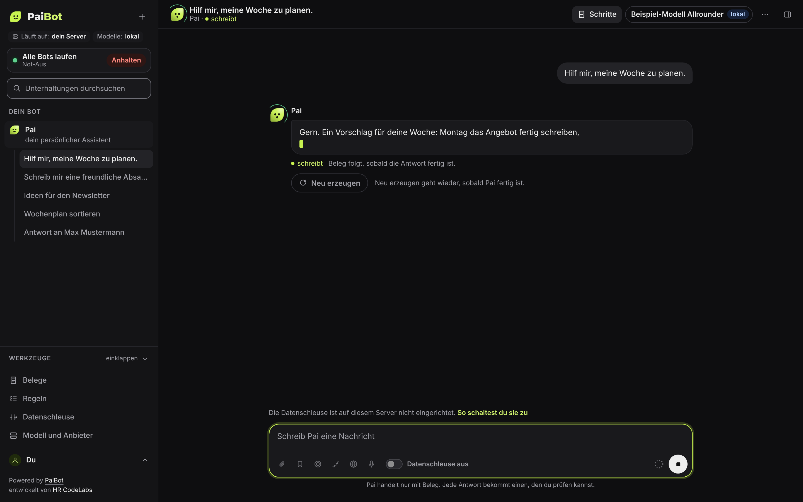
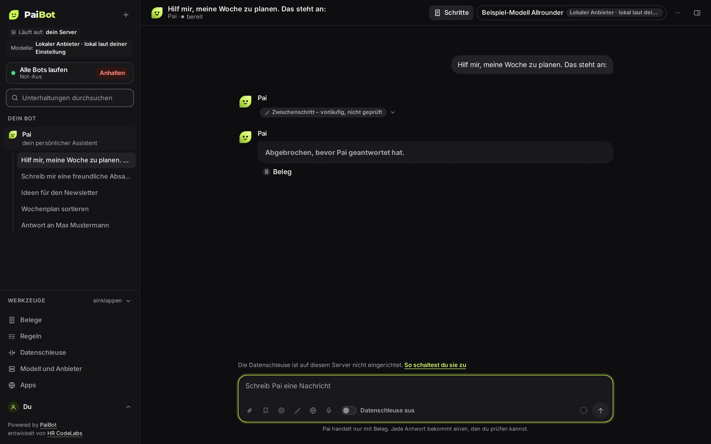
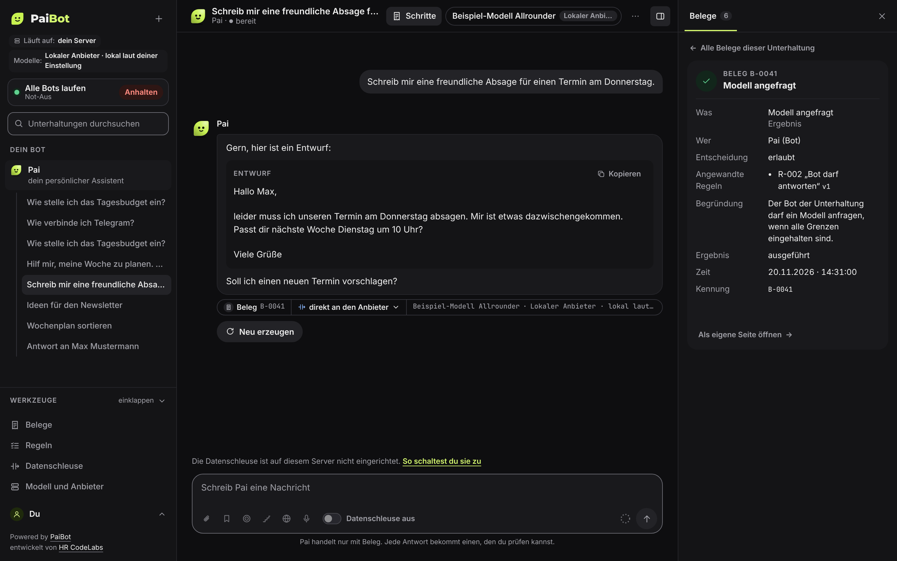
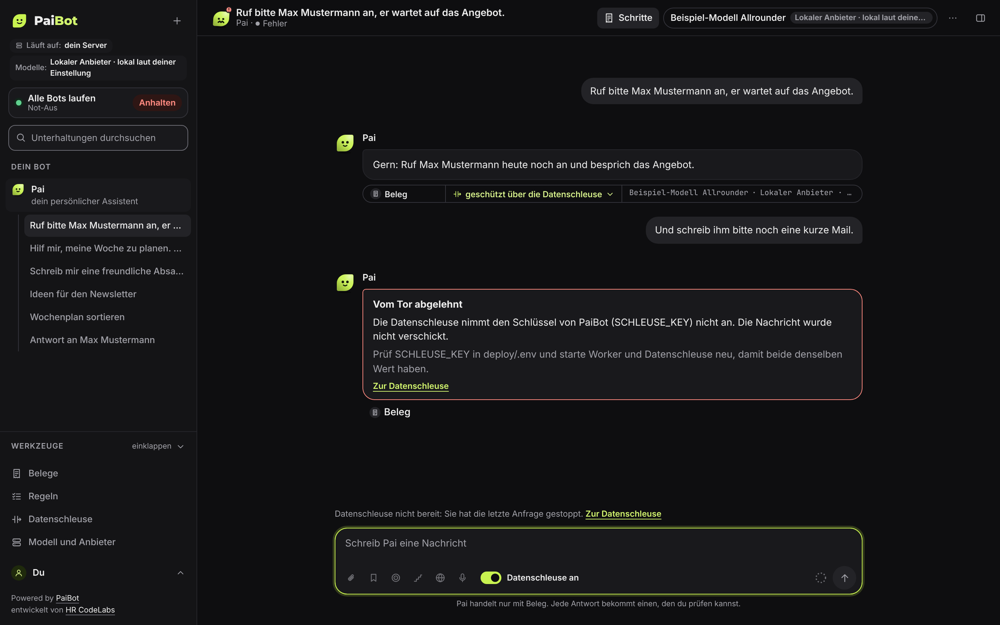
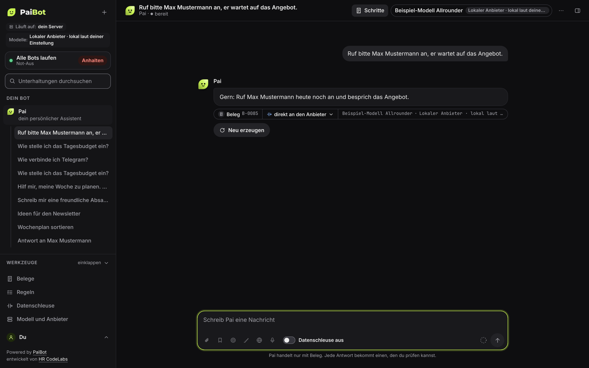
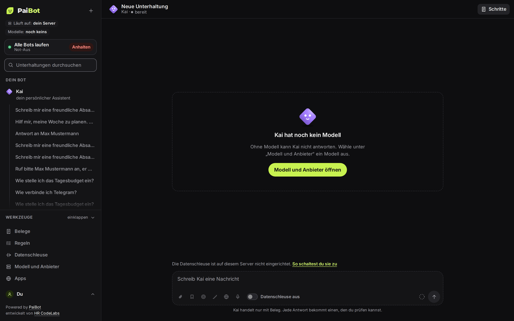
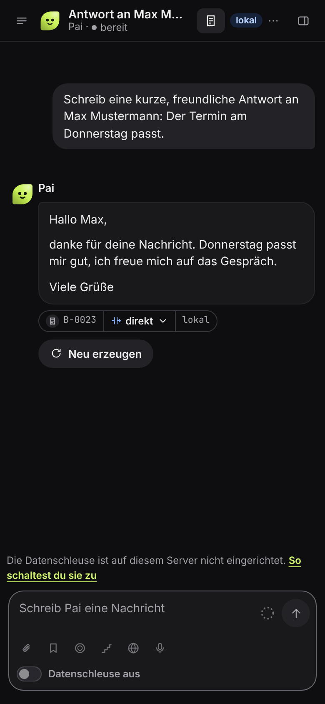
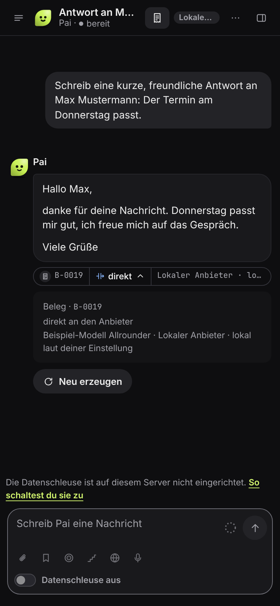

<!--
PaiBot – Doku: Chat mit dem Bot, wie aus einer Nachricht eine Antwort wird.

Autor:     Oliver Hees
Website:   https://paibot.de
Copyright: 2026 Oliver Hees. Alle Urheberrechte liegen beim Autor.
Lizenz:    PaiBot Fair-Code-Lizenz 1.1 – siehe Datei LICENSE im Projektstamm
Seit:      2026-11-20
-->

# Chat

**Ergebnis:** Du schreibst deinem Bot eine Nachricht, und er antwortet Stück für Stück, während der Text entsteht. Jede Anfrage an das Modell geht durch das Tor und bekommt zwei Belege; du kannst die Antwort jederzeit stoppen.

## Wofür

Der Chat ist die Hauptsache von PaiBot: Fragen stellen, Texte schreiben lassen, Gedanken sortieren. Die Antwort entsteht im Hintergrund (im Dienst `worker`). Sie läuft also weiter, auch wenn du die Seite schließt oder die Verbindung kurz abreißt, und du siehst sie beim nächsten Öffnen vollständig.

## So benutzt du es

**Eine neue Unterhaltung beginnen**

1. Melde dich an. Du landest auf der Startseite mit der Überschrift „Frag deinen Bot etwas“. Das ist eine neue, noch leere Unterhaltung.
2. Schreib deine Frage in das Feld „Schreib Pai eine Nachricht“ (statt „Pai“ steht dort der Name deines Bots). Oder klick auf eine der drei Beispiel-Fragen: Sie landet im Feld, gesendet wird noch nichts.
3. Drück **Enter**, um zu senden. Für eine neue Zeile drückst du **Umschalt+Enter**.
4. Die Unterhaltung erscheint links in der Seitenleiste unter deinem Bot. Ihr Titel ist der Anfang deiner ersten Nachricht (höchstens 60 Zeichen); ändern kannst du ihn später.

   

**Die Antwort lesen**

1. Unter deiner Nachricht erscheint die Antwort des Bots Stück für Stück. Oben steht neben dem Namen „wartet in der Schlange“ oder „schreibt“.

   
2. Abgesetzte Blöcke (etwa ein Mail-Entwurf) haben rechts oben **Kopieren**. Ein Klick legt nur diesen Block in die Zwischenablage.
3. Links in einer Antwort zeigen in Klammern, wohin sie führen. Bilder lädt PaiBot nie; statt eines Bildes steht ein Link.
4. Ist die Antwort fertig, steht darunter eine Zeile mit drei Teilen: **Beleg** mit seiner Kennung (z. B. `B-0142`), der **Weg** („direkt · EU“ bzw. „geschützt über die Datenschleuse“) und das **Modell** mit Herkunft. Am Handy ist die Zeile gekürzt; ein Tipp auf den Weg klappt sie aus.

   
5. Mit **Schritte** oben rechts blendest du diese Zeilen aus und wieder ein.

**Antwort stoppen**

1. Solange der Bot antwortet, steht in der Eingabe statt des Pfeils ein Quadrat: **Stopp**.
2. Klick darauf. Binnen etwa einer halben Sekunde hört der Bot auf. Was bis dahin geschrieben war, bleibt stehen, darunter „Abgebrochen. Der Text bis hierhin bleibt stehen.“

   
3. Solange eine Antwort läuft, kannst du in dieser Unterhaltung nichts Neues senden. Danach geht es wie gewohnt weiter.

**Belege einer Unterhaltung ansehen**

1. Klick in der Zeile unter einer Antwort auf **Beleg**. Rechts öffnet sich die Arbeitsfläche (am Handy als Blatt von unten) mit diesem Beleg: was geschah, wer es tat, die Entscheidung des Tors, die angewandten Regeln, das Ergebnis, Zeit und Kennung.

   
2. **Als eigene Seite öffnen** führt zur Seite des Belegs unter „Belege“; dort lässt er sich prüfen.
3. **Alle Belege dieser Unterhaltung** zeigt die Liste, neuester oben. Neue Belege erscheinen dort von selbst, während der Bot arbeitet.

   
4. Ohne Klick auf einen Beleg öffnest du die Liste über das Symbol rechts oben in der Kopfzeile oder über **⋯ → Belege dieser Unterhaltung**. Mit dem Kreuz schließt du sie.

**Datenschleuse für diese Unterhaltung**

1. Unten in der Eingabe steht der Schalter **Datenschleuse an/aus**. Er gilt nur für diese Unterhaltung; neue Unterhaltungen beginnen mit dem Standard aus der Einrichtung.
2. Ist die Datenschleuse auf deinem Server nicht eingerichtet (der Worker meldet sie nicht), lässt sich der Schalter nicht einschalten. Über dem Feld steht dann „Die Datenschleuse ist auf diesem Server nicht eingerichtet.“ mit dem Link **So schaltest du sie zu** (siehe [Datenschleuse](funktion-datenschleuse.md)). Ausschalten geht immer.
3. Hat die Datenschleuse die letzte Anfrage gestoppt, steht über dem Feld „Datenschleuse nicht bereit“. Die Nachricht ging dann nicht an das Modell; es gibt keinen Rückfall auf den direkten Weg.
4. Lag es an der Datenschleuse, sagt der Hinweis an der Stelle der Antwort genau, woran: Sie hat die Anfrage gestoppt, sie war nicht bereit, sie nimmt den Schlüssel von PaiBot (`SCHLEUSE_KEY`) nicht an, oder die Antwort war zu groß. Darunter steht, was du tun kannst, und der Link **Zur Datenschleuse**.

   

**Unterhaltung umbenennen oder löschen**

1. Klick oben rechts auf **⋯** (Weitere Aktionen).

   
2. **Umbenennen**: neuen Titel eintragen, **Speichern** oder Enter. Die Seitenleiste zeigt den neuen Titel sofort.
3. **Unterhaltung löschen**: PaiBot fragt nach. **Löschen** entfernt Nachrichten und Antworten; die Belege bleiben, damit die Kette vollständig bleibt. Danach bist du wieder auf der Startseite.

   
4. Solange der Bot in der Unterhaltung antwortet, lässt sie sich nicht löschen. Erst stoppen oder die Antwort abwarten.

**Eine andere Unterhaltung öffnen**

1. Klick links in der Seitenleiste auf ihren Titel (am Handy zuerst auf das Menü oben links). Die zuletzt benutzte steht oben.
2. Das **+** oben in der Seitenleiste beginnt eine neue Unterhaltung.
3. Einen angefangenen, nicht gesendeten Text merkt sich der Browser je Unterhaltung, bis du den Tab schließt.

## So sieht es aus

Die Bilder zu den einzelnen Schritten stehen oben in der Anleitung. Alle zeigen Beispiel-Daten: den Bot „Pai“, erfundene Unterhaltungen und den Test-Anbieter mit seinen Beispiel-Modellen. Uhrzeiten, die die Datenbank vergibt, sind in den Bildern ausgeblendet.

Eine Antwort über die Datenschleuse trägt in der Zeile darunter den Weg „geschützt über die Datenschleuse“:

Hat dein Bot kein Modell, sagt die Startseite das und führt zur Seite „Modell und Anbieter“:

Am Handy ist die Zeile unter der Antwort gekürzt. Ein Tipp auf den Weg klappt sie aus; ein Tipp auf den Beleg öffnet ihn als Blatt von unten.

## Einstellungen

| Einstellung            | Wo                                 | Bedeutung                                                                                 | Standard                                  |
| ---------------------- | ---------------------------------- | ----------------------------------------------------------------------------------------- | ----------------------------------------- |
| Modell des Bots        | Seite „Modell und Anbieter“        | Ohne gewähltes Modell antwortet der Bot nicht („Für deinen Bot ist kein Modell gewählt.“) | keins                                     |
| Anweisung des Bots     | Seite „Bot“                        | Steht am Ende der Anweisung an das Modell                                                 | leer                                      |
| Ausgabegrenze des Bots | in dieser Version fest             | Höchstens so viele Token je Antwort                                                       | 4096                                      |
| Datenschleuse          | Schalter je Unterhaltung, Standard | `An`: jede Anfrage geht über die Datenschleuse oder gar nicht                             | aus                                       |
| Verlaufsgrenze (Token) | Einstellungen                      | Wie viel vom bisherigen Gespräch mitgeschickt wird (etwa 4 Zeichen je Token)              | keine eigene Grenze                       |
| Tagesbudget (Token)    | Einstellungen                      | Ist es erreicht, lehnt das Tor weitere Anfragen bis Mitternacht (deine Zeitzone) ab       | keins                                     |
| Not-Aus                | in dieser Version ohne Schalter    | Ist er an, lehnt das Tor jede Anfrage des Bots ab                                         | aus                                       |
| Zeitzone               | Einstellungen                      | Für das Datum in der Anweisung und den Beginn des Tagesbudgets                            | Zeitzone des Browsers bei der Einrichtung |

Feste Werte der Lauf-Steuerung (im Code, `RUN_TUNING`):

| Wert                             | Wirkung                                                              |
| -------------------------------- | -------------------------------------------------------------------- |
| höchstens 50 Nachrichten Verlauf | Ältere Nachrichten werden abgeschnitten, nicht zusammengefasst       |
| höchstens 120.000 Zeichen        | Anweisung plus Verlauf je Anfrage; älteres fällt zuerst weg          |
| höchstens 200.000 Zeichen        | Länge einer Antwort; darüber endet sie mit „Ein Limit ist erreicht.“ |
| 9 Minuten                        | längste Dauer einer Antwort                                          |
| 60 Sekunden                      | längste Pause des Modells ohne neues Text-Stück                      |
| 10 Sekunden                      | Herzschlag einer laufenden Antwort in der Datenbank                  |
| 0,5 Sekunden                     | so oft prüft der Worker, ob du „Stopp“ gedrückt hast                 |
| 50 ms oder 200 Zeichen           | so werden Text-Stücke gebündelt, bevor sie an die Seite gehen        |

## So funktioniert es

Eine Nachricht wird in diesen Schritten zur Antwort:

1. **Senden (Web-App):** Steht der Schalter „Datenschleuse“ anders als bisher für die Unterhaltung, wird zuerst umgeschaltet (Aktion `schleuse.umschalten`, eigene Belege). Dann prüft das Tor die Aktion `nachricht.senden` (Unterhaltung vorhanden, kein Lauf aktiv, Länge, Not-Aus). Erst mit Erlaubnis entstehen in **einer** Transaktion die Nachricht, ein Lauf im Zustand „wartet“, die Ereignisse `message.created` und `run.queued` und der Auftrag in der Warteschlange. Scheitert ein Teil, entsteht nichts davon. Die erste Nachricht einer neuen Unterhaltung legt diese vorher an (Aktion `unterhaltung.anlegen`).
2. **Abholen (Worker):** Der Worker holt den Auftrag ab und liest Lauf, Unterhaltung, Bot, Einstellungen, Modell, Anbieter, Verlauf und den Tagesverbrauch **in einem Lesestand**. Der Lauf geht auf „läuft“ (Ereignis `run.started`).
3. **Fakten bilden:** Aus der Datenbank, nie aus dem Text der Nachricht: Anbieter, Region, Ziel-Adresse (als Abdruck), Weg (direkt oder Datenschleuse), ob die Datenschleuse erreichbar ist, Länge der Anfrage, Ausgabegrenze, Tagesverbrauch, Not-Aus.
4. **Tor:** Aktion `modell.anfragen` mit dem Bot als Akteur. Der Beleg „Entscheidung“ enthält die Fakten und eine Prüfsumme der ausgehenden Anfrage, nicht den Text.
5. **Antwort:** Nur wenn das Tor erlaubt, entsteht der Zugang zum Modell, und nur innerhalb dieser einen Ausführung. Der Motor macht genau einen Modell-Schritt. Text-Stücke gehen gebündelt als `text.delta` an die Seite. Am Ende wird die Antwort mit Modell, Weg und Token-Zahlen gespeichert (`message.completed`).
6. **Ergebnis:** Der Beleg „Ergebnis“ enthält Status, Token-Zahlen und eine Prüfsumme der Antwort, nie den Text. Danach ist der Lauf fertig, und die Unterhaltung nimmt die nächste Nachricht an.

Was die Seite live bekommt (über den Ereignis-Strom der Unterhaltung):

| Ereignis             | Bedeutung                                                             |
| -------------------- | --------------------------------------------------------------------- |
| `run.started`        | Der Bot beginnt zu antworten                                          |
| `message.created`    | Die Antwort des Bots ist angelegt (noch leer)                         |
| `text.delta`         | Neuer Text der Antwort, zum Anhängen                                  |
| `message.completed`  | Antwort fertig, mit Weg, Modell und Token                             |
| `run.cancelled`      | Abgebrochen; der bisherige Text bleibt als „Abgebrochen“              |
| `run.failed`         | Keine (vollständige) Antwort; Code und Satz sagen warum               |
| `run.denied`         | Das Tor hat abgelehnt; es ging nichts an das Modell                   |
| `schleuse.blockiert` | Die Datenschleuse war gefordert, aber nicht nutzbar oder hat gestoppt |
| `beleg.created`      | Ein Beleg ist entstanden (Entscheidung oder Ergebnis)                 |

**Abbruch:** „Stopp“ setzt in der Datenbank einen Abbruch-Wunsch (Aktion `lauf.abbrechen`). Der Worker sieht ihn binnen einer halben Sekunde, schließt die Verbindung zum Anbieter und beendet den Lauf. Auch wenn der Worker herunterfährt, endet eine laufende Antwort als „Abgebrochen“.

**Hängende Läufe:** Stürzt der Worker mitten in einer Antwort ab, fehlt der Herzschlag. Beim nächsten Start beendet der Worker solche Läufe als „unterbrochen“, schreibt das fehlende Ergebnis zum Beleg „Entscheidung“ und gibt die Unterhaltung wieder frei. Läufe, die länger als 15 Minuten nie abgeholt wurden, beendet er ebenso.

**Reihenfolge der Sperren:** Die Lauf-Steuerung hält nie eine Transaktion auf der Unterhaltung offen, während sie das Tor fragt. So können Web-App und Worker gleichzeitig Ereignisse und Belege schreiben, ohne sich zu verklemmen; die Beleg-Kette bleibt lückenlos.

**Die Seite:** Beim Öffnen liest die Seite den Verlauf in einem einzigen Lesestand (Nachrichten, Läufe, die Ereignisse einer gerade laufenden Antwort, die letzte Nummer im Ereignis-Strom und die Belege). Danach verbindet sie sich mit dem Ereignis-Strom ab genau dieser Nummer. Reißt die Verbindung ab, steht über der Eingabe „verbindet neu …“; danach holt die Seite alles ab der letzten gesehenen Nummer nach, ohne Lücke und ohne Doppel. Lädst du die Seite mitten in einer Antwort neu, erscheint der Text bis dahin sofort, und die Antwort läuft live weiter.

Beteiligte Teile: `apps/web/src/app/(app)/chat/` und `apps/web/src/lib/chat/` (Seite und Routen), `packages/agents/src/run/` (Lauf-Steuerung), `packages/agents/src/prompt.ts` (Anweisung an das Modell), `packages/gate` (Tor), `packages/llm` (Modell-Zugang), `packages/receipts` (Belege), `apps/worker` (Dienst im Hintergrund).

## Grenzen

- Der Bot hat in dieser Fassung **keine Werkzeuge**: Er kann nichts auslösen, nichts speichern, nichts nachschlagen. Wünscht ein Modell trotzdem ein Werkzeug, endet die Antwort mit „Das Tor hat die Aktion abgelehnt.“, und nichts wird ausgeführt. Werkzeuge sind geplant; die Stelle dafür ist in der Lauf-Steuerung vorgesehen.
- **Kein automatisches Wiederholen:** Scheitert eine Anfrage beim Anbieter, schickst du die Nachricht selbst noch einmal.
- **Kein Rückfall auf direkt:** Ist die Datenschleuse an, aber nicht erreichbar, geht die Nachricht gar nicht raus.
- Älterer Verlauf wird abgeschnitten, nicht zusammengefasst. Bei sehr langen Unterhaltungen „vergisst“ der Bot den Anfang.
- Pro Unterhaltung antwortet der Bot immer nur auf eine Nachricht zur selben Zeit.
- Die Token-Zahlen meldet der Anbieter; PaiBot rechnet sie nicht nach.
- Der Schalter „Datenschleuse“ gilt je Unterhaltung (oder als Standard). Ein eigener Schalter nur für eine einzelne Nachricht ist geplant.
- Ob die Datenschleuse gerade bereit ist, zeigt der Chat erst, wenn eine Anfrage gestoppt wurde („Datenschleuse nicht bereit“). Den laufenden Zustand, den der Worker alle 30 Sekunden prüft, zeigt die Seite [Datenschleuse](funktion-datenschleuse.md).
- Unter einer Antwort steht nicht, wie viele Angaben die Datenschleuse ersetzt hat; diese Zahl wird nicht festgehalten.
- Die Seitenleiste zeigt die 100 zuletzt benutzten Unterhaltungen.
- Eine Nachricht hat höchstens 32.000 Zeichen. Kurz vor der Grenze zeigt die Eingabe, wie viele noch gehen; darüber wird nicht gesendet.

## Fehlerbehebung

| Beobachtung                                           | Ursache                                                                     | Was tun                                                                                         |
| ----------------------------------------------------- | --------------------------------------------------------------------------- | ----------------------------------------------------------------------------------------------- |
| „Für deinen Bot ist kein Modell gewählt.“             | Der Bot hat kein Modell, oder es ist abgeschaltet                           | Modell wählen (siehe [Anbieter und Modelle](funktion-anbieter-und-modelle.md))                  |
| „Dein Bot antwortet gerade noch.“                     | In dieser Unterhaltung läuft schon eine Antwort                             | Abwarten oder „Stopp“                                                                           |
| „Das Tor hat die Aktion abgelehnt.“                   | Eine Grenze greift: Not-Aus, Tagesbudget, Anbieter abgeschaltet, Region     | Im Beleg „Entscheidung“ steht, welche Grenze (siehe [Das Tor](funktion-tor.md))                 |
| `schleuse.blockiert`, keine Antwort                   | Datenschleuse an, aber nicht installiert, nicht erreichbar oder gestoppt    | Datenschleuse prüfen ([Datenschleuse](funktion-datenschleuse.md)) oder ausschalten              |
| „Der Anbieter hat den Schlüssel nicht angenommen.“    | Schlüssel falsch, abgelaufen, oder die Adresse des Anbieters wurde geändert | Schlüssel neu eintragen                                                                         |
| „Ein Limit ist erreicht.“                             | Der Anbieter meldet ein Limit, oder die Antwort wurde zu lang               | Kurz warten; Tagesbudget prüfen                                                                 |
| „Der Anbieter des Modells ist nicht erreichbar.“      | Netz, Anbieter gestört, oder keine Antwort innerhalb der Zeitgrenze         | Später noch einmal senden                                                                       |
| „Die Antwort wurde unterbrochen.“                     | Abgebrochen oder der Worker wurde beendet                                   | Nachricht noch einmal senden                                                                    |
| Antwort bleibt lange bei „schreibt …“                 | Worker läuft nicht                                                          | `docker compose logs worker` ansehen; Zeilen wie `Lauf lau_… beendet: succeeded` zeigen Läufe   |
| „verbindet neu …“ bleibt stehen                       | Die Web-App ist nicht erreichbar                                            | Warten; sonst „Neu verbinden“ oder die Seite neu laden. Die Antwort läuft im Hintergrund weiter |
| Schalter „Datenschleuse“ lässt sich nicht einschalten | Die Datenschleuse ist auf diesem Server nicht eingerichtet                  | [Datenschleuse](funktion-datenschleuse.md) einrichten                                           |
| „… nimmt den Schlüssel von PaiBot nicht an“           | Worker und Datenschleuse haben verschiedene `SCHLEUSE_KEY`                  | `SCHLEUSE_KEY` in `deploy/.env` prüfen, Worker und Datenschleuse neu starten                    |
| „… Zeichen zu viel“ über dem Feld                     | Die Nachricht ist länger als 32.000 Zeichen                                 | Kürzen oder auf mehrere Nachrichten verteilen                                                   |
