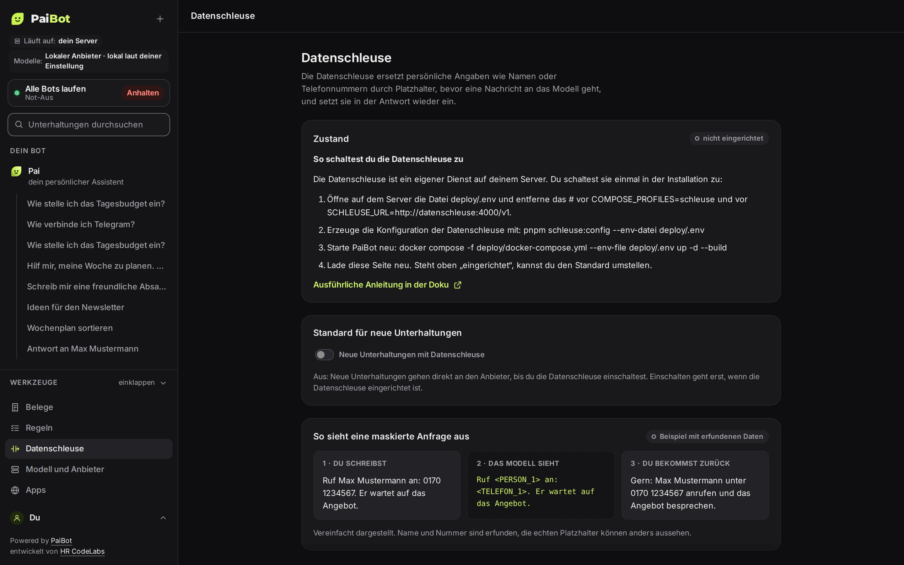
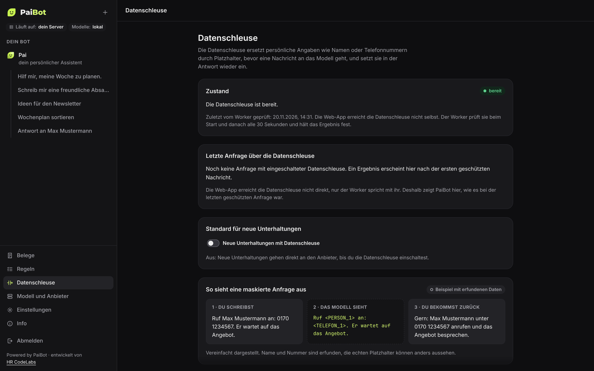
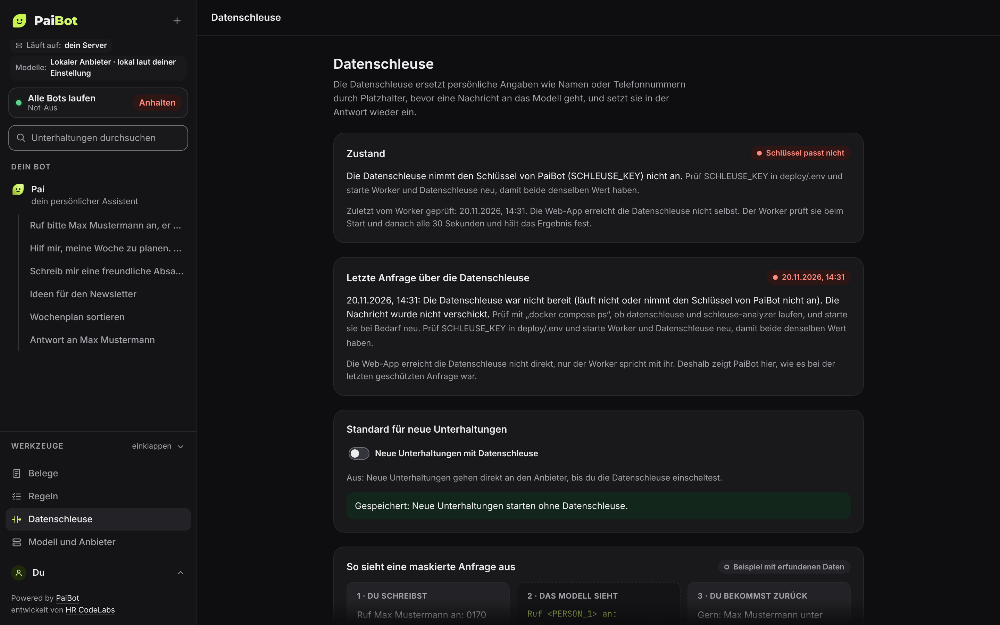
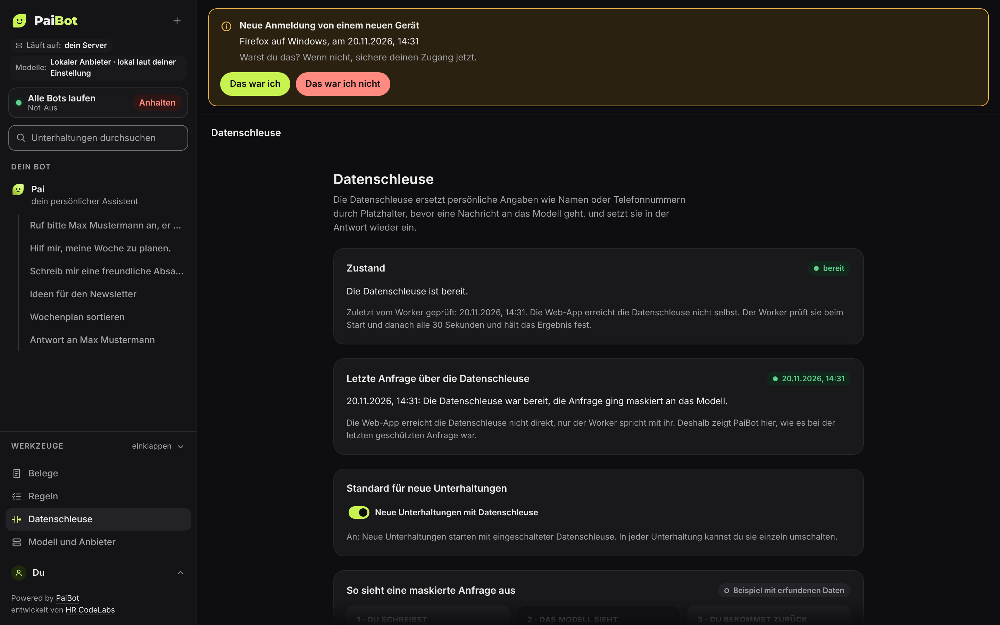
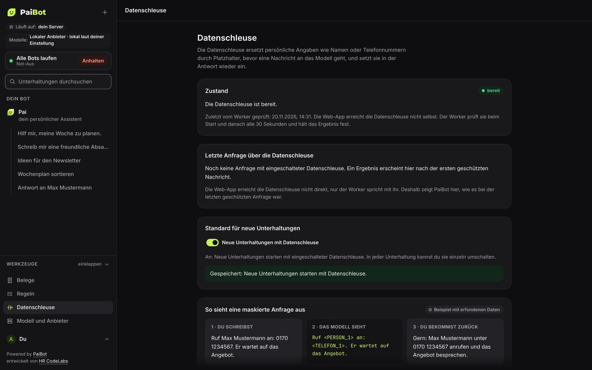
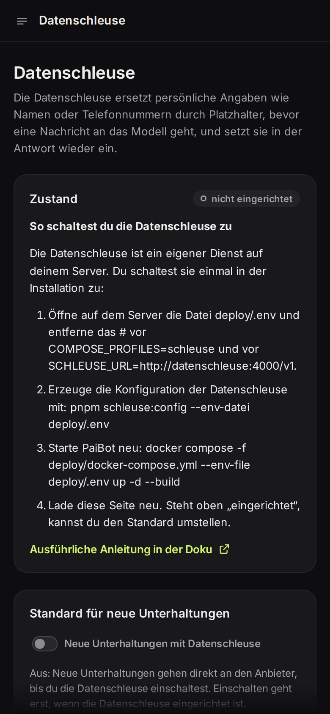

<!--
PaiBot – Doku: die Datenschleuse zuschalten, prüfen und wieder ausschalten.

Autor:     Oliver Hees
Website:   https://paibot.de
Copyright: 2026 Oliver Hees. Alle Urheberrechte liegen beim Autor.
Lizenz:    PaiBot Fair-Code-Lizenz 1.1 – siehe Datei LICENSE im Projektstamm
Seit:      2026-11-20
-->

# Datenschleuse

**Ergebnis:** Bevor eine Nachricht an das KI-Modell geht, ersetzt die Datenschleuse Namen, Telefonnummern, Adressen und ähnliche Angaben durch Platzhalter wie `<PERSON_0>`. In der Antwort tauscht sie die Platzhalter wieder zurück. Du liest also die echten Namen, der Modell-Anbieter sieht sie nicht.

Die Datenschleuse ist **standardmäßig aus**. Sie ist eine technische Schutzmaßnahme und erkennt nicht alles (siehe [Grenzen](#grenzen)).

## Wofür

Du schreibst mit deinem Bot über echte Menschen, Kunden oder Termine und willst nicht, dass der Modell-Anbieter diese Angaben im Klartext bekommt. Dann schaltest du die Datenschleuse zu. Sie läuft als eigener Dienst auf deinem Server, zwischen PaiBot und dem Anbieter.

Die Datenschleuse ist ein eigenes Projekt (Lizenz AGPL-3.0, Quellcode: <https://github.com/oliverhees/datenschleuse>). PaiBot enthält keinen Code daraus, sondern startet sie als getrennten Dienst in genau einer festgelegten Version.

## So benutzt du es

Voraussetzung: PaiBot läuft schon mit Docker Compose (siehe [Installation](installation.md)), und du hast Node.js 22 für den Befehl `pnpm schleuse:config` (oder `node scripts/schleuse-config.mjs`, ohne weitere Pakete).

**Zuschalten**

1. Öffne `deploy/.env`. Wurde die Datei mit `sh deploy/env-erzeugen.sh` angelegt, stehen `SCHLEUSE_KEY` und `SCHLEUSE_STATE_KEY` schon darin. Fehlen sie (ältere Datei), erzeuge sie:

   ```bash
   echo "SCHLEUSE_KEY=sk-$(openssl rand -hex 32)" >> deploy/.env
   echo "SCHLEUSE_STATE_KEY=$(openssl rand -base64 32 | tr '+/' '-_')" >> deploy/.env
   ```

2. Entferne in `deploy/.env` das `#` vor diesen beiden Zeilen:

   ```text
   COMPOSE_PROFILES=schleuse
   SCHLEUSE_URL=http://datenschleuse:4000/v1
   ```

   Den Schlüssel deines Modell-Anbieters trägst du hier **nicht** ein. PaiBot hat ihn schon (verschlüsselt, aus den Einstellungen des Anbieters) und schickt ihn mit jeder Anfrage an die Datenschleuse mit (`SCHLEUSE_SCHLUESSEL_WEG=anfrage`, Standard). `SCHLEUSE_ANBIETER_SCHLUESSEL` bleibt leer.

3. Erzeuge die Konfiguration der Datenschleuse:

   ```bash
   pnpm schleuse:config --env-datei deploy/.env
   ```

   Das schreibt `deploy/schleuse/config.yaml` und `deploy/schleuse/nlp-config.yml`. Beide enthalten keine Geheimnisse und bleiben außerhalb von Git.

4. Starte den Stack neu. Beim ersten Mal werden zwei Images gebaut; das dauert einige Minuten.

   ```bash
   docker compose -f deploy/docker-compose.yml --env-file deploy/.env up -d --build
   ```

**Prüfen**

5. Schau nach, ob alle Dienste laufen:

   ```bash
   docker compose -f deploy/docker-compose.yml --env-file deploy/.env ps
   ```

   Erwartet: `datenschleuse` und `schleuse-analyzer` stehen auf `healthy`, ebenso `web` und `worker`.

6. Prüfe, ob der Worker die Datenschleuse erreicht:

   ```bash
   docker compose -f deploy/docker-compose.yml --env-file deploy/.env exec worker \
     wget -qO- http://datenschleuse:4000/health/liveliness
   ```

   Erwartet: `"I'm alive!"`. Der Worker prüft die Datenschleuse selbst in zwei Stufen: Läuft sie (diese Adresse, ohne Schlüssel)? Und nimmt sie `SCHLEUSE_KEY` an (Modell-Liste mit Schlüssel)? Erst wenn beides stimmt, gilt sie als bereit.

**Ausschalten**

7. Setze in `deploy/.env` wieder ein `#` vor `COMPOSE_PROFILES=schleuse` und vor `SCHLEUSE_URL=…` und entferne die beiden Dienste:

   ```bash
   docker compose -f deploy/docker-compose.yml --env-file deploy/.env --profile schleuse rm -sf datenschleuse schleuse-analyzer
   docker compose -f deploy/docker-compose.yml --env-file deploy/.env up -d
   ```

   Danach gilt die Datenschleuse für PaiBot als „nicht installiert“. Eine Unterhaltung, die die Datenschleuse verlangt, bekommt dann keine Antwort, statt ungeschützt an den Anbieter zu gehen.

**In PaiBot nachsehen und den Standard festlegen**

8. Öffne in PaiBot über die Seitenleiste die Seite „Datenschleuse“. Unter „Zustand“ steht, was der Worker zuletzt geprüft hat: „bereit“, „nicht erreichbar“ oder „Schlüssel passt nicht“, jeweils mit dem, was du tun kannst, und der Zeit der Prüfung. Der Worker prüft die Datenschleuse gleich nach seinem Start und danach alle 30 Sekunden. Steht dort „nicht eingerichtet“, zeigt die Seite die Schritte 1 bis 4 von oben und einen Link auf diese Anleitung.

   

   

   
9. Steht dort „Worker meldet sich nicht“, kam seit fünf Minuten keine Prüfung mehr an. Sieh dann mit `docker compose … ps` nach, ob der Dienst `worker` läuft, und lies sein Log.
10. Darunter zeigt „Letzte Anfrage über die Datenschleuse“, wie die letzte Nachricht mit eingeschalteter Datenschleuse lief: bereit, gestoppt oder nicht bereit. PaiBot liest das aus den Belegen des Workers.


11. Schalte „Neue Unterhaltungen mit Datenschleuse“ ein. Neue Unterhaltungen starten dann geschützt; in jeder Unterhaltung kannst du sie einzeln umschalten. Solange die Datenschleuse nicht eingerichtet ist, lässt sich der Schalter nicht einschalten.


12. Unter „So sieht eine maskierte Anfrage aus“ zeigt die Seite ein Beispiel mit erfundenen Daten: Was du schreibst, was das Modell sieht und was du zurückbekommst.

Auf einem Server mit Coolify: [Datenschleuse zuschalten mit Coolify](deploy-coolify.md#datenschleuse-zuschalten).

## So sieht es aus

Die Bilder zu den Schritten in PaiBot stehen oben in der Anleitung (Schritte 8 bis 11). Für die Zustände „bereit“ und „Schlüssel passt nicht“ läuft in der Beispiel-Umgebung der Doku statt der echten Datenschleuse eine kleine Attrappe, die dem Worker diese Zustände meldet; Seite und Texte sind dieselben wie im Betrieb.

Am Handy, Zustand „nicht eingerichtet“:



Im Chat zeigt die Zeile unter einer Antwort, ob sie über die Datenschleuse lief; Bilder dazu in [Chat](funktion-chat.md#so-sieht-es-aus).

## Einstellungen

Alle Werte stehen in `deploy/.env`. Nach einer Änderung an den Werten mit `SCHLEUSE_` im Namen `pnpm schleuse:config --env-datei deploy/.env` und danach `docker compose … up -d --build` ausführen.

| Einstellung                    | Wo            | Bedeutung                                                                                                                                                                                                                       | Standard                              |
| ------------------------------ | ------------- | ------------------------------------------------------------------------------------------------------------------------------------------------------------------------------------------------------------------------------- | ------------------------------------- |
| `COMPOSE_PROFILES`             | `deploy/.env` | `schleuse` startet die beiden Dienste der Datenschleuse                                                                                                                                                                         | leer (aus)                            |
| `SCHLEUSE_URL`                 | `deploy/.env` | Adresse, unter der der Worker die Datenschleuse erreicht; leer heißt „nicht installiert“. Nur der Worker bekommt sie; die Web-App liest den Zustand, den er meldet                                                              | leer                                  |
| `SCHLEUSE_KEY`                 | `deploy/.env` | Zugangsschlüssel zwischen PaiBot und Datenschleuse, `sk-` und mindestens 32 Zeichen; ohne ihn startet die Datenschleuse nicht                                                                                                   | von `env-erzeugen.sh` erzeugt         |
| `SCHLEUSE_STATE_KEY`           | `deploy/.env` | Schlüssel für den verschlüsselten Zwischenstand der Datenschleuse                                                                                                                                                               | von `env-erzeugen.sh` erzeugt         |
| `SCHLEUSE_ANBIETER_SCHLUESSEL` | `deploy/.env` | nur beim Rückfall `SCHLEUSE_SCHLUESSEL_WEG=umgebung`: Schlüssel deines Modell-Anbieters für die Datenschleuse; sonst leer lassen                                                                                                | leer                                  |
| `SCHLEUSE_ANBIETER`            | `deploy/.env` | Anbieter als `<schlüssel>=<basis-url>`; der Schlüssel ist der Name der Vorlage in PaiBot                                                                                                                                        | `eurouter=https://api.eurouter.ai/v1` |
| `SCHLEUSE_SCHLUESSEL_WEG`      | `deploy/.env` | `anfrage`: Der Worker schickt den Anbieter-Schlüssel mit jeder Anfrage mit. `umgebung` (Rückfall): Die Datenschleuse liest ihn aus `SCHLEUSE_ANBIETER_SCHLUESSEL`, nur ein Anbieter. Gilt für Worker und `pnpm schleuse:config` | `anfrage`                             |
| `SCHLEUSE_SPRACHMODELL`        | `deploy/.env` | Sprachmodell für Namen, Orte und Organisationen: `de_core_news_md` oder `de_core_news_lg` (findet etwas mehr Namen, braucht deutlich mehr Speicher)                                                                             | `de_core_news_md`                     |
| `SCHLEUSE_QI_STUFE`            | `deploy/.env` | wie früh Angaben wie Postleitzahl, Geburtsjahr oder Beruf verallgemeinert werden: `utility`, `balanced`, `paranoid`                                                                                                             | `balanced`                            |
| `SCHLEUSE_ANALYZER_SPEICHER`   | `deploy/.env` | Speichergrenze der Erkennung; für `de_core_news_lg` `1536m` setzen                                                                                                                                                              | `768m`                                |
| `SCHLEUSE_SPEICHER`            | `deploy/.env` | Speichergrenze der Datenschleuse selbst                                                                                                                                                                                         | `768m`                                |

Speicher: Mit `de_core_news_md` brauchen beide Dienste zusammen im Betrieb knapp 1 GB Arbeitsspeicher, mit `de_core_news_lg` rund 0,6 GB mehr. Plane das bei einem kleinen Server ein.

## So funktioniert es

```text
worker ──(Netz paibot-schleuse)──► datenschleuse ──(Netz schleuse-aussen)──► Modell-Anbieter
                                        │
                                (Netz schleuse-analyse)
                                        ▼
                                 schleuse-analyzer
```

1. Steht die Datenschleuse für eine Unterhaltung auf „An“, schickt der Worker die Anfrage nicht direkt zum Anbieter, sondern an `SCHLEUSE_URL`, mit `SCHLEUSE_KEY` und der ID der Unterhaltung. Das Modell heißt dort `<anbieter>/<modell>`, z. B. `eurouter/mistral-small-latest`. Im Standard (`anfrage`) entschlüsselt der Worker dafür den Schlüssel deines Anbieters und legt ihn als Feld `api_key` in die Anfrage. Er geht nur an die Adresse der Datenschleuse und steht in keinem Log und in keiner Fehlermeldung.
2. Die Datenschleuse lässt den Text vom Dienst `schleuse-analyzer` prüfen (Muster für Mail, Telefon, IBAN, Straße und Ähnliches, dazu ein deutsches Sprachmodell für Namen, Orte und Organisationen).
3. Gefundene Angaben ersetzt sie durch nummerierte Platzhalter und schickt nur den so geänderten Text an den Anbieter. Die ID der Unterhaltung bleibt bei ihr.
4. In der Antwort, auch beim Streamen, tauscht sie die Platzhalter wieder gegen die echten Angaben. Das gilt auch für Argumente, mit denen das Modell ein Werkzeug aufruft.
5. Klappt die Prüfung nicht (Erkennung nicht erreichbar, unbekannter Inhalt, Bild im Anhang), wird die Anfrage **blockiert** und geht gar nicht an den Anbieter. PaiBot meldet das als eigenen Fehler „Datenschleuse hat gestoppt“, versucht es nicht noch einmal und fällt nie auf den direkten Weg zurück. Die Begründung der Datenschleuse übernimmt PaiBot nicht, weil sie Teile deiner Nachricht enthalten kann; sie steht nur im Log der Datenschleuse.

Abschirmung:

| Dienst              | Netze                                                    | Warum                                                                        |
| ------------------- | -------------------------------------------------------- | ---------------------------------------------------------------------------- |
| `worker`            | `paibot-intern`, `paibot-aussen`, `paibot-schleuse`      | spricht als einziger PaiBot-Dienst mit der Datenschleuse                     |
| `datenschleuse`     | `paibot-schleuse`, `schleuse-analyse`, `schleuse-aussen` | erreicht die Erkennung und den Anbieter, aber nicht die Datenbank von PaiBot |
| `schleuse-analyzer` | `schleuse-analyse`                                       | ohne Weg nach draußen; nur die Datenschleuse erreicht ihn                    |

- Keiner der beiden Dienste veröffentlicht einen Port. `web` erreicht die Datenschleuse nicht.
- Den Zustand prüft deshalb der Worker: gleich nach dem Start und danach alle 30 Sekunden, in zwei Stufen wie in Schritt 6. Das Ergebnis (nur `aus`, `nicht_erreichbar`, `schluessel_falsch` oder `bereit` mit der Zeit der Prüfung, keine Meldungen der Datenschleuse) schreibt er in die Tabelle `schleuse_zustand`. Die Web-App liest diese eine Zeile. Maßstab für die Zeit ist die Uhr der Datenbank: Eine Meldung, die mehr als eine Minute in der Zukunft liegt, kürzt PaiBot beim Schreiben auf diese Grenze, und eine gespeicherte Meldung aus der Zukunft gilt beim Lesen als nicht gemeldet, bis der Worker sie mit seiner nächsten Prüfung ersetzt. „Eingerichtet“ heißt für sie: Der Worker meldet etwas anderes als `aus`. Danach richtet sich auch, ob sich der Standard und der Schalter im Chat einschalten lassen.
- Die Datenschleuse hat keine eigene Datenbank und keine Verwaltungs-Oberfläche. Ihr Zwischenstand liegt verschlüsselt im Arbeitsspeicher und ist nach einem Neustart weg.
- Beide Container laufen ohne Root-Rechte, ohne Linux-Fähigkeiten, mit `no-new-privileges` und schreibgeschütztem Dateisystem (beschreibbar ist nur ein kleiner Bereich im Arbeitsspeicher), mit Speichergrenze, Healthcheck und Neustart nach einem Absturz.
- Gebaut wird aus einem festen Commit der Datenschleuse und festen Basis-Images (per Prüfsumme); das Sprachmodell wird beim Bau mit Prüfsumme geladen.
- Die Konfiguration erzeugt `pnpm schleuse:config` (`scripts/schleuse-config.mjs`). Gleiche Werte ergeben immer dieselbe Datei; sie verweist auf Schlüssel nur über den Namen einer Umgebungsvariable.

**Wo der Schlüssel deines Anbieters liegt:** Im Standard `SCHLEUSE_SCHLUESSEL_WEG=anfrage` nur an einer Stelle, verschlüsselt in der Datenbank von PaiBot. Wechselst du ihn beim Anbieter, trägst du ihn nur in PaiBot neu ein. Ehrlich dazu: Der Schlüssel **durchläuft die Datenschleuse im Arbeitsspeicher**, denn sie leitet die Anfrage damit an den Anbieter weiter. Gemessen mit der eingesetzten Version: Hat sie einen Schlüssel einmal bekommen, hält sie ihn im Arbeitsspeicher, bis sie neu startet. Auf die Festplatte schreibt sie ihn nicht, und in `deploy/.env` steht er nicht.

Mit dem Rückfall `SCHLEUSE_SCHLUESSEL_WEG=umgebung` liegt er an zwei Stellen: verschlüsselt in PaiBot und im Klartext in `deploy/.env` bzw. in der Umgebung der Datenschleuse. Dann schickt PaiBot ihn nicht mit; bei einem Wechsel trägst du ihn an beiden Stellen neu ein und startest die Datenschleuse neu.

## Grenzen

- **Nicht jede Angabe wird erkannt.** Namen, Orte und Organisationen findet ein Sprachmodell, das sich irren kann: Es übersieht manche Namen und markiert manchmal Wörter, die keine sind. Prüfe sensible Texte selbst, bevor du sie schickst.
- Die Datenschleuse ist eine technische Maßnahme. Sie ersetzt keine eigene Prüfung, was du einem Anbieter anvertraust.
- Erkannt wird auf Deutsch. Text in anderen Sprachen wird mit dem deutschen Modell geprüft und schlechter erkannt.
- **Werkzeuge:** Die Beschreibungen der Werkzeuge (Name, Beschreibung, Parameter), die mit einer Anfrage gehen, werden **nicht** maskiert. Argumente von Werkzeug-Aufrufen und Werkzeug-Ergebnisse im Verlauf werden maskiert; in der Antwort kommen die Argumente zurückgetauscht an, das Werkzeug arbeitet also mit den echten Angaben auf deinem Server.
- **Dateien und Bilder:** Bilder und Dateien als Anhang werden nicht geprüft, sondern blockiert. Die Anfrage geht dann gar nicht raus.
- Was nach dem Zurücktauschen in PaiBot gespeichert wird, ist der Klartext (Unterhaltungen in deiner Datenbank).
- Der Zustand auf der Seite „Datenschleuse“ ist so alt wie die letzte Prüfung des Workers, also höchstens etwa 30 Sekunden, solange er läuft. Läuft der Worker nicht, bleibt der letzte Stand stehen; nach fünf Minuten steht dort „Worker meldet sich nicht“.
- Hat der Worker noch nie gemeldet (zum Beispiel direkt nach der ersten Installation), gilt die Datenschleuse als „nicht eingerichtet“. Die Einrichtung von PaiBot liest „eingerichtet“ noch aus `SCHLEUSE_URL` in der Umgebung der Web-App; mit Compose zeigt sie deshalb „nicht eingerichtet“. Den Standard stellst du danach auf der Seite „Datenschleuse“ um.
- `SCHLEUSE_SCHLUESSEL_WEG` muss für Worker und Konfiguration gleich sein. Beide lesen ihn aus `deploy/.env`; nach einer Änderung `pnpm schleuse:config --env-datei deploy/.env` und `up -d` ausführen.
- Ein Neustart der Datenschleuse löscht ihren Zwischenstand; laufende Unterhaltungen beginnen bei der Verallgemeinerung von vorn.

## Fehlerbehebung

| Beobachtung                                                                   | Ursache                                                                                                                                                                    | Was tun                                                                                                                                  |
| ----------------------------------------------------------------------------- | -------------------------------------------------------------------------------------------------------------------------------------------------------------------------- | ---------------------------------------------------------------------------------------------------------------------------------------- |
| `datenschleuse` startet ständig neu, Log: „Start abgebrochen: SCHLEUSE_KEY …“ | Schlüssel fehlt oder ist zu kurz                                                                                                                                           | `SCHLEUSE_KEY=sk-$(openssl rand -hex 32)` in `deploy/.env`, neu starten                                                                  |
| Log: „Start abgebrochen: deploy/schleuse/config.yaml fehlt“                   | Konfiguration nicht erzeugt (Docker legt dann einen leeren Ordner an)                                                                                                      | Ordner `deploy/schleuse/config.yaml` löschen, `pnpm schleuse:config --env-datei deploy/.env`, neu starten                                |
| Log: „Start abgebrochen: SCHLEUSE_ANBIETER_SCHLUESSEL fehlt“                  | Konfiguration für den Weg `umgebung`, aber kein Anbieter-Schlüssel                                                                                                         | `SCHLEUSE_SCHLUESSEL_WEG=anfrage` (Standard), `pnpm schleuse:config --env-datei deploy/.env`, neu starten; oder Schlüssel eintragen      |
| Chat oder Seite: „Schlüssel passt nicht“                                      | Worker und Datenschleuse haben verschiedene `SCHLEUSE_KEY`                                                                                                                 | `SCHLEUSE_KEY` in `deploy/.env` prüfen, Worker und Datenschleuse neu starten                                                             |
| Fehler „Schlüssel ungültig“ nur mit Datenschleuse                             | Der Anbieter lehnt seinen Schlüssel ab                                                                                                                                     | Schlüssel des Anbieters in PaiBot unter „Modell und Anbieter“ prüfen                                                                     |
| Seite „Datenschleuse“: „Worker meldet sich nicht“                             | Der Worker läuft nicht oder erreicht die Datenbank nicht                                                                                                                   | `docker compose … ps` und `docker compose … logs worker` lesen                                                                           |
| Seite „Datenschleuse“ bleibt „nicht eingerichtet“, obwohl sie läuft           | `SCHLEUSE_URL` fehlt beim Worker, oder der Worker hat seit dem Neustart noch nicht gemeldet                                                                                | `SCHLEUSE_URL` in `deploy/.env` prüfen, `up -d`, nach einer halben Minute die Seite neu laden                                            |
| Log der Datenschleuse: „Missing credentials“                                  | Weg `anfrage` in der Konfiguration, aber der Worker schickt keinen Schlüssel (`SCHLEUSE_SCHLUESSEL_WEG=umgebung` beim Worker, oder in PaiBot fehlt der Anbieter-Schlüssel) | `SCHLEUSE_SCHLUESSEL_WEG` überall gleich setzen; Schlüssel des Anbieters in PaiBot eintragen                                             |
| `schleuse-analyzer` wird nicht `healthy`                                      | Sprachmodell lädt noch, Speichergrenze zu klein oder Modell passt nicht zum Image                                                                                          | Log lesen; bei `de_core_news_lg` `SCHLEUSE_ANALYZER_SPEICHER=1536m`; nach Wechsel des Modells `pnpm schleuse:config` und `up -d --build` |
| `pnpm schleuse:config` bricht ab                                              | Wert unzulässig (z. B. http-Adresse, `de_core_news_sm`)                                                                                                                    | die Meldung nennt den Wert und die erlaubten Möglichkeiten                                                                               |
| Worker bricht beim Start ab: „SCHLEUSE_KEY fehlt.“                            | `SCHLEUSE_URL` gesetzt, Schlüssel nicht                                                                                                                                    | `SCHLEUSE_KEY` eintragen oder `SCHLEUSE_URL` wieder auskommentieren                                                                      |
| Antworten bleiben mit Datenschleuse aus                                       | Anfrage blockiert oder Datenschleuse nicht erreichbar; PaiBot geht dann nie direkt                                                                                         | `docker compose … logs datenschleuse` lesen; Schritt 5 und 6 wiederholen                                                                 |
