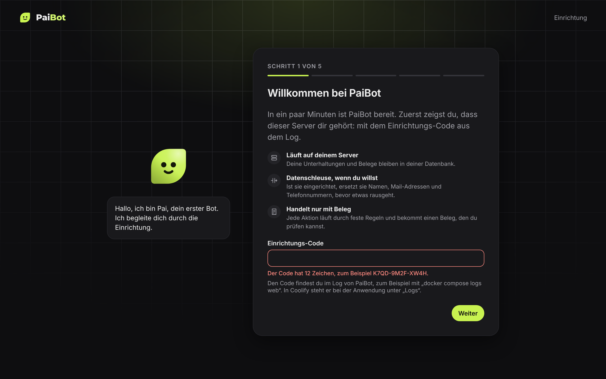
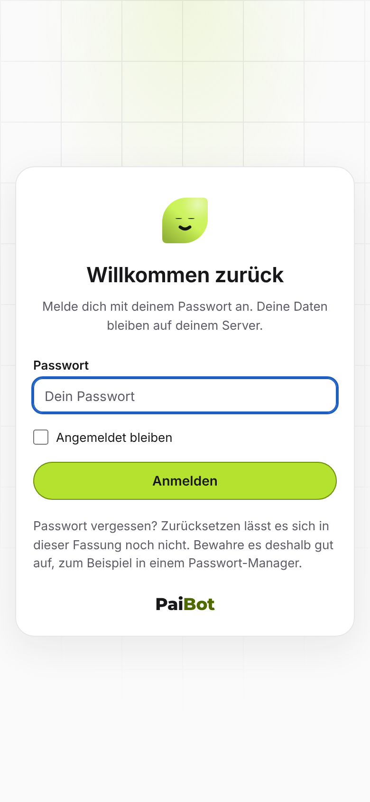

<!--
PaiBot – Doku: Einrichtung mit Einrichtungs-Code, Anmelden, Sitzung, Abmelden und der Schutz der App.

Autor:     Oliver Hees
Website:   https://paibot.de
Copyright: 2026 Oliver Hees. Alle Urheberrechte liegen beim Autor.
Lizenz:    PaiBot Fair-Code-Lizenz 1.1 – siehe Datei LICENSE im Projektstamm
Seit:      2026-11-20
-->

# Einrichtung und Zugang

**Ergebnis:** Deine frische Installation gehört dir: Nur wer den Einrichtungs-Code aus dem Log kennt, kann sie einrichten. Danach kommst nur du mit deinem Passwort hinein, und jede Seite und jede Schnittstelle prüft das.

## Wofür

Wer eine neue Installation im Internet zuerst erreicht, könnte sonst das Passwort setzen. Der Einrichtungs-Code steht deshalb nur im Log deines Servers. Nach der Einrichtung meldest du dich mit deinem Passwort an; PaiBot merkt sich die Anmeldung in einer Sitzung, bis du dich abmeldest oder sie abläuft.

## So benutzt du es

### Einrichten

1. Starte PaiBot (siehe [Installation](installation.md)) und öffne die Adresse im Browser. Du landest automatisch auf der Seite „Einrichtung“.
2. Suche den Einrichtungs-Code im Log:
   - Docker Compose: `docker compose logs web | grep Einrichtungs-Code`
   - Coolify: in der Anwendung unter „Logs“ nach „Einrichtungs-Code“ suchen.

   Die Zeile sieht so aus (der Code ist bei dir ein anderer):

   ```text
   Einrichtungs-Code: K7QD-9M2F-XW4H (gilt bis zum Ende der Einrichtung)
   ```

3. Gib den Code ein. Bindestriche und Kleinbuchstaben sind egal. Klick auf „Weiter“.
4. Lege dein Passwort fest: mindestens 12 Zeichen, zweimal gleich eingegeben. Die Liste unter den Feldern zeigt, ob beides erfüllt ist. Gut zu merken und schwer zu erraten sind mehrere Wörter mit Bindestrichen.
5. Trag den Schlüssel für EUrouter ein und klick auf „Verbindung testen“. PaiBot holt dabei die passenden Modelle. Hast du noch keinen Schlüssel, klick auf „Später eintragen“.
6. Wähle ein Modell aus der Liste (nur mit Schlüssel).
7. Entscheide, ob die Datenschleuse für neue Unterhaltungen standardmäßig an ist. Der Schalter lässt sich nur bedienen, wenn die Datenschleuse auf deinem Server eingerichtet ist; sonst bleibt sie aus.
8. Gib deinem Bot einen Namen (Vorschlag: „Pai“) und klick auf „Einrichtung abschließen“.
9. Du siehst „Alles bereit“ und bist angemeldet. Mit „Zur App“ geht es weiter. Der Code gilt ab jetzt nicht mehr.

### Anmelden und Abmelden

1. Öffne PaiBot. Ohne gültige Sitzung landest du auf „Anmelden“.
2. Gib dein Passwort ein. Mit „Angemeldet bleiben“ bleibt die Sitzung auch nach dem Schließen des Browsers erhalten.
3. Klick auf „Anmelden“. Bei einem falschen Passwort steht unter dem Feld „Das Passwort stimmt nicht.“
4. Zum Abmelden klick in der Navigation unten auf „Abmelden“ (am Handy erst auf „Menü öffnen“).

### Code verloren oder abgelaufen

1. Starte den Dienst `web` neu (`docker compose restart web` bzw. in Coolify „Restart“).
2. Solange PaiBot nicht eingerichtet ist, steht nach jedem Start ein **neuer** Code im Log; der alte gilt nicht mehr.
3. Lade die Seite „Einrichtung“ neu und gib den neuen Code ein. Was du vorher eingegeben hattest, musst du noch einmal eingeben: Gespeichert wird erst beim Abschluss, dann alles auf einmal.

## So sieht es aus

Der erste Schritt der Einrichtung: links dein Bot, rechts der Schritt mit dem Feld für den Code und dem Hinweis, wo der Code steht.


Fehlt der Code oder hat er die falsche Form, sagt das Feld, wie er aussehen muss.



Auf dem Handy steht der Bot mit seiner Sprechblase über dem Schritt.


Folgt mit der Oberfläche: Bilder der Schritte 2 bis 6 (Passwort, Schlüssel, Modell, Datenschleuse, Name des Bots) und von „Alles bereit“. Das Aufnahme-Skript kann bisher nur klicken, aber nichts eintippen; ohne Code im Feld zeigt die Einrichtung keinen späteren Schritt.

Nach der Einrichtung: die Anmeldung mit dem Feld für dein Passwort.


Ohne Passwort weist das Feld darauf hin.


Die Anmeldung auf dem Handy im hellen Design:



## Einstellungen

| Einstellung                       | Wo                | Bedeutung                                                                                                                                                                       | Standard                 |
| --------------------------------- | ----------------- | ------------------------------------------------------------------------------------------------------------------------------------------------------------------------------- | ------------------------ |
| `APP_URL`                         | Umgebungsvariable | Adresse, unter der du PaiBot öffnest. Nur Anfragen genau von dieser Adresse dürfen etwas verändern. Beginnt sie mit `https://`, sind die Cookies `Secure` und heißen `__Host-…` | `http://localhost:3000`  |
| `TRUST_PROXY`                     | Umgebungsvariable | `1`, wenn PaiBot hinter einem Proxy läuft (Coolify, Traefik, Caddy, nginx). Dann zählt die Adresse, die dein Proxy als letzte in `X-Forwarded-For` anhängt                      | nicht gesetzt            |
| `PAIBOT_SECRET`                   | Umgebungsvariable | Wurzel-Geheimnis; daraus entstehen die Prüfzeichen gegen untergeschobene Anfragen und die Schlüssel für Belege und Anbieter                                                     | Pflicht                  |
| `PAIBOT_EINRICHTUNG_ANBIETER_URL` | Umgebungsvariable | Nur für Tests und eigene Dienste: Die Einrichtung verbindet statt EUrouter diesen OpenAI-kompatiblen Dienst (zum Beispiel den Test-Anbieter)                                    | nicht gesetzt (EUrouter) |
| Angemeldet bleiben                | Seite „Anmelden“  | Cookie bleibt 30 Tage im Browser; ohne Haken endet es mit dem Browser                                                                                                           | aus                      |

**Hinter einem Proxy `TRUST_PROXY=1` setzen.** Ohne diese Einstellung kennt PaiBot die Adresse der Besucher nicht, denn den Wert in `X-Forwarded-For` kann jeder frei setzen, und PaiBot liest ihn dann gar nicht. Alle Besucher teilen sich so einen Zähler. Damit niemand dich aussperren kann, bremst PaiBot Versuche dann nur (2 Sekunden je Versuch über dem Limit), statt sie je Adresse zu sperren. Beim Start und auf der Seite „Einrichtung“ steht dazu ein Hinweis. Setze `TRUST_PROXY=1` nur, wenn wirklich ein Proxy davor steht; sonst könnte ein Besucher seine Adresse vortäuschen.

## So funktioniert es

- **Einrichtungs-Code:** 12 Zeichen aus 32 Zeichen (60 Bit Zufall). PaiBot hält ihn nur als Prüfwert (SHA-256) im Speicher des Dienstes `web` und schreibt ihn genau einmal ins Log. Er gilt bis zum Ende der Einrichtung; ein Neustart erzeugt einen neuen. Falsche Codes zählen je Adresse: nach 5 Fehlversuchen in 15 Minuten ist für diese Adresse Pause. Der Verbindungstest der Einrichtung verlangt denselben Code und zählt zusätzlich höchstens 10 Tests in 15 Minuten.
- **Abschluss in einem Rutsch:** Alles läuft in einer einzigen Datenbank-Transaktion: Signaturschlüssel der Installation erzeugen und verschlüsselt speichern, Beleg „Start“ als erster Eintrag der Beleg-Kette, dann über das [Tor](funktion-tor.md) die Aktionen „Einrichtung abgeschlossen“ (Konto, Einstellungen, erste Sitzung), „Bot geändert“, „Anbieter gespeichert“ (Schlüssel verschlüsselt und an Anbieter und Adresse gebunden), „Modell gewählt“ und gegebenenfalls „Datenschleuse umgeschaltet“. Scheitert ein Schritt, bleibt nichts davon übrig. Kommen zwei Abschlüsse gleichzeitig, gewinnt genau einer; der andere bekommt „PaiBot ist schon eingerichtet“.
- **Passwort:** gespeichert nur als scrypt-Hash. Vor jeder Prüfung zählt PaiBot den Versuch (5 je Adresse in 15 Minuten sperren; 20 insgesamt in 15 Minuten bremsen nur, sperren aber nie). Höchstens zwei Prüfungen rechnen gleichzeitig. Die Antwort auf einen Fehlversuch ist immer gleich und dauert ähnlich lang, auch vor der Einrichtung. Stammt der Hash aus einem älteren Verfahren, wird er beim nächsten Anmelden erneuert.
- **Sitzung:** Bei jeder Anmeldung entsteht ein neues Zufalls-Token. Der Browser bekommt es als Cookie (`HttpOnly`, `SameSite=Lax`, `Path=/`, bei https zusätzlich `Secure`); in der Datenbank steht nur seine Prüfsumme. Eine Sitzung gilt 30 Tage ab der letzten Benutzung, höchstens aber 90 Tage ab der Anmeldung; beides prüft der Server. Abmelden löscht die Sitzung, ein Passwortwechsel löscht alle.
- **Untergeschobene Anfragen:** Jede Anfrage, die etwas verändert, muss genau von `APP_URL` kommen (`Origin`) und ein Prüfzeichen mitschicken, das aus deiner Sitzung abgeleitet ist und in jeder Seite steht. Beides fehlt einer fremden Seite.
- **Schutz jeder Route:** Ein Proxy vor allen Anfragen leitet ohne Einrichtung zur Einrichtung und ohne Anmeldung zur Anmeldung und beantwortet Schnittstellen ohne Sitzung mit „Nicht angemeldet“. Zusätzlich prüft jede Seite und jede Schnittstelle die Sitzung selbst. Jede Antwort trägt strenge Sicherheits-Kopfzeilen: Skripte laufen nur mit einer Nonce, die für jede Antwort neu entsteht; HSTS geht nur bei https mit.
- **Belege:** An- und Abmelden, alle Sitzungen beenden und das Passwort ändern stehen als Belege im Protokoll. Fehlversuche nicht; sie stehen nur im Zähler.

## Grenzen

- Passwort vergessen: Zurücksetzen gibt es in dieser Fassung noch nicht. Bewahre das Passwort gut auf.
- Nur ein Passwort, keine zweite Stufe (2FA ist geplant).
- Der Einrichtungs-Code liegt im Speicher des Dienstes `web`. Laufen mehrere `web`-Dienste gleichzeitig, hat jeder seinen eigenen Code.
- Die Seite für Sitzungen und Passwortwechsel kommt mit den Einstellungen; die Schnittstellen dafür gibt es schon.
- Hast du die Einrichtung abgeschlossen, lässt sie sich nicht wiederholen.

## Fehlerbehebung

| Beobachtung                                      | Ursache                                                                        | Was tun                                                                          |
| ------------------------------------------------ | ------------------------------------------------------------------------------ | -------------------------------------------------------------------------------- |
| „Der Einrichtungs-Code stimmt nicht.“            | Tippfehler oder alter Code nach einem Neustart                                 | Neuesten Code aus dem Log nehmen (letzte Zeile mit „Einrichtungs-Code“)          |
| „Zu viele Versuche. Versuch es in … Sekunden …“  | 5 Fehlversuche von dieser Adresse in 15 Minuten                                | Warten, bis die Zeit um ist                                                      |
| „Die Anfrage kam nicht von dieser PaiBot-Seite.“ | `APP_URL` passt nicht zur Adresse im Browser                                   | `APP_URL` genau auf die Adresse setzen, unter der du PaiBot öffnest; neu starten |
| „Die Anfrage konnte nicht bestätigt werden.“     | Seite war lange offen oder Cookies wurden gelöscht                             | Seite neu laden                                                                  |
| Nach dem Anmelden sofort wieder „Anmelden“       | Browser speichert keine Cookies, oder `APP_URL` ist https, die Seite aber http | Cookies erlauben; PaiBot über die Adresse aus `APP_URL` öffnen                   |
| Hinweis „TRUST_PROXY ist nicht gesetzt“          | PaiBot kennt die Adresse der Besucher nicht                                    | Hinter einem Proxy `TRUST_PROXY=1` setzen (siehe Einstellungen)                  |
| „Datenbank nicht erreichbar“ statt der Anmeldung | Datenbank läuft nicht oder ist nicht eingerichtet                              | Log ansehen, Datenbank starten, Seite neu laden                                  |

## Bilder neu aufnehmen

Für Mitwirkende: Das Aufnahme-Skript fügt einen Stil in die Seite ein. Das erlaubt die strenge Content-Security-Policy des Betriebs nicht, deshalb laufen die Aufnahmen gegen den Entwicklungs-Server, mit leerer Wegwerf-Datenbank, dem [Test-Anbieter](entwickeln.md) und nur Beispiel-Daten.

```bash
# 1. Test-Anbieter (Beispiel-Schlüssel, kein echter)
FAKE_PROVIDER_PORT=8080 FAKE_PROVIDER_API_KEY=beispiel-schluessel node tools/fake-provider/dist/fake-provider.mjs &
# 2. App mit leerer Datenbank (DATABASE_URL, DATABASE_MIGRATION_URL, PAIBOT_SECRET wie in apps/web/.env.example)
APP_URL=http://127.0.0.1:3000 TRUST_PROXY=1 \
  PAIBOT_EINRICHTUNG_ANBIETER_URL=http://127.0.0.1:8080/v1 pnpm dev
# 3. Bilder der Einrichtung
PAIBOT_URL=http://127.0.0.1:3000 pnpm doku:screenshots einrichtung-code einrichtung-code-fehler einrichtung-code-handy
# 4. Einrichtung mit Beispiel-Daten abschließen (Code aus dem Log)
APP=http://127.0.0.1:3000; CODE=XXXX-XXXX-XXXX; JAR=$(mktemp)
TOKEN=$(curl -s -c "$JAR" "$APP/einrichtung" | grep -o 'name="pb-pruefzeichen" content="[^"]*"' | cut -d'"' -f4)
curl -s -b "$JAR" -H "Origin: $APP" -H "X-Pb-Pruefzeichen: $TOKEN" -H 'content-type: application/json' \
  -d "{\"setupCode\":\"$CODE\",\"password\":\"Beispiel-Passwort-2026\",\"passwordRepeat\":\"Beispiel-Passwort-2026\",\"apiKey\":\"beispiel-schluessel\",\"modelSlug\":\"fake/test-modell\",\"schleuseModeDefault\":\"off\",\"botName\":\"Pai\"}" \
  "$APP/api/einrichtung"
# 5. Bilder der Anmeldung
PAIBOT_URL=http://127.0.0.1:3000 pnpm doku:screenshots anmelden anmelden-leer anmelden-handy-hell
```
