<!--
PaiBot – Doku: Einrichtung mit Einrichtungs-Code, Anmelden, Sitzung, Abmelden und der Schutz der App.

Autor:     Oliver Hees
Website:   https://paibot.de
Copyright: 2026 Oliver Hees. Alle Urheberrechte liegen beim Autor.
Lizenz:    PaiBot Fair-Code-Lizenz 1.1 – siehe Datei LICENSE im Projektstamm
Seit:      2026-11-20
-->

# Einrichtung und Zugang

**Ergebnis:** Deine frische Installation gehört dir: Nur wer den Einrichtungs-Code aus dem Log kennt, kann sie einrichten. Danach kommst nur du mit deinem Passwort hinein, und jede Seite und jede Schnittstelle prüft das.

## Wofür

Wer eine neue Installation im Internet zuerst erreicht, könnte sonst das Passwort setzen. Der Einrichtungs-Code steht deshalb nur im Log deines Servers. Nach der Einrichtung meldest du dich mit deinem Passwort an; PaiBot merkt sich die Anmeldung in einer Sitzung, bis du dich abmeldest oder sie abläuft.

## So benutzt du es

Die Bilder zeigen eine Installation mit Beispiel-Daten. Als Modell-Anbieter ist dort der Test-Anbieter von PaiBot auf dem eigenen Rechner verbunden; die Modelle heißen „Beispiel-Modell …“, die Routing-Regel „EU Beispiel“. Bei dir stehen dort dein Anbieter, deine Modelle bzw. deine Regeln.

### Einrichten

Die Einrichtung hat immer sieben Schritte. Überspringst du einen (zum Beispiel „Später eintragen“), zählt er trotzdem mit; die Zählung springt nicht.

1. Starte PaiBot (siehe [Installation](installation.md)) und öffne die Adresse im Browser. Du landest automatisch auf der Seite „Einrichtung“.

   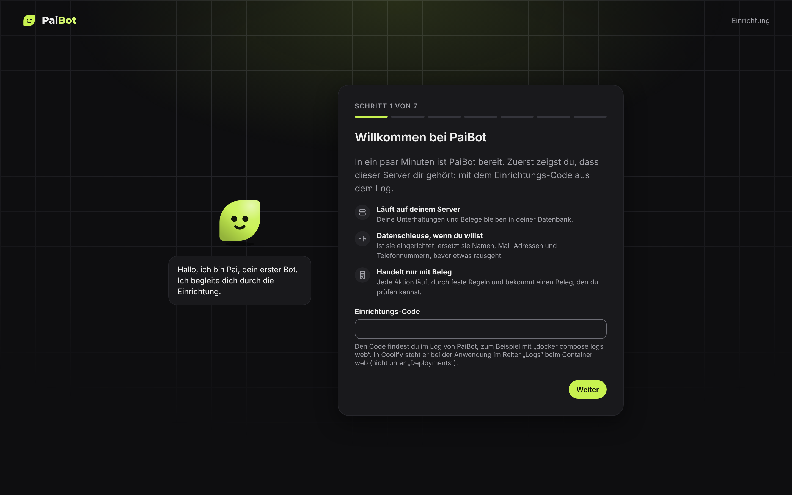

2. Suche den Einrichtungs-Code im Log:
   - Docker Compose: `docker compose logs web | grep Einrichtungs-Code`
   - Coolify: in der Anwendung unter „Logs“ nach „Einrichtungs-Code“ suchen.

   Die Zeile sieht so aus (der Code ist bei dir ein anderer):

   ```text
   Einrichtungs-Code: K7QD-9M2F-XW4H (gilt 24 Stunden, längstens bis zum Ende der Einrichtung)
   ```

3. Gib den Code ein. Bindestriche und Kleinbuchstaben sind egal. Klick auf „Weiter“. Fehlt der Code oder hat er die falsche Form, sagt das Feld, wie er aussehen muss; ob er stimmt, prüft PaiBot schon bei „Weiter“. Ein falscher Code zeigt „Der Einrichtungs-Code stimmt nicht.“ gleich in diesem Schritt.

   

4. Lege dein Passwort fest: mindestens 12 Zeichen, zweimal gleich eingegeben. Die Liste unter den Feldern zeigt mit Haken, ob beides erfüllt ist. Gut zu merken und schwer zu erraten sind mehrere Wörter mit Bindestrichen. Klick auf „Weiter“.

   

5. Wähle den Anbieter: **EUrouter**, **Mistral AI (direkt)** oder **Eigener oder lokaler Anbieter**. Zu jedem Anbieter steht, was er selbst über sich sagt, mit dem Tag, an dem PaiBot das nachgelesen hat, und ein Link „Noch kein Konto? Hier anlegen“ (öffnet die Seite des Anbieters in einem neuen Fenster). Klick auf „Weiter“.

   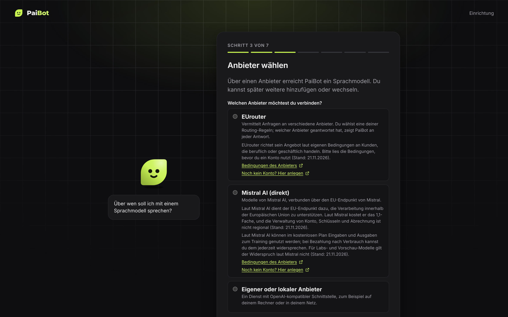

   Am Handy stehen die Anbieter untereinander; hier ist Mistral AI gewählt:

   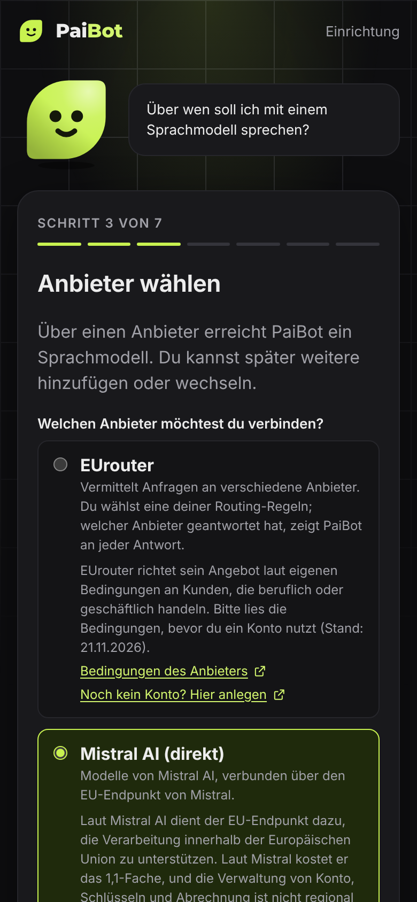

6. Trag den Schlüssel deines Anbieters ein.
   - **Mistral AI oder eigener Anbieter:** Klick auf „Verbindung testen“. Hast du noch keinen Schlüssel, klick auf „Später eintragen“. Einen eigenen Anbieter, den dein Server nicht vorgibt, richtest du nach der Einrichtung unter „Modell und Anbieter“ ein; dann steht hier nur dieser Hinweis.

     

     Nimmt der Anbieter den Schlüssel nicht an, steht das rot mit Warnzeichen unter dem Feld: „Verbindung fehlgeschlagen“ und der Grund. Prüfe den Schlüssel und teste noch einmal.

     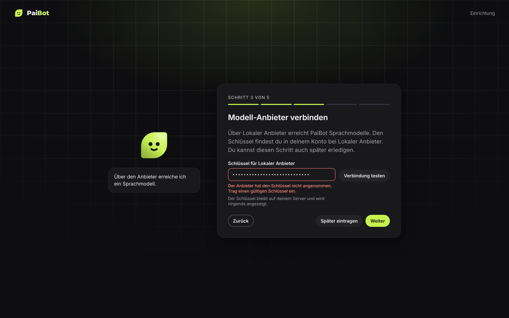

     Klappt es, steht dort ein grüner Kasten mit Haken: „Verbindung steht“ und wie viele passende Modelle PaiBot gefunden hat. Klick auf „Weiter“.

     

   - **EUrouter:** Trag zusätzlich die Namen deiner Routing-Regeln ein (eine oder mehrere, mit „Weitere Regel“). Die Namen findest du in deinem Konto bei EUrouter unter „Routing“; schreib sie genau so, auch groß und klein. Klick auf „Schlüssel und Regeln prüfen“. Für jede Regel schickt PaiBot eine sehr kleine echte Anfrage an ein Modell; das kostet bei EUrouter wenige Token. Bei jeder Regel steht danach, ob sie funktioniert und wer laut EUrouter geantwortet hat – mit dessen Sitz laut der Anbieter-Liste von EUrouter. Eine Liste einzelner Modelle bietet PaiBot bei EUrouter nicht an.

     

     Dasselbe im hellen Design:

     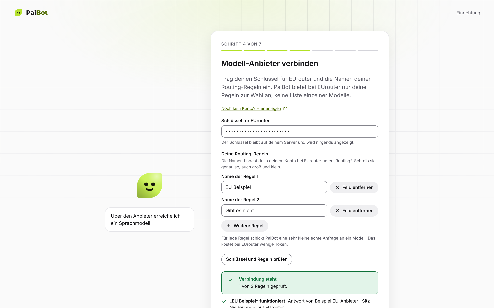

7. Wähle das Modell (Mistral AI, eigener Anbieter) bzw. die Routing-Regel (EUrouter), mit der dein Bot arbeitet, und klick auf „Weiter“. Ohne Schlüssel entfällt dieser Schritt.

   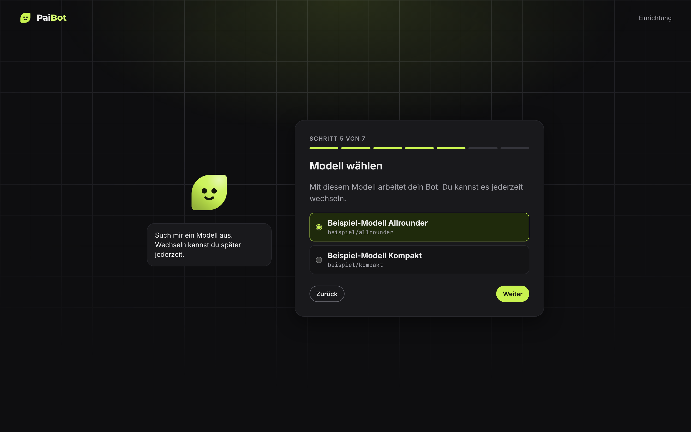

   Bei EUrouter stehen hier die geprüften Regeln:

   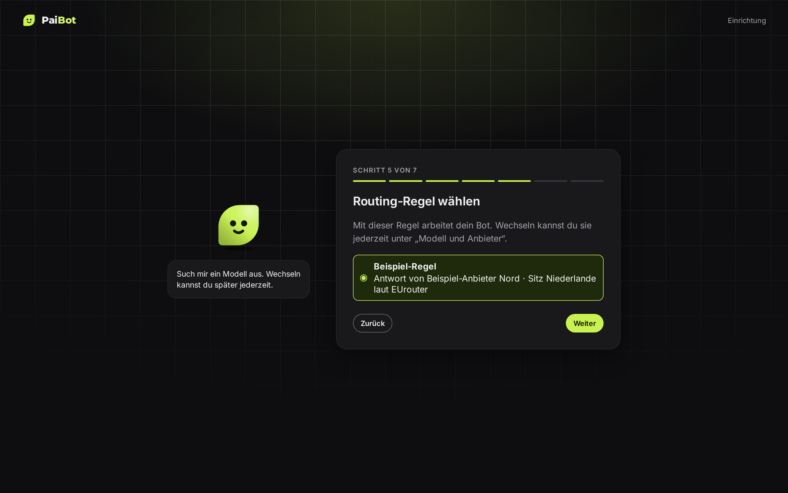

8. Entscheide, ob die Datenschleuse für neue Unterhaltungen standardmäßig an ist. Der Schalter lässt sich nur bedienen, wenn die Datenschleuse auf deinem Server eingerichtet ist; sonst bleibt sie aus, und PaiBot sagt dir das unter dem Schalter. Klick auf „Weiter“.

   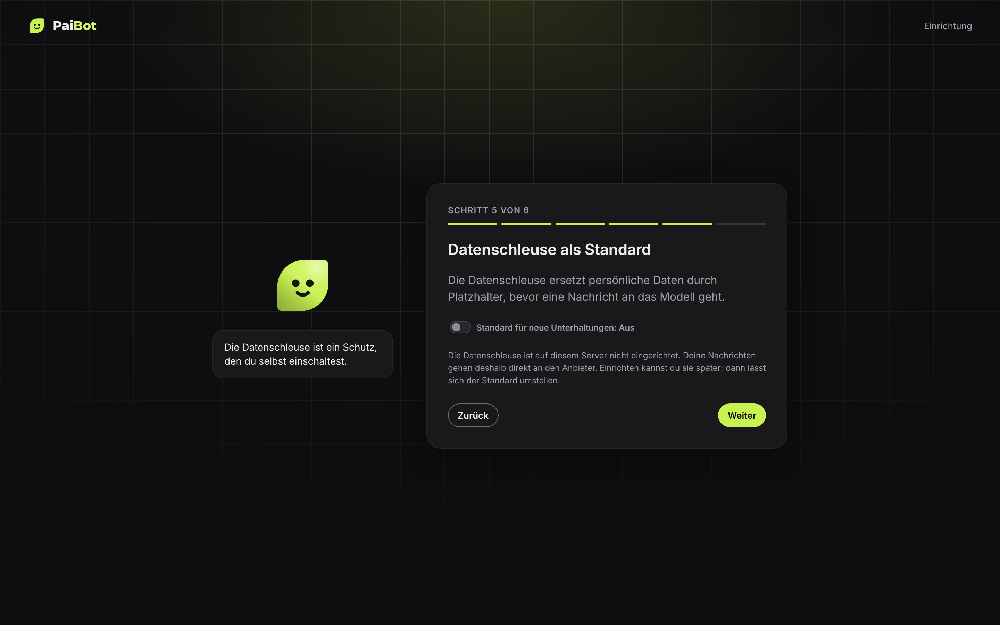

9. Gib deinem Bot einen Namen (Vorschlag: „Pai“) und klick auf „Einrichtung abschließen“.

   

10. Du siehst „Alles bereit“ mit allem, was eingerichtet ist, und bist angemeldet. Der Code gilt ab jetzt nicht mehr. Mit „Zur App“ geht es weiter.


11. Die App öffnet sich: links dein Bot und die Navigation, in der Mitte eine neue Unterhaltung mit deinem Bot (siehe [Chat](funktion-chat.md)).

    

### Anmelden und Abmelden

1. Öffne PaiBot. Ohne gültige Sitzung landest du auf „Anmelden“.

   

2. Gib dein Passwort ein. Mit „Angemeldet bleiben“ bleibt die Sitzung auch nach dem Schließen des Browsers erhalten. Klickst du ohne Passwort auf „Anmelden“, weist das Feld darauf hin.

   

3. Klick auf „Anmelden“. Bei einem falschen Passwort steht unter dem Feld „Das Passwort stimmt nicht.“

   

4. Zum Abmelden klick unten links auf „Du“ und im Menü auf „Abmelden“ (am Handy erst auf „Menü öffnen“); mehr dazu unter [Einstellungen und Info](funktion-einstellungen.md).

### Hinweis bei Anmeldung von einem neuen Gerät

Meldet sich jemand mit deinem Passwort in einem Browser an, der noch kein bekanntes Gerät ist, siehst du das auf deinen anderen Geräten.

1. Melde dich in einem neuen Browser an (zum Beispiel auf einem neuen Handy). Er wird ein bekanntes Gerät und steht in den Einstellungen unter **Bekannte Geräte** mit der Marke **dieses Gerät**. Dieser Browser selbst zeigt keinen Hinweis.

   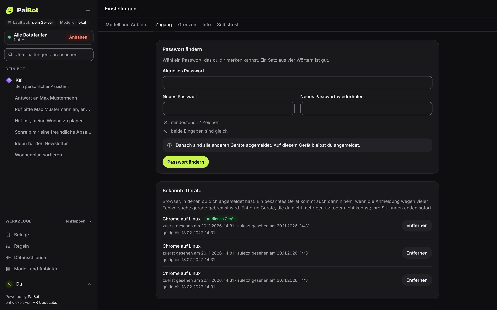
2. Auf jedem anderen angemeldeten Gerät erscheint beim nächsten Seitenaufruf oben die Leiste **Neue Anmeldung von einem neuen Gerät** mit grober Angabe und Zeitpunkt, zum Beispiel „Chrome auf Linux, am 20.11.2026, 14:31“. Sie bleibt, bis du auf diesem Gerät antwortest.

   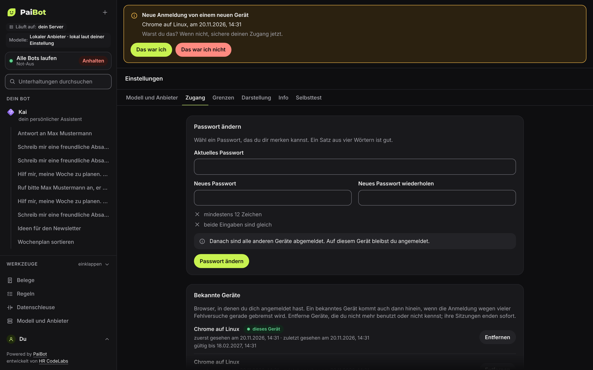
3. Warst du es, klick auf **Das war ich**. Die Leiste ist auf diesem Gerät geschlossen; auf deinen anderen Geräten bleibt sie, bis du sie dort ebenfalls bestätigst. Erst ein Gerät, das später dazukommt, bringt sie wieder.

   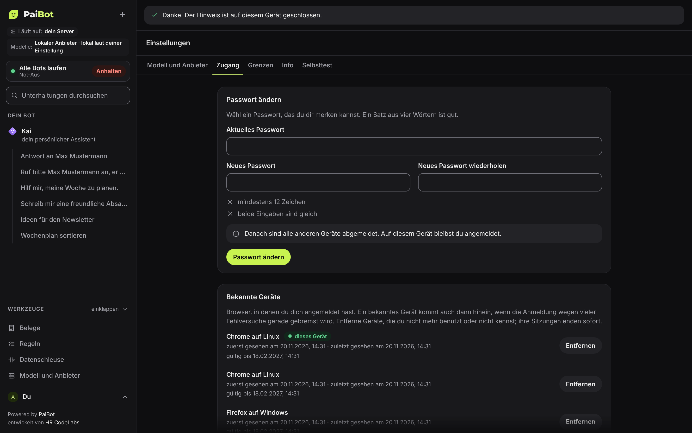
4. Warst du es nicht, klick auf **Das war ich nicht**. Darunter stehen zwei Wege, deinen Zugang zu sichern:
   - **Passwort ändern** (der beste erste Schritt): beendet alle anderen Sitzungen und entfernt alle anderen Geräte; dieser Browser bleibt angemeldet. Der Link führt zu „Passwort ändern“ in den Einstellungen.
   - **Alle Sitzungen beenden**: meldet überall ab, auch hier; danach meldest du dich neu an.

   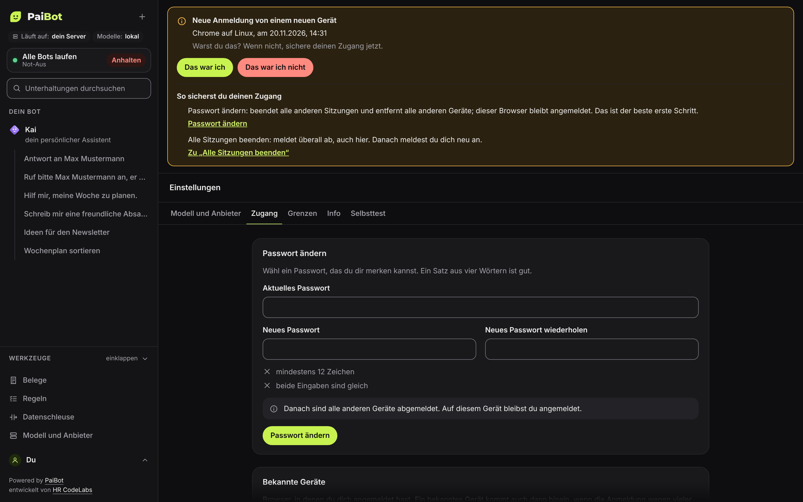
5. Ist das fremde Gerät weg (neues Passwort, „Alle Sitzungen beenden“ oder unter **Bekannte Geräte** entfernt), verschwindet auch die Leiste.

### Ausgesperrt? So kommst du wieder hinein

Versucht jemand massenhaft Passwörter, bremst PaiBot die Anmeldung für alle (siehe „So funktioniert es“). So kommst du trotzdem hinein:

1. Melde dich in einem Browser an, in dem du dich in den letzten 90 Tagen angemeldet und seitdem nicht abgemeldet hast. Er ist ein bekanntes Gerät: Er geht an der Bremse vorbei, und auch eine gesperrte Adresse hält ihn nicht auf. Dafür braucht es keinen Neustart.
2. Geht das nicht, starte den Migrations-Schritt noch einmal: `docker compose up -d` (startet den Dienst `migrate` erneut) bzw. in Coolify „Redeploy“. Er hebt alle Sperren der Anmeldung auf; im Log von `migrate` steht dann „Sperren der Anmeldung aufgehoben.“
3. Melde dich an. Hält die Flut an, nimm dafür einen bekannten Browser oder sperre die Adressen der Angreifer in deinem Proxy.

### Code verloren

1. Ein Neustart von `web` allein bringt keinen neuen Code: Solange die Einrichtung offen ist, gilt der Code aus dem ersten Start weiter, höchstens 24 Stunden. Im Log steht nach einem Neustart nur, wann er erzeugt wurde. Ist er älter als 24 Stunden, steht beim nächsten Aufruf der Seite „Einrichtung“ von selbst ein neuer im Log.
2. Lass den Migrations-Schritt noch einmal laufen: `docker compose up -d` (startet den Dienst `migrate` erneut) bzw. in Coolify „Redeploy“. Er verwirft den alten Code.
3. Lade die Seite „Einrichtung“ neu. Jetzt steht ein **neuer** Code im Log von `web`; der alte gilt nicht mehr. Was du vorher eingegeben hattest, musst du noch einmal eingeben: Gespeichert wird erst beim Abschluss, dann alles auf einmal.

## So sieht es aus

Die Bilder zu jedem Schritt stehen oben in der Anleitung. Hier die Ansichten am Handy, im hellen Design und die Seite für Adressen, die es nicht gibt.

Auf dem Handy steht der Bot mit seiner Sprechblase über dem Schritt.

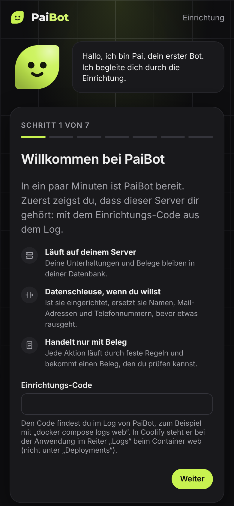

Der Hinweis auf eine neue Anmeldung auf dem Handy:

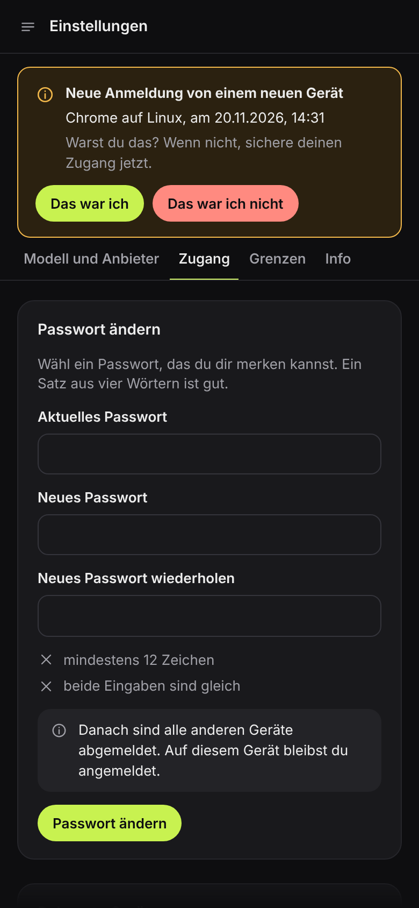

Die Anmeldung auf dem Handy im hellen Design:


Das Passwort im hellen Design, erst ein Feld ausgefüllt: Die Prüfliste zeigt, was noch fehlt.

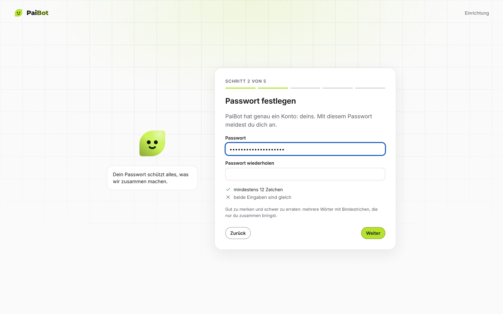

Eine Adresse, die es in PaiBot nicht gibt, führt zu dieser Seite mit einem Link zurück zur Startseite.


## Einstellungen

| Einstellung                       | Wo                | Bedeutung                                                                                                                                                                                                                                                                                                                         | Standard                |
| --------------------------------- | ----------------- | --------------------------------------------------------------------------------------------------------------------------------------------------------------------------------------------------------------------------------------------------------------------------------------------------------------------------------- | ----------------------- |
| `APP_URL`                         | Umgebungsvariable | Adresse, unter der du PaiBot öffnest. Nur Anfragen genau von dieser Adresse dürfen etwas verändern. Beginnt sie mit `https://`, sind die Cookies `Secure` und heißen `__Host-…`. Im Betrieb Pflicht; `http://` nur für den eigenen Rechner (mit Warnung im eigenen Netz)                                                          | `http://localhost:3000` |
| `TRUST_PROXY`                     | Umgebungsvariable | `1`, wenn PaiBot hinter einem Proxy läuft (Coolify, Traefik, Caddy, nginx). Dann zählt die Adresse, die dein Proxy als letzte in `X-Forwarded-For` anhängt                                                                                                                                                                        | im Compose `1`          |
| `PAIBOT_SECRET`                   | Umgebungsvariable | Wurzel-Geheimnis; daraus entstehen die Prüfzeichen gegen untergeschobene Anfragen und die Schlüssel für Belege und Anbieter                                                                                                                                                                                                       | Pflicht                 |
| `PAIBOT_EINRICHTUNG_ANBIETER_URL` | Umgebungsvariable | Nur für Tests und eigene Dienste: Die Auswahl „Eigener oder lokaler Anbieter“ verbindet in der Einrichtung diesen OpenAI-kompatiblen Dienst. Er heißt in PaiBot „Lokaler Anbieter“ (Adresse im eigenen Netz, Region lokal) bzw. „Eigener Anbieter“. Ohne die Variable richtest du einen eigenen Anbieter nach der Einrichtung ein | nicht gesetzt           |
| `PAIBOT_VORLAGEN_TESTADRESSE`     | Umgebungsvariable | Nur für Tests und Doku-Bilder: Die Vorlagen EUrouter und Mistral AI zeigen auf diese Adresse (nur eine Adresse auf dem eigenen Rechner oder im eigenen Netz wird angenommen)                                                                                                                                                      | nicht gesetzt           |
| Angemeldet bleiben                | Seite „Anmelden“  | Cookie bleibt 30 Tage im Browser; ohne Haken endet es mit dem Browser                                                                                                                                                                                                                                                             | aus                     |

**Hinter einem Proxy `TRUST_PROXY=1` setzen.** Im Compose ist das der Standard, denn der Port der App ist dort nur auf dem Server selbst erreichbar. Ohne diese Einstellung kennt PaiBot die Adresse der Besucher nicht, denn den Wert in `X-Forwarded-For` kann jeder frei setzen, und PaiBot liest ihn dann gar nicht. Alle Besucher teilen sich so einen Zähler; die Sperre je Adresse verzögert dann nur (2 Sekunden je Versuch). Die gemeinsame Bremse gilt trotzdem für alle. Beim Start und auf der Seite „Einrichtung“ steht dazu ein Hinweis. Setze `TRUST_PROXY=1` nur, wenn wirklich ein Proxy davor steht, und gib den Port der App nie direkt frei; sonst könnte ein Besucher seine Adresse vortäuschen.

**Beim Start in Produktion prüft PaiBot `APP_URL`:**

| `APP_URL`                                                                                      | Ergebnis                                                                 |
| ---------------------------------------------------------------------------------------------- | ------------------------------------------------------------------------ |
| fehlt, ist keine Adresse oder enthält Benutzer und Passwort                                    | Start bricht ab, mit Meldung im Log                                      |
| `http://` mit öffentlicher Adresse (IPv4 oder IPv6) oder öffentlichem Namen                    | Start bricht ab: Passwort und Sitzung gingen unverschlüsselt durchs Netz |
| `http://` im eigenen Netz (`192.168.…`, `10.…`, `[fd…]`, `[fe80…]`, `nas`, `….local`, `….lan`) | Start mit Warnung                                                        |
| `http://localhost`, `http://127.0.0.1`, `http://[::1]`                                         | Start ohne Warnung (eigener Rechner)                                     |
| `https://…`                                                                                    | Start ohne Warnung                                                       |
| mit Pfad oder Abfrage (`https://…/app`)                                                        | Start mit Warnung; es zählt nur der Ursprung                             |

Ein Name, der nur wie eine Adresse beginnt (etwa `127.irgendwas.de` oder `10.irgendwas.de`), ist ein öffentlicher Name und zählt nicht als eigener Rechner oder eigenes Netz.

Kommt eine Anfrage an einen anderen Host als in `APP_URL`, schreibt `web` einmal einen Hinweis ins Log. Dann scheitern Anmelden und Einrichtung, bis `APP_URL` genau die Adresse im Browser ist.

## So funktioniert es

- **Einrichtungs-Code:** 12 Zeichen aus 32 Zeichen (60 Bit Zufall). PaiBot speichert nur seinen Prüfwert (SHA-256) in der Datenbank und schreibt den Code genau einmal ins Log, beim ersten Start. Er gilt 24 Stunden, längstens bis zum Ende der Einrichtung; danach entsteht beim nächsten Aufruf ein neuer. Richte PaiBot deshalb gleich nach dem ersten Start ein. Ein Neustart oder ein zweiter Prozess erzeugt keinen neuen; dann steht im Log nur ein Hinweis, wann der Code erzeugt wurde. Erst ein neuer Lauf des Migrations-Schritts verwirft ihn (siehe „Code verloren“). Falsche Codes zählen je Adresse: nach 5 Fehlversuchen in 15 Minuten ist für diese Adresse Pause. Das gilt gleich für die Prüfung bei „Weiter“, für den Verbindungstest und für den Abschluss; die Prüfung bei „Weiter“ speichert nichts. Der Verbindungstest der Einrichtung verlangt denselben Code und zählt zusätzlich höchstens 10 Tests in 15 Minuten.
- **Abschluss in einem Rutsch:** Alles läuft in einer einzigen Datenbank-Transaktion: Signaturschlüssel der Installation erzeugen und verschlüsselt speichern, Beleg „Start“ als erster Eintrag der Beleg-Kette, dann über das [Tor](funktion-tor.md) die Aktionen „Einrichtung abgeschlossen“ (Konto, Einstellungen, erste Sitzung), „Bot geändert“, „Anbieter gespeichert“ (Schlüssel verschlüsselt und an Anbieter und Adresse gebunden), „Modell gewählt“ und gegebenenfalls „Datenschleuse umgeschaltet“. Scheitert ein Schritt, bleibt nichts davon übrig. Kommen zwei Abschlüsse gleichzeitig, gewinnt genau einer; der andere bekommt „PaiBot ist schon eingerichtet“.
- **Passwort:** gespeichert nur als scrypt-Hash. Vor jeder Prüfung zählt PaiBot den Versuch, in der Datenbank und auch bei gleichzeitigen Anfragen genau:
  - je Adresse: höchstens 5 Fehlversuche in 15 Minuten und 20 an einem Tag. Die Fenster gleiten: Versuche vom Ende des letzten Fensters zählen am Anfang des nächsten anteilig mit, eine Pause dauert deshalb bis zu 30 Minuten bzw. zwei Tage. IPv6-Adressen zählen je Netz (/64), weil ein Anschluss meist ein ganzes Netz hat.
  - für alle zusammen: über 20 Versuchen in 15 Minuten (ebenfalls gleitend) prüft PaiBot höchstens ein Passwort je Takt, egal wie viele Anfragen gleichzeitig kommen. Der Takt beginnt bei 2 Sekunden und verdoppelt sich je 20 weiteren Versuchen bis 1 Minute. Alle anderen bekommen „Zu viele Versuche“ mit der Wartezeit.
  - Bekannte Geräte: Ein Browser, in dem du dich anmeldest, wird ein bekanntes Gerät und bekommt ein Geräte-Cookie (`HttpOnly`, `SameSite=Strict`, mit Prüfzeichen aus `PAIBOT_SECRET`). PaiBot führt dazu ein Verzeichnis auf dem Server: Art (heute immer „Browser“), Browser-Kennung, wann angelegt, wann zuletzt gesehen, bis wann gültig, ob widerrufen. Vom Cookie steht dort nur die Prüfsumme. Ein Cookie ohne gültigen Eintrag gilt nicht. Ein Gerät gilt 90 Tage ab der letzten Anmeldung damit; meldest du dich im selben Browser wieder an, bleibt es dasselbe Gerät. Höchstens 10 Geräte gelten gleichzeitig, ein elftes widerruft das älteste. Jede Sitzung gehört zu einem Gerät und endet, wenn das Gerät widerrufen wird. Abmelden widerruft das Gerät dieses Browsers, „Alle Sitzungen beenden“ und ein neues Passwort widerrufen alle Geräte. Hinzufügen und Entfernen eines Geräts stehen als Belege im Protokoll („Gerät hinzugefügt“, „Gerät entfernt“).
  - Limit je Gerät: höchstens 5 Fehlversuche in 15 Minuten und 20 am Tag, darüber ist für dieses Gerät Pause. Die ersten 3 Versuche im Fenster gehen an der gemeinsamen Bremse und am Limit der Adresse vorbei, danach gilt für das Gerät zusätzlich dasselbe wie für jeden anderen Browser. Ein kopiertes Cookie bringt so höchstens 5 Versuche je 15 Minuten.
  - Höchstens zwei Prüfungen rechnen gleichzeitig. Die Antwort auf einen Fehlversuch ist immer gleich und dauert ähnlich lang, auch vor der Einrichtung. Stammt der Hash aus einem älteren Verfahren, wird er beim nächsten Anmelden erneuert.
- **Sitzung:** Bei jeder Anmeldung entsteht ein neues Zufalls-Token. Der Browser bekommt es als Cookie (`HttpOnly`, `SameSite=Lax`, `Path=/`, bei https zusätzlich `Secure`); in der Datenbank steht nur seine Prüfsumme. Eine Sitzung gilt 30 Tage ab der letzten Benutzung, höchstens aber 90 Tage ab der Anmeldung; beides prüft der Server. Abmelden löscht die Sitzung, ein Passwortwechsel löscht alle. Beim Passwort ändern gelten höchstens 5 Versuche in 15 Minuten je Sitzung; darüber endet die Sitzung, mit der es versucht wurde, und du meldest dich neu an. Deine anderen Sitzungen zählen getrennt.
- **Untergeschobene Anfragen:** Jede Anfrage, die etwas verändert, muss genau von `APP_URL` kommen (`Origin`) und ein Prüfzeichen mitschicken, das aus deiner Sitzung abgeleitet ist und in jeder Seite steht. Beides fehlt einer fremden Seite.
- **Schutz jeder Route:** Ein Proxy vor allen Anfragen leitet ohne Einrichtung zur Einrichtung und ohne Anmeldung zur Anmeldung und beantwortet Schnittstellen ohne Sitzung mit „Nicht angemeldet“. Zusätzlich prüft jede Seite und jede Schnittstelle die Sitzung selbst. Jede Antwort trägt strenge Sicherheits-Kopfzeilen: Skripte laufen nur mit einer Nonce, die für jede Antwort neu entsteht; HSTS geht nur bei https mit.
- **Hinweis bei neuer Anmeldung:** Jedes Gerät merkt sich auf dem Server, bis wann du neue Anmeldungen auf ihm bestätigt hast (am Anfang: seit es dazukam). Neu ist für ein Gerät jedes andere gültige Gerät, das danach dazukam. Eine erneute Anmeldung mit einem bekannten Gerät ist keine neue Anmeldung. „Das war ich“ ist die Aktion „Neue Anmeldung bestätigt“ durch das Tor mit Beleg und gilt nur für das Gerät, auf dem du sie wählst. Der Hinweis nennt nur die grobe Angabe aus der Browser-Kennung und den Zeitpunkt; Adressen speichert PaiBot nicht.
- **Belege:** An- und Abmelden, alle Sitzungen beenden, das Passwort ändern, Geräte hinzufügen und entfernen und „Das war ich“ stehen als Belege im Protokoll; jeder Beleg „Entscheidung“ nennt das Gerät, von dem die Aktion kam (bei der ersten Anmeldung in einem neuen Browser gibt es dieses Gerät erst danach; der Beleg „Gerät hinzugefügt“ nennt es). Fehlversuche nicht; sie stehen nur im Zähler.

- **Anbieter-Wahl:** Mistral AI und ein eigener Anbieter werden wie bisher über `GET <Adresse>/models` geprüft. Bei EUrouter prüft PaiBot jede Routing-Regel mit einer sehr kleinen echten Anfrage (`rule_name`, ohne Modell, höchstens 4 Token Ausgabe). Eine Regel, die gerade geprüft wurde, prüft PaiBot beim Abschluss nicht noch einmal (15 Minuten gemerkt, nur ein Prüfwert, nie der Schlüssel). Alle geprüften Regeln stehen danach unter „Modell und Anbieter“ zur Wahl. Mehr dazu unter [Anbieter und Modelle](funktion-anbieter-und-modelle.md).

## Grenzen

- Bei EUrouter kann PaiBot die Regeln deines Kontos nicht selbst auflisten; mit dem normalen Schlüssel antwortet EUrouter darauf mit „This key cannot access this endpoint“. Du trägst die Namen deshalb selbst ein.
- Jede Prüfung einer Regel kostet bei EUrouter wenige Token.
- Passwort vergessen: Zurücksetzen gibt es in dieser Fassung noch nicht. Bewahre das Passwort gut auf.
- Nur ein Passwort, keine zweite Stufe (2FA ist geplant).
- Der Einrichtungs-Code liegt im Speicher des Dienstes `web`. Laufen mehrere `web`-Dienste gleichzeitig, hat jeder seinen eigenen Code.
- Sitzungen, bekannte Geräte und Passwort ändern stehen in den [Einstellungen](funktion-einstellungen.md) im Reiter „Zugang“; einzelne Sitzungen lassen sich dort nicht beenden, nur ganze Geräte oder alle Sitzungen auf einmal.
- Hast du die Einrichtung abgeschlossen, lässt sie sich nicht wiederholen.
- Der Hinweis auf eine neue Anmeldung erscheint nur in PaiBot selbst, beim nächsten Seitenaufruf; eine Nachricht aufs Handy oder per Mail gibt es nicht. Sitzungen aus der Zeit vor dem Geräte-Verzeichnis gehören zu keinem Gerät und zeigen keinen Hinweis; nach der nächsten Anmeldung schon.
- Fehlversuche der Anmeldung stehen nicht im Protokoll der Belege, auch nicht zusammengefasst; sie zählen nur für die Limits.
- Während einer Flut von Fehlversuchen kommt ein Browser, der noch kein bekanntes Gerät ist (neues Handy, gelöschte Cookies, privates Fenster), nur selten an der gemeinsamen Bremse vorbei. Dann hilft ein bekanntes Gerät oder ein neuer Lauf von `migrate` (siehe „Ausgesperrt?“). Einen eigenen Notfall-Code für die Anmeldung gibt es nicht.
- Die Limits je Adresse sind nur so gut wie die Adresse, die dein Proxy weitergibt. Steht ein weiterer Dienst vor deinem Proxy (etwa ein CDN), stell den Proxy so ein, dass er die echte Adresse der Besucher weitergibt; sonst teilen sich alle Besucher die Adresse dieses Dienstes. Steht `web` in einem Docker-Netz mit anderen Anwendungen, können diese die Adresse vortäuschen; `web` gehört deshalb nur in die Netze aus dem Compose. Ein bekanntes Gerät kommt in beiden Fällen trotzdem an.

## Fehlerbehebung

| Beobachtung                                                       | Ursache                                                                                                  | Was tun                                                                                    |
| ----------------------------------------------------------------- | -------------------------------------------------------------------------------------------------------- | ------------------------------------------------------------------------------------------ |
| „Der Einrichtungs-Code stimmt nicht.“                             | Tippfehler, oder der Code wurde inzwischen verworfen                                                     | Neuesten Code aus dem Log von `web` nehmen (letzte Zeile mit „Einrichtungs-Code“)          |
| „Zu viele Versuche. Versuch es in … Sekunden …“                   | 5 Fehlversuche von dieser Adresse in 15 Minuten (20 am Tag), oder viele fremde Versuche                  | Warten, bis die Zeit um ist; ausgesperrt: siehe „Ausgesperrt? So kommst du wieder hinein“  |
| Nach „Passwort ändern“ abgemeldet                                 | 5 Versuche mit falschem aktuellem Passwort in 15 Minuten                                                 | Neu anmelden; nach 15 Minuten wieder versuchen                                             |
| Start bricht ab: „APP_URL fehlt“ oder „APP_URL nutzt http://…“    | `APP_URL` fehlt oder ist eine öffentliche Adresse ohne https                                             | `APP_URL=https://…` setzen, https über den Proxy                                           |
| „Die Anfrage kam nicht von dieser PaiBot-Seite.“                  | `APP_URL` passt nicht zur Adresse im Browser                                                             | `APP_URL` genau auf die Adresse setzen, unter der du PaiBot öffnest; neu starten           |
| „Die Anfrage konnte nicht bestätigt werden.“                      | Seite war lange offen oder Cookies wurden gelöscht                                                       | Seite neu laden                                                                            |
| Nach dem Anmelden sofort wieder „Anmelden“                        | Browser speichert keine Cookies, oder `APP_URL` ist https, die Seite aber http                           | Cookies erlauben; PaiBot über die Adresse aus `APP_URL` öffnen                             |
| Hinweis „TRUST_PROXY ist nicht gesetzt“                           | PaiBot kennt die Adresse der Besucher nicht                                                              | Hinter einem Proxy `TRUST_PROXY=1` setzen (siehe Einstellungen)                            |
| Leiste „Neue Anmeldung von einem neuen Gerät“, obwohl du es warst | Du hast dich in einem neuen Browser, einem privaten Fenster oder nach dem Löschen der Cookies angemeldet | Auf jedem anderen Gerät „Das war ich“ wählen                                               |
| „„…“ geht nicht.“ bei einer Routing-Regel                         | EUrouter kennt keine eingeschaltete Regel mit genau diesem Namen                                         | Namen im Konto unter „Routing“ nachsehen (groß und klein beachten), Regel dort einschalten |
| „Verbindung fehlgeschlagen“ in Rot                                | Schlüssel falsch, Anbieter nicht erreichbar oder Limit erreicht; der Grund steht im Kasten               | Den genannten Ausweg befolgen und noch einmal testen                                       |
| „Datenbank nicht erreichbar“ statt der Anmeldung                  | Datenbank läuft nicht oder ist nicht eingerichtet                                                        | Log ansehen, Datenbank starten, Seite neu laden                                            |

## Bilder neu aufnehmen

Für Mitwirkende: Alle Bilder dieser Seite entstehen per Skript aus der App im Produktions-Build, mit Wegwerf-Datenbank, dem [Test-Anbieter](entwickeln.md) und nur Beispiel-Daten. Der Ablauf steht in der [Doku-Übersicht](README.md#screenshots):

```bash
pnpm build
pnpm doku:app -- pnpm doku:screenshots   # App bereitstellen, alle Bilder aufnehmen, abräumen
pnpm doku:check
```
