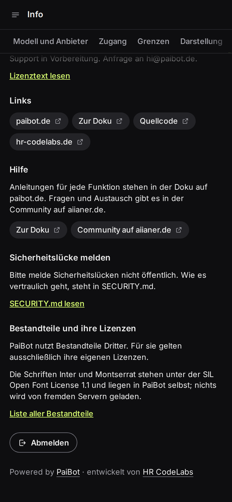
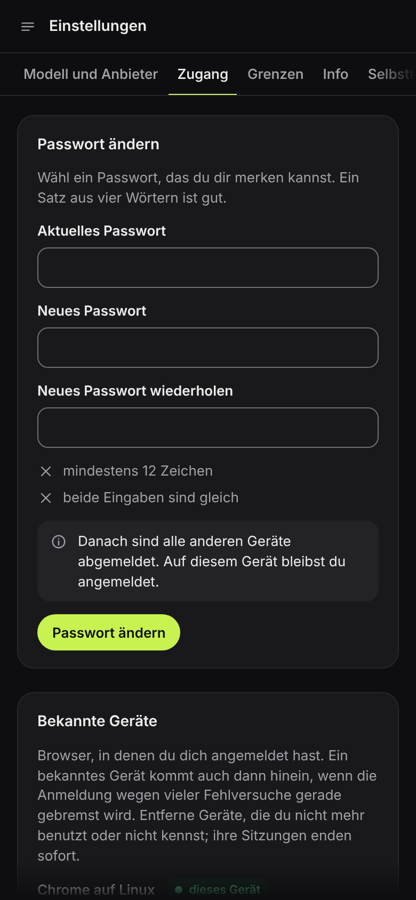
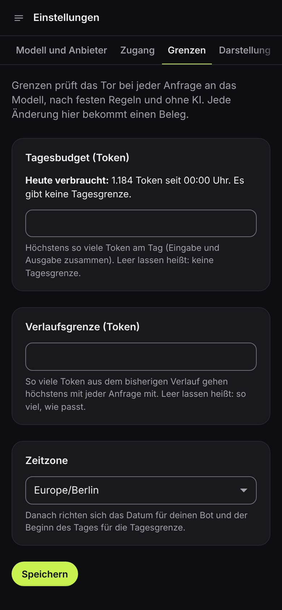
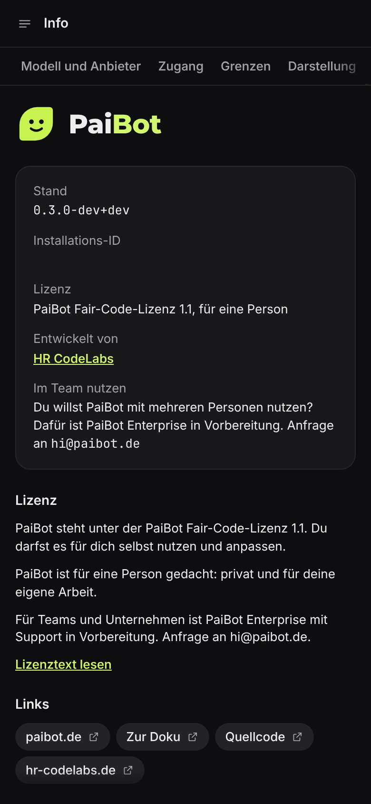

<!--
PaiBot – Doku-Seite: Einstellungen (Zugang und Grenzen) und Info.

Autor:     Oliver Hees
Website:   https://paibot.de
Copyright: 2026 Oliver Hees. Alle Urheberrechte liegen beim Autor.
Lizenz:    PaiBot Fair-Code-Lizenz 1.1 – siehe Datei LICENSE im Projektstamm
Seit:      2026-11-21
-->

# Einstellungen und Info

**Ergebnis:** Du änderst dein Passwort, siehst, wo du angemeldet bist, meldest alle Geräte ab, legst eine Tagesgrenze für dein Modell fest und findest Stand, Lizenz und Hilfe von PaiBot an einer Stelle.

## Wofür

Unter **Einstellungen** regelst du den Zugang zu deinem PaiBot und die Grenzen, die das Tor bei jeder Anfrage an das Modell prüft. Unter **Info** steht, welchen Stand deine Installation hat, unter welcher Lizenz PaiBot steht und wo du Hilfe bekommst.

## So benutzt du es

**Passwort ändern**

1. Klick in der Navigation auf **Einstellungen**. Der Reiter **Zugang** ist offen.
2. Gib im Kasten **Passwort ändern** dein **aktuelles Passwort** ein.
3. Gib das **neue Passwort** zweimal ein. Die Prüfliste darunter zeigt, ob es mindestens 12 Zeichen hat und ob beide Eingaben gleich sind.

   
4. Klick auf **Passwort ändern**. Die Seite lädt neu und meldet: „Dein Passwort ist geändert. Alle anderen Geräte sind jetzt abgemeldet.“ Auf diesem Gerät bleibst du angemeldet.
5. Auf anderen Geräten meldest du dich ab jetzt mit dem neuen Passwort an.

**Sitzungen ansehen und alle beenden**

1. Im Reiter **Zugang** steht unter **Sitzungen** jede Anmeldung mit grober Geräte-Angabe (zum Beispiel „Firefox auf Windows“), dem Zeitpunkt der Anmeldung und wann sie zuletzt aktiv war. Dieses Gerät trägt die Marke **diese Sitzung**.

   
2. Willst du überall abgemeldet sein (zum Beispiel, weil du ein Gerät verloren hast), klick auf **Alle Sitzungen beenden**.
3. Bestätige die Rückfrage mit **Alle Sitzungen beenden**. Alle Geräte sind abgemeldet, auch dieses; du landest auf der Anmeldung.

   
4. Melde dich mit deinem Passwort wieder an.

Nur dieses Gerät abmelden: Knopf **Abmelden** im Reiter **Zugang**, auf der Seite **Info** oder unten in der Navigation.

**Grenzen festlegen**

1. Klick in den Einstellungen auf den Reiter **Grenzen**.
2. Unter **Tagesbudget (Token)** siehst du, wie viele Token dein Bot heute schon verbraucht hat (seit Mitternacht in deiner Zeitzone). Trag eine Zahl ein, zum Beispiel `50000`, oder lass das Feld leer für keine Tagesgrenze.

   
3. Unter **Verlaufsgrenze (Token)** legst du fest, wie viel vom bisherigen Verlauf höchstens mit jeder Anfrage mitgeht. Leer heißt: so viel, wie passt.
4. Unter **Zeitzone** wählst du deine Zeitzone, zum Beispiel `Europe/Berlin`.
5. Klick auf **Speichern**. Neben dem Knopf steht „Gespeichert.“ und ein Link **Beleg Nr. … ansehen**: Die Änderung lief durch das Tor und steht mit Beleg im Protokoll.

   

**Info ansehen**

1. Klick in der Navigation auf **Info** (oder in den Einstellungen auf den Reiter **Info**).
2. Oben stehen Stand und Installations-ID deiner Installation, die Lizenz, wer PaiBot entwickelt und der Hinweis auf PaiBot Enterprise für Teams.

   
3. Darunter findest du den Lizenztext, Links zur Doku und zur Community, wie du eine Sicherheitslücke meldest und die Liste der Bestandteile Dritter. Alle Links öffnen in einem neuen Tab.

   

## So sieht es aus

Die Bilder zu den einzelnen Schritten stehen oben in der Anleitung. Sie zeigen Beispiel-Daten: zwei Sitzungen der Beispiel-Umgebung, den Bot „Pai“ und den Test-Anbieter. Die Installations-ID ist in den Bildern ausgeblendet, weil sie bei jeder Installation anders ist.

Am Handy, Reiter „Zugang“, „Grenzen“ und die Seite „Info“:

## Einstellungen

| Einstellung    | Wo                      | Bedeutung                                                                                                                                                                      | Standard            |
| -------------- | ----------------------- | ------------------------------------------------------------------------------------------------------------------------------------------------------------------------------ | ------------------- |
| Tagesbudget    | Einstellungen › Grenzen | Höchstens so viele Token am Tag (Eingabe und Ausgabe aller Antworten zusammen). Ist es erreicht, fragt dein Bot das Modell bis Mitternacht nicht mehr an. 1 bis 1.000.000.000. | keine Tagesgrenze   |
| Verlaufsgrenze | Einstellungen › Grenzen | Höchstens so viele Token aus dem bisherigen Verlauf gehen mit jeder Anfrage mit. 1 bis 2.000.000.                                                                              | so viel, wie passt  |
| Zeitzone       | Einstellungen › Grenzen | Datum für deinen Bot und Beginn des Tages für das Tagesbudget.                                                                                                                 | aus der Einrichtung |

## So funktioniert es

- **Passwort ändern** prüft zuerst dein aktuelles Passwort. Nur wenn es stimmt, lässt das Tor die Aktion zu (Vorbedingung „Aktuelles Passwort bestätigt“). Danach werden in einem Schritt das neue Passwort gespeichert und alle Sitzungen gelöscht; dieses Gerät bekommt eine neue Sitzung. Auch ein falsches aktuelles Passwort steht als abgelehnte Aktion im Protokoll.
- **Sitzungen** zeigt nur, was gespeichert ist: Zeitpunkte und die Browser-Kennung, aus der PaiBot eine grobe Angabe wie „Chrome auf Android“ macht. Adressen oder Orte speichert PaiBot nicht. Lässt sich nichts sicher erkennen, steht „Gerät ohne Angabe“ da.
- **Alle Sitzungen beenden** löscht alle Sitzungen. Offene Verbindungen anderer Geräte (zum Beispiel ein laufender Chat) enden spätestens beim nächsten Herzschlag nach etwa 15 Sekunden.
- **Grenzen speichern** schickt nur die geänderten Felder. Die Aktion „Einstellung geändert“ läuft durch das Tor und bekommt zwei Belege (Entscheidung und Ergebnis); die Belege nennen, welche Felder sich geändert haben. Den Link zum Beleg zeigt die Seite direkt nach dem Speichern.
- Das **Tagesbudget** prüft das Tor als feste Grenze (G-04) bei jeder Anfrage an das Modell, ohne KI. Gezählt werden Eingabe und Ausgabe aller Antworten deines Bots seit Mitternacht in deiner Zeitzone, genau wie unter „Heute verbraucht“.
- **Info** liest den Stand aus der Installation und die Installations-ID aus der Datenbank. Die Seite lädt nichts von fremden Servern; Links nach außen sind normale Links.

## Grenzen

- **Alle anderen abmelden, aber hier angemeldet bleiben** gibt es als eigenen Knopf nicht: „Alle Sitzungen beenden“ meldet auch dieses Gerät ab. Wer nur die anderen Geräte loswerden will, ändert das Passwort.
- Der **Not-Aus**, der alle Bots anhält, ist in dieser Version nicht in der Oberfläche einstellbar.
- **Sprache** lässt sich noch nicht umstellen; PaiBot spricht Deutsch.
- Konto löschen, alle Daten exportieren und Sicherungen gibt es in den Einstellungen nicht.
- Ein vergessenes Passwort lässt sich hier nicht zurücksetzen; dafür musst du angemeldet sein.

## Fehlerbehebung

| Beobachtung                                                                                                                                           | Ursache                                                                     | Was tun                                                                         |
| ----------------------------------------------------------------------------------------------------------------------------------------------------- | --------------------------------------------------------------------------- | ------------------------------------------------------------------------------- |
| „Das Passwort stimmt nicht.“ beim Passwort ändern                                                                                                     | Das aktuelle Passwort war falsch.                                           | Aktuelles Passwort neu eingeben. Nichts wurde geändert.                         |
| „Das neue Passwort erfüllt die Prüfliste noch nicht.“                                                                                                 | Weniger als 12 Zeichen oder die beiden Eingaben sind verschieden.           | Prüfliste beachten, bis beide Punkte einen Haken haben.                         |
| „Gib eine ganze Zahl von 1 bis … ein oder lass das Feld leer.“                                                                                        | Null, Kommazahl, Text oder zu große Zahl bei einer Grenze.                  | Ganze Zahl eintragen oder das Feld leeren.                                      |
| „Es gibt nichts zu speichern.“                                                                                                                        | Nichts wurde geändert.                                                      | Erst einen Wert ändern, dann speichern.                                         |
| Im Chat: „Das Tor hat die Aktion abgelehnt. Grenze nicht eingehalten: G-04 „Tagesbudget“.“ (auf der Seite „Grenzen“: „Die Tagesgrenze ist erreicht.“) | Dein Bot hat heute so viele Token verbraucht, wie du erlaubst.              | Bis Mitternacht warten oder das Tagesbudget erhöhen bzw. leeren.                |
| „Die Sitzungen lassen sich gerade nicht laden.“                                                                                                       | Die Anfrage an den Server ist gescheitert.                                  | „Noch einmal versuchen“ klicken; hilft das nicht, ins Log von PaiBot schauen.   |
| Nach dem Speichern landest du auf der Anmeldung                                                                                                       | Deine Sitzung war abgelaufen oder wurde auf einem anderen Gerät beendet.    | Neu anmelden und die Änderung wiederholen.                                      |
| Nach mehreren Versuchen, das Passwort zu ändern, landest du auf der Anmeldung                                                                         | Mehr als 5 Versuche in 15 Minuten: PaiBot beendet zum Schutz diese Sitzung. | Neu anmelden und es mit dem richtigen aktuellen Passwort noch einmal versuchen. |
