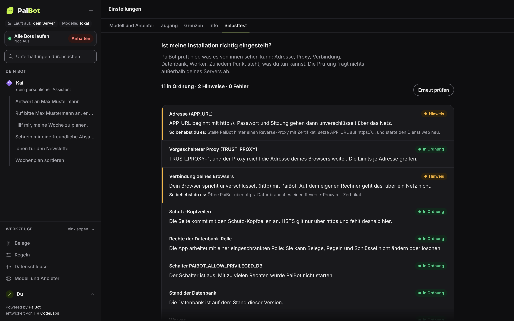
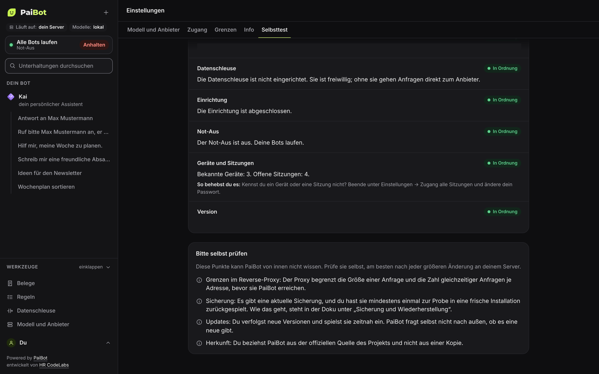
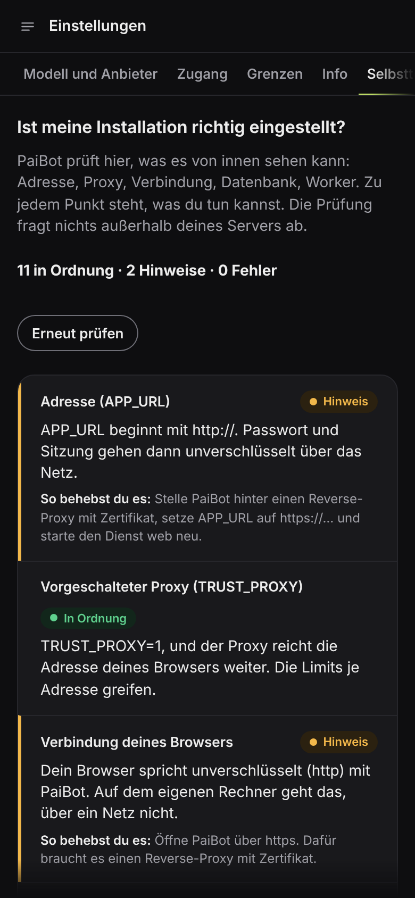
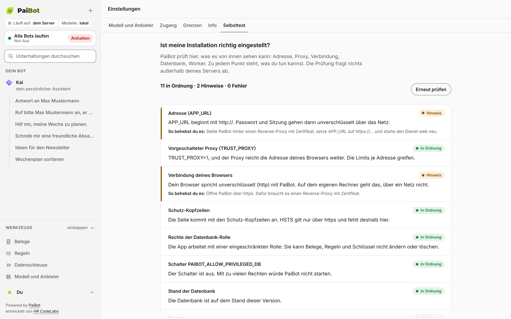

<!--
PaiBot – Selbsttest: Ist meine Installation richtig eingestellt?

Autor:     Oliver Hees
Website:   https://paibot.de
Copyright: 2026 Oliver Hees. Alle Urheberrechte liegen beim Autor.
Lizenz:    PaiBot Fair-Code-Lizenz 1.1 – siehe Datei LICENSE im Projektstamm
Seit:      2026-11-21
-->

# Selbsttest

**Ergebnis:** Auf einer Seite siehst du, ob deine Installation sicher eingestellt ist. Zu jedem Punkt steht „In Ordnung“, „Hinweis“ oder „Fehler“ und, wenn etwas nicht stimmt, wie du es behebst.

## Wofür

Viele Fehler beim Betrieb fallen erst auf, wenn etwas schiefgeht: eine falsche Adresse in `APP_URL`, ein Proxy, der die Adresse des Browsers nicht weiterreicht, eine Datenbank-Rolle mit zu vielen Rechten oder ein Worker, der gar nicht läuft. Der Selbsttest zeigt dir das nach dem ersten Start und nach jeder Änderung an deinem Server auf einen Blick.

## So benutzt du es

1. Melde dich an und klick unten links in der Seitenleiste auf **Du**, dann unter **Hilfe** auf **Selbsttest** (oder in den Einstellungen auf den Reiter **Selbsttest**).
2. PaiBot prüft sofort; oben steht die Zusammenfassung, zum Beispiel „11 in Ordnung · 2 Hinweise · 0 Fehler“.

   
3. Geh die Liste von oben nach unten durch. Bei jedem Punkt mit **Hinweis** (gelb) oder **Fehler** (rot) steht unter **So behebst du es**, was zu tun ist.

   
4. Behebe den Punkt (meist eine Umgebungsvariable in `deploy/.env` bzw. in Coolify, danach den Dienst neu starten) und klick auf **Erneut prüfen**.
5. Lies ganz unten **Bitte selbst prüfen**: Diese Punkte kann PaiBot von innen nicht wissen (Grenzen im Reverse-Proxy, Sicherung mit Probe, Updates, Herkunft). Prüfe sie selbst.

   

## So sieht es aus

Die Bilder zu den Schritten stehen oben (Beispiel-Daten, Beispiel-Installation auf dem eigenen Rechner über http, deshalb zwei Hinweise). Am Handy und im hellen Design:

## Einstellungen

Am Selbsttest selbst gibt es nichts einzustellen. Er liest diese Einstellungen deiner Installation:

| Prüfung                    | Woher                                                      | In Ordnung, wenn …                                                                       |
| -------------------------- | ---------------------------------------------------------- | ---------------------------------------------------------------------------------------- |
| Adresse (APP_URL)          | Umgebungsvariable `APP_URL` und die Adresse dieser Anfrage | sie mit `https://` beginnt und zur Adresse passt, über die du die Seite geöffnet hast    |
| Vorgeschalteter Proxy      | `TRUST_PROXY` und ob eine weitergereichte Adresse ankommt  | beides zusammenpasst: `TRUST_PROXY=1` mit Proxy, sonst aus                               |
| Verbindung deines Browsers | dein Browser                                               | die Seite über https kommt (über http zum eigenen Rechner: Hinweis)                      |
| Schutz-Kopfzeilen          | die Antwort, wie sie bei deinem Browser ankommt            | Content-Security-Policy und die weiteren Schutz-Kopfzeilen da sind, über https auch HSTS |
| Rechte der Datenbank-Rolle | Verbindung aus `DATABASE_URL`                              | die Rolle eingeschränkt ist (kein Superuser, kann Belege und Regeln nicht ändern)        |
| Schalter erhöhte Rechte    | Umgebungsvariable `PAIBOT_ALLOW_PRIVILEGED_DB`             | sie nicht gesetzt ist                                                                    |
| Stand der Datenbank        | angewendete Migrationen gegenüber dieser Version           | alle angewendet sind                                                                     |
| Worker                     | letzte Meldung des Workers (alle 30 Sekunden)              | die Meldung jünger als 5 Minuten ist                                                     |
| Datenschleuse              | letzte Meldung des Workers                                 | sie aus (freiwillig) oder bereit ist                                                     |
| Einrichtung                | Einstellungen in der Datenbank                             | sie abgeschlossen ist                                                                    |
| Not-Aus                    | Einstellungen in der Datenbank                             | er aus ist (an: Hinweis)                                                                 |
| Geräte und Sitzungen       | bekannte Geräte und offene Sitzungen                       | immer; die Zahlen helfen dir, fremde Geräte zu bemerken                                  |
| Version                    | Stand dieser Installation                                  | immer; ob es eine neuere gibt, prüft PaiBot nicht                                        |

## So funktioniert es

- Die Seite `/einstellungen/selbsttest` fragt die lesende Route `GET /api/selbsttest`. Sie ist nur mit Sitzung erreichbar (ohne Anmeldung `401`), schreibt nichts und erzeugt keinen Beleg.
- Jede Prüfung ist eine reine Funktion in `apps/web/src/lib/selbsttest/pruefungen.ts`: Sie bekommt nur die Werte, die sie braucht, und gibt Ergebnis, Satz und Ausweg zurück. Die Antwort enthält nie Adressen, Namen von Rollen, Zugangsdaten oder Geheimnisse, nur diese Sätze.
- Zwei Prüfungen macht dein Browser selbst, weil nur er sie sehen kann: ob er verschlüsselt verbunden ist und welche Kopfzeilen bei ihm ankommen (ein Reverse-Proxy kann Kopfzeilen entfernen).
- Rechte der Rolle und Stand der Migrationen prüft die Web-App mit derselben Verbindung, mit der sie arbeitet (App-Rolle), mit den Prüfungen, die auch beim Start laufen.
- PaiBot fragt dafür nichts außerhalb deines Servers ab, auch nicht, ob es eine neue Version gibt.

## Grenzen

- Der Selbsttest sieht nur, was von innen sichtbar ist. Grenzen im Reverse-Proxy, ob deine Sicherung funktioniert (siehe [Sicherung und Wiederherstellung](sicherung.md)), ob du Updates einspielst und woher deine Images stammen, musst du selbst prüfen; die Seite listet das unter „Bitte selbst prüfen“.
- Die Adresse wird mit der Kopfzeile `Host` der Anfrage verglichen. Schreibt ein Proxy den Host um, kann die Prüfung „andere Adresse“ melden, obwohl dein Browser die richtige nutzt.
- Ob ein Proxy davorsteht, erkennt PaiBot nur an der weitergereichten Adresse (`X-Forwarded-For`). Ein Proxy, der sie nicht setzt, sieht aus wie kein Proxy.
- Zweiter Faktor und Wiederherstellungs-Codes sind noch nicht gebaut und deshalb noch keine Prüfung (geplant).

## Fehlerbehebung

| Beobachtung                                     | Ursache                                                           | Was tun                                                                                     |
| ----------------------------------------------- | ----------------------------------------------------------------- | ------------------------------------------------------------------------------------------- |
| „Der Selbsttest konnte nicht geladen werden.“   | Web-App oder Datenbank antwortet gerade nicht                     | Kurz warten, **Erneut prüfen**; sonst das Log von `web` ansehen                             |
| „Konnte gerade nicht geprüft werden.“ bei Rolle | Die Datenbank war bei der Prüfung nicht erreichbar                | Seite in ein paar Sekunden neu laden                                                        |
| Adresse: „über eine andere Adresse geöffnet“    | `APP_URL` passt nicht zur Adresse im Browser                      | PaiBot über die Adresse aus `APP_URL` öffnen oder `APP_URL` anpassen und `web` neu starten  |
| Proxy: Hinweis trotz Proxy                      | Der Proxy setzt `X-Forwarded-For` nicht                           | Proxy so einstellen, dass er die Adresse weiterreicht; Coolify und Caddy tun das von selbst |
| Worker: „hat sich noch nie gemeldet“            | Der Dienst `worker` läuft nicht oder erreicht die Datenbank nicht | `docker compose ps` und das Log von `worker` ansehen                                        |
| Stand der Datenbank: Migrationen fehlen         | Der Migrations-Schritt lief nach einem Update nicht               | Dienst `migrate` erneut starten (z. B. `docker compose up -d`)                              |
