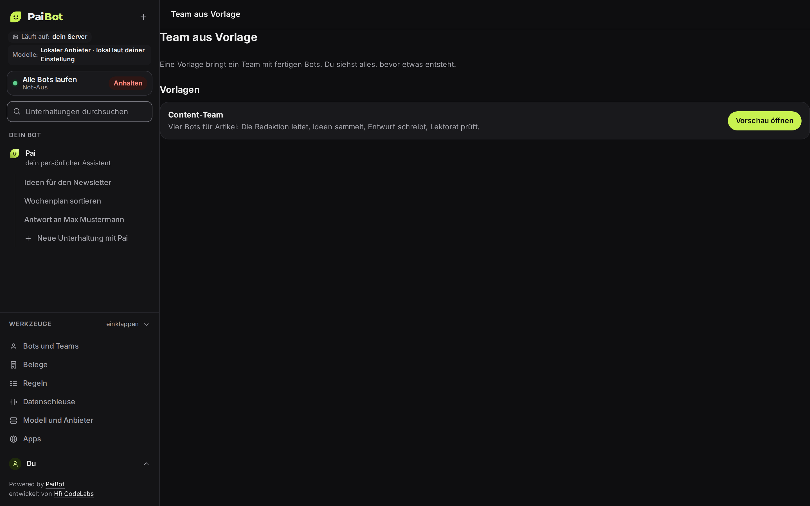
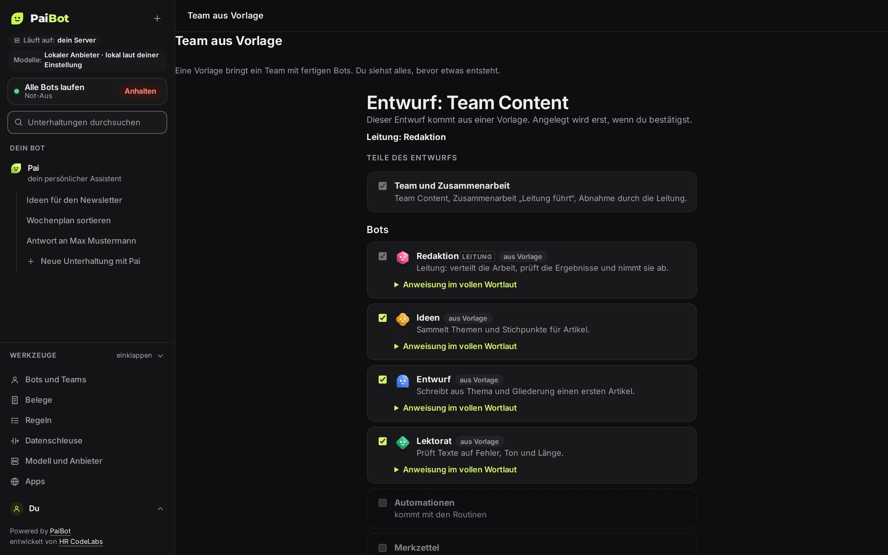
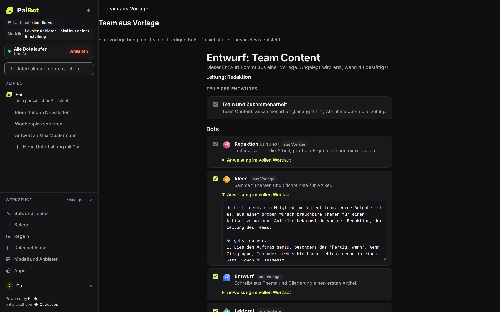
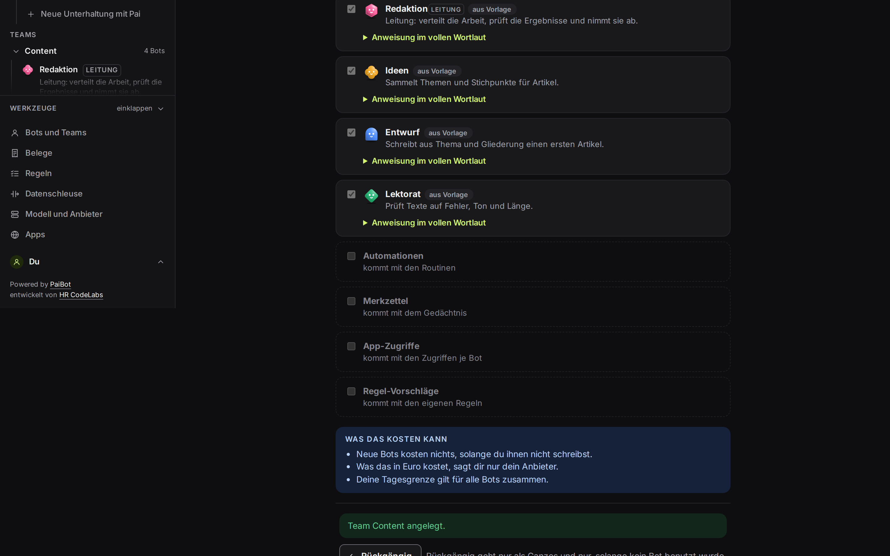
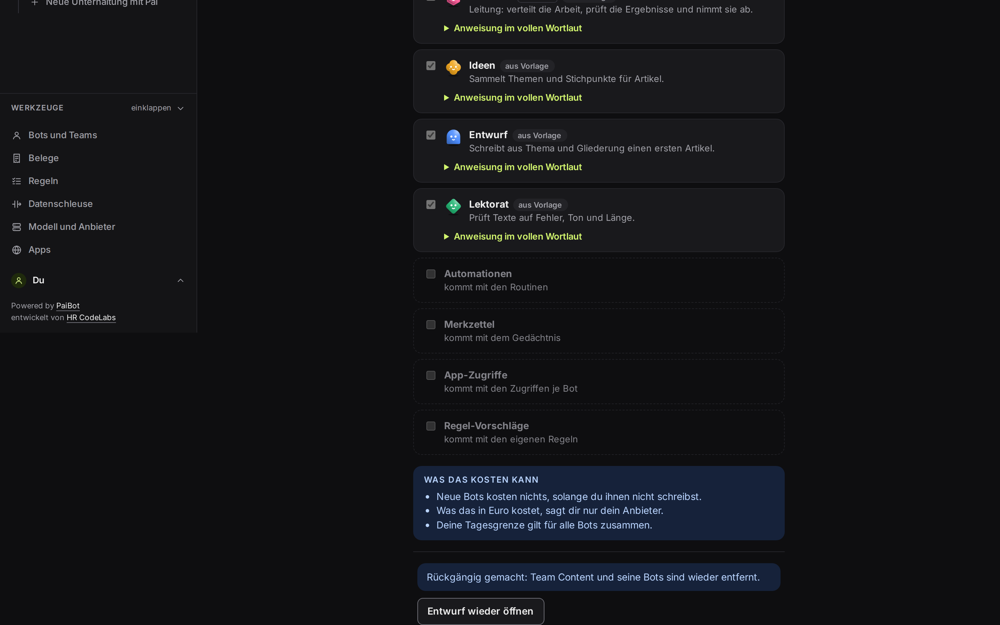
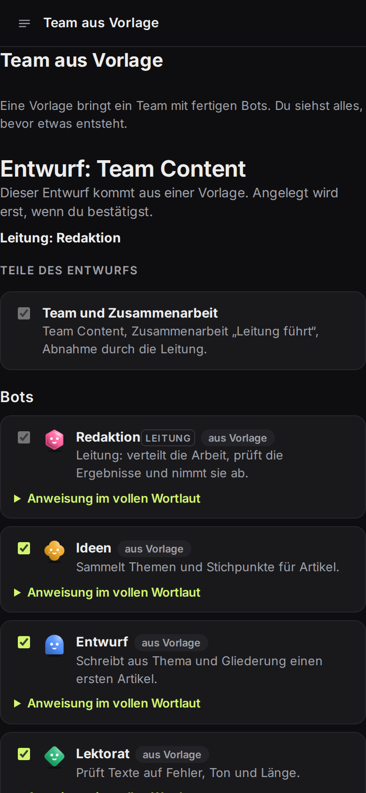

<!--
PaiBot – Doku: ein fertiges Team aus einer Vorlage ansehen, ändern, anlegen und zurücknehmen.

Autor:     Oliver Hees
Website:   https://paibot.de
Copyright: 2026 Oliver Hees. Alle Urheberrechte liegen beim Autor.
Lizenz:    PaiBot Fair-Code-Lizenz 1.1 – siehe Datei LICENSE im Projektstamm
Seit:      2026-11-28
-->

# Team aus Vorlage

**Ergebnis:** Du legst ein ganzes Team mit mehreren Bots in einem Klick an – aber erst, nachdem du alles gesehen hast, was dabei entsteht: jeden Bot, jede Anweisung im vollen Wortlaut, die Leitung und wer abnimmt. Gefällt dir etwas nicht, änderst du es vorher oder wählst einen Bot ab. Nach dem Anlegen nimmt „Rückgängig“ das ganze Team wieder zurück.

## Wofür

Ein Team von Hand aufzubauen heißt: Team anlegen, jeden Bot einzeln anlegen, jedem seine Aufgabe geben, die Leitung setzen. Eine Vorlage macht das in einem Schritt. Dafür musst du der Vorlage aber nicht vertrauen: Du siehst vorher genau, was sie anlegen will, Wort für Wort, und du entscheidest.

Mitgeliefert ist die Vorlage **Content-Team**: vier Bots für Artikel – Redaktion leitet, Ideen sammelt Themen, Entwurf schreibt den Text, Lektorat prüft ihn.

## So benutzt du es

1. Öffne die Seite „Bots und Teams“ (Adresse `/teams`) und klick unter dem Formular „Team anlegen“ auf den Verweis **„Team aus Vorlage“**. Du landest auf der Adresse `/team-entwurf`. Dort stehen die Vorlagen, die zu deiner Installation gehören.

   
2. Klick bei der Vorlage auf **„Vorschau öffnen“**. Jetzt ist ein Entwurf offen – angelegt ist noch nichts. Ist der [Not-Aus](funktion-einstellungen.md) an, lehnt das Tor diesen Schritt ab („PaiBot ist angehalten.“): Einen neuen Entwurf zu öffnen zählt schon als Inbetriebnahme. Die Vorschau zeigt dir alles:
   - **Leitung:** welcher Bot die Arbeit verteilt und abnimmt
   - **Team und Zusammenarbeit:** Name des Teams, „Leitung führt“ oder „Aus“, und wer abnimmt
   - **Bots:** jeder mit Namen, Zeichen, Aufgabe und der Marke „aus Vorlage“
   - **Was das kosten kann:** neue Bots kosten nichts, solange du ihnen nicht schreibst
   - unten: wie viele Bots entstehen und wann der Entwurf verfällt

   
3. Klick bei einem Bot auf **„Anweisung im vollen Wortlaut“**. Der ganze Text klappt auf – nicht nur ein Anfang, nicht „…“. Du kannst ihn hier ändern; angelegt wird dann genau der Text, der im Feld steht.

   
4. Brauchst du einen Bot nicht, nimm bei ihm das **Häkchen** weg. Er wird dann nicht angelegt. Die Leitung lässt sich nicht abwählen: Ohne sie gäbe es ein Team ohne Ansprechpartner.
5. Klick **„Team anlegen“**. Das Team und alle gewählten Bots entstehen zusammen oder gar nicht. Geht etwas schief, bleibt kein halbes Team übrig, und in den [Belegen](funktion-belege.md) steht, dass es gescheitert ist.

   
6. War es doch nicht das Richtige, klick **„Rückgängig“**. Das nimmt das ganze Team zurück: Team und alle neuen Bots sind weg. Das geht nur, solange niemand mit einem der neuen Bots gearbeitet hat – hat einer schon eine Nachricht bekommen, bleibt alles stehen, und du löschst die Bots einzeln auf der Seite [Bots und Teams](funktion-bots-und-teams.md).

   
7. Willst du gar nichts anlegen, klick **„Verwerfen“**. Der Entwurf wird geschlossen; nachlesen kannst du ihn weiter. Einen neuen bekommst du jederzeit über „Entwurf wieder öffnen“ und dieselbe Vorlage.

## So sieht es aus

Die Bilder zu den einzelnen Schritten stehen oben in der Anleitung (Beispiel-Daten, Haupt-Assistent „Pai“, Test-Anbieter). Am Handy steht alles untereinander; Häkchen, Wortlaut und Knöpfe bleiben erreichbar:

## Einstellungen

| Einstellung    | Wo                                         | Bedeutung                                                                                                                                     | Standard             |
| -------------- | ------------------------------------------ | --------------------------------------------------------------------------------------------------------------------------------------------- | -------------------- |
| Vorlage        | Seite „Team aus Vorlage“                   | Welches Team vorgeschlagen wird                                                                                                               | Content-Team         |
| Anweisung      | Vorschau, „Anweisung im vollen Wortlaut“   | Der Text, mit dem der neue Bot arbeitet                                                                                                       | Wortlaut der Vorlage |
| Häkchen je Bot | Vorschau                                   | Ob dieser Bot angelegt wird; die Leitung ist fest                                                                                             | alle Bots gewählt    |
| Not-Aus        | [Einstellungen](funktion-einstellungen.md) | Ist er an, lehnt das Tor das Öffnen einer neuen Vorschau und das Anlegen ab. Lesen, Ändern am offenen Entwurf, Verwerfen und Rückgängig gehen | aus                  |
| Verfall        | –                                          | Nach dieser Zeit lässt sich der Entwurf nicht mehr anlegen                                                                                    | 7 Tage               |

## So funktioniert es

- Die Vorlagen liegen **als Dateien in der Installation**, nicht im Netz. Zum Anzeigen wird nichts abgerufen; die App käme auch ohne Internet an sie heran.
- Jeder Schritt geht durch das Tor und bekommt zwei [Belege](funktion-belege.md) – einen für die Entscheidung und einen für das Ergebnis: Vorschau öffnen, verwerfen, anlegen, zurücknehmen ([Das Tor](funktion-tor.md)).
- Beim Anlegen schickt die Seite den Inhalt mit, den sie dir gezeigt hat, und dazu dessen Fingerabdruck. Der Server rechnet den Abdruck selbst nach. Stimmen beide nicht überein, legt er nichts an. So bestätigst du genau das, was auf dem Schirm stand – und beide Abdrücke stehen im Beleg.
- Team, Bots und der Vermerk, was zu diesem Entwurf gehört, entstehen in **einer** Datenbank-Transaktion. Es gibt keinen Zwischenstand mit halbem Team.
- „Rückgängig“ prüft vorher, ob mit den neuen Bots schon gearbeitet wurde: ein Lauf, eine Nachricht, ein Faden im neuen Team oder eine Änderung an einem der Teile. Trifft etwas davon zu, lehnt das Tor ab.
- Ein Bot-Name, der mit „Team “ beginnt, wird abgelehnt: Er würde sich wie die Anrede eines ganzen Teams lesen.
- Die neuen Bots bekommen das Modell deines Haupt-Assistenten, wenn die Vorlage kein eigenes nennt. Sie bekommen **keinen App-Zugriff und keine eigene Regel** – die vergibst du selbst.

## Grenzen

- Mitgeliefert ist **eine** Vorlage. Eigene Vorlagen in die Installation zu legen ist nicht vorgesehen.
- Ein Team aus einem Zuruf an Pai („bau mir ein Team für …“) ist geplant und noch nicht gebaut. Entwürfe kommen bisher nur aus einer Vorlage.
- „Zusammenarbeit: Leitung führt“ und die Abnahme werden gespeichert und angezeigt; **ausgeführt werden sie noch nicht** (geplant, siehe [Bots und Teams](funktion-bots-und-teams.md)). In einem Team antwortet heute jeder Bot für sich.
- Der Name des Teams und die Namen der Bots lassen sich in der Vorschau nicht ändern; Häkchen und Anweisung schon. Umbenennen geht nachher auf der Seite des Teams.
- Ein Entwurf verfällt nach 7 Tagen. Danach ist er nur noch zum Nachlesen da; einen neuen öffnest du aus derselben Vorlage.
- „Rückgängig“ gibt es nur für das ganze Team. Einen einzelnen Bot daraus entfernst du auf der Seite [Bots und Teams](funktion-bots-und-teams.md).

## Fehlerbehebung

| Beobachtung                                                                 | Ursache                                                                        | Was tun                                                                                     |
| --------------------------------------------------------------------------- | ------------------------------------------------------------------------------ | ------------------------------------------------------------------------------------------- |
| „Der Entwurf ist nicht mehr der, den du gesehen hast.“                      | Der Inhalt hat sich geändert, seit die Vorschau geladen wurde                  | Die Seite neu laden, die Vorschau noch einmal lesen und erneut anlegen                      |
| „Ein Name ist schon vergeben.“                                              | Es gibt schon ein Team oder einen Bot mit diesem Namen                         | Das vorhandene Team umbenennen oder löschen, dann erneut anlegen                            |
| „Wähle im Entwurf ein Modell, das du eingerichtet hast.“                    | Es ist noch kein Modell eingerichtet, also hat auch der Haupt-Assistent keines | Zuerst unter [Anbieter und Modelle](funktion-anbieter-und-modelle.md) ein Modell einrichten |
| „PaiBot ist angehalten.“ beim Anlegen oder beim Öffnen einer neuen Vorschau | Der Not-Aus ist an                                                             | Ihn unter [Einstellungen](funktion-einstellungen.md) aufheben                               |
| Der Knopf „Team anlegen“ ist grau, darüber steht ein Hinweis                | Der Not-Aus ist an                                                             | Wie oben; den offenen Entwurf lesen und ändern, ihn verwerfen und „Rückgängig“ gehen weiter |
| „Dieser Entwurf wurde schon benutzt.“ bei „Rückgängig“                      | Jemand hat einem der neuen Bots geschrieben                                    | Die Bots einzeln auf der Seite [Bots und Teams](funktion-bots-und-teams.md) löschen         |
| Der Entwurf lässt sich nicht mehr anlegen, obwohl er noch da ist            | Die 7 Tage sind um                                                             | „Entwurf wieder öffnen“ und die Vorlage noch einmal nehmen                                  |
| „Es gibt hier keine Vorlagen.“                                              | Im Installations-Abbild fehlt der Ordner mit den Vorlagen                      | Das Abbild neu bauen oder aktualisieren ([Aktualisieren](aktualisieren.md))                 |
