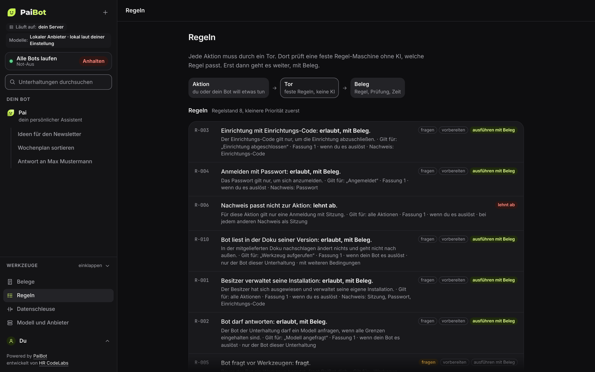
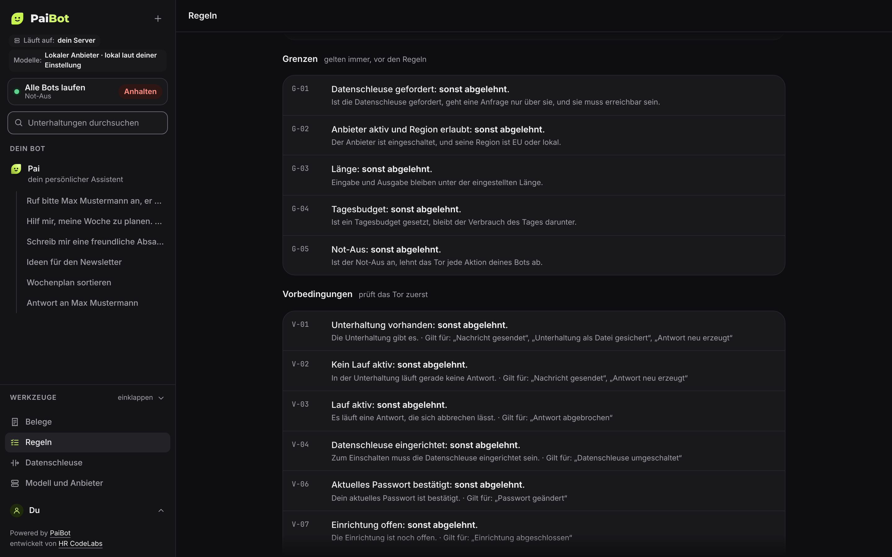
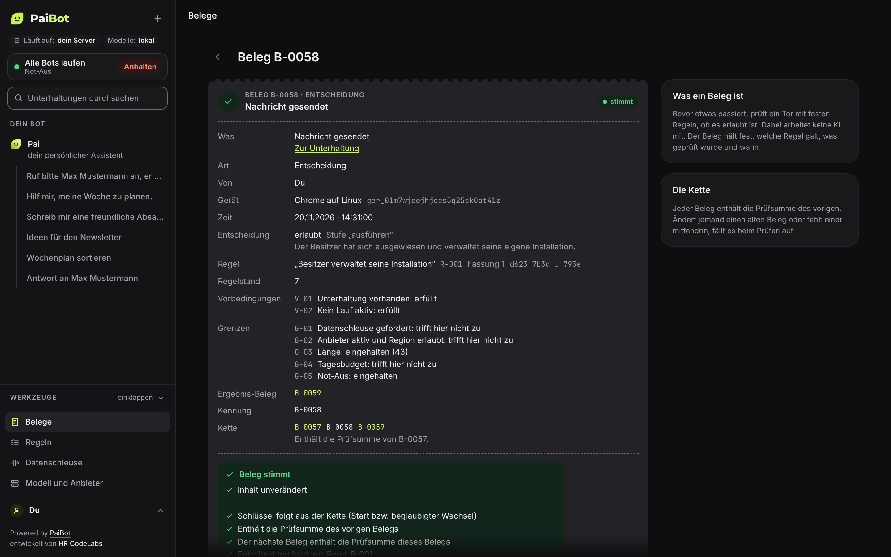
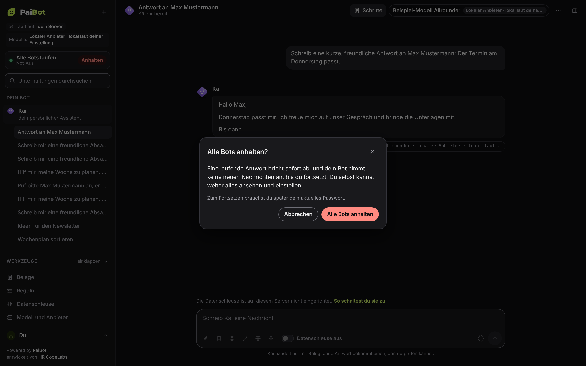
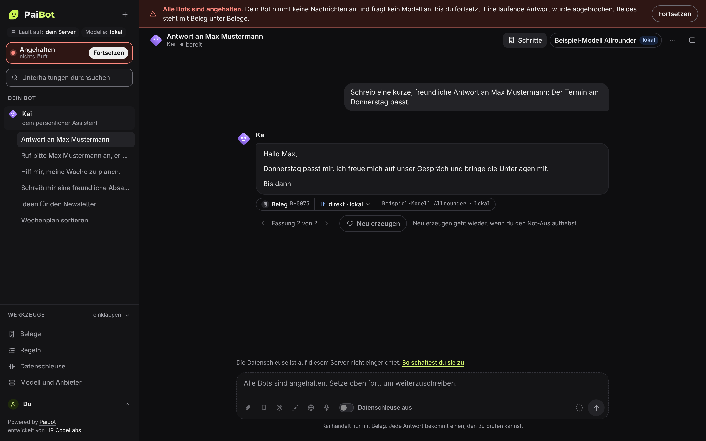
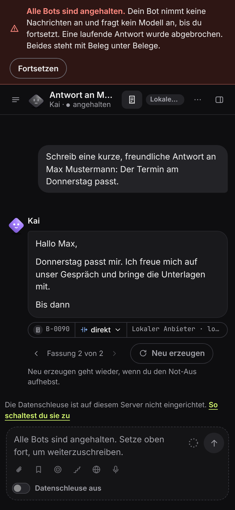
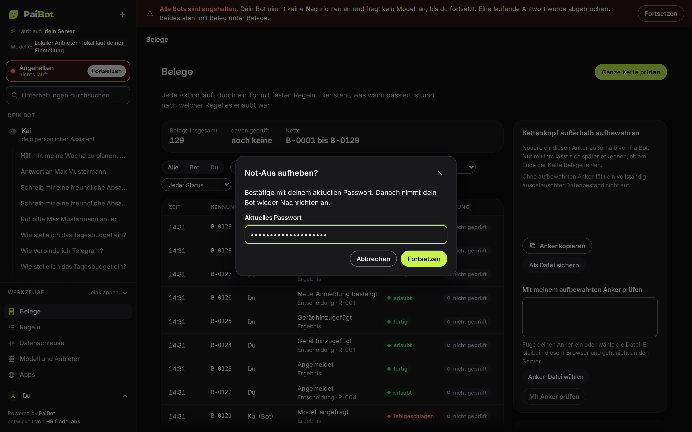
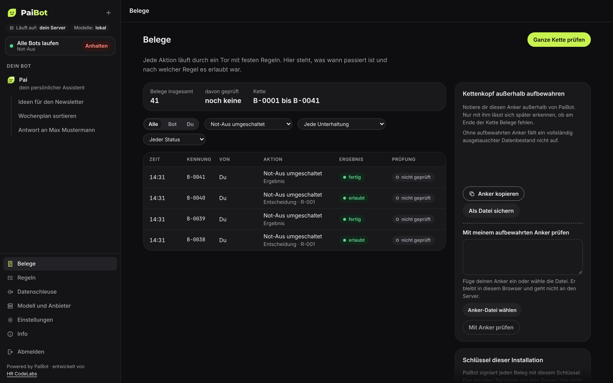
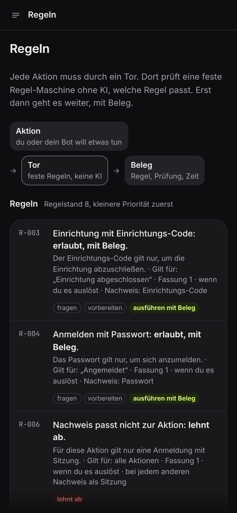

<!--
PaiBot – Doku: das Tor, seine Stufen, Standard-Regeln und festen Grenzen.

Autor:     Oliver Hees
Website:   https://paibot.de
Copyright: 2026 Oliver Hees. Alle Urheberrechte liegen beim Autor.
Lizenz:    PaiBot Fair-Code-Lizenz 1.1 – siehe Datei LICENSE im Projektstamm
Seit:      2026-11-20
-->

# Das Tor

**Ergebnis:** Jede Aktion in PaiBot läuft durch eine feste Regelprüfung ohne KI. Dein Bot fragt nicht um Erlaubnis, er belegt, dass er darf: Für jede Aktion entstehen zwei Belege im Protokoll, einer für die Entscheidung und einer für das Ergebnis.

## Wofür

Das Tor sorgt dafür, dass nichts an dir vorbei passiert. Bevor PaiBot etwas tut (eine Nachricht annehmen, ein Modell anfragen, eine Einstellung ändern), prüft das Tor nach festen Regeln, ob das erlaubt ist. Die Prüfung ist immer gleich: gleiche Lage, gleiche Entscheidung. Deshalb lässt sich jede Entscheidung später aus dem Beleg nachrechnen.

## So benutzt du es

Du musst nichts einschalten. Das Tor arbeitet bei jeder Aktion mit:

1. Du oder dein Bot löst eine Aktion aus, zum Beispiel „Nachricht senden“ oder „Modell anfragen“.
2. Das Tor prüft erst den Zustand (Vorbedingungen), dann die festen Grenzen und dann die Regeln und schreibt die Entscheidung als Beleg ins Protokoll.
3. Ist die Aktion erlaubt, wird sie ausgeführt. Danach schreibt das Tor einen zweiten Beleg mit dem Ergebnis.
4. Ist sie nicht erlaubt, passiert nichts. Du bekommst eine verständliche Meldung, und auch das steht als Beleg im Protokoll.

So siehst du die Regeln und Entscheidungen in PaiBot an:

1. Klick in der Navigation auf **Regeln** (direkt unter **Belege**; auf der Seite „Belege“ führt auch **Regeln ansehen** dorthin). Die Seite **Regeln** zeigt jede geltende Regel mit Kennung (zum Beispiel `R-001`), Fassung, einem Satz in Worten („Besitzer verwaltet seine Installation: erlaubt, mit Beleg.“), für welche Aktionen sie gilt, unter welchen Bedingungen und mit welcher Stufe (fragen, vorbereiten, ausführen mit Beleg; „lehnt ab“ bei Regeln, die ablehnen). Darüber steht der aktuelle Regelstand.

   
2. Darunter stehen die festen **Grenzen** (G-01 bis G-05, G-16 und G-18) und die **Vorbedingungen** in Worten. Diese Regeln sind fest eingebaut. Grenzen und Vorbedingungen, die nur Werkzeuge betreffen (G-17, V-12 bis V-14), zeigt die Seite noch nicht, weil es noch kein Werkzeug gibt.

   
3. Zurück auf der Seite **Belege** klickst du auf einen Beleg der Art „Entscheidung“. Die Karte nennt das Ergebnis mit Stufe, die angewandte Regel mit Fassung und Prüfsumme, den Regelstand und jede Vorbedingung und Grenze mit „erfüllt“, „eingehalten“, „verletzt“ oder „trifft hier nicht zu“.
4. **Beleg prüfen** rechnet die Entscheidung in deinem Browser mit dem damaligen Regelstand nach, ohne KI. Stimmt sie, steht dort „Entscheidung folgt aus Regel R-001“.

   

### Not-Aus: alle Bots anhalten

Bei einem Verdacht (dein Bot verhält sich seltsam, ein Anbieter spinnt, du willst einfach sofort Ruhe) hältst du mit einem Klick alle Bots an. Du selbst kannst danach weiter alles ansehen und einstellen.

1. Oben in der Seitenleiste steht der Schalter **Alle Bots laufen** mit dem Knopf **Anhalten**. Klick darauf. Es kommt die Rückfrage „Alle Bots anhalten?“.

   
2. Klick auf **Alle Bots anhalten**. Ab jetzt steht auf jeder Seite oben die rote Leiste „Alle Bots sind angehalten.“, der Schalter heißt **Angehalten**, und die Eingabe im Chat ist gesperrt. Eine Antwort, die gerade entsteht, bricht binnen einer Sekunde ab und heißt dann „Angehalten (Not-Aus)“; der Text bis dahin bleibt stehen.

   

   Am Handy steht die Leiste über jeder Seite; mit **Fortsetzen** darin hebst du den Not-Aus auch ohne Menü auf.

   
3. Zum Aufheben klickst du auf **Fortsetzen** (in der Leiste oder im Schalter). PaiBot fragt nach deinem **aktuellen Passwort**. Gib es ein und klick auf **Fortsetzen**. Danach nimmt dein Bot wieder Nachrichten an.

   
4. Beides steht unter **Belege** als Aktion „Not-Aus umgeschaltet“, jeweils mit Entscheidung (Regel R-001) und Ergebnis. Mit dem Filter **Not-Aus umgeschaltet** siehst du nur diese.

   

Beispiel einer Entscheidung, wie sie im Beleg steht:

```text
Aktion:        nachricht.senden (du)
Tor-Fassung:   2
Ergebnis:      erlaubt, Stufe „ausführen“
Vorbedingungen: V-01 ok · V-02 ok
Grenzen:       G-01 entfällt · G-02 entfällt · G-03 ok · G-04 entfällt · G-05 ok
               G-16 entfällt · G-17 entfällt · G-18 entfällt
Regel:         R-001 Fassung 1, Prüfsumme sha256:d6237b3d…
Regelstand:    7
```

## So sieht es aus

Die Bilder zu den Schritten stehen oben in der Anleitung (Beispiel-Daten). Am Handy:



## Einstellungen

Am Tor selbst gibt es nichts einzustellen: Die Regeln sind in der Basisversion **nur lesbar**. Diese Regeln gelten (kleinere Priorität zuerst):

| Regel | Name                                  | Priorität | Was sie bedeutet                                                                                                                                                                                                      |
| ----- | ------------------------------------- | --------- | --------------------------------------------------------------------------------------------------------------------------------------------------------------------------------------------------------------------- |
| R-003 | Einrichtung mit Einrichtungs-Code     | 50        | Mit dem Einrichtungs-Code darfst du nur die Einrichtung abschließen                                                                                                                                                   |
| R-004 | Anmelden mit Passwort                 | 50        | Mit dem Passwort darfst du dich nur anmelden                                                                                                                                                                          |
| R-006 | Nachweis passt nicht zur Aktion       | 60        | Für jede andere Aktion lehnt das Tor Passwort und Einrichtungs-Code ausdrücklich ab; dafür gilt nur deine Sitzung                                                                                                     |
| R-001 | Besitzer verwaltet seine Installation | 100       | Mit deiner Sitzung darfst du alles an deiner Installation verwalten                                                                                                                                                   |
| R-002 | Bot darf antworten                    | 100       | Der Bot einer Unterhaltung darf für diese Unterhaltung ein Modell anfragen, wenn alle Grenzen eingehalten sind                                                                                                        |
| R-005 | Bot fragt vor Werkzeugen              | 100       | Bevor der Bot einer Unterhaltung ein Werkzeug benutzt, fragt PaiBot dich. Fragen gibt es in dieser Fassung noch nicht; das Werkzeug wird deshalb nicht benutzt                                                        |
| R-007 | Einmal erlaubt                        | 100       | Ein Werkzeug-Aufruf, den du freigegeben hast, darf genau einmal laufen: nur mit deiner erteilten, unbenutzten und nicht abgelaufenen Freigabe für genau diese Argumente                                               |
| R-008 | Ausführen nur mit Freigabe            | 200       | Ohne gültige Freigabe lehnt das Tor die Ausführung eines wartenden Werkzeug-Aufrufs ab                                                                                                                                |
| R-010 | Bot liest in der Doku seiner Version  | 90        | Der Bot einer Unterhaltung darf in der mitgelieferten Doku nachschlagen (eingebaut, nur lesen, nichts nach außen). Wirkt erst, wenn es das Werkzeug „In der Doku nachschlagen“ gibt; bis dahin ruft PaiBot es nie auf |
| R-999 | Ohne passende Regel                   | 1000000   | Passt keine andere Regel, fragt das Tor. In der Basisversion heißt das: nichts wird ausgeführt, Meldung „Dafür gibt es noch keine Regel.“                                                                             |

Kurz: Der Einrichtungs-Code gilt nur für die Einrichtung, das Passwort nur fürs Anmelden, sonst zählt deine Sitzung. R-007 und R-008 gehören wie V-08 und V-09 zur Freigabe eines Werkzeug-Aufrufs; die kennt die aktuelle Fassung des Tors noch nicht.

Vor den Grenzen und Regeln prüft das Tor feste Vorbedingungen. Sie beschreiben den Zustand, in dem eine Aktion überhaupt Sinn ergibt. Ist eine verletzt, wird die Aktion abgelehnt, und die Meldung nennt sie. Fehlt die Angabe, die eine Vorbedingung braucht, gilt sie als verletzt.

| Vorbedingung | Name                            | Was sie prüft                                                                                                     | Betrifft                                                               |
| ------------ | ------------------------------- | ----------------------------------------------------------------------------------------------------------------- | ---------------------------------------------------------------------- |
| V-01         | Unterhaltung vorhanden          | Die Unterhaltung gibt es                                                                                          | Nachricht senden, Unterhaltung als Datei sichern, Antwort neu erzeugen |
| V-02         | Kein Lauf aktiv                 | In der Unterhaltung antwortet der Bot gerade nicht                                                                | Nachricht senden, Antwort neu erzeugen                                 |
| V-03         | Lauf aktiv                      | Es gibt eine laufende Antwort, die sich abbrechen lässt                                                           | Antwort abbrechen                                                      |
| V-04         | Datenschleuse eingerichtet      | Beim Einschalten der Datenschleuse ist ihr Dienst eingerichtet                                                    | Datenschleuse schalten                                                 |
| V-05         | Lauf läuft                      | Die Antwort, zu der ein Werkzeug-Aufruf gehört, läuft noch                                                        | Werkzeug aufrufen, Werkzeug nach Freigabe ausführen                    |
| V-06         | Aktuelles Passwort bestätigt    | Beim Ändern des Passworts wurde das aktuelle Passwort geprüft                                                     | Passwort ändern                                                        |
| V-07         | Einrichtung offen               | Die Einrichtung ist noch nicht abgeschlossen                                                                      | Einrichtung abschließen                                                |
| V-08         | Aufruf wartet auf Freigabe      | Der Werkzeug-Aufruf wartet noch auf deine Antwort und ist nicht abgelaufen                                        | Werkzeug-Aufruf beantworten                                            |
| V-09         | Freigabe passt zum Aufruf       | Deine Antwort gilt genau den Argumenten, die gespeichert sind                                                     | Werkzeug-Aufruf beantworten                                            |
| V-10         | Passwort zum Aufheben bestätigt | Beim Aufheben des Not-Aus wurde dein aktuelles Passwort in derselben Anfrage geprüft (beim Anhalten entfällt sie) | Not-Aus umschalten                                                     |
| V-11         | Letzte Antwort                  | Neu erzeugt wird nur die letzte Antwort der Unterhaltung                                                          | Antwort neu erzeugen                                                   |
| V-12         | Werkzeug angeboten              | Das Werkzeug gibt es, und es stand für diesen Schritt zur Wahl                                                    | Werkzeug aufrufen                                                      |
| V-13         | Eingabe des Werkzeugs gültig    | Die Eingabe passt zum Werkzeug                                                                                    | Werkzeug aufrufen                                                      |
| V-14         | Aufrufe je Schritt              | Ein Schritt ruft höchstens so viele Werkzeuge auf wie erlaubt                                                     | Werkzeug aufrufen                                                      |

Zusätzlich gibt es feste Grenzen. Sie gelten immer, auch wenn eine Regel etwas erlaubt. Ist eine Grenze verletzt, wird die Aktion abgelehnt, und die Meldung nennt die Grenze.

| Grenze | Name                              | Was sie prüft                                                                                                                                                                            | Betrifft                                                                   |
| ------ | --------------------------------- | ---------------------------------------------------------------------------------------------------------------------------------------------------------------------------------------- | -------------------------------------------------------------------------- |
| G-01   | Datenschleuse gefordert           | Ist die Datenschleuse für die Unterhaltung an, muss die Anfrage über sie laufen und sie muss erreichbar sein. Es gibt keinen Rückfall auf den direkten Weg                               | Modell anfragen                                                            |
| G-02   | Anbieter aktiv und Region erlaubt | Der Anbieter ist eingeschaltet und steht in der EU oder läuft bei dir (lokal). Anbieter außerhalb der EU lehnt die Basisversion ab                                                       | Modell anfragen                                                            |
| G-03   | Länge                             | Die Eingabe ist höchstens so lang wie erlaubt; eine Anfrage verlangt höchstens so viel Ausgabe, wie für deinen Bot eingestellt ist                                                       | Nachricht senden, Modell anfragen                                          |
| G-04   | Tagesbudget                       | Hast du ein Tagesbudget gesetzt, muss der Verbrauch des Tages darunter liegen. Ohne Budget entfällt die Grenze                                                                           | Modell anfragen                                                            |
| G-05   | Not-Aus                           | Ist der Not-Aus an, wird jede betroffene Aktion abgelehnt (Meldung „Alle Bots sind angehalten.“). Das Umschalten des Not-Aus selbst ist nie betroffen, du kannst ihn also immer aufheben | Nachricht senden, Antwort neu erzeugen, Modell anfragen, Werkzeug aufrufen |
| G-16   | Schritte je Lauf                  | Eine Antwort macht höchstens so viele Schritte wie erlaubt                                                                                                                               | Modell anfragen                                                            |
| G-17   | Werkzeug-Aufrufe je Lauf          | Eine Antwort ruft höchstens so viele Werkzeuge auf wie erlaubt                                                                                                                           | Werkzeug aufrufen                                                          |
| G-18   | Token je Lauf                     | Eine Antwort verbraucht zusammen höchstens so viele Token wie erlaubt (bisheriger Verbrauch plus Schätzung für den nächsten Schritt)                                                     | Modell anfragen                                                            |

Heute macht ein Lauf genau einen Schritt; G-16 und G-18 sind deshalb immer eingehalten. Sie wirken, sobald Pai Werkzeuge benutzen kann. Fehlt eine Angabe, die G-16, G-17 oder G-18 braucht, gilt die Grenze als verletzt, nie als „trifft hier nicht zu“.

**Für Werkzeuge vorbereitet:** Die Vorbedingungen V-12 bis V-14, die Grenze G-17 und der Deckel D-01 betreffen nur Werkzeug-Aufrufe. D-01 („Nach fremden Inhalten fragen“) greift nach den Regeln: Hat dein Bot in einer Anfrage schon fremde Inhalte gelesen, und will er danach etwas schreiben oder nach außen senden, wird aus „erlaubt“ ein „fragen“. Keine Regel und keine Einstellung hebt den Deckel auf. Fragen an dich gibt es in dieser Fassung noch nicht; bräuchte ein Werkzeug deine Erlaubnis, lehnt PaiBot ab.

**Nummern:** Diese Nummern gibt es in dieser Fassung:

| Art          | Nummern                       |
| ------------ | ----------------------------- |
| Regeln       | R-001 bis R-008, R-010, R-999 |
| Vorbedingung | V-01 bis V-14                 |
| Grenzen      | G-01 bis G-05, G-16 bis G-18  |
| Deckel       | D-01                          |

Lücken in der Nummerierung sind Absicht: Jede Nummer wird nur einmal vergeben und nie neu belegt.

## So funktioniert es

- Das Tor liegt im Paket `packages/gate`. Es ist der einzige Weg, eine Aktion auszuführen (`gate.run`).
- Die Entscheidung trifft die Funktion `evaluate`. Sie ist rein: Sie liest keine Uhr, keine Datenbank, kein Netz und nutzt keine KI. Sie bekommt nur die Aktion, die Fakten (Werte wie Zeichenzahl, Region, Schalter, nie Inhalte von Nachrichten oder Schlüssel) und die Regeln.
- **Fassung der Tor-Regeln:** Das Tor entscheidet jetzt nach **Fassung 2**. Jeder Beleg nennt sie, ältere Belege werden nach ihrer Fassung geprüft (Belege ohne Angabe nach Fassung 1). Eine Fassung wird nie geändert; was das Tor anders entscheiden würde, kommt als neue Fassung.
- Reihenfolge: 1. Eingabe prüfen, 2. Vorbedingungen, 3. Grenzen, 4. Regeln, 5. Deckel (nur bei Werkzeug-Aufrufen). Alle Vorbedingungen der Aktion, alle Grenzen und bei Werkzeug-Aufrufen der Deckel stehen im Beleg. Eine verletzte Vorbedingung geht einer verletzten Grenze vor; beide führen immer zur Ablehnung. Von allen Regeln, die passen, entscheidet die mit der kleinsten Priorität; sie bleibt auch bei einer Ablehnung im Beleg sichtbar.
- Regelstand: Für jede angewandte Regel stehen Kennung, Fassung und eine Prüfsumme ihres Inhalts im Beleg, dazu der Stand des Regel-Protokolls. Regeln werden nie geändert, nur als neue Fassung angehängt. Mit dem Stand lässt sich eine Entscheidung später mit genau den Regeln von damals nachrechnen, und eine nachträglich veränderte Regel fällt an der Prüfsumme auf.
- Bevor das Tor entscheidet, prüft es den Regelstand: Jede Prüfsumme muss zum Inhalt passen, und jede eingebaute Regel (Quelle „standard“, Kennung `R-…`) muss genau der Fassung gleichen, die in PaiBot selbst steht. Fehlt eine eingebaute Regel (auch, weil eine abgeschaltete höhere Fassung sie verdeckt), taucht eine unbekannte Kennung `R-…` auf, trägt eine Kennung `R-…` eine andere Quelle, ist ein Regel-Vorschlag eingeschaltet oder liegt eine Regel außerhalb des Prioritäten-Bands ihrer Quelle, entscheidet das Tor nicht, schreibt keinen Beleg und führt nichts aus (Fehler `intern`). Das gilt auch für eine leere Regel-Tabelle: Dann wird nie „alles gefragt“ und nie „alles erlaubt“, sondern abgebrochen. Regel-Vorschläge zählen nie mit.
- Das Tor nimmt Regeln nur als Regelstand an (mit Stand und Prüfsummen). Jede Entscheidung trägt deshalb ihren Regelstand und je Regel die Prüfsumme.
- Feste Prioritäten-Bänder: Eingebaute Regeln liegen bei 0 bis 999 (die Auffang-Regel R-999 bei 1 000 000), eigene Regeln und Vorschläge künftig nur bei 1 000 bis 999 999. Eine eigene Regel kommt damit immer nach allen eingebauten außer der Auffang-Regel und kann keine davon überdecken. Die Datenbank prüft dasselbe.
- Dieselbe Aktion (gleiche Aktions-Kennung) läuft nie zweimal gleichzeitig durchs Tor; die Datenbank nimmt je Aktion höchstens eine Entscheidung und ein Ergebnis an.
- Ablauf von `gate.run`:
  1. Aktion und Fakten werden geprüft. Passen sie nicht zusammen (zum Beispiel eine unbekannte Aktion), wird abgelehnt und nichts ausgeführt.
  2. Regelstand laden, prüfen und entscheiden.
  3. Beleg „Entscheidung“ schreiben. Gelingt das nicht, wird **nichts** ausgeführt.
  4. Nur bei „erlaubt“ wird die Aktion ausgeführt, mit einer Berechtigung, die nur das Tor ausstellen kann und die nur während der Ausführung gilt. Sie ist unveränderlich; bei „Modell anfragen“ trägt sie auch das Ziel der Anfrage (Origin und Abdruck von Anbieter und Adresse), damit die Anbieter-Schicht genau dorthin sendet.
  5. Beleg „Ergebnis“ schreiben: ok, Fehler, abgebrochen oder abgelehnt.
- Lehnt das Tor ab, meldet `gate.run` das mit dem Fehler `GateDenied`. Er nennt das Ergebnis (`deny`, `ask` oder `prepare`), die ganze Entscheidung, beide Belege und die Aktions-Kennung. Bei einer verletzten Vorbedingung trägt er deren Fehlercode (zum Beispiel `lauf_aktiv`), beim Not-Aus `angehalten`, bei einer verletzten Grenze eines Laufs (G-16 bis G-18) `limit_erreicht`, sonst `abgelehnt` bzw. `regel_fehlt`. „Fragen“ (`ask`) gibt es in dieser Fassung nicht als Freigabe: Ein Werkzeug-Aufruf, bei dem das Tor fragt, ist abgelehnt (Code `freigabe_noetig`), und nichts wartet.
- Werkzeug-Aufrufe deines Bots laufen als eigene Aktion `werkzeug.aufrufen` durch das Tor. Im Beleg stehen Name, Kennung, Quelle, Art und Reichweite des Werkzeugs (bei einem Werkzeug von einem MCP-Server auch dessen Name, sonst nie), Zähler für Schritte und Aufrufe und nur ein Abdruck des Aufrufs, nie die Argumente selbst. Werkzeuge selbst gibt es in dieser Fassung noch nicht.
- Not-Aus: Der Schalter ist die Aktion `notaus.umschalten` (Route `PUT /api/notaus`) mit eigenen Belegen. Ihre Fakten sind „soll an sein“, „war an“ und „Passwort bestätigt“, bewusst ohne den Schalter `killSwitch`; deshalb trifft G-05 sie nie. Der Zustand steht in den Einstellungen der Datenbank. Eine laufende Antwort sieht den Schalter im selben Takt wie den Stopp (alle halbe Sekunde) und endet als abgebrochen mit dem Code `angehalten`; jede neue Anfrage an ein Modell lehnt das Tor über G-05 ab.
- Freigabe und Ausführung danach (`werkzeug.freigeben`, `werkzeug.ausfuehren`, Regeln R-007 und R-008, Vorbedingungen V-08 und V-09) kennt Fassung 2 nicht; eine solche Anfrage ist ungültig und wird abgelehnt. Nur Fassung 1 hat sie entschieden.
- Für Tests gibt es den Zugang `@paibot/gate/testing` (`withTestPermit`). Er stellt eine Berechtigung auf demselben Weg aus wie das Tor, aber ohne Regeln und ohne Beleg. Eine Lint-Regel lässt ihn nur in Tests zu.
- Beide Belege einer Aktion hängen über dieselbe Aktions-Kennung zusammen. Wie Belege verkettet und geprüft werden, steht auf der Seite [Belege](funktion-belege.md).

## Grenzen

- Die Regeln sind in der Basisversion nur lesbar: Die App darf in der Datenbank keine Regeln schreiben, die eingebauten kommen allein aus den Migrationen, und eigene Regeln oder Vorschläge können dort nicht eingeschaltet sein. Eigene Regeln und Regel-Vorschläge deines Bots sind geplant; eine eigene Regel anzulegen wird dann selbst eine Aktion durch das Tor mit Beleg. Der Bot entscheidet nie für dich, er wird Regeln nur vorschlagen.
- „Fragen“ mit Freigabe-Karte ist geplant. Heute wird eine Aktion, die fragt, nicht ausgeführt; auch ein Werkzeug-Aufruf, bei dem das Tor fragt, ist abgelehnt.
- Laufen zwei Antworten gleichzeitig, prüft jede das Tagesbudget für sich; zusammen können sie es leicht überschreiten.
- „Vorbereiten“ ist geplant. Heute wird eine solche Aktion ebenfalls abgelehnt.
- Der Not-Aus hält deine Bots an, sperrt aber nicht den Zugang: Wer angemeldet ist, kann weiter alles einstellen. Ein Schalter „Zugang abriegeln“ (alle Sitzungen und Geräte widerrufen) ist geplant.
- Fortsetzen geht nur mit deinem aktuellen Passwort. Falsche Versuche zählen zusammen mit denen beim Passwort ändern (5 in 15 Minuten je Sitzung).
- Das Tor prüft nur die Fakten, die es bekommt. Es liest keine Inhalte und bewertet nicht, ob eine Antwort gut ist. Ob ein Nachweis (Sitzung, Passwort, Code) echt ist, prüft der Zugang vorher; das Tor prüft nur, ob er zur Aktion passt.

## Fehlerbehebung

| Beobachtung                                  | Ursache                                                      | Was tun                                                                                          |
| -------------------------------------------- | ------------------------------------------------------------ | ------------------------------------------------------------------------------------------------ |
| „Dafür gibt es noch keine Regel.“            | Für diese Aktion passt keine Regel (R-999)                   | In der Basisversion gibt es dafür keinen Weg; die Aktion ist nicht vorgesehen                    |
| „Das Tor hat die Aktion abgelehnt.“ mit G-01 | Datenschleuse ist an, aber nicht erreichbar                  | Prüf, ob die Datenschleuse läuft, oder schalte sie für diese Unterhaltung aus                    |
| Abgelehnt mit G-02                           | Anbieter ist ausgeschaltet oder steht außerhalb der EU       | Anbieter einschalten oder einen Anbieter in der EU bzw. lokal wählen                             |
| Abgelehnt mit G-03                           | Nachricht zu lang oder Ausgabegrenze der Anfrage zu hoch     | Nachricht kürzen; die Ausgabegrenze gehört zum Bot und lässt sich in der Oberfläche nicht ändern |
| Abgelehnt mit G-04                           | Tagesbudget ist aufgebraucht                                 | Bis morgen warten oder das Budget in den Einstellungen erhöhen                                   |
| „Alle Bots sind angehalten.“ (G-05)          | Not-Aus ist an                                               | Oben auf **Fortsetzen** klicken und dein aktuelles Passwort eingeben                             |
| Fortsetzen: „Das Passwort stimmt nicht.“     | Beim Aufheben fehlt das richtige Passwort (V-10)             | Aktuelles Passwort eingeben; vergessen: siehe [Zugang](funktion-einrichtung-und-zugang.md)       |
| Abgelehnt mit V-01                           | Die Unterhaltung gibt es nicht (mehr)                        | Seite neu laden und eine vorhandene Unterhaltung öffnen                                          |
| Abgelehnt mit V-02                           | Dein Bot antwortet noch                                      | Antwort abwarten oder abbrechen, dann erneut senden                                              |
| Abgelehnt mit V-03                           | Es läuft keine Antwort, die sich abbrechen lässt             | Nichts zu tun; die Antwort ist schon fertig                                                      |
| Abgelehnt mit V-04                           | Der Dienst der Datenschleuse ist nicht eingerichtet          | Datenschleuse einrichten, dann einschalten                                                       |
| Abgelehnt mit V-06                           | Das aktuelle Passwort stimmt nicht                           | Aktuelles Passwort richtig eingeben                                                              |
| Abgelehnt mit V-07                           | Die Einrichtung ist schon abgeschlossen                      | Anmelden statt neu einrichten                                                                    |
| Abgelehnt mit R-006                          | Passwort oder Code für eine Aktion, die eine Sitzung braucht | Anmelden; danach gilt deine Sitzung                                                              |
| Fehler `intern` bei jeder Aktion             | Eine eingebaute Regel in der Datenbank weicht ab             | Datenbank aus einer Sicherung wiederherstellen; nichts wurde ausgeführt                          |
