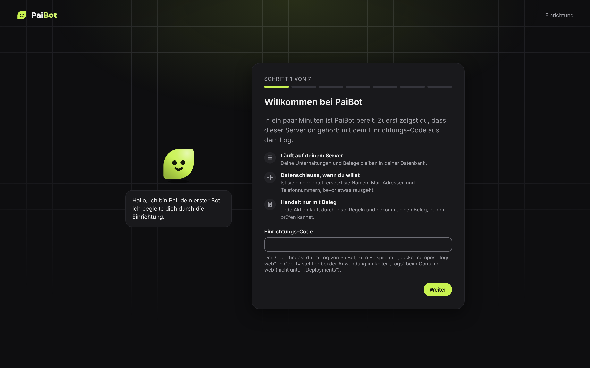
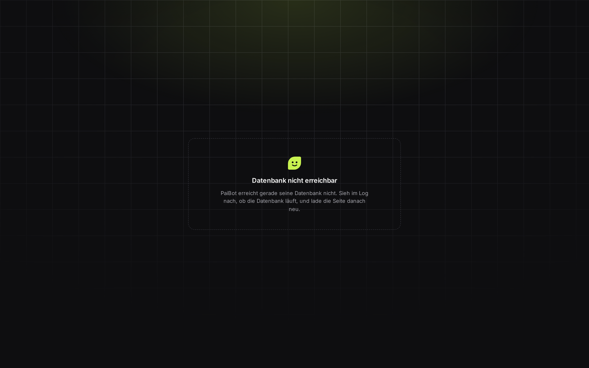

<!--
PaiBot – Installation mit Docker Compose, lokal und auf dem Server.

Autor:     Oliver Hees
Website:   https://paibot.de
Copyright: 2026 Oliver Hees. Alle Urheberrechte liegen beim Autor.
Lizenz:    PaiBot Fair-Code-Lizenz 1.1 – siehe Datei LICENSE im Projektstamm
Seit:      2026-11-18
-->

# Installation

**Ergebnis:** PaiBot läuft bei dir, und `/api/health` meldet `"db":"ok"`.

Der offizielle Weg ist **Docker Compose**. Das gilt lokal und auf dem Server. Alle Dienste stehen in `deploy/docker-compose.yml`.

## Was du brauchst

| Wofür               | Voraussetzung                                                             |
| ------------------- | ------------------------------------------------------------------------- |
| Lokal und Server    | Docker mit dem Compose-Plugin                                             |
| Server (empfohlen)  | Server mit Rechenzentrum in der EU, Ubuntu LTS, mind. 2 vCPU und 4 GB RAM |
| Entwicklung am Code | Node.js 22 und pnpm 10                                                    |

## Was heute mitläuft

| Dienst     | Aufgabe                                                                           | Erreichbar                                     |
| ---------- | --------------------------------------------------------------------------------- | ---------------------------------------------- |
| `postgres` | Datenbank                                                                         | nur im internen Netz des Stacks                |
| `migrate`  | Einmal-Dienst: wendet die Migrationen an, richtet die App-Rolle ein, endet danach | kein Port, läuft bei jedem Start kurz          |
| `web`      | PaiBot-App (Next.js)                                                              | `127.0.0.1:3000`, nach außen über deine Domain |
| `worker`   | erzeugt die Antworten deines Bots im Hintergrund                                  | kein Port, nimmt keine Verbindungen an         |

`migrate`, `web` und `worker` sind dasselbe Image in drei Rollen (Variable `PAIBOT_ROLE`). Bei jedem Start des Stacks läuft zuerst `migrate` und beendet sich mit Exit 0; erst danach starten `web` und `worker`. Beide migrieren nie selbst, sie prüfen beim Start nur, ob die Datenbank auf Stand ist und ihre Rolle nicht zu viel darf.

Die Datenschleuse lässt sich zuschalten (Abschnitt [Datenschleuse zuschalten](#datenschleuse-zuschalten), Standard: aus). Der Browser-Dienst ist **geplant** und noch nicht Teil des Stacks.

## Lokal mit Docker Compose

```bash
git clone https://github.com/oliverhees/paibot.git
cd paibot
sh deploy/env-erzeugen.sh               # legt deploy/.env mit Zufallswerten an
docker compose -f deploy/docker-compose.yml --env-file deploy/.env up -d --build
curl http://localhost:3000/api/health
```

Erwartet: `{"status":"ok","app":"PaiBot","db":"ok",...}`.

Danach zeigt `docker compose -f deploy/docker-compose.yml --env-file deploy/.env ps -a` die Dienste `web` und `worker` als `healthy` und `migrate` als `Exited (0)`; im Log von `migrate` steht zuletzt „Migrations-Schritt fertig.“. Im Log des Workers (`… logs worker`) steht zuletzt „Bereit: nimmt Läufe an“.

`deploy/env-erzeugen.sh` schreibt zwei Datenbank-Passwörter und das Wurzel-Geheimnis `PAIBOT_SECRET` in `deploy/.env` (nur für dich lesbar) und überschreibt nie eine vorhandene Datei. Sichere die Datei getrennt von der Datenbank, zum Beispiel im Passwort-Manager. Wer die Werte lieber selbst erzeugt: `openssl rand -hex 32` für jedes Passwort, `openssl rand -base64 32` für `PAIBOT_SECRET`.

## So sieht es aus

Nach dem Start öffnest du `http://localhost:3000` im Browser. Eine frische Installation zeigt zuerst die Einrichtung: Du gibst den Einrichtungs-Code aus dem Log ein, legst dein Passwort fest und verbindest einen Modell-Anbieter. Alle Schritte mit Bildern stehen in [Einrichtung und Zugang](funktion-einrichtung-und-zugang.md).



Erreicht PaiBot die Datenbank nicht, steht statt der Einrichtung oder der Anmeldung der Hinweis „Datenbank nicht erreichbar“. Dann läuft der Dienst `postgres` nicht oder die Zugangsdaten passen nicht: Schau ins Log (`… logs postgres web`), starte die Datenbank und lade die Seite neu. Fehlt die `DATABASE_URL` ganz, startet PaiBot im Betrieb gar nicht erst; im Log steht dann „Start abgebrochen“.



## Auf dem Server

Der Ablauf ist derselbe Stack, nur mit Domain und HTTPS davor. Schritt für Schritt mit Coolify: [deploy-coolify.md](deploy-coolify.md). Coolify ist bequem, aber nicht nötig: Wer einen eigenen Reverse-Proxy nutzt, startet denselben Compose-Stack und leitet seine Domain auf Port 3000 des Dienstes `web`.

Die Datenbank hat keinen veröffentlichten Port; sie hängt nur im internen Netz `paibot-intern`, das keinen Weg nach draußen hat. Die Web-App ist nur an `127.0.0.1` gebunden. Von außen erreichst du PaiBot nur über den Proxy mit HTTPS.

Die Container laufen gehärtet: ohne Root-Rechte, ohne Linux-Fähigkeiten (`cap_drop: ALL`), mit `no-new-privileges`; `migrate`, Web-App und Worker zusätzlich mit schreibgeschütztem Dateisystem (beschreibbar sind nur `/tmp` und bei der Web-App der Cache von Next.js). Die dauerhaften Dienste haben einen Healthcheck und starten nach einem Absturz neu; `migrate` läuft nur einmal (`restart: "no"`).

Web-App und Worker haben eine Speicher-Grenze (Standard: `web` 768 MB, `worker` 512 MB, `migrate` 384 MB). Wird sie überschritten, beendet Docker den Dienst und startet ihn neu, statt dass der ganze Server voll läuft. Die Werte reichen für die Basisversion mit einigen gleichzeitigen Antworten; mehr gleichzeitige Antworten (`PAIBOT_WORKER_CONCURRENCY`) brauchen mehr Speicher beim Worker.

Die Logs jedes Dienstes sind begrenzt: höchstens 3 Dateien zu je 10 MB (Docker-Treiber `json-file`). Ältere Zeilen fallen dann weg; so kann eine Flut von Anfragen die Platte nicht über die Logs füllen. Zähler der Limits (Anmelden, Einrichtung) räumt PaiBot selbst auf, sobald ihr Zeitfenster vorbei ist.

Der Worker hat keinen Port. Er hängt im internen Netz (für die Datenbank) und im Netz nach außen, weil er die Anfragen an die Modell-Anbieter stellt. Er bekommt wie die Web-App nur die eingeschränkte App-Rolle (`DATABASE_URL`), nie die Zugangsdaten der Migrations-Rolle; die hat nur `migrate`. Sein Healthcheck prüft eine Herzschlag-Datei unter `/tmp`, die er alle zehn Sekunden schreibt, solange die Datenbank antwortet und kein Lauf hängt.

## Mit fertigem Image

**Stand:** Dieser Weg gilt **ab der ersten veröffentlichten Version**. Bis dahin gibt es noch kein Image auf GHCR, und du installierst wie oben mit `--build` aus dem Quellcode. Welche Versionen es gibt, siehst du unter [Releases](https://github.com/oliverhees/paibot/releases) bzw. [Packages](https://github.com/oliverhees/paibot/pkgs/container/paibot) im Repo.

Mit fertigem Image baust du nichts selbst: Docker lädt PaiBot als fertiges Image von `ghcr.io/oliverhees/paibot` (für `linux/amd64` und `linux/arm64`). Das spart Zeit und Speicher beim Start, gerade auf kleinen Servern. Die Aufstellung ist dieselbe wie beim Bau aus dem Quellcode: dieselben Dienste, Netze, Rechte, Speicher-Grenzen und Healthchecks. Sie steht in `deploy/docker-compose.image.yml`.

1. Den Stand der Version holen, die du installieren willst (hier als Beispiel `v0.3.0`). Du brauchst daraus nur den Ordner `deploy/`:

   ```bash
   git clone --depth 1 --branch v0.3.0 https://github.com/oliverhees/paibot.git
   cd paibot
   ```

2. Werte erzeugen und die Version eintragen. `PAIBOT_VERSION` ist Pflicht und hat keinen Standard wie „latest“, damit kein Update unbemerkt kommt:

   ```bash
   sh deploy/env-erzeugen.sh
   echo "PAIBOT_VERSION=0.3.0" >> deploy/.env
   ```

3. Starten und prüfen:

   ```bash
   docker compose -f deploy/docker-compose.image.yml --env-file deploy/.env up -d
   curl http://localhost:3000/api/health
   ```

   Erwartet: `{"status":"ok","app":"PaiBot","db":"ok",...}`, und `… ps -a` zeigt wie oben `web` und `worker` als `healthy` und `migrate` als `Exited (0)`.

Fehlt `PAIBOT_VERSION`, bricht `docker compose` mit „PAIBOT_VERSION fehlt“ ab, bevor etwas startet.

### Fest auf ein Image pinnen

Ein Versions-Tag zeigt normalerweise immer auf dasselbe Image. Wer ganz sicher gehen will, hängt den Digest an. Den Digest jeder Version zeigt die Übersicht des Release-Laufs, oder du liest ihn selbst aus:

```bash
docker buildx imagetools inspect ghcr.io/oliverhees/paibot:0.3.0
```

In `deploy/.env` steht dann zum Beispiel `PAIBOT_VERSION=0.3.0@sha256:<64 Zeichen>`. Docker lädt genau dieses Image oder bricht ab.

Zu jedem Image gehören ein Herkunftsnachweis (aus welchem Commit und mit welchen Schritten es gebaut wurde) und eine Stückliste der enthaltenen Pakete (SBOM). Ansehen:

```bash
docker buildx imagetools inspect ghcr.io/oliverhees/paibot:0.3.0 --format '{{json .Provenance}}'
docker buildx imagetools inspect ghcr.io/oliverhees/paibot:0.3.0 --format '{{json .SBOM}}'
```

### Auf eine neue Version wechseln

Wie du auf eine neue Version wechselst (mit eigenem Bau oder mit fertigem Image, Sicherung vorher, Rückweg), steht in [Aktualisieren](aktualisieren.md).

Die Datenschleuse (Profil `schleuse`) wird auch mit fertigem Image aus einem festen Commit gebaut, weil es von ihr noch kein fertiges Image gibt.

## Einstellungen

Alle Werte stehen in `deploy/.env` (Vorlage: `deploy/.env.example`). Diese Datei wird nie committet.

| Variable                     | Bedeutung                                                                                   | Standard                |
| ---------------------------- | ------------------------------------------------------------------------------------------- | ----------------------- |
| `POSTGRES_PASSWORD`          | Passwort der Migrations-Rolle, **Pflicht**, mindestens 24 Zeichen                           | keiner                  |
| `POSTGRES_APP_PASSWORD`      | Passwort der App-Rolle, **Pflicht**, mindestens 24 Zeichen                                  | keiner                  |
| `PAIBOT_SECRET`              | Wurzel-Geheimnis, **Pflicht**, genau 32 Byte als Base64 (siehe [Sicherheit](sicherheit.md)) | keiner                  |
| `POSTGRES_USER`              | Migrations-Rolle (Besitzer der Tabellen)                                                    | `paibot`                |
| `POSTGRES_APP_USER`          | App-Rolle (eingeschränkt)                                                                   | `paibot_app`            |
| `POSTGRES_DB`                | Name der Datenbank                                                                          | `paibot`                |
| `APP_URL`                    | Adresse der App, genau wie im Browser; im Betrieb `https://…` (siehe unten)                 | `http://localhost:3000` |
| `TRUST_PROXY`                | `1`: Adresse der Besucher aus dem Eintrag, den dein Proxy an `X-Forwarded-For` anhängt      | `1`                     |
| `WEB_PORT`                   | Port der Web-App auf dem Rechner                                                            | `3000`                  |
| `PAIBOT_ALLOW_PRIVILEGED_DB` | `1` erlaubt den Start mit zu vielen Rechten, **nur für den Übergang**                       | leer                    |
| `PAIBOT_WORKER_CONCURRENCY`  | wie viele Antworten der Worker gleichzeitig erzeugt (1 bis 32)                              | `2`                     |
| `PAIBOT_WEB_SPEICHER`        | Speicher-Grenze der Web-App (Docker-Angabe wie `768m`, `1g`)                                | `768m`                  |
| `PAIBOT_WORKER_SPEICHER`     | Speicher-Grenze des Workers                                                                 | `512m`                  |
| `PAIBOT_MIGRATE_SPEICHER`    | Speicher-Grenze des Dienstes `migrate`                                                      | `384m`                  |
| `PAIBOT_VERSION`             | nur mit fertigem Image: Version (z. B. `0.3.0`), auch mit Digest; **Pflicht** dort          | keiner                  |

Passwörter bitte nur aus Buchstaben und Ziffern (wie `openssl rand -hex 32`), weil sie in einer Datenbank-Adresse stehen. `POSTGRES_PASSWORD` und `POSTGRES_APP_PASSWORD` müssen verschieden sein, sonst startet `migrate` nicht.

**`APP_URL` und `TRUST_PROXY`:** `web` bricht den Start ab, wenn `APP_URL` fehlt, keine Adresse ist oder eine öffentliche Adresse über `http://` nennt (dann gingen Passwort und Sitzung unverschlüsselt durchs Netz). `http://localhost:3000` für den eigenen Rechner geht ohne Warnung, `http://` im eigenen Netz mit Warnung. `TRUST_PROXY` steht im Compose auf `1`: Der Port der App ist nur auf dem Server selbst erreichbar (`127.0.0.1`), jede Anfrage von außen kommt über deinen Proxy. Gib den Port nie direkt frei, solange `TRUST_PROXY=1` gilt. Ohne Proxy davor setze `TRUST_PROXY=0`; dann steht ein Hinweis im Log, und die Limits je Adresse können Besucher nicht unterscheiden (die gemeinsame Bremse beim Anmelden gilt weiter, siehe [Einrichtung und Zugang](funktion-einrichtung-und-zugang.md)).

**Größe und Zahl von Anfragen:** PaiBot nimmt Anfragen nur bis zu einer festen Größe an (16 KiB, Nachrichten 256 KiB, Bot ändern 64 KiB) und weist größere schon an der angegebenen Länge ab. Vor jeder Prüfung hält die App höchstens 16 KiB eines Körpers im Speicher; die beiden Routen mit größerer Grenze lesen ihren Körper erst nach Anmeldung und Prüfzeichen, und höchstens 32 Körper gleichzeitig. Was die App nicht begrenzen kann: wie viele Verbindungen gleichzeitig offen sind. Jede offene Anfrage kostet Speicher, auch eine kleine, und bei einigen Tausend gleichzeitig wird es eng (der Dienst `web` hat 768 MiB). Begrenze deshalb in deinem Proxy beides, die Größe auf etwa 300 KB und die gleichzeitigen Anfragen je Adresse:

| Proxy           | Größe                                                   | Gleichzeitige Anfragen je Adresse                                                                    |
| --------------- | ------------------------------------------------------- | ---------------------------------------------------------------------------------------------------- |
| Caddy           | `request_body { max_size 300KB }`                       | nicht eingebaut; nur mit Erweiterung oder einem Proxy davor                                          |
| nginx           | `client_max_body_size 300k;`                            | `limit_conn_zone $binary_remote_addr zone=paibot:10m;` (im `http`-Block) und `limit_conn paibot 20;` |
| Traefik/Coolify | Middleware `buffering` mit `maxRequestBodyBytes=300000` | Middleware `inFlightReq` mit `amount=20` (siehe [Coolify](deploy-coolify.md))                        |

Eine Grenze von 1 MiB, wie sie früher hier stand, ist zu groß: Sie lässt mehr durch, als PaiBot je annimmt.

Fehlt ein Pflichtwert, bricht schon `docker compose` mit einer Meldung „… fehlt“ ab. Ist ein Wert zu kurz, falsch geformt oder noch ein Platzhalter, startet die App nicht und nennt im Log, welcher Wert es ist (nie den Wert selbst).

## Rollen der Datenbank

PaiBot nutzt zwei Rollen in Postgres:

| Rolle                       | Wofür                                                                        | Wer nutzt sie                                       |
| --------------------------- | ---------------------------------------------------------------------------- | --------------------------------------------------- |
| Migrations-Rolle (`paibot`) | Besitzer der Tabellen; legt Tabellen an und ändert sie                       | nur der Dienst `migrate` (`DATABASE_MIGRATION_URL`) |
| App-Rolle (`paibot_app`)    | die normale Arbeit der App: lesen, anlegen, ändern, wo es fachlich nötig ist | Web-App und Worker (`DATABASE_URL`)                 |

Der Dienst `migrate` macht bei jedem Start des Stacks der Reihe nach:

1. Die Migrationen laufen mit der Migrations-Rolle.
2. Fehlt die App-Rolle, wird sie angelegt (ohne Sonderrechte, mit dem Passwort aus `POSTGRES_APP_PASSWORD`). Danach bekommt sie ihre Rechte, bei jedem Lauf neu, damit auch neue Tabellen stimmen. Eigene Einstellungen der App-Rolle werden dabei zurückgesetzt und ihr Passwort wird neu gesetzt.
3. Liegen außerhalb von `public` Objekte mit dem Namen einer Tabelle der App (etwa `pgboss.belege`), räumt er sie weg: Sichten löscht er (sie haben keine eigenen Daten, aber Code, der beim Lesen läuft). Tabellen verschiebt er ins Schema `paibot_quarantaene`, nachdem er Trigger, Regeln und Standardwerte von ihnen entfernt hat; ihr Besitzer bleibt, wer sie angelegt hat. Auf das Schema kommt die App-Rolle nicht. PaiBot legt solche Objekte nie selbst an. Steht im Log von `migrate` eine solche Meldung, **öffne die Tabelle nicht**, sondern lösche sie mit dem Zugang der Migrations-Rolle (`drop table "paibot_quarantaene"."<name>" cascade;`, der genaue Befehl steht im Log). Prüfe danach den Server und tausche die Zugangsdaten: Wer solche Objekte anlegen konnte, hatte vermutlich die Rechte der App.
4. Er hebt Sperren der Anmeldung auf (Ausweg, wenn du ausgesperrt bist) und verwirft einen offenen Einrichtungs-Code.
5. Mit der App-Rolle prüft er, ob die Datenbank auf Stand ist und die Rolle nicht zu viel darf. Dann endet er mit Exit 0, bei einem Fehler mit Exit 1, und `web` und `worker` starten nicht.

Web-App und Worker prüfen beim Start nur mit der App-Rolle:

1. Ist die Datenbank auf dem Stand dieser Version? Wenn nicht, meldet das Log „Datenbank nicht auf Stand“, und der Dienst startet nicht.
2. Hat die App-Verbindung zu viele Rechte oder ist sie falsch eingestellt (Superuser, Besitzer von Objekten in `public`, Änderungsrechte auf Belegen oder Regeln, eigene Einstellungen an der Rolle, gleichnamige Tabellen in einem anderen Schema)? Dann bricht der Start ab. Eigene Einstellungen an der Rolle, einen anderen Suchpfad und gleichnamige Tabellen behebt der nächste Lauf von `migrate`; die Meldung nennt die gefundenen Tabellen. Nur für den Übergang von einer Installation mit einer Rolle für alles erlaubt `PAIBOT_ALLOW_PRIVILEGED_DB=1` den Start trotzdem; dann steht eine Warnung im Log.
3. Lehnt Postgres das Passwort der App-Rolle ab, sagt das Log das ausdrücklich. Postgres lässt jede Rolle ihr eigenes Passwort und ihre eigenen Voreinstellungen ändern; das lässt sich nicht verbieten. Der nächste Lauf von `migrate` setzt beides zurück.
4. Ist bei `web` `DATABASE_MIGRATION_URL` gesetzt, startet die Web-App im Betrieb nicht. Die Zugangsdaten der Migrations-Rolle gehören nur zu `migrate`.

Was die App-Rolle darf (alle Tabellen: [Sicherheit, Abschnitt „Rollen der Datenbank“](sicherheit.md#rollen-der-datenbank)):

| Bereich                         | Rechte                                                                                               |
| ------------------------------- | ---------------------------------------------------------------------------------------------------- |
| Belege                          | nur lesen und anhängen                                                                               |
| Regeln                          | nur lesen; Standard-Regeln kommen allein aus den Migrationen                                         |
| Signaturschlüssel               | lesen, anhängen, ausmustern (nur das Datum dafür)                                                    |
| Ereignisse der Unterhaltungen   | lesen, anhängen, löschen (kein Ändern)                                                               |
| Werkzeug-Aufrufe                | lesen, anlegen, nur Zustand und Ergebnis fortschreiben                                               |
| alle übrigen Tabellen           | lesen, anlegen, ändern, löschen                                                                      |
| Warteschlange (Schema `pgboss`) | gehört der App-Rolle                                                                                 |
| überall                         | kein Leeren (`TRUNCATE`), keine Trigger, keine neuen Tabellen in `public`, keine temporären Tabellen |

Dadurch kann die App-Rolle die Schutz-Trigger der Belege weder abschalten noch löschen.

### So stellst du eine bestehende Installation um

**Von einem Stand, in dem `web` selbst migriert hat:** Es reicht, den neuen Stand zu holen und neu zu starten (`git pull`, dann `docker compose -f deploy/docker-compose.yml --env-file deploy/.env up -d --build`). Der Dienst `migrate` kommt dabei dazu, die Daten bleiben. Wer `docker-compose.yml` angepasst hat: bei `web` die Zeile `DATABASE_MIGRATION_URL` entfernen, sonst startet die Web-App nicht.

**Von einem Stand mit nur einer Rolle für alles:** Die Umstellung behält alle Daten.

1. Sicherung der Datenbank anlegen (siehe unten).
2. Neuen Stand holen: `git pull`.
3. In `deploy/.env` ergänzen (die bisherigen Werte bleiben):

   ```bash
   echo "POSTGRES_APP_USER=paibot_app" >> deploy/.env
   echo "POSTGRES_APP_PASSWORD=$(openssl rand -hex 32)" >> deploy/.env
   echo "PAIBOT_SECRET=$(openssl rand -base64 32)" >> deploy/.env   # nur, wenn es noch fehlt
   ```

4. Ist dein bisheriges `POSTGRES_PASSWORD` kürzer als 24 Zeichen oder noch der alte Platzhalter aus der Vorlage, ändere es in der Datenbank und danach in `deploy/.env`:

   ```bash
   docker compose -f deploy/docker-compose.yml --env-file deploy/.env exec postgres \
     psql -U paibot -d paibot -c "\password paibot"
   ```

5. Neu starten: `docker compose -f deploy/docker-compose.yml --env-file deploy/.env up -d --build`.
6. Im Log von `migrate` stehen „App-Rolle paibot_app angelegt“, „Rechte der App-Rolle paibot_app gesetzt“ und „Migrations-Schritt fertig.“. `/api/health` meldet `"db":"ok"`, und im Log von `web` steht keine Warnung zu den Rechten.

Läuft deine Datenbank nicht im Compose-Stack (z. B. eine verwaltete Datenbank), setze beim Dienst `migrate` `DATABASE_MIGRATION_URL` auf die bisherige Adresse und `DATABASE_URL` auf eine neue Rolle; `web` und `worker` bekommen nur `DATABASE_URL`. Die Migrations-Rolle braucht dann das Recht, Rollen anzulegen, und muss die App-Rolle übernehmen dürfen (`GRANT paibot_app TO <migrations-rolle>`, nachdem die Rolle existiert); sonst lege die App-Rolle selbst an (`CREATE ROLE paibot_app LOGIN PASSWORD '…'`).

Kannst du gerade nicht umstellen, startet PaiBot mit `PAIBOT_ALLOW_PRIVILEGED_DB=1` in `deploy/.env` wie bisher, mit Warnung. Das ist nur für den Übergang gedacht.

## Datenschleuse zuschalten

Die Datenschleuse ersetzt Namen, Nummern und Adressen durch Platzhalter, bevor eine Anfrage an das Modell geht. Sie ist standardmäßig aus und startet nur mit dem Profil `schleuse`.

1. In `deploy/.env` `COMPOSE_PROFILES=schleuse` und `SCHLEUSE_URL=http://datenschleuse:4000/v1` eintragen. `SCHLEUSE_KEY` und `SCHLEUSE_STATE_KEY` legt `deploy/env-erzeugen.sh` schon an. Den Schlüssel deines Anbieters trägst du hier nicht ein: PaiBot schickt ihn mit jeder Anfrage an die Datenschleuse mit; `SCHLEUSE_ANBIETER_SCHLUESSEL` bleibt leer.
2. `pnpm schleuse:config --env-datei deploy/.env` ausführen.
3. `docker compose -f deploy/docker-compose.yml --env-file deploy/.env up -d --build` – danach sind `datenschleuse` und `schleuse-analyzer` `healthy`.

Sie braucht knapp 1 GB Arbeitsspeicher zusätzlich. Alles Weitere (prüfen, ausschalten, Einstellungen, Grenzen): [Datenschleuse](funktion-datenschleuse.md).

## Sicherungen

Sichere die Datenbank regelmäßig, zum Beispiel:

```bash
docker compose -f deploy/docker-compose.yml --env-file deploy/.env exec -T postgres \
  pg_dump -U paibot -d paibot -Fc > paibot-$(date +%F).dump
```

Die Sicherung enthält deine Unterhaltungen lesbar. Behandle sie wie ein Passwort und lege `PAIBOT_SECRET` nicht daneben ab (siehe [Sicherheit](sicherheit.md#was-in-der-datenbank-steht)).

Die Details zu Compose stehen in [deploy/README.md](../deploy/README.md).

## Nur entwickeln

Datenbank per Docker, App direkt mit pnpm. Für die Entwicklung kommt der Zusatz `deploy/docker-compose.entwicklung.yml` dazu, der die Datenbank auf `127.0.0.1:5432` erreichbar macht (nie auf dem Server nutzen):

```bash
sh deploy/env-erzeugen.sh
docker compose -f deploy/docker-compose.yml -f deploy/docker-compose.entwicklung.yml \
  --env-file deploy/.env up -d postgres
cp apps/web/.env.example apps/web/.env.local   # Passwörter aus deploy/.env eintragen
pnpm install
pnpm dev
```

In der Entwicklung (`pnpm dev`) migriert die Web-App beim Start selbst, mit `DATABASE_MIGRATION_URL` aus `apps/web/.env.local` (fehlt sie, mit `DATABASE_URL`). Einen eigenen Dienst `migrate` brauchst du dafür nicht. Zu viele Rechte und kurze Passwörter bleiben dort bei einer Warnung; abgebrochen wird nur im Betrieb (`NODE_ENV=production`).

## Fehlerbehebung

| Beobachtung                                                                                | Ursache                                                                                            | Was tun                                                                                      |
| ------------------------------------------------------------------------------------------ | -------------------------------------------------------------------------------------------------- | -------------------------------------------------------------------------------------------- |
| Compose bricht mit „fehlt“ ab                                                              | ein Pflichtwert ist nicht gesetzt                                                                  | `sh deploy/env-erzeugen.sh` (neu) oder Wert in `deploy/.env` ergänzen                        |
| Compose bricht mit „PAIBOT_VERSION fehlt“ ab                                               | fertiges Image ohne Version                                                                        | `PAIBOT_VERSION=<Version>` in `deploy/.env` eintragen                                        |
| Beim Laden des Images: „manifest unknown“ oder „not found“                                 | diese Version gibt es (noch) nicht auf GHCR                                                        | Version unter Releases prüfen; bis zur ersten Version mit `--build` installieren             |
| Log: „Start abgebrochen: Einstellungen unvollständig“                                      | Passwort zu kurz, Platzhalter oder `PAIBOT_SECRET` falsch geformt                                  | genannten Wert neu erzeugen (siehe „Einstellungen“)                                          |
| Log: „… mit zu vielen Rechten oder falsch eingestellt“                                     | App nutzt die Migrations-Rolle oder einen Superuser, oder die App-Rolle trägt eigene Einstellungen | „So stellst du eine bestehende Installation um“; sonst `migrate` erneut starten (`… up -d`)  |
| `web` und `worker` starten nicht, `migrate` steht auf `Exited (1)`                         | Migration oder Einrichtung der App-Rolle fehlgeschlagen                                            | `… logs migrate` lesen; `POSTGRES_PASSWORD` prüfen                                           |
| Log `web`: „DATABASE_MIGRATION_URL ist beim Dienst web gesetzt“                            | eigene Anpassung von `docker-compose.yml` aus einem älteren Stand                                  | Variable bei `web` entfernen                                                                 |
| Log `migrate`: „Die Sperre der Migration ist seit … s belegt“                              | eine andere Verbindung hält die Sperre                                                             | genannte Verbindung beenden, `migrate` erneut starten                                        |
| Log: „Datenbank nicht auf Stand“                                                           | Migration fehlgeschlagen oder Datenbank neuer als diese Version                                    | Meldungen der Migration davor lesen; `POSTGRES_PASSWORD` prüfen; passende Version einspielen |
| Log: „Migration fehlgeschlagen“                                                            | Migrations-Rolle falsch oder Datenbank nicht erreichbar                                            | `POSTGRES_USER`/`POSTGRES_PASSWORD` prüfen, Logs von `postgres` lesen                        |
| `"db":"down"`, HTTP 503                                                                    | App läuft, Datenbank nicht erreichbar                                                              | Logs von `postgres` und `web` prüfen, Passwort vergleichen                                   |
| Worker: „Warte auf die Migrationen der Web-App“, dann „Datenbank nicht auf Stand nach … s“ | `migrate` ist nicht durchgelaufen                                                                  | Log von `migrate` lesen; der Worker migriert nie selbst                                      |
| Worker: „Datenbank nach … s nicht erreichbar“                                              | Datenbank aus oder App-Rolle noch nicht angelegt                                                   | Log von `postgres` und `migrate` prüfen                                                      |
| Worker `unhealthy`, Log: „Herzschlag ausgesetzt“                                           | Datenbank antwortet nicht oder ein Lauf hängt                                                      | Log von `postgres` prüfen; der Container startet danach neu                                  |
| `"db":"not_configured"`                                                                    | `DATABASE_URL` fehlt (z. B. bei `pnpm dev`)                                                        | `apps/web/.env.local` aus `apps/web/.env.example` anlegen                                    |
| keine Antwort                                                                              | Port, Domain oder Proxy falsch                                                                     | `WEB_PORT`, DNS und Domain-Eintrag beim Dienst `web` prüfen                                  |

## Als Web-App installieren

PaiBot lässt sich wie eine App auf Rechner und Handy ablegen: mit eigenem Fenster und Symbol, ohne Adressleiste. Es ist weiterhin dieselbe Seite von deinem Server.

**Wichtig:** Die Web-App läuft **nur mit Verbindung zu deinem Server**. Es gibt keinen Offline-Modus und keine Benachrichtigungen. Ist der Server nicht erreichbar, siehst du eine Fehlerseite des Browsers.

**Voraussetzung:** PaiBot ist über **https** erreichbar (z. B. mit Coolify und eigener Domain) oder du öffnest es auf demselben Rechner über `http://localhost`. Über eine einfache `http`-Adresse im Netzwerk bieten Browser das Installieren nicht an.

### Am Rechner (Chrome, Edge)

1. PaiBot im Browser öffnen und anmelden.
2. In der Adressleiste auf das Symbol „Installieren“ klicken. Alternativ im Browser-Menü „PaiBot installieren“ (Chrome: „Speichern und teilen“, dann „Als App installieren“).
3. Mit „Installieren“ bestätigen. PaiBot öffnet in einem eigenen Fenster und steht in der Programmliste.

### Auf Android (Chrome)

1. PaiBot in Chrome öffnen.
2. Menü (drei Punkte) öffnen und „App installieren“ (oder „Zum Startbildschirm hinzufügen“) wählen.
3. Bestätigen. Das PaiBot-Symbol liegt jetzt auf dem Startbildschirm.

### Auf dem iPhone und iPad (Safari)

1. PaiBot in **Safari** öffnen (andere Browser bieten es nicht an).
2. Auf „Teilen“ tippen, dann „Zum Home-Bildschirm“.
3. Namen prüfen („PaiBot“) und „Hinzufügen“ tippen.

### Wenn „Installieren“ fehlt

| Beobachtung                                | Ursache                                               | Was tun                                             |
| ------------------------------------------ | ----------------------------------------------------- | --------------------------------------------------- |
| Kein Installieren-Symbol                   | Adresse ist `http` im Netzwerk statt https            | PaiBot über https erreichbar machen                 |
| Kein Installieren-Symbol am Rechner        | Browser ohne Unterstützung (z. B. Firefox am Rechner) | Chrome oder Edge nutzen                             |
| Auf dem iPhone fehlt „Zum Home-Bildschirm“ | Nicht Safari                                          | Die Adresse in Safari öffnen                        |
| Falsches oder kein Symbol                  | Der Browser hat ein altes Symbol gemerkt              | App entfernen, Seite neu laden, erneut installieren |
