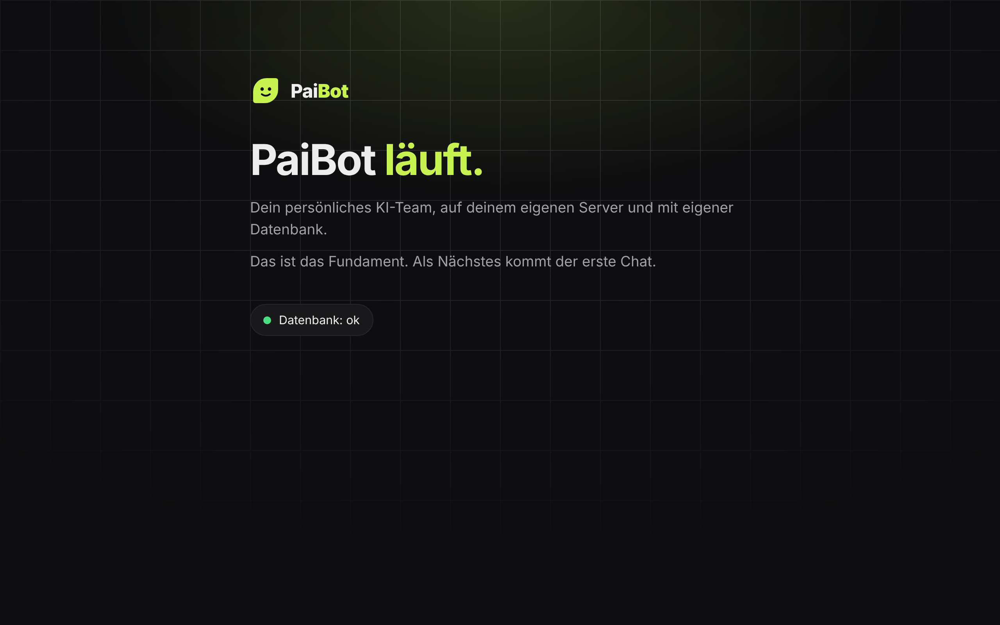
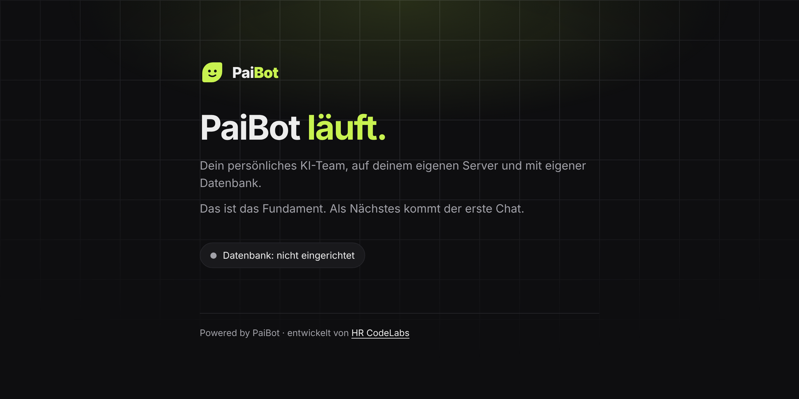

<!--
PaiBot – Installation mit Docker Compose, lokal und auf dem Server.

Autor:     Oliver Hees
Website:   https://paibot.de
Copyright: 2026 Oliver Hees. Alle Urheberrechte liegen beim Autor.
Lizenz:    PaiBot Fair-Code-Lizenz 1.1 – siehe Datei LICENSE im Projektstamm
Seit:      2026-11-18
-->

# Installation

**Ergebnis:** PaiBot läuft bei dir, und `/api/health` meldet `"db":"ok"`.

Der offizielle Weg ist **Docker Compose**. Das gilt lokal und auf dem Server. Alle Dienste stehen in `deploy/docker-compose.yml`.

## Was du brauchst

| Wofür               | Voraussetzung                                                             |
| ------------------- | ------------------------------------------------------------------------- |
| Lokal und Server    | Docker mit dem Compose-Plugin                                             |
| Server (empfohlen)  | Server mit Rechenzentrum in der EU, Ubuntu LTS, mind. 2 vCPU und 4 GB RAM |
| Entwicklung am Code | Node.js 22 und pnpm 10                                                    |

## Was heute mitläuft

| Dienst     | Aufgabe                                                    | Erreichbar                                     |
| ---------- | ---------------------------------------------------------- | ---------------------------------------------- |
| `postgres` | Datenbank                                                  | nur im internen Netz des Stacks                |
| `web`      | PaiBot-App (Next.js), wendet beim Start die Migrationen an | `127.0.0.1:3000`, nach außen über deine Domain |
| `worker`   | erzeugt die Antworten deines Bots im Hintergrund           | kein Port, nimmt keine Verbindungen an         |

`web` und `worker` sind dasselbe Image in zwei Rollen (Variable `PAIBOT_ROLE`). Der Worker startet erst, wenn `web` gesund ist: `web` wendet die Migrationen an, der Worker wartet nur darauf und migriert nie selbst.

Weitere Dienste (Datenschleuse, Browser-Dienst) sind **geplant** und noch nicht Teil des Stacks.

## Lokal mit Docker Compose

```bash
git clone https://github.com/oliverhees/paibot.git
cd paibot
sh deploy/env-erzeugen.sh               # legt deploy/.env mit Zufallswerten an
docker compose -f deploy/docker-compose.yml --env-file deploy/.env up -d --build
curl http://localhost:3000/api/health
```

Erwartet: `{"status":"ok","app":"PaiBot","db":"ok",...}`.

Danach zeigt `docker compose -f deploy/docker-compose.yml --env-file deploy/.env ps` die Dienste `web` und `worker` als `healthy`. Im Log des Workers (`… logs worker`) steht zuletzt „Bereit: nimmt Läufe an“.

`deploy/env-erzeugen.sh` schreibt zwei Datenbank-Passwörter und das Wurzel-Geheimnis `PAIBOT_SECRET` in `deploy/.env` (nur für dich lesbar) und überschreibt nie eine vorhandene Datei. Sichere die Datei getrennt von der Datenbank, zum Beispiel im Passwort-Manager. Wer die Werte lieber selbst erzeugt: `openssl rand -hex 32` für jedes Passwort, `openssl rand -base64 32` für `PAIBOT_SECRET`.

## So sieht es aus

Nach dem Start öffnest du `http://localhost:3000` im Browser. Mit erreichbarer Datenbank zeigt die Startseite „Datenbank: ok“.



Fehlt die `DATABASE_URL` (z. B. bei `pnpm dev` ohne `.env.local`), steht dort „Datenbank: nicht eingerichtet“. Das ist kein Fehler der App, sondern der Hinweis, dass noch keine Datenbank verbunden ist.



## Auf dem Server

Der Ablauf ist derselbe Stack, nur mit Domain und HTTPS davor. Schritt für Schritt mit Coolify: [deploy-coolify.md](deploy-coolify.md). Coolify ist bequem, aber nicht nötig: Wer einen eigenen Reverse-Proxy nutzt, startet denselben Compose-Stack und leitet seine Domain auf Port 3000 des Dienstes `web`.

Die Datenbank hat keinen veröffentlichten Port; sie hängt nur im internen Netz `paibot-intern`, das keinen Weg nach draußen hat. Die Web-App ist nur an `127.0.0.1` gebunden. Von außen erreichst du PaiBot nur über den Proxy mit HTTPS.

Die Container laufen gehärtet: ohne Root-Rechte, ohne Linux-Fähigkeiten (`cap_drop: ALL`), mit `no-new-privileges`; Web-App und Worker zusätzlich mit schreibgeschütztem Dateisystem (beschreibbar sind nur `/tmp` und bei der Web-App der Cache von Next.js). Alle Dienste haben einen Healthcheck und starten nach einem Absturz neu.

Der Worker hat keinen Port. Er hängt im internen Netz (für die Datenbank) und im Netz nach außen, weil er die Anfragen an die Modell-Anbieter stellt. Er bekommt nur die eingeschränkte App-Rolle (`DATABASE_URL`), nie die Zugangsdaten der Migrations-Rolle. Sein Healthcheck prüft eine Herzschlag-Datei unter `/tmp`, die er alle zehn Sekunden schreibt, solange die Datenbank antwortet und kein Lauf hängt.

## Einstellungen

Alle Werte stehen in `deploy/.env` (Vorlage: `deploy/.env.example`). Diese Datei wird nie committet.

| Variable                     | Bedeutung                                                                                   | Standard                |
| ---------------------------- | ------------------------------------------------------------------------------------------- | ----------------------- |
| `POSTGRES_PASSWORD`          | Passwort der Migrations-Rolle, **Pflicht**, mindestens 24 Zeichen                           | keiner                  |
| `POSTGRES_APP_PASSWORD`      | Passwort der App-Rolle, **Pflicht**, mindestens 24 Zeichen                                  | keiner                  |
| `PAIBOT_SECRET`              | Wurzel-Geheimnis, **Pflicht**, genau 32 Byte als Base64 (siehe [Sicherheit](sicherheit.md)) | keiner                  |
| `POSTGRES_USER`              | Migrations-Rolle (Besitzer der Tabellen)                                                    | `paibot`                |
| `POSTGRES_APP_USER`          | App-Rolle (eingeschränkt)                                                                   | `paibot_app`            |
| `POSTGRES_DB`                | Name der Datenbank                                                                          | `paibot`                |
| `APP_URL`                    | öffentliche Adresse der App                                                                 | `http://localhost:3000` |
| `WEB_PORT`                   | Port der Web-App auf dem Rechner                                                            | `3000`                  |
| `PAIBOT_ALLOW_PRIVILEGED_DB` | `1` erlaubt den Start mit zu vielen Rechten, **nur für den Übergang**                       | leer                    |
| `PAIBOT_WORKER_CONCURRENCY`  | wie viele Antworten der Worker gleichzeitig erzeugt (1 bis 32)                              | `2`                     |

Passwörter bitte nur aus Buchstaben und Ziffern (wie `openssl rand -hex 32`), weil sie in einer Datenbank-Adresse stehen.

Fehlt ein Pflichtwert, bricht schon `docker compose` mit einer Meldung „… fehlt“ ab. Ist ein Wert zu kurz, falsch geformt oder noch ein Platzhalter, startet die App nicht und nennt im Log, welcher Wert es ist (nie den Wert selbst).

## Rollen der Datenbank

PaiBot nutzt zwei Rollen in Postgres:

| Rolle                       | Wofür                                                                        | Wer nutzt sie                                                    |
| --------------------------- | ---------------------------------------------------------------------------- | ---------------------------------------------------------------- |
| Migrations-Rolle (`paibot`) | Besitzer der Tabellen; legt Tabellen an und ändert sie                       | nur der Migrations-Schritt beim Start (`DATABASE_MIGRATION_URL`) |
| App-Rolle (`paibot_app`)    | die normale Arbeit der App: lesen, anlegen, ändern, wo es fachlich nötig ist | Web-App und Worker (`DATABASE_URL`)                              |

Beim Start passiert der Reihe nach:

1. Die Migrationen laufen mit der Migrations-Rolle.
2. Fehlt die App-Rolle, wird sie angelegt (ohne Sonderrechte, mit dem Passwort aus `POSTGRES_APP_PASSWORD`). Danach bekommt sie ihre Rechte, bei jedem Start neu, damit auch neue Tabellen stimmen.
3. Mit der App-Rolle prüft PaiBot, ob die Datenbank auf dem Stand dieser Version ist. Wenn nicht, meldet das Log „Datenbank nicht auf Stand“, und die App startet nicht.
4. PaiBot prüft, ob die App-Verbindung zu viele Rechte hat (Superuser, Besitzer der Tabellen, Änderungsrechte auf Belegen). Dann bricht der Start ab, außer `PAIBOT_ALLOW_PRIVILEGED_DB=1` ist gesetzt. In dem Fall steht eine Warnung im Log, und `/api/health` sendet die Kopfzeile `X-Pb-Db-Rolle: zu_viele_rechte`.

Was die App-Rolle darf:

| Bereich                         | Rechte                                                                    |
| ------------------------------- | ------------------------------------------------------------------------- |
| Belege, Regeln                  | nur lesen und anhängen                                                    |
| Signaturschlüssel               | lesen, anhängen, ausmustern (nur das Datum dafür)                         |
| Ereignisse der Unterhaltungen   | lesen, anhängen, löschen (kein Ändern)                                    |
| alle übrigen Tabellen           | lesen, anlegen, ändern, löschen                                           |
| Warteschlange (Schema `pgboss`) | gehört der App-Rolle                                                      |
| überall                         | kein Leeren (`TRUNCATE`), keine Trigger, keine neuen Tabellen in `public` |

Dadurch kann die App-Rolle die Schutz-Trigger der Belege weder abschalten noch löschen.

### So stellst du eine bestehende Installation um

Bisher lief PaiBot mit einer einzigen Rolle für alles. Die Umstellung behält alle Daten.

1. Sicherung der Datenbank anlegen (siehe unten).
2. Neuen Stand holen: `git pull`.
3. In `deploy/.env` ergänzen (die bisherigen Werte bleiben):

   ```bash
   echo "POSTGRES_APP_USER=paibot_app" >> deploy/.env
   echo "POSTGRES_APP_PASSWORD=$(openssl rand -hex 32)" >> deploy/.env
   echo "PAIBOT_SECRET=$(openssl rand -base64 32)" >> deploy/.env   # nur, wenn es noch fehlt
   ```

4. Ist dein bisheriges `POSTGRES_PASSWORD` kürzer als 24 Zeichen oder noch der alte Platzhalter aus der Vorlage, ändere es in der Datenbank und danach in `deploy/.env`:

   ```bash
   docker compose -f deploy/docker-compose.yml --env-file deploy/.env exec postgres \
     psql -U paibot -d paibot -c "\password paibot"
   ```

5. Neu starten: `docker compose -f deploy/docker-compose.yml --env-file deploy/.env up -d --build`.
6. Im Log von `web` stehen „App-Rolle paibot_app angelegt“ und „Rechte der App-Rolle paibot_app gesetzt“. `/api/health` meldet `"db":"ok"` ohne die Kopfzeile `X-Pb-Db-Rolle`.

Läuft deine Datenbank nicht im Compose-Stack (z. B. eine verwaltete Datenbank), setze `DATABASE_MIGRATION_URL` auf die bisherige Adresse und `DATABASE_URL` auf eine neue Rolle. Die Migrations-Rolle braucht dann das Recht, Rollen anzulegen, und muss die App-Rolle übernehmen dürfen (`GRANT paibot_app TO <migrations-rolle>`, nachdem die Rolle existiert); sonst lege die App-Rolle selbst an (`CREATE ROLE paibot_app LOGIN PASSWORD '…'`).

Kannst du gerade nicht umstellen, startet PaiBot mit `PAIBOT_ALLOW_PRIVILEGED_DB=1` in `deploy/.env` wie bisher, mit Warnung. Das ist nur für den Übergang gedacht.

## Sicherungen

Sichere die Datenbank regelmäßig, zum Beispiel:

```bash
docker compose -f deploy/docker-compose.yml --env-file deploy/.env exec -T postgres \
  pg_dump -U paibot -d paibot -Fc > paibot-$(date +%F).dump
```

Die Sicherung enthält deine Unterhaltungen lesbar. Behandle sie wie ein Passwort und lege `PAIBOT_SECRET` nicht daneben ab (siehe [Sicherheit](sicherheit.md#was-in-der-datenbank-steht)).

Die Details zu Compose stehen in [deploy/README.md](../deploy/README.md).

## Nur entwickeln

Datenbank per Docker, App direkt mit pnpm. Für die Entwicklung kommt der Zusatz `deploy/docker-compose.entwicklung.yml` dazu, der die Datenbank auf `127.0.0.1:5432` erreichbar macht (nie auf dem Server nutzen):

```bash
sh deploy/env-erzeugen.sh
docker compose -f deploy/docker-compose.yml -f deploy/docker-compose.entwicklung.yml \
  --env-file deploy/.env up -d postgres
cp apps/web/.env.example apps/web/.env.local   # Passwörter aus deploy/.env eintragen
pnpm install
pnpm dev
```

In der Entwicklung (`pnpm dev`) bleiben zu viele Rechte und kurze Passwörter bei einer Warnung; abgebrochen wird nur im Betrieb (`NODE_ENV=production`).

## Fehlerbehebung

| Beobachtung                                                                                | Ursache                                                           | Was tun                                                                                      |
| ------------------------------------------------------------------------------------------ | ----------------------------------------------------------------- | -------------------------------------------------------------------------------------------- |
| Compose bricht mit „fehlt“ ab                                                              | ein Pflichtwert ist nicht gesetzt                                 | `sh deploy/env-erzeugen.sh` (neu) oder Wert in `deploy/.env` ergänzen                        |
| Log: „Start abgebrochen: Einstellungen unvollständig“                                      | Passwort zu kurz, Platzhalter oder `PAIBOT_SECRET` falsch geformt | genannten Wert neu erzeugen (siehe „Einstellungen“)                                          |
| Log: „… mit zu vielen Rechten“                                                             | App nutzt die Migrations-Rolle oder einen Superuser               | „So stellst du eine bestehende Installation um“                                              |
| Log: „Datenbank nicht auf Stand“                                                           | Migration fehlgeschlagen oder Datenbank neuer als diese Version   | Meldungen der Migration davor lesen; `POSTGRES_PASSWORD` prüfen; passende Version einspielen |
| Log: „Migration fehlgeschlagen“                                                            | Migrations-Rolle falsch oder Datenbank nicht erreichbar           | `POSTGRES_USER`/`POSTGRES_PASSWORD` prüfen, Logs von `postgres` lesen                        |
| `"db":"down"`, HTTP 503                                                                    | App läuft, Datenbank nicht erreichbar                             | Logs von `postgres` und `web` prüfen, Passwort vergleichen                                   |
| Worker: „Warte auf die Migrationen der Web-App“, dann „Datenbank nicht auf Stand nach … s“ | `web` startet nicht oder migriert nicht                           | Log von `web` lesen; der Worker migriert nie selbst                                          |
| Worker: „Datenbank nach … s nicht erreichbar“                                              | Datenbank aus oder App-Rolle noch nicht angelegt                  | Log von `postgres` und `web` prüfen; `POSTGRES_APP_PASSWORD` gleich bei `web` und `worker`   |
| Worker `unhealthy`, Log: „Herzschlag ausgesetzt“                                           | Datenbank antwortet nicht oder ein Lauf hängt                     | Log von `postgres` prüfen; der Container startet danach neu                                  |
| `"db":"not_configured"`                                                                    | `DATABASE_URL` fehlt (z. B. bei `pnpm dev`)                       | `apps/web/.env.local` aus `apps/web/.env.example` anlegen                                    |
| keine Antwort                                                                              | Port, Domain oder Proxy falsch                                    | `WEB_PORT`, DNS und Domain-Eintrag beim Dienst `web` prüfen                                  |

## Als Web-App installieren

PaiBot lässt sich wie eine App auf Rechner und Handy ablegen: mit eigenem Fenster und Symbol, ohne Adressleiste. Es ist weiterhin dieselbe Seite von deinem Server.

**Wichtig:** Die Web-App läuft **nur mit Verbindung zu deinem Server**. Es gibt keinen Offline-Modus und keine Benachrichtigungen. Ist der Server nicht erreichbar, siehst du eine Fehlerseite des Browsers.

**Voraussetzung:** PaiBot ist über **https** erreichbar (z. B. mit Coolify und eigener Domain) oder du öffnest es auf demselben Rechner über `http://localhost`. Über eine einfache `http`-Adresse im Netzwerk bieten Browser das Installieren nicht an.

### Am Rechner (Chrome, Edge)

1. PaiBot im Browser öffnen und anmelden.
2. In der Adressleiste auf das Symbol „Installieren“ klicken. Alternativ im Browser-Menü „PaiBot installieren“ (Chrome: „Speichern und teilen“, dann „Als App installieren“).
3. Mit „Installieren“ bestätigen. PaiBot öffnet in einem eigenen Fenster und steht in der Programmliste.

### Auf Android (Chrome)

1. PaiBot in Chrome öffnen.
2. Menü (drei Punkte) öffnen und „App installieren“ (oder „Zum Startbildschirm hinzufügen“) wählen.
3. Bestätigen. Das PaiBot-Symbol liegt jetzt auf dem Startbildschirm.

### Auf dem iPhone und iPad (Safari)

1. PaiBot in **Safari** öffnen (andere Browser bieten es nicht an).
2. Auf „Teilen“ tippen, dann „Zum Home-Bildschirm“.
3. Namen prüfen („PaiBot“) und „Hinzufügen“ tippen.

### Wenn „Installieren“ fehlt

| Beobachtung                                | Ursache                                               | Was tun                                             |
| ------------------------------------------ | ----------------------------------------------------- | --------------------------------------------------- |
| Kein Installieren-Symbol                   | Adresse ist `http` im Netzwerk statt https            | PaiBot über https erreichbar machen                 |
| Kein Installieren-Symbol am Rechner        | Browser ohne Unterstützung (z. B. Firefox am Rechner) | Chrome oder Edge nutzen                             |
| Auf dem iPhone fehlt „Zum Home-Bildschirm“ | Nicht Safari                                          | Die Adresse in Safari öffnen                        |
| Falsches oder kein Symbol                  | Der Browser hat ein altes Symbol gemerkt              | App entfernen, Seite neu laden, erneut installieren |
